# LMA · Local models on Android

> **Current development: 0.3.0-dev.41 / code45.** Complete the optional MOSS-TTS 1.5 pair, actual progress, independent settings, cancellation/recovery and results. The production Java/native path passes 87 checks across five actual runs; English and reference-input WAVs match direct native generation byte for byte. Reference mode still hits its output limit without natural completion, and that failure remains open. App updates deliver only the foundation, preserving recommendations and user control of model downloads, imports and versions.


[Actual host audio, waveforms and video](docs/MOSS_TTS15.en.md#actual-artifacts-and-reports) · [UI output-limit notice](docs/media/development/openmoss/05-output-limit.png)
[English workflow](docs/MOSS_TTS15.en.md) · [中文方案](docs/MOSS_TTS15.md) · [Implemented work and complete pending scope](docs/releases/v0.3.0-dev.41.md)


The optional matched pair occupies approximately **13.43 GB** and is absent from the APK. File size does not establish RAM requirements; no Z20 or other physical Android pass is claimed. The complete frozen v0.3.0 targets, quality, resources and background gates remain required.

> **Previous development: 0.3.0-dev.40 / code44.** Fix dropped first-step and terminal progress during fast sampling; complete per-model Wan decoder controls, input clamping and native validation. Existing installations gain the controls while legacy jobs retain their behavior and defaults preserve the previous memory policy. Explicit assets, independent settings, queue/cancel/recovery and results use the shared foundation. The APK carries no models or automatic asset replacements. [Workflow and quality diagnosis](docs/WAN_DECODER.en.md) · [Implemented work and full pending scope](docs/releases/v0.3.0-dev.40.md).

dev.40 validation: **22 suites / 3,085 passed checks**. The 61,329,930-byte development APK retains the signing identity; 35 native files and package checks pass, with Lint 0 errors /17 warnings. Five full-geometry experiments and an independent official CPU VAE comparison retain the later-frame artifacts. Quality, full numerics, resource fit, phone and formal Release acceptance remain pending.


Actual host model output, production UI demonstrations, Android compilation, independent numerics/quality and physical-phone acceptance remain separate. All frozen targets and phone gates still apply to the single complete Release.

> **Retained dev.38: 0.3.0-dev.38 / code42.** Add the complete optional four-component Z-Image-Turbo model to All/HF/Local, independent eight-step settings, shared jobs, cancellation/recovery and results. Exact content hashes reuse matching files; browsing/declaration never implicitly download or install. The App remains foundation-only, preserving Recommended and user assets. [Complete design/user flow](docs/ZIMAGE_TURBO.en.md) · [Current changes/full pending scope](docs/releases/v0.3.0-dev.38.md).


Host execution, UI fixtures and Android compilation are separate. Complete numerics, quality, resources and phone acceptance remain pending; no formal Release is published.

> **Retained dev.37: 0.3.0-dev.37 / code 41.** Add an optional complete four-component FLUX.2-klein 4B download with HF / All / Local selection, independent settings, immutable jobs and output management. Fix shifted Qwen token IDs caused by HF merge-file headers and compare the full vocabulary and multilingual inputs with the official tokenizer. App updates deliver foundation code only; recommendations, user models and old jobs remain preserved. [Design and user flow](docs/FLUX2_KLEIN.en.md) · [Numbered changes, full pending scope and evidence limits](docs/releases/v0.3.0-dev.37.md). Actual Windows CPU execution, UI fixtures, Android compilation and physical-phone/quality acceptance are separate. The complete v0.3.0 Release remains unpublished.

| Actual local text-to-image: robot and teapot | Actual local text-to-image: sailboat |
|---|---|
|  |  |

[Images, GIF and video](docs/FLUX2_KLEIN.en.md#5-evidence-and-reproduction) display actual outputs and do not represent generation speed or phone recordings.

> **Retained dev.36: 0.3.0-dev.36 / code 40.** Correct Sana Edit's capability: complete fifteen-component, required local PNG/JPEG, fixed-prompt 512×512 image conversion with per-model settings, immutable jobs, real cancellation/recovery and managed outputs. The App only updates foundation code; users choose/download/manage all model assets. The shared upload listener also fixes intermittent connection resets on oversized requests. [Complete user flow](docs/MNN_SANA_EDIT.en.md) · [Numbered work/full pending scope](docs/releases/v0.3.0-dev.36.md) · [Actual-output MP4](docs/media/development/sana-edit-trained/sana-host-outputs.mp4) · [GIF](docs/media/development/sana-edit-trained/sana-host-outputs.gif). Original Sana text-to-image remains pending. Actual host execution, Android compilation, UI fixtures and incomplete phone/formal Release acceptance are recorded separately.

| User input (public-domain sample) | Actual native host output (not phone footage) |
|---|---|
|  |  |

[中文](README.md) · [English](README.en.md) · [Releases](https://github.com/wikigsroom/LMA/releases) · [Documentation](docs/README.md) · [Changelog](CHANGELOG.md)

dev.38 validation: **22 suites / 3,022 passed checks**, including 117 independent tokenizer comparisons, 35 complete Z-Image native checks and 100 application-flow checks. APK signature/dependencies/16 KiB alignment pass; Lint has 0 errors and 17 warnings. Actual host execution, Android compilation and pending physical-phone/formal Release acceptance remain separate.

> **Historical dev.35 (model capability corrected in dev.36).** The matched Sana variant now has real-component execution and the production Java import / generation / sampling cancellation / recovery path. Repairs cover CFG encoder batching, float masks, completed-step progress, one-step scheduling and write results. All thirteen components (1,505,181,194 bytes) remain user-selected; the APK only updates foundation code. Host execution and Android compilation have separate evidence. Observed samples do not depict the requested subjects; image quality remains unaccepted. [Execution/usage](docs/MNN_SANA_TRAINED.en.md) · [Numbered delivery/full pending scope](docs/releases/v0.3.0-dev.35.md) · [Actual-output MP4](docs/media/development/sana-trained/sana-host-outputs.mp4) · [GIF](docs/media/development/sana-trained/sana-host-outputs.gif). This is not phone or complete Release acceptance.

> **Retained dev.34: companion-file management.** HF companion review scans one pinned revision and applies only user-confirmed suggestions. It never overwrites existing choices, declares a model or downloads weights. Nineteen of 35 existing recipes provide 49 filename hints, including all thirteen Sana roles; ambiguity and incomplete directories retain manual selection. Model IDs, parameters and queued snapshots are preserved. [Design/usage](docs/COMPONENT_SUGGESTIONS.en.md) · [Numbered delivery/full pending scope](docs/releases/v0.3.0-dev.34.md) · [MP4](docs/media/development/components/components-ui.mp4) · [GIF](docs/media/development/components/components-ui.gif). These are metadata/selection checks, not model inference or phone acceptance; all complete-version gates remain required.

| Confirm companions — UI fixture | Complete download plan — UI fixture |
|---|---|
| 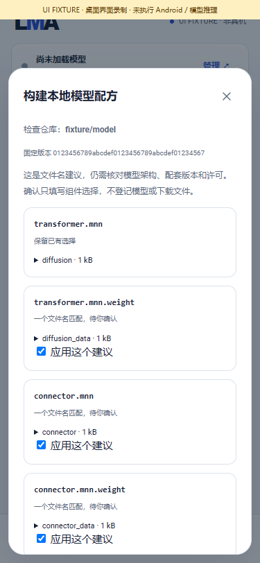 | 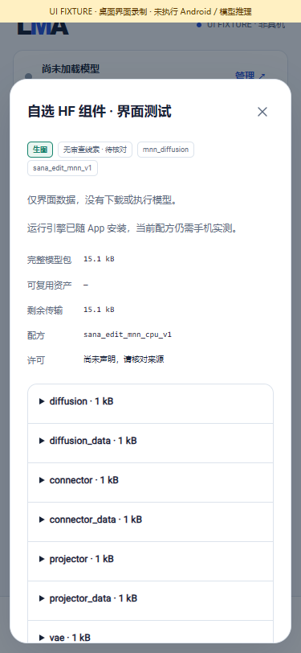 |

[Nano and local voice selection](docs/SPEECH_SELECTION.en.md) remain available; the following are also desktop UI fixtures.

| Optional speech models — UI fixture | Local voice names and limits — UI fixture |
|---|---|
| 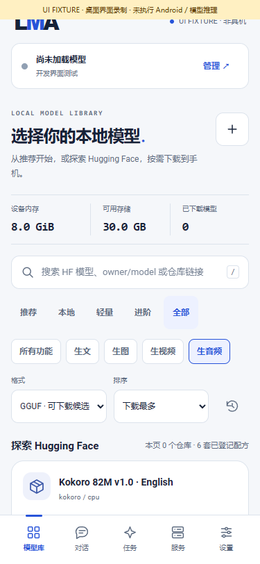 | 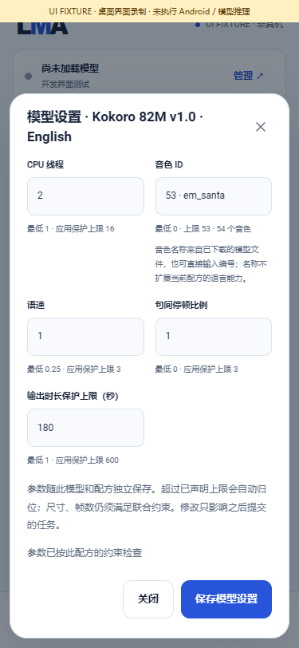 |

[Curated diffusion and generic LoRA dependencies](docs/CURATED_DIFFUSION.en.md) remain available; the following are also desktop UI fixtures.

| LoRA base dependency — UI fixture | Paired generation request — UI fixture |
|---|---|
| 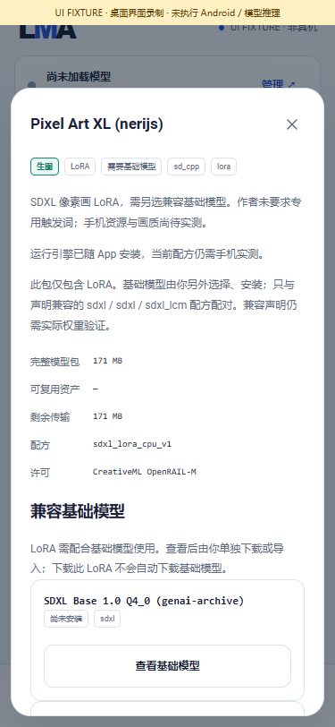 | 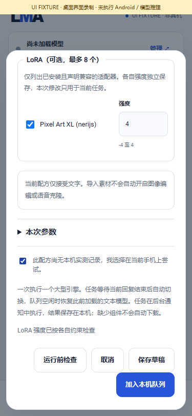 |

[Shared runtime resource protection](docs/RUNTIME_RESOURCES.en.md) remains available across jobs, loading, chat and API, with saved stop reports and explicit retry. The following pages use desktop fixtures.

| Runtime observations (UI fixture) | Saved stop report (UI fixture) |
|---|---|
| 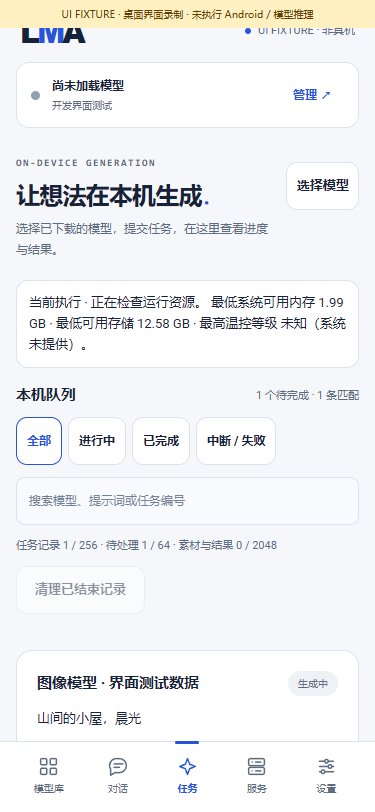 | 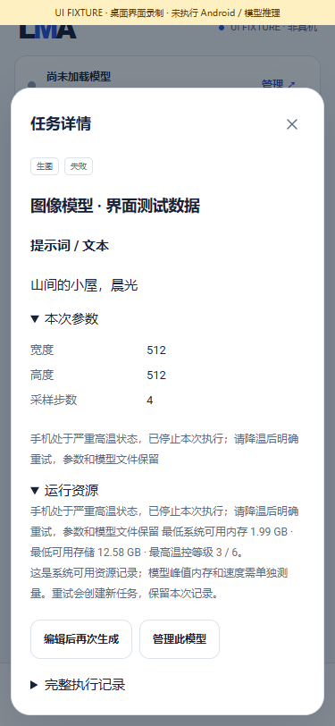 |

The [old-LTX production video flow](docs/LTX098_APP_FLOW.en.md) and its UI/actual host media below remain available. The community Google T5 Q5 single-scale variant differs from the official default; all six original numerical failures remain unchanged.

| Local video settings (UI fixture) | Shared video queue/cancellation (UI fixture) |
|---|---|
| 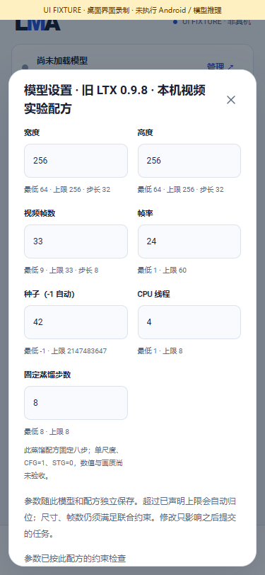 | 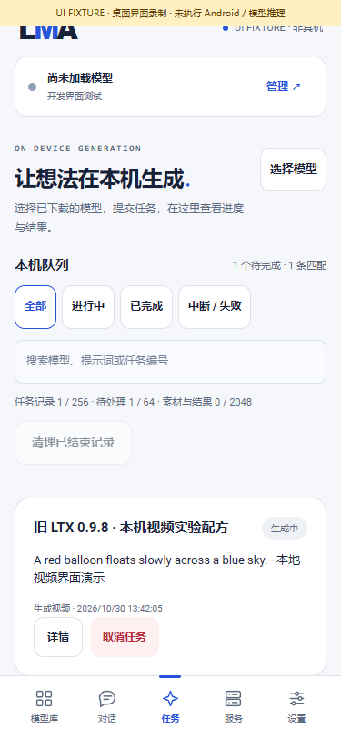 |

Actual trained host validation uses 22 complete components/9.45 GB and the production Java queue, producing 256×256/33-frame video. Seven bridge files and the MP4 preserve baseline bytes. [Actual MP4](docs/media/development/ltx-app-trained/video.mp4) · [HOST GIF](docs/media/development/ltx-app-trained/preview.gif); original numerical failures and Android gates remain open.

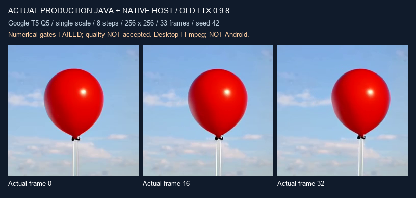

[MOSS Realtime incremental audio/playback](docs/AUDIO_STREAMING.en.md) retains its model-scoped option, authenticated cache and final WAV agreement. Complete trained speech and Android acceptance remain open.

The [draft/result workflow](docs/TASK_WORKBENCH.en.md), [preflight](docs/TASK_PREFLIGHT.en.md), [recovery/history/capacity](docs/TASK_RECOVERY.en.md), recommendations m08→m06→m01, HF All/search, Local management and model-scoped settings remain available.

The [evidence index](verification/development/status.json) distinguishes current checks from historical experiments. [LCM preparation/association/generation](docs/LCM_APP_FLOW.en.md) retains trained host evidence at its dev.28 commit, including the failed pixel gate 8 > 5. The following dev.24 experiments describe their own commits; “unchanged APK” refers to those updates. Original failures and the entire same-release scope remain preserved.

New: [small native LCM preparation foundation](docs/LCM_LOCAL_PREPARATION.en.md). A complete 3.44 GB source is verified to produce a 5,696-byte condition component. 24 native children/105 checks, trained output, cancellation/recovery and Android compilation have distinct scopes. [Numbered work/full pending scope](docs/releases/v0.3.0-dev.24-lcm-preparation.md) and actual HOST PNG/GIF/MP4 accompany unchanged production/APK inputs. The new C++ image comparison fails its preset maximum difference gate (8 > 5). The candidate stays rejected; App integration, quality and the complete release remain open.

New: [trained SD-Turbo and standalone LCM checkpoint validation](docs/SD_DISTILLED_TRAINED.en.md): ten native children /six PNGs, plus production HF selection, two whole-object imports,80 Java/binding checks and five actual workers /three PNGs for SD-Turbo. LCM analysis identifies a missing condition, executes30 complete UNet forwards and produces a private folded native candidate. Quality, canonical pipeline and phone acceptance remain open; LCM product preparation is unimplemented. Bilingual guides, original PNG/GIF/MP4 and [numbered work/full pending scope](docs/releases/v0.3.0-dev.24-sd-distilled.md) accompany unchanged production sources/APK bytes.

> **Historical checkpoint: 0.3.0-dev.24 / code 28.** Corrects diffusion loading/generation progress and adds [trained SD1.5 validation](docs/SD15_TRAINED.en.md) plus [old-LTX modulation diagnosis](docs/LTX098_MODULATION.en.md). The new LTX candidate still fails frozen numerical gates. [Numbered implementation/full pending scope](docs/releases/v0.3.0-dev.24.md). The App updates only the foundation; users choose/download/import models. Complete v0.3.0 and phone acceptance remain pending.

New: [trained SDXL / SD1.5 and SDXL LoRA / LCM-LoRA validation](docs/SD_VARIANTS_TRAINED.en.md), using five new pinned objects and seven unique objects including the existing SD1.5 base/external vocabulary. Standard, style scale 0 / 1, LCM weight-effect, combination and cancellation/recovery controls run alongside complete production Java imports and actual native workers. [Original PNGs/contact sheets/GIF/MP4](docs/SD_VARIANTS_TRAINED.en.md#4-actual-images-and-demonstration-media) and [numbered work/full pending scope](docs/releases/v0.3.0-dev.24-sd-variants.md) retain host-only scope. Low-step samples have image-quality problems; quality, Android and the full Release remain unaccepted. APK bytes stay unchanged.

New: [trained Qwen3-TTS validation](docs/QWEN_TTS_TRAINED.en.md), with the complete pinned920MB bundle, ten languages, references, parameters, cancellation/recovery, eighteen WAV jobs/twelve controls and94 production Java checks/six real workers after full two-object import. [Original audio/waveform media](docs/QWEN_TTS_TRAINED.en.md#3-measurements-and-media) and [numbered work/full pending scope](docs/releases/v0.3.0-dev.24-qwen-tts.md) distinguish HOST execution from pending phone/quality acceptance. A greedy short-text case reaches30 seconds. APK bytes are unchanged; the complete Release remains pending.

Earlier: [trained Kokoro/Piper/Matcha validation](docs/TTS_TRAINED.en.md), covering all three frozen recipes, all 54 Kokoro voice IDs, 68 actual WAV jobs/13 controls, 157 production Java checks, full imports and twelve actual worker children. [Original audio/waveform media](docs/TTS_TRAINED.en.md#3-measurements-and-media) and [numbered implementation/full pending scope](docs/releases/v0.3.0-dev.24-tts.md) separate host execution from pending phone, quality, license and complete Release acceptance. This developer-tool/evidence/documentation follow-up preserves APK bytes.

Earlier: [trained MOSS Nano assets and user import](docs/MOSS_NANO_TRAINED.en.md), with an eleven-component pinned manifest, seven actual WAV jobs/seven controls and forty production Java→native host checks. [Audio/waveform media](docs/MOSS_NANO_TRAINED.en.md#measured-results) and [numbered implementation/full pending scope](docs/releases/v0.3.0-dev.24-moss-nano.md) retain explicit host scope. That metadata/tool/documentation follow-up leaves APK bytes unchanged; speech quality, Android and complete Release remain unaccepted.

> **Existing foundation: explicit runtime model association.** [Users reuse prepared components](docs/MODEL_ASSEMBLY.en.md), then separately download/import missing dependencies. Shared jobs, references, independent deletion and per-model settings are preserved. The original-signature dev.24 APK contains 29 native files and model-free architecture resources. [Current UI screenshot](docs/media/development/66-assembly-review.png), [recording](docs/media/development/foundation-ui.mp4) and [GIF](docs/media/development/foundation-ui.gif) are UI FIXTURE. Host checks and Android compilation establish no physical-phone preparation/generation/screen-off acceptance. The v0.2.0 description below documents the preserved public version.

**Choose a local model, discover more on Hugging Face, download a compatible GGUF, chat locally, and serve an OpenAI-compatible API from an Android phone.**

LMA (Local Model App) brings a desktop model-workbench workflow into one APK: model selection, downloads, local chat, and an API server. It requires no ROOT, Termux, or separate server. This is an independent community project, unaffiliated with LM Studio. The application UI is currently primarily Chinese; the documentation is bilingual.

| Version | Platform | Backend | License | Stage |
| --- | --- | --- | --- | --- |
| **0.2.0 / versionCode 4** | Android 9+, ARM64 | llama.cpp, CPU | MIT for LMA code | Prerelease; physical-device acceptance pending |

> **Validation status:** A signed APK is available, with 226 desktop assertions and separate APK, native-library, and Android Lint checks. No physical Android device was available. Installation, actual model inference, tokens/s, and screen-off endurance have **not** been tested. Images and recordings use the shipped UI with explicitly simulated native state; they are **not phone inference recordings**. See [validation](docs/VALIDATION.en.md).

<p>
  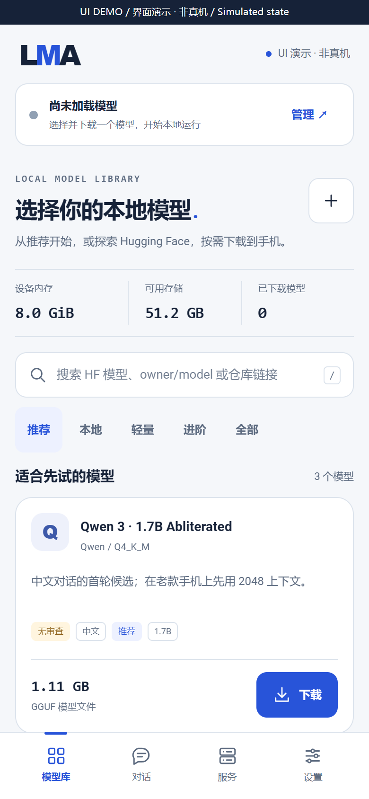
  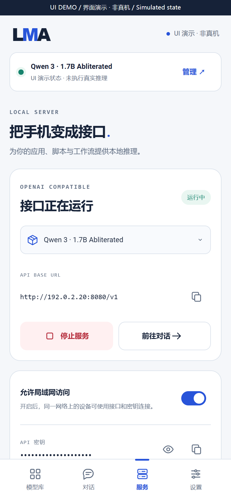
  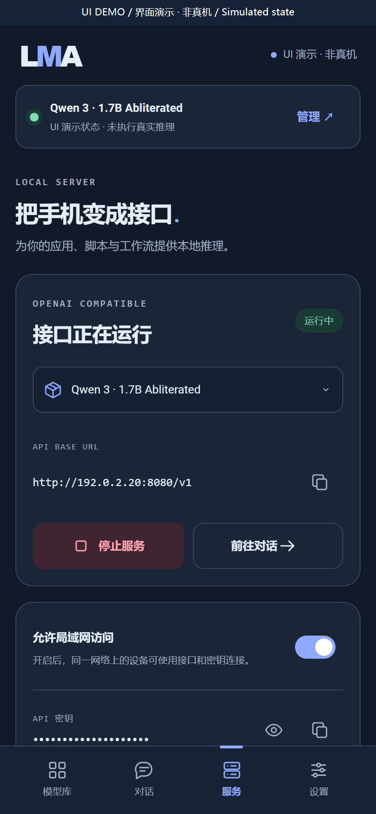
</p>

## Download and start

Download `LMA-0.2.0-arm64-v8a.apk` from the [v0.2.0 Release](https://github.com/wikigsroom/LMA/releases/tag/v0.2.0). The APK is about 10.9 MB and contains no model weights. Installation and runtime storage require additional space.

1. Install the APK, allow the installation source if Android asks, and open LMA.
2. In **模型库 / Model library**, use the preserved recommendations, or search HF through **全部 / All**, select a repository and a GGUF quantization, and tap **下载 / Download**. The original recommendation order remains `m08 → m06 → m01`.
3. Wait for GGUF, length, and publisher SHA256 verification, then tap **加载 / Load**. By default, the first completed download loads automatically if no model was previously selected.
4. Open **对话 / Chat** to send a message, or **服务 / Server** to copy the endpoint, key, and connection example.
5. For background serving, allow foreground-service notifications and open Android battery settings from the Server page. Vendor settings may also require background network, autostart, and unrestricted background activity.
6. After leaving the app or turning off the screen, a native foreground service owns downloads and inference. **停止服务 / Stop service** in its notification stops the model and current download. Work can be resumed later in LMA.

The first download needs networking; inference with downloaded weights runs locally. No LMA login or cloud inference API is required.

### Verify the package

```text
File: LMA-0.2.0-arm64-v8a.apk
SHA256: d8c16c7414ce5cc28c55fb3c2375c042e6735d53f73ebb5d4efa8388d7b130c1
Package: com.lma.app / versionCode 4
Signing certificate SHA256: 90444a717a55549e2094364d8d7d005cf8b7f4df24562da62cc1884a2f341c17
```

On Windows, run `Get-FileHash .\LMA-0.2.0-arm64-v8a.apk -Algorithm SHA256`. Release assets include hashes, the dedicated source ZIP, validation JSON, and the walkthrough video. Updates must use the same signing identity; personal builds have their own key.

## Multimodal expansion research

The next version, **v0.3.0**, must deliver the **complete local multimodal foundation plus runtime/recipe support for 01–14/16/17 together**: bundles/components/recipes, internal engines, model settings, jobs/artifacts and APIs. Models remain equal peers with task/dependency tags; preserve Recommended and use model selection → form → on-phone queue → artifacts. See [complete update requirements](docs/MULTIMODAL_RELEASE_PLAN.en.md) and the [delivery summary](docs/releases/v0.3.0-plan.md) for shared release gates, work packages and risks. No split releases or automatic deferral; no ComfyUI canvas/user-node/plugin/import ecosystem. v0.3.0 is unpublished. See the [development implementation record](docs/DEVELOPMENT.en.md) for code, current verification results and the full remaining work; this does not substitute for complete delivery.

Tokenization, encoders, sampling, codecs and export execute on the same Android phone without ROOT or off-device inference/fallbacks. HF provides discovery and explicit asset downloads. Supported architecture variants may reuse recipes; new architectures need native-engine/APK updates. Validate Z20 and newer devices separately. See [research/licenses](docs/MULTIMODAL.en.md), [foundation/migration](docs/FOUNDATION.en.md) and [tasks/background recovery](docs/WORKFLOWS.en.md). Full MOSS/SoulX retain research gates; listing/downloading is not execution support. **The public release remains v0.2.0. 0.3.0-dev adds part of the foundation and text/diffusion/speech runtime code; complete model adaptation, unified APIs and physical-device acceptance remain unfinished.**

**App updates deliver the foundation; APKs contain no model weights and installation/upgrades trigger no model downloads.** Users choose a model/quantization/recipe and explicitly download that bundle with its disclosed dependencies. Install only what is needed and manage/settings/update/delete independently in Local. Recommendations are catalogue candidates; capability and installed/runnable status are separate. Preserve existing weights/settings without silent replacement. See [asset boundaries and A11 acceptance](docs/MULTIMODAL_RELEASE_PLAN.en.md).

## Features and workflow

| Page | Actions | State and lifecycle |
| --- | --- | --- |
| Model library | Preserved recommendations, HF discovery / quantization selection, dedicated Local manager, lightweight / advanced groups, evidence, downloads/resume, delete and imports | Download completion and model readiness are separate; chat and API share one loaded model |
| Chat | Streaming, stop generation, reasoning disclosure, code copy, SQLite history, new / previous sessions | A native thread reads SSE and persists received text roughly every 160ms; reopening restores it |
| Server | Start/stop, LAN switch, endpoint / key / curl copy, battery settings, log export | Localhost by default; LAN access is user-enabled and requires an API key |
| Settings | Application source/token preferences, auto-load, boot restore, service port and theme; link to Local model settings | Model parameters are configured independently on each downloaded model |

One model and one inference slot are used. Switching models reloads the engine; stop a running model before deleting its file. **Stop generation** cancels one reply; the notification's **Stop service** stops background work.

## Recommended, All, and Local

| Entry | Behavior |
| --- | --- |
| 推荐 / Recommended | Preserves `m08`, `m06`, `m01`, in that order, with their original labels and evidence; HF downloads never replace recommendations |
| 全部 / All and search | Queries the live HF model API by keyword, `owner/model`, or repository URL; sort by downloads, likes, or update date and navigate pages |
| Format | GGUF by default; **HF 全部格式 / All HF formats** discovers repositories beyond GGUF and links to their sources |
| File picker | Shows GGUF path, quantization, bytes and hash; pins the commit before paginating/selecting a file |
| 本地 / Local | Manages all downloaded built-in, HF and imported models, plus active/interrupted downloads; local search, individual model settings, load, pause, resume and delete |
| Lightweight / Advanced | Preserves the original curated groups |

All-format **discovery** does not imply every HF format can run on Android. This version serves text chat from compatible **single-file GGUF** weights. It does not directly run Safetensors, PyTorch, ONNX, MLX, split GGUFs, standalone vision projectors, or speech tasks, and does not automatically convert weights. GGUF architecture, quantization, template and RAM compatibility still require loading. This is not yet full feature parity with LM Studio.

Public models need no HF account. Automatic source selection tries HF, then HF Mirror; fixed sources are available. For gated/private repositories, save an optional HF token in Settings and accept the license on HF first. The token stays in private app preferences, is not returned to the UI/log export, and is sent only to the official HF HTTPS host. Authenticated requests use the official source; mirrors and CDN redirects receive no token. See the [HF and local-model guide](docs/HF_MODELS.en.md).

<p>
  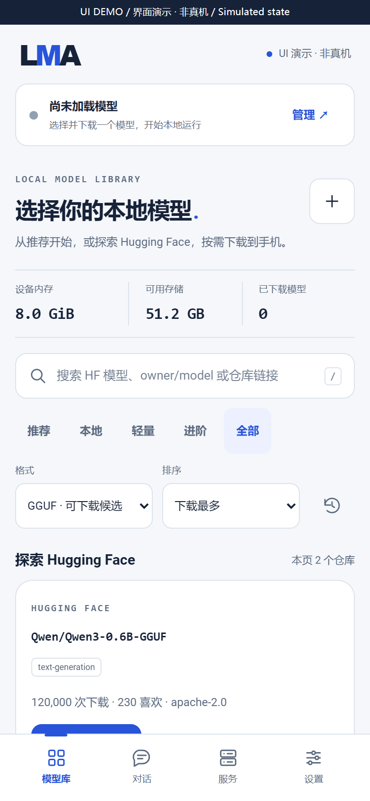
  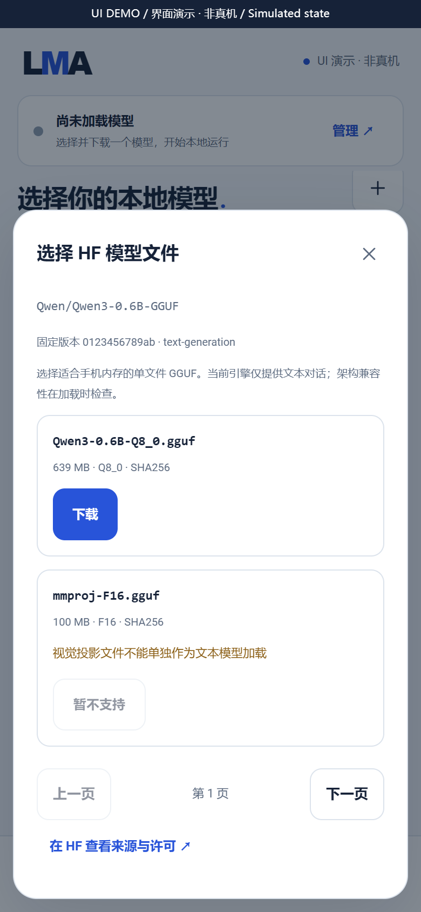
  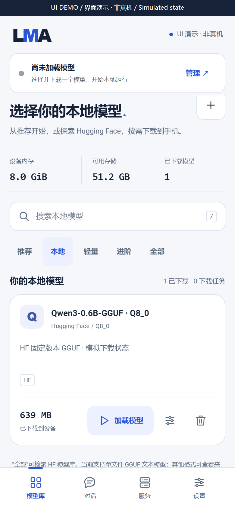
</p>

## Per-model settings

Open **Model library → 本地 / Local → a downloaded model’s settings icon**. Context, output limit, CPU threads, temperature, reasoning and system prompt are saved separately by model ID. Numeric controls support presets and custom text. Values above a bound reset automatically: context uses the GGUF architecture’s declared context length, output is at most configured context minus one, threads use available processors, and temperature uses the application range 0–2. Unknown context metadata is explicitly labeled with a temporary application fallback of 8192. Actual prompts/history can reduce available output further.

Switching/restoring models reads their own profiles. Legacy global inference preferences migrate to existing models. Editing the running model’s context, threads or reasoning reloads it; generation preferences apply to the next in-app chat. See the bilingual [per-model guide](docs/MODEL_SETTINGS.en.md) for limits, examples, persistence and external-API behavior.

<p>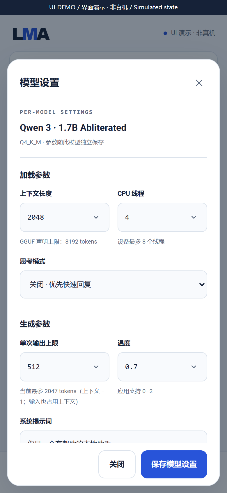</p>

[Model-settings GIF](docs/media/lma-model-settings.gif) · [中文说明](docs/MODEL_SETTINGS.md).

## Separate uncensored labels

The original 14 curated variants retain their checked publisher declarations, pinned commits, exact sizes and SHA256. They carry **无审查 / Uncensored** tags. Online HF names/tags that suggest uncensored or abliterated weights carry **无审查 · 元数据 / Uncensored · metadata**; this is an unverified hint. Ordinary models have no such label. Manual imports never gain verified status from their filenames.

The evidence gate applies to a checked label, not eligibility for general HF discovery. LMA adds no keyword blocklist, cloud moderation, or response-content filter to chat; system prompts remain editable. Publisher claims do not guarantee zero refusals, and independent refusal rates and phone inference have not been measured. See [tag evidence](docs/UNCENSORED_MODELS.en.md).

### Built-in candidates

All selected weights are `Q4_K_M` GGUF. These approximate decimal download sizes are **not RAM requirements**. Exact bytes, hashes, filenames, and revisions are in [models.json](app/src/main/assets/models.json).

| ID | Model | Download | Role |
| --- | --- | ---: | --- |
| `m01` | Dolphin 3 · Qwen 0.5B Uncensored | 398 MB | Smallest initial candidate |
| `m04` | Dolphin 3 · Llama 1B Uncensored | 808 MB | Lightweight, English |
| `m05` | Gemma 3 · 1B Abliterated | 806 MB | Lightweight, multilingual |
| `m06` | LFM 2.5 · 1.2B Uncensored | 731 MB | Recommended candidate |
| `m08` | Qwen 3 · 1.7B Abliterated | 1.11 GB | Recommended Chinese candidate |
| `m10` | LFM 2.5 · 2.6B Uncensored | 1.67 GB | Advanced, reasoning model |
| `m11` | Dolphin 3 · Qwen 3B Uncensored | 1.93 GB | Advanced, Chinese |
| `m12` | Dolphin 3 · Llama 3B Uncensored | 2.02 GB | Advanced, English |
| `m13` | Llama 3.2 · 3B Uncensored | 2.24 GB | Advanced, English |
| `m14` | Qwen 3 · 4B Instruct 2507 Abliterated | 2.50 GB | Advanced, Chinese |
| `m16` | Gemma 3 · 4B Abliterated v2 | 2.49 GB | Advanced, multilingual |
| `m03` | Qwen 3.5 · 0.8B Abliterated | 528 MB | Experimental architecture candidate |
| `m09` | Qwen 3.5 · 2B Abliterated | 1.27 GB | Experimental architecture candidate |
| `m15` | Qwen 3.5 · 4B Uncensored · HauhauCS Aggressive | 2.71 GB | Experimental architecture candidate |

### nubia Z20 and older phones

The APK targets **ARM64 Android 9+**, with an ARMv8.0 CPU baseline and optimized kernels selected at runtime. A starting configuration for Snapdragon 855+-class devices is **4 threads / 2048-token context / 512 output tokens / reasoning off / temperature 0.7**. Try `m01` first, then compare `m06` and `m08`. Use 3B–4B only after observing actual free memory, temperature, and sustained speed.

This configuration awaits device testing. **No Z20 throughput, peak-memory, thermal, or battery measurements exist.** RAM includes KV cache, working buffers, and Android overhead. If loading fails, close large apps, reduce context to 1024 / 512, and use a smaller model. Downloadability does not establish successful phone inference.

## Architecture and background serving

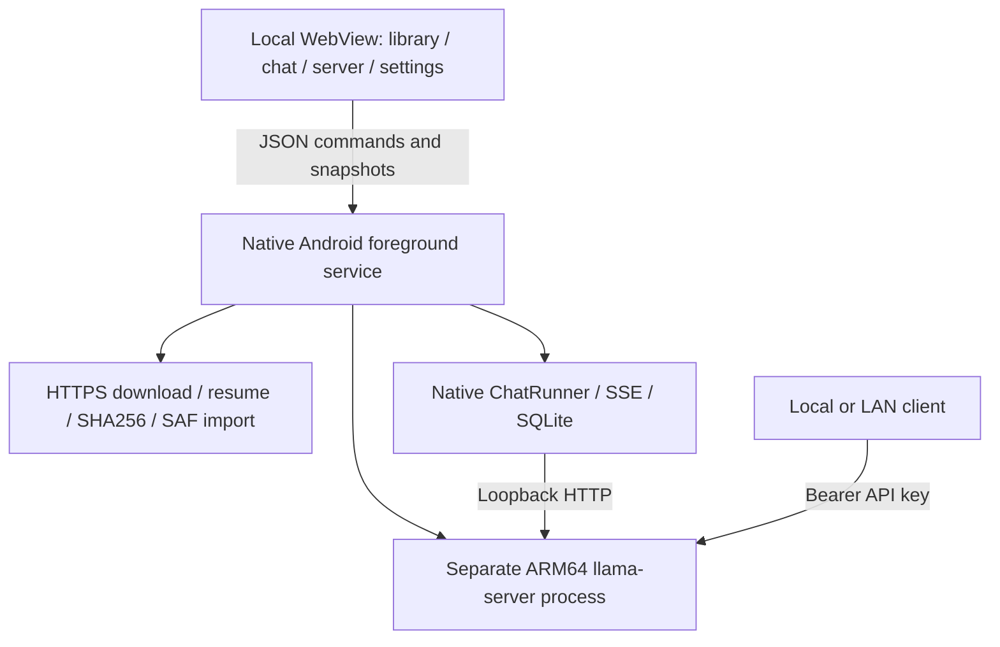

The UI handles interaction; native code owns transfers, SSE consumption, and the engine lifecycle. A `specialUse` foreground service shows a notification and stop action and holds CPU / Wi-Fi locks. An API-serving model keeps the service active while idle; no-work state releases resources.

`ProcessBuilder` starts the packaged native executable from the APK's native-library directory without ROOT or shell. Readiness requires `/health` and authenticated `/v1/models` with the expected alias; unexpected exits are retried at most three times. Boot restore is off by default and only attempts a previously enabled, still-present model when enabled.

**Background streaming means SSE can continue during an active generation request.** EOS, output limits, and cancellation still end a request. An ordinary Android application cannot guarantee permanent survival through force-stop, low memory, heat, or vendor power policies. First-run downloads, notification consent, and system battery settings are not silently bypassed.

The [architecture](docs/ARCHITECTURE.en.md) documents download states, process recovery, conversation persistence, and network boundaries.

## API integration

Default Base URL: `http://127.0.0.1:8080/v1`. For another device, enable LAN access and use the phone's displayed address. Each installation generates a random API key. The in-app copy example fills the endpoint, model ID, and actual key.

```bash
curl http://PHONE_IP:8080/v1/models \
  -H "Authorization: Bearer YOUR_LMA_API_KEY"

curl -N http://PHONE_IP:8080/v1/chat/completions \
  -H "Authorization: Bearer YOUR_LMA_API_KEY" \
  -H "Content-Type: application/json" \
  -d '{"model":"m08","messages":[{"role":"user","content":"Hello"}],"max_tokens":256,"stream":true}'
```

Replace `m08` with the ID returned by `/v1/models`. The documented surface is models, chat completions, and SSE, not every OpenAI endpoint. LAN uses HTTP; TLS and public tunneling are not built in. External clients send their own system messages and parameters; in-app settings primarily control in-app chat. See the [API guide](docs/API.en.md) for Python / PowerShell, stream parsing, and errors.

## Downloads and local data

Automatic selection tries Hugging Face and falls back to HF Mirror on connection or source-status failure; fixed sources are available. Only HTTPS and HTTPS redirects are accepted. Other custom hosts are not rewritten to the mirror.

Transfers run serially, validating `Content-Range`, length, GGUF magic, and known publisher SHA256. Hash failures are isolated as `.rejected`. A 12 GiB file limit and 64 MiB free-space reserve apply. Android's system file picker supports streamed GGUF import, without reading an entire model into Java memory.

Weights, progress, and SQLite history live in private app storage; uninstalling deletes them. Offline UI assets use no remote scripts or fonts. Log export redacts the current API key and excludes the chat database. Downloads contact the selected host; LAN clients can request inference only after LAN is enabled and they supply the key.

## Screenshots, recording, and GIFs

<p></p>

The media uses **the HTML / CSS / JavaScript shipped in the APK**, driven by an explicit demonstration bridge. A UI DEMO banner is always visible. Downloads are simulated, chat is scripted, and IP / API key values are placeholders. No Android runtime or model executes.

[Full MP4 recording](docs/media/lma-walkthrough.mp4) · [HF / Local GIF](docs/media/lma-hf-local.gif) · [API / theme GIF](docs/media/lma-api-theme.gif) · [Twelve screenshots and reproduction](docs/MEDIA.md) · [Media hashes and provenance](docs/media/manifest.json).

## Build from source

The verified path is **native Windows JDK 21, Python 3, Android SDK Platform 35 and Build Tools 35.0.1**. It uses no Gradle dependency downloads, NDK, Docker, WSL, or emulator. Android Studio / Gradle files are included, but that path has not been validated.

```powershell
git clone git@github.com:wikigsroom/LMA.git
cd LMA
python tools/bootstrap_runtime.py
python tools/build.py
```

The bootstrap downloads the pinned ServLlama 1.2.2 llama.cpp v0.4.1 ARM64 CPU bundle, checks SHA256, and extracts 14 libraries. Re-fetchable binaries are excluded from Git; the dedicated Release source ZIP contains them and verification records. The builder runs catalogue admission checks, AAPT2, javac, D8, zipalign, and apksigner and writes to `dist/`. Set `--sdk` or `ANDROID_SDK_ROOT` for a different SDK.

**Preserve local `signing/` for in-place upgrades.** The first build creates a local signing identity; private keys and passwords are never published. See [build instructions](docs/BUILD.en.md).

```powershell
python tools/test_protocol.py
python tools/test_backend.py
python tools/test_hub.py --live
python tools/test_sqlite.py
python tools/test_android_lint.py
node tests/ui-smoke.cjs
python tools/verify_package.py
python tools/build_acceptance.py
python tools/package_delivery.py
python tools/prepare_release.py
python tools/check_repository.py
```

UI work requires Node.js, Playwright, and Edge / Chromium. Set `LMA_PLAYWRIGHT` and `LMA_BROWSER` if necessary. Media additionally needs FFmpeg / FFprobe. Standalone Lint needs SDK Command-line Tools. All test pages and browser processes close in `finally`.

Current evidence is **85 backend + 45 HF logic + 25 protocol + 5 SQLite + 66 UI = 226 desktop assertions**, plus **5 live public HF metadata checks** and **Lint: 0 errors, 7 warnings**. Android framework adapters, host SQLite, and a test UI bridge are explicitly identified. Separate APK, signature, native-library, alignment, and author-evidence checks do not replace Android execution. **Physical-device checks: 0.** See [validation](docs/VALIDATION.en.md) and [`verification/`](verification/).

## Documentation and source layout

| Path | Contents |
| --- | --- |
| [Documentation index](docs/README.md) | All Chinese / English guides |
| [User guide](docs/USER_GUIDE.en.md) / [中文](docs/USER_GUIDE.md) | Installation, pages, background use, troubleshooting |
| [Architecture](docs/ARCHITECTURE.en.md) / [中文](docs/ARCHITECTURE.md) | Services, engine, downloads, chat, storage, boundaries |
| [Multimodal feasibility](docs/MULTIMODAL.en.md) / [中文](docs/MULTIMODAL.md) | Fully local image, speech, music and video; device ratings, Android evidence and licenses |
| [Foundation assessment](docs/FOUNDATION.en.md) / [中文](docs/FOUNDATION.md) | Shared multi-engine architecture, extension costs, migration and completion criteria |
| [Shared execution slot](docs/SCHEDULING.en.md) / [中文](docs/SCHEDULING.md) | Automatic switching among resident text, chat, API and local generation jobs |
| [Foundation and asset audit](docs/ASSET_CONTROL_AUDIT.en.md) / [中文](docs/ASSET_CONTROL_AUDIT.md) | Foundation-only updates, user-controlled model assets and task labels |
| [Requirements and releases](docs/MULTIMODAL_RELEASE_PLAN.en.md) / [中文](docs/MULTIMODAL_RELEASE_PLAN.md) | Complete v0.3.0 scope, 16 selected groups, flat tags and single-release acceptance |
| [Task execution](docs/WORKFLOWS.en.md) / [中文](docs/WORKFLOWS.md) | Forms, shared queue, internal stages, background ownership and recovery |
| [API](docs/API.en.md) / [中文](docs/API.md) | Client integration and SSE |
| [Build](docs/BUILD.en.md) / [中文](docs/BUILD.md) | Toolchain and verification |
| [HF and local models](docs/HF_MODELS.en.md) / [中文](docs/HF_MODELS.md) | Search, pagination, quantizations, Local management, compatibility and tokens |
| [Uncensored models](docs/UNCENSORED_MODELS.en.md) / [中文](docs/UNCENSORED_MODELS.md) | Complete model / author evidence |
| [Device acceptance](docs/DEVICE_ACCEPTANCE.en.md) / [中文](docs/DEVICE_ACCEPTANCE.md) | Compiled tools awaiting a real phone |
| [`app/src/main/java/com/lma/app/`](app/src/main/java/com/lma/app/) | Production Android code |
| [`app/src/main/assets/`](app/src/main/assets/) | Offline interface, catalogue, licenses |
| [`catalogue/`](catalogue/) / [`third_party/`](third_party/) | Model evidence, runtime locks, license notices |
| [`tools/`](tools/) / [`tests/`](tests/) / [`verification/`](verification/) | Build, audit, test tooling and results |
| [Changelog](CHANGELOG.md) / [release notes](docs/releases/) | Bilingual version history |

## Future updates and licensing

Each subsequent authorized LMA update must synchronize code, both READMEs / guides, affected screenshots and GIFs, `CHANGELOG.md`, and version notes before committing and pushing to `git@github.com:wikigsroom/LMA.git`. This standing instruction is recorded in [AGENTS.md](AGENTS.md), [CONTRIBUTING.md](CONTRIBUTING.md), and [the release procedure](docs/RELEASING.md). Do not force-push, rewrite published tags, or replace released assets with different bytes under the same filename.

`v0.1.2` was the first public repository release; `v0.2.0` adds broad HF discovery and Local management. Earlier 0.1.0 / 0.1.1 builds were local iterations. This release remains a prerelease while Android acceptance is outstanding.

For post-release documentation/tool updates, `python tools/check_repository.py --published` compares the immutable source archive with its tag while checking current public files and guides. Draft releases are resolved through the authenticated list to handle GitHub's draft-by-tag 404 behavior. Maintenance notes go in the Unreleased changelog; published APKs, tags, and assets are not rewritten.

LMA code uses [MIT](LICENSE). The CPU engine is supplied by [ServLlama 1.2.2](https://github.com/ArkaneFans/servllama/releases/tag/1.2.2), from a [pinned llama.cpp revision](https://github.com/ggml-org/llama.cpp/tree/b29c606e28a01b1bc8c1351026a0fa6e616bf6c4). Licenses and dependency notices are preserved in [third_party/](third_party/README.md). LMA's build did not run containers, WSL, or virtualized environments. Models and base models retain their publishers' licenses, and no weights are bundled in the APK or Git.

Development UI fixtures (visibly marked; no physical device or model output): [video](docs/media/development/foundation-ui.mp4) · [GIF](docs/media/development/foundation-ui.gif).

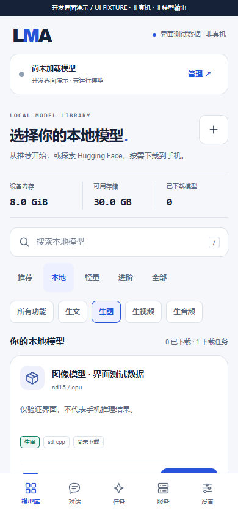 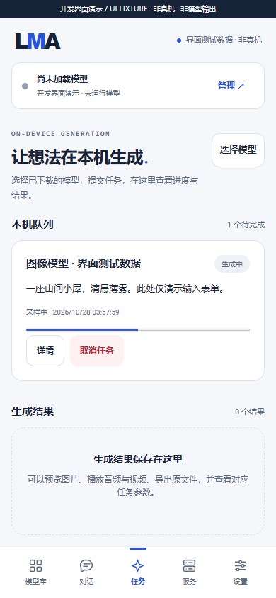

The development gateway can start independently, submit durable jobs and read events/artifacts without choosing/downloading models. See [development API](docs/API.en.md#030-dev2-independent-gateway-jobs-and-artifacts) and [progress](docs/DEVELOPMENT.en.md).

Internal progress (**0.3.0-dev.3 / code 7**, unpublished): signed speech worker paths for Kokoro / Piper / Matcha, three explicitly user-selected audio candidates and a speech form. 62 speech contract / host-process checks, 89 UI checks and package checks for 18 native files pass. There is no Android speech or endurance evidence; complete v0.3.0 remains unfinished. See [speech implementation and license boundaries](docs/TTS_ENGINE.en.md); [screenshots/video/GIF](docs/DEVELOPMENT.en.md) are visibly labeled UI fixtures.


Earlier checkpoint (**0.3.0-dev.5 / code 9**, unpublished): explicit HF component recipes for SD 1.5 / SDXL checkpoints, LoRAs and Kokoro / Piper / Matcha, with separate repositories, pinned revisions, declaration and download confirmation. Ordinary Git files verify blob identity and retain measured SHA256. 217 foundation, 74 HF and 112 UI checks pass. App updates deliver the foundation; users select/download/manage models. Complete adaptations, independent version updates and phone acceptance remain unfinished. See [recipes](docs/HF_RECIPES.en.md), [asset-control audit](docs/ASSET_CONTROL_AUDIT.en.md) and [checkpoint notes](docs/releases/v0.3.0-dev.5.md).

Earlier internal checkpoint (**0.3.0-dev.6 / code 10**, unpublished) adds a compiled MOSS Nano speech worker, arbitrary-text tokenization, audio codec output, explicit user-selected external weights and disposable private hardlinks. Eight HF component templates and 190 new host checks are available; no actual MOSS speech or Android acceptance has been recorded. Models remain independent user downloads, with no weights/tokenizers/voices in the APK. See [Nano implementation](docs/MOSS_NANO_ENGINE.en.md), [checkpoint notes](docs/releases/v0.3.0-dev.6.md) and [labeled screenshot/recording/GIF](docs/DEVELOPMENT.en.md). Full v0.3.0 remains unfinished.

Earlier internal checkpoint (**0.3.0-dev.7 / code 11**, unpublished) adds bundle [independent updates and rollback](docs/MODEL_UPDATES.en.md). Users select a version, review assets/settings and explicitly download; successful verification still needs separate activation consent. Old files/profiles and fixed API/job IDs remain intact; queued base/LoRA references prevent deletion. 302 foundation assertions include 62 version checks, with 132 UI checks and zero Lint errors. [Notes](docs/releases/v0.3.0-dev.7.md) and [labeled screenshots/recording/GIF](docs/DEVELOPMENT.en.md) are synchronized. Complete migration, selected-target integration and physical-device gates remain open; no new Release.

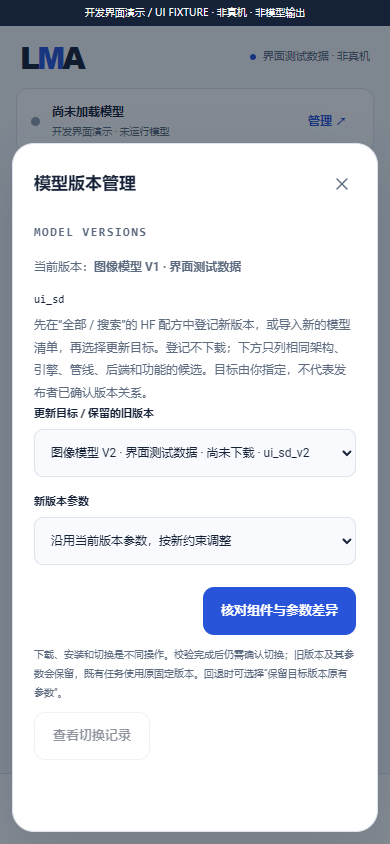 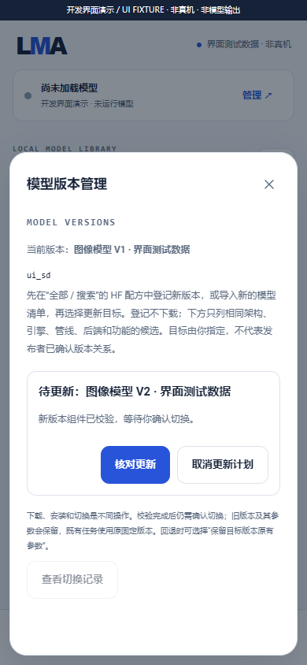

Earlier internal checkpoint (**0.3.0-dev.8 / code 12**, unpublished) adds [shared text-bundle execution](docs/TEXT_ENGINE.en.md): a ninth HF recipe, inspected GGUF context/dependent output limits, shared jobs and typed text artifacts, separate reasoning, copy and export. App updates still deliver only the foundation; users choose/download models. Recommendations and existing chat/API remain. 310 foundation, 66 added text-host and 147 UI checks pass, with zero Lint errors; these do not establish phone inference. Legacy migration, every selected model and physical-device gates remain in the same complete v0.3.0. No new Release. See [notes](docs/releases/v0.3.0-dev.8.md).

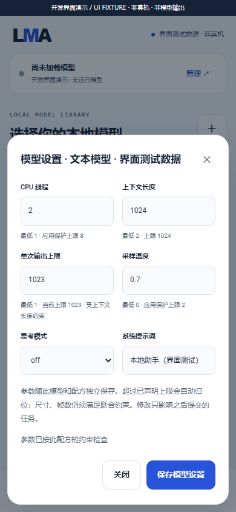 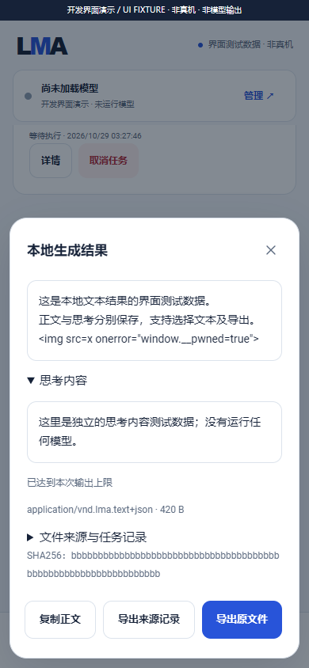

Earlier internal checkpoint (**0.3.0-dev.9 / code 13**, unpublished) adds [existing model migration](docs/MODEL_MIGRATION.en.md): verified GGUF reuse preserves IDs, sources, Recommended, content labels and per-model defaults, with shared task/version controls in the original details. Interrupted downloads stay paused until explicit resume. 69 added migration, 310 foundation and 156 UI checks pass; full model/device acceptance and automatic scheduling remain in the same v0.3.0. No new Release. See [notes](docs/releases/v0.3.0-dev.9.md) and [labeled media](docs/DEVELOPMENT.en.md).

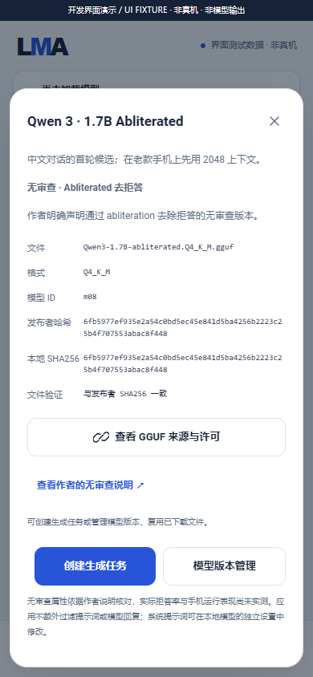 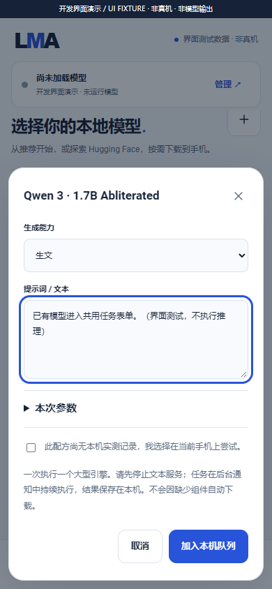

Earlier internal checkpoint (**0.3.0-dev.10 / code 14**, unpublished) integrates persistent loading, chat, synchronous APIs and generation through a [shared execution slot](docs/SCHEDULING.en.md). Jobs wait for active replies, reap old children before switching and restore a resident the user still wants. Waiting is cancellable, with generation-specific stop ownership. APK updates remain foundation-only; users select/download/manage models. 43 added production-queue/host-child/HTTP checks and 167 UI checks accompany scoped regression/package evidence in [progress](docs/DEVELOPMENT.en.md); [screenshots/recording/GIF](docs/MEDIA.md) remain labeled fixtures. All selected models and physical-device gates remain in the same complete v0.3.0, without a new Release.

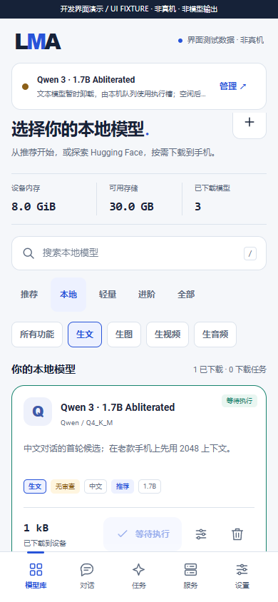 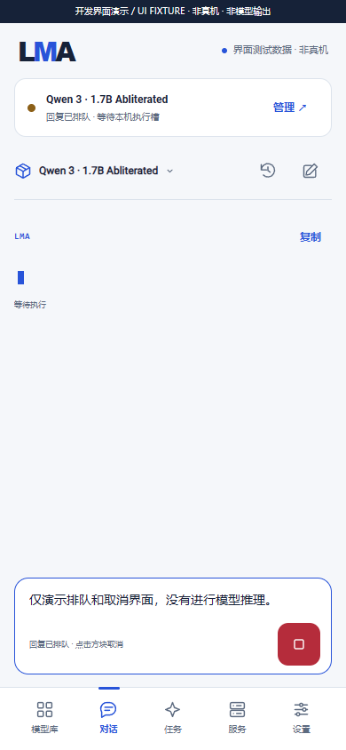

Earlier internal checkpoint (**0.3.0-dev.11 / code 15**, unpublished) adds [local input media](docs/LOCAL_INPUTS.en.md): Android document selection, service-owned private imports with cancellation, source filters and authenticated resumable chunk uploads. Jobs freeze IDs/hashes/metadata, protect queued/running references and rehash before worker startup. Existing production recipes remain prompt-only; the media form is an explicit contract fixture, without claimed voice cloning/image editing. 64 input/HTTP, 49 production-scheduler and 182 UI assertions pass, accompanied by 30 screenshots plus recording/GIF. All remaining pipelines and physical-Android gates remain in the same complete v0.3.0; no new Release. See [progress](docs/DEVELOPMENT.en.md) and [notes](docs/releases/v0.3.0-dev.11.md).

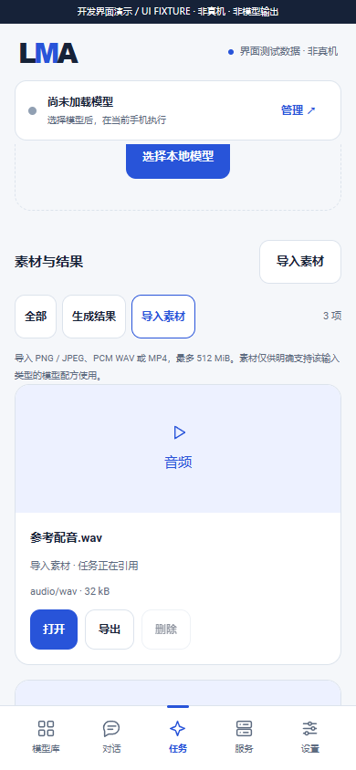 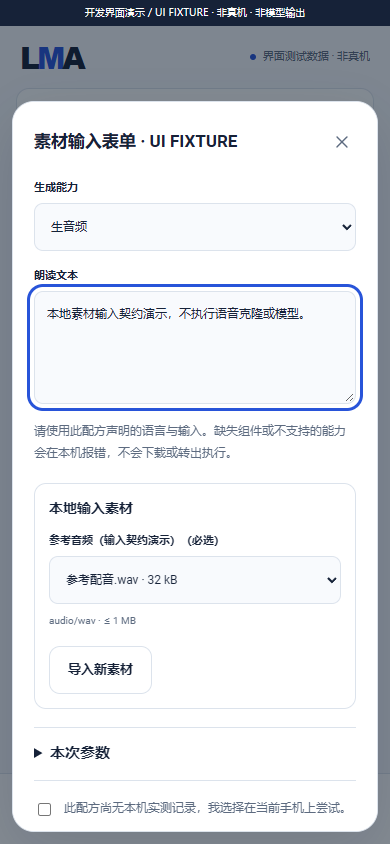

Earlier internal checkpoint (**0.3.0-dev.12 / code 16**, unpublished) adds [diffusion sampling and components](docs/DIFFUSION_ENGINE.en.md): split SD1.5/SDXL, SD-Turbo and both architectures' LCM checkpoints/LCM-LoRA, with frozen task samplers/CFG/step guards and preserved per-model settings. Java and shared C++ policies validate the plan; the native worker checks loaded tensor architecture. 83 added diffusion-host, 381 foundation and 194 UI checks pass alongside signed APK validation. 32 labeled fixture screenshots and recording/GIF are synchronized. The App updates the foundation; sixteen data templates install/download no models. Every selected target and physical-Android offline/quality/background/upgrade gate remains in the same complete v0.3.0; no new Release. See [notes](docs/releases/v0.3.0-dev.12.md).


Earlier internal checkpoint (**0.3.0-dev.14 / code 18**, unpublished). dev.14 adds the [Sana mobile / MNN pipeline](docs/MNN_SANA_ENGINE.en.md): a real ARM64 CPU worker, 13 user-selected components, whitelisted Qwen3 metadata, encoder release before diffusion, per-model CFG/token/thread controls and immutable job plans. Its 74 host/C++ checks perform no model inference. All 21 templates remain metadata with separately confirmed downloads. Foundation 445 and UI 208 checks pass; 37 screenshots and recording/GIF are explicit UI FIXTUREs. No Android image/endurance evidence exists. Every frozen target and release gate remains in the same complete v0.3.0, without a new Release. See [bilingual notes](docs/releases/v0.3.0-dev.14.md).

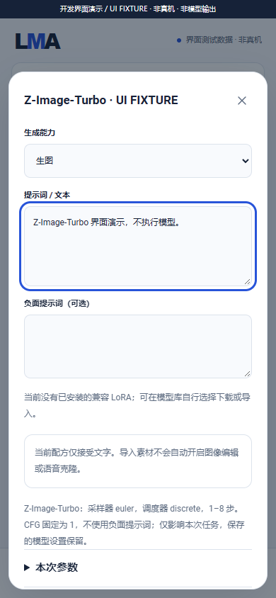 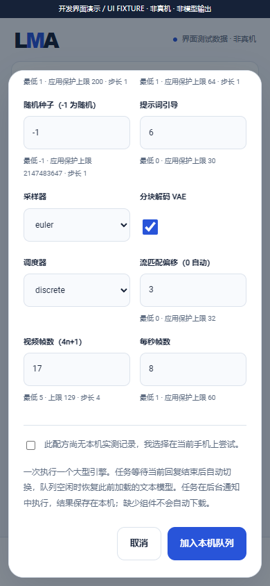

Earlier internal checkpoint (**0.3.0-dev.15 / code 19**, unpublished): [Qwen3-TTS 0.6B Base](docs/QWEN_TTS_ENGINE.en.md) adds a real ARM64 CPU worker, a complete two-GGUF local speech pipeline, optional reference WAV, independent sampling settings and actual timing/RTF recording. Shared `provides` discloses embedded tokenizer/predictor/speaker dependencies without duplicate downloads. Its 81 Java/C++ host checks exercise protocols and structural WAV only; pinned optional assets have header review, without model inference. All 22 templates remain metadata and never implicitly download models. Screenshots 38–39 and development recording/GIF remain UI FIXTUREs. App updates deliver the foundation; every full v0.3.0 target, real-output/quality/background gate remains, with no new Release. See [bilingual notes](docs/releases/v0.3.0-dev.15.md).

Internal checkpoint (**0.3.0-dev.16 / code 20**, unpublished): the [MOSS Delay native CPU pipeline](docs/MOSS_DELAY_ENGINE.en.md) adds a user-selected first-class backbone/decoder, optional reference encoder, independent text/audio sampling and shared jobs. Its 176 Java/C++ host checks include the pinned upstream Delay self-test; structural WAVs are not generated speech. All 23 recipes are metadata; APKs carry no model assets or implicit downloads. Screenshots 40–41 and recording/GIF remain UI FIXTUREs. Every complete v0.3.0 target and physical-device gate remains, without a new Release. See [bilingual notes](docs/releases/v0.3.0-dev.16.md).

Earlier internal checkpoint (**0.3.0-dev.17 / code 21**, unpublished): the [native MOSS Local-v1.5 / SoundEffect-v2 foundation](docs/OPENMOSS_ENGINE.en.md) adds two distinct CPU pipelines, explicit backbone/extras assets, embedded dependency tags, optional stereo reference, per-model settings and shared jobs/receipts. Its 180 Java/C++ checks include six actual host children and pinned upstream sound sampling primitives, without full model or Android inference. All 25 templates remain data-only and never auto-download. SoundEffect discloses its fixed 30-second latent cost. Screenshots 42–47 and recording/GIF are UI FIXTUREs. Every frozen target and physical-device gate remains in the same complete v0.3.0; no new Release. See the [bilingual notes](docs/releases/v0.3.0-dev.17.md).

Internal checkpoint (**0.3.0-dev.18 / code 22**, unpublished): the [native MOSS foundation](docs/OPENMOSS_ENGINE.en.md) adds four equal-peer TTS/v1.5/TTSD/VoiceGenerator recipes with explicit 32/16-codebook and 8B/1.7B layout validation, paired speaker references and per-model voice/language instructions. An actual generation-grid context guard runs before prefill and rejects overflow. 459 scoped Java/C++ checks (18 actual host children), 521 foundation and 265 UI assertions pass. All 29 templates stay metadata-only; no model assets are bundled. Screens 48–52 and refreshed recording/GIF are UI FIXTURE, without full-model or Android inference. All frozen targets and physical gates remain in one complete v0.3.0; no new Release. See [bilingual notes](docs/releases/v0.3.0-dev.18.md).

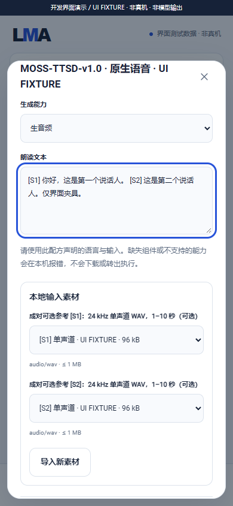 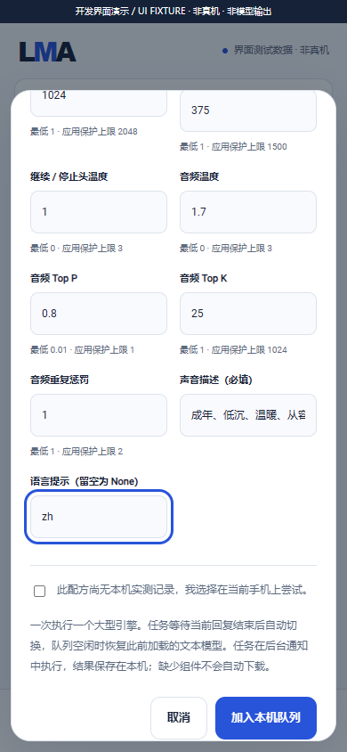


Internal checkpoint (**0.3.0-dev.19 / code 23**, unpublished): the [old Local / Realtime native RQ foundation](docs/MOSS_RQ_ENGINE.en.md) adds separate four-layer depth architectures, three explicitly selected GGUFs, model-specific tokenizer validation, actual prompt guards and shared jobs. [Old SoundEffect](docs/OPENMOSS_ENGINE.en.md) now binds official ambient-sound conditioning. Realtime currently returns a complete WAV from one text request, without an audio-stream or real-time claim. 178 RQ checks include 10 actual host children, 14 GGUF metadata checks and two synthetic tiny graphs; openmoss 514, foundation 550 and UI 280 checks pass. All 32 recipes are metadata; users independently select/download/manage assets. The original-signature APK has 24 native files and no bundled model assets. All 55 screens and refreshed recording/GIF remain UI FIXTURE. All nine MOSS subtargets now have separate code routes, with complete-model/phone/endurance acceptance still pending. Every frozen target remains in one complete v0.3.0, without a new Release. See [bilingual notes and numbered delivery tables](docs/releases/v0.3.0-dev.19.md).

<p>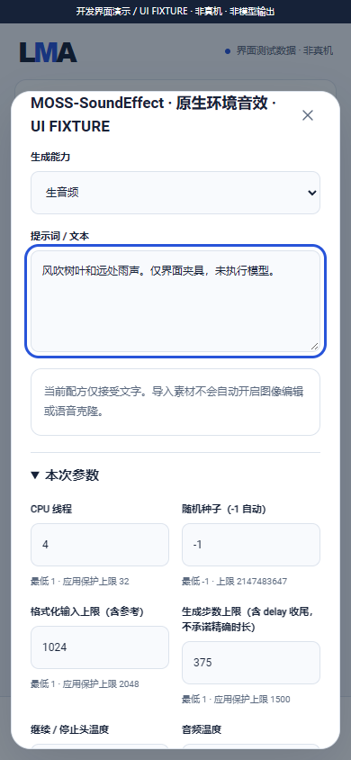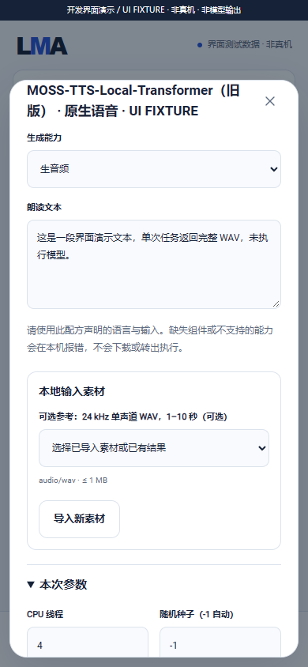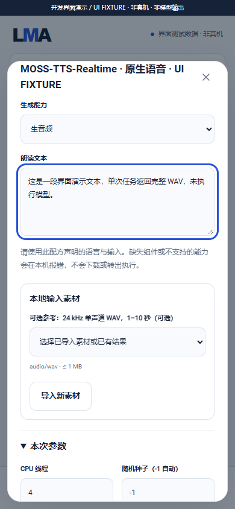</p>

Internal checkpoint (**0.3.0-dev.20 / code 24**, unpublished): the [Stable Audio Open Small foundation](docs/STABLE_AUDIO_ENGINE.en.md) adds sequential same-phone LiteRT CPU T5 → DiT → decoder execution, four user-selected assets, editable model-specific limits and fixed-length cost disclosure. 144 scoped assertions include 6 actual LiteRT tiny-graph runs and 6 host child processes, without a trained checkpoint. All 33 recipes are metadata only; 561 foundation / 287 UI checks pass. The original-signature APK has no weights/vocabulary. Screens 56–58 and recording/GIF are UI FIXTURE. Complete Stable Audio, SoulX/old LTX and every frozen target/device gate remain within the same complete v0.3.0; no new Release. See [numbered delivery notes](docs/releases/v0.3.0-dev.20.md).

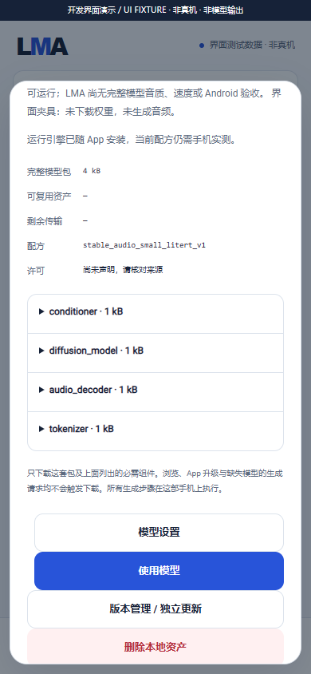 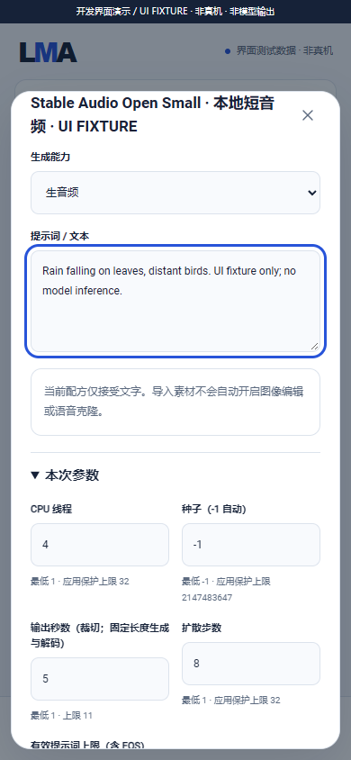

Source follow-up (APK still dev.20): [SoulX native audio primitives](docs/SOULX_DSP.en.md) add three reference frontends, sinc resampling, Flow numerical updates and HiFT spectra/NSF. 153 scoped checks and Android ARM64/API28 static-library compilation include 30/120-second F0 inputs. This library is not connected to the APK; the complete SoulX executor, model output and phone evidence remain pending. Recommendations, tags, explicit user downloads and existing UI media are unchanged. See [numbered delivery and complete remaining gates](docs/releases/v0.3.0-dev.20-soulx-dsp.md).

Source follow-up (APK remains dev.20): [SoulX trained references and acoustic reconstruction](docs/SOULX_REFERENCE.en.md) execute real S3Tokenizer v2/CAMPPlus/Flow/HiFT weights. 145 reference and253 trained reconstruction checks pass, including complete graph/tensor identity,63 stage and12 identical-input comparisons. The244 untrained acoustic and155 DSP checks remain current; reference/acoustic executors compile for ARM64 / API28 / 16KiB. Target codes still come from synthetic PCM: Qwen3 text-to-codes, complete TTS, App integration and phone acceptance remain pending. Research executors stay outside APK, model assets outside Git; no early Release. See [numbered implementation and complete remaining work](docs/releases/v0.3.0-dev.20-soulx-reference.md).

Source follow-up (APK remains dev.20): [SoulX language and complete host pipeline](docs/SOULX_LANGUAGE.en.md) execute trained Qwen3/S3/CAMPPlus/Flow/HiFT on fresh texts and write 24 kHz WAV. Language 546 assertions / 20 native children and pipeline 60 assertions/5 native children pass; distinct official/earlier community tokenizers, full original HF logits, RAS/history and actual decode cancellation are checked. ARM64 / API28 / 16KiB compilation passes; executors are outside APK. Synthetic references provide no speech quality, App or phone acceptance. Models/WAVs remain ignored; all complete-scope/Release gates stay open. See [numbered implementation and remaining work](docs/releases/v0.3.0-dev.20-soulx-language.md).


Internal checkpoint (**0.3.0-dev.21 / code25**, unpublished): the [SoulX App foundation](docs/SOULX_ENGINE.en.md) adds sequential same-phone CPU reference encoding → complete Qwen3 → Flow/HiFT → WAV, fourteen explicitly selected assets including forty bytes of learned source weights, S1–S4 paired transcripts, independent bounded profiles and shared jobs/API.222 contract checks and95 complete trained production-worker assertions pass: fresh two-speaker text produces4.84seconds of WAV; four-speaker capped output also executes. Synthetic references establish neither voice quality nor Android readiness. Foundation582/UI295 checks pass; all34 recipes are metadata. The original-signature APK has27 native files and no weights/tokenizers/source coefficients. Screens59–61 and refreshed recordings/GIFs are explicit UI FIXTUREs. Target13 still needs a verified complete public user download candidate, actual speech quality and phone acceptance; all other frozen targets/background gates remain in the same complete v0.3.0. See the [numbered implemented/pending handoff](docs/releases/v0.3.0-dev.21.md).

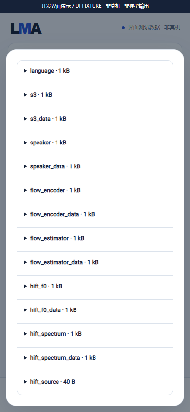 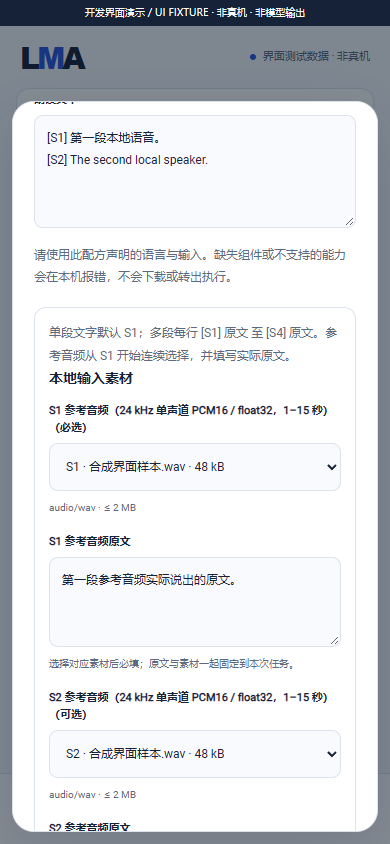

## dev.21 source follow-up: old LTX DiT / unpublished

The independent [LTX-Video 2B 0.9.8 native DiT](docs/LTX098_DIT.en.md) implements CPU/Vulkan GGML forwards for frozen target 17. **675 checks, 80 native children and 48** comparisons against original publisher PyTorch pass across 2 / 3 / 28-layer UNTRAINED reduced-width networks and F32/F16 dense weights. The full 715-tensor / 1,923,385,472-parameter layout matches the pinned checkpoint header. ARM64 / API28 / 16KiB is compilation only; this component stays outside APK. That first DiT checkpoint did not verify trained weights or sampling; the follow-up below adds those scoped checks. T5/VAE/complete video/App/phone acceptance remain pending. APK/UI media stays dev.21 and the public Release stays v0.2.0. See the [numbered implementation and complete pending work](docs/releases/v0.3.0-dev.21-ltx-dit.md).

## dev.21 source follow-up: trained old-LTX DiT and sampling / unpublished

[Explicit checkpoint acquisition, streaming local conversion and native eight-step sampling](docs/LTX098_SAMPLING.en.md) now exercise the complete old trained DiT: 715 tensors /1,923,385,472 parameters, separate F16/F32 GGUF, original PyTorch versus RTX3060 Vulkan velocity/eight-step latent results. **692 checks /58 actual native children /111 error records pass**. Trained velocity max error is6.91414e-6; final latent max error is3.57628e-6. All22 math cases match exactly; untrained CPU/Vulkan trajectories, cancellation, malformed assets and existing-file protection are separate checks. Probe/sampler ARM64/API28/16KiB compilation also passes.

Inputs are12 latent tokens and5 synthetic caption-embedding tokens. **No T5/tokenizer, VAE, video output, App integration or Android execution is claimed**; host resources/timing do not establish phone performance. External checkpoints/GGUF stay outside APK; no implicit download is added. App/UI media/APK version remain unchanged. F-01–F-12,01–14/16/17,every frozen subtarget,phone/background/quality gates remain in one complete unfulfilled v0.3.0. See the [numbered implementation and full pending work](docs/releases/v0.3.0-dev.21-ltx-sampling.md).

## dev.21 source follow-up: old LTX T5 encoding / unreleased

The [native T5 component and reproduction](docs/LTX098_TEXT.en.md) add external quantized storage, temporary F32 matrix execution, original external tokenizer config, raw per-token embeddings and actual neural cancellation. **491 checks /76 actual native children pass**: full 24 layer /219-tensor /4,762,310,656-parameter execution against independent Transformers dequantized-weight forwards, trained maximum error `3.27826e-6`. All 32000 learned pieces/scores and the normalization table match original SentencePiece; 100 sentinel definitions are loaded separately. 27 tokenizer, 8 untrained and 6 padding comparisons pass. ARM64/API28/16KiB compilation remains separate.

No unquantized-weight/prompt quality, full trained256-token completion, VAE/video/App/phone acceptance is established. Assets remain user-chosen external data with no installation/upgrade model downloads. Recommendations, All/search/Local and equal model/tag rules remain. APK/UI media stay dev.21; every frozen target remains in the same complete v0.3.0. See the [numbered implemented/pending handoff and resource limits](docs/releases/v0.3.0-dev.21-ltx-text.md).


## dev.21 source follow-up: trained old-LTX VAE / unreleased

The [nine-stage local VAE decoder and reproduction](docs/LTX098_VAE.en.md) add all132 trained tensors /552,814,641 parameters, cast from original BF16 to F32. ONNX graphs and external weights stay outside APK. Explicit noise blending precedes channel denormalization; original time conditioning is retained. Nine CPU sessions load/unload sequentially and output raw RGB float frames. Host checks, ARM64/API28/16KiB compilation, complete prompt-to-video, App and phone acceptance remain separate; see the [numbered handoff and complete pending scope](docs/releases/v0.3.0-dev.21-ltx-vae.md). APK/UI media remain dev.21 and the complete v0.3.0 scope is preserved.


**Validation:**355 checks /36 actual native children /31 guards /40 comparison records pass. Four geometries and conditioning settings use44 independently hashed original references. Maximum intermediate error is1.14441e-4; final-frame error is2.14577e-6. Sequential sessions, repeatability and actual in-Run ORT termination pass. Maximum observed Windows working set is1,238,388,736 bytes, not phone memory. ARM64/API28/16KiB is compilation only; complete video, quality, App, phone and full Release acceptance remain pending.


### Old LTX real-prompt video: independent host pipeline

[English design and reproduction](docs/LTX098_PIPELINE.en.md) / [中文](docs/LTX098_PIPELINE.md) / [numbered implemented and complete pending scope](docs/releases/v0.3.0-dev.21-ltx-pipeline.md). The developer chain connects real prompts, complete trained T5, exact old 28-layer DiT/eight-step sampling, nine trained decoder stages and RGB/MP4. Portable RNG/layout/frame primitives also compile separately for Android ARM64. The explicit recipe is single-scale with Google/community Q5 text; official default multi-scale/PixArt weight identity, quality, App and phone acceptance remain separate. Users continue controlling all model assets. APK/UI media stay dev.21; older component receipts retain their historical scopes.

The full original-forward review has **six failed float gates**: 157 of 163 checks pass, including both final RGB comparisons. The model test retains exit 1; strict numerical, App, phone and complete Release acceptance remain false. See [metrics and pending repair](docs/LTX098_PIPELINE.en.md). Media shows actual experimental outputs with NUMERIC + QUALITY GATES OPEN labels.

Actual host output, not App screen recording or Android evidence: [MP4](docs/media/development/ltx098-host-comparison.mp4) / [GIF](docs/media/development/ltx098-host-comparison.gif) / [source and timing receipt](docs/media/development/ltx098-host-media.json).

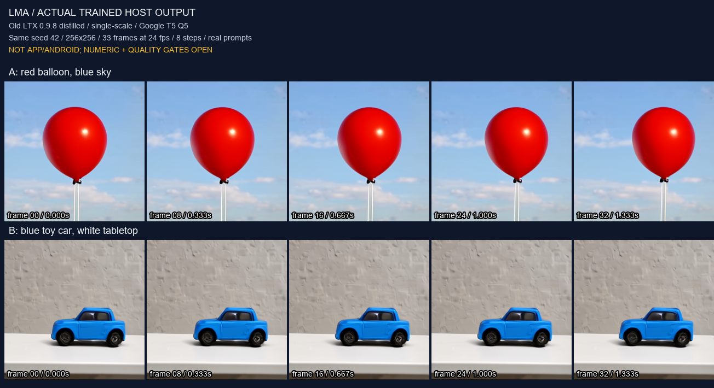

### Old LTX text roundoff and isolated precision candidates

[English investigation](docs/LTX098_PRECISION.en.md) / [中文](docs/LTX098_PRECISION.md) / [numbered handoff and full pending scope](docs/releases/v0.3.0-dev.21-ltx-precision.md). Added 314 trained intermediate comparisons, 628 verified tensor identities/recomputed errors and 120 operator comparisons on identical native inputs. Both instrumented native and original reference final embeddings retain their existing bytes. Precision candidates have separate identities and are excluded from APK. The complete pipeline still has six failed float gates; diagnostics do not replace numerical, quality, App or phone acceptance. All frozen targets remain in one complete v0.3.0.

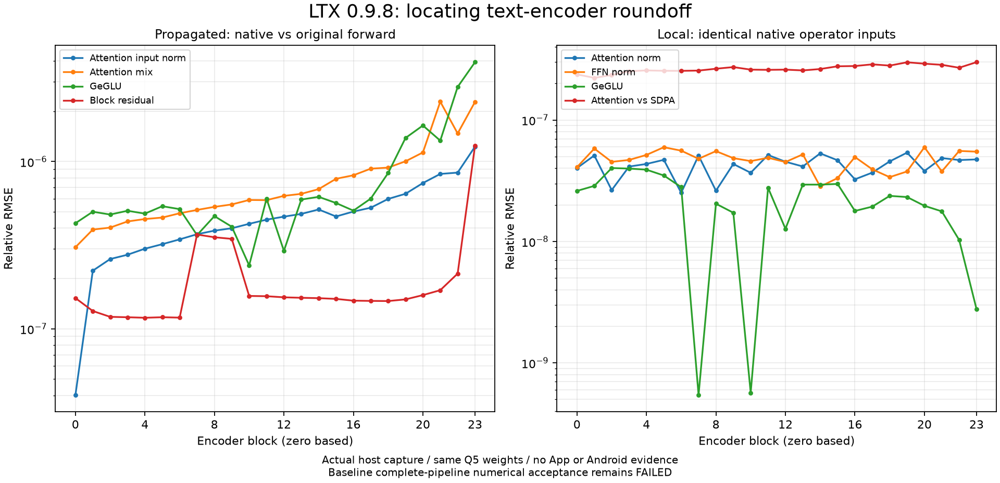

Both candidates completed trained T5 A/B/A sequences. Combined-candidate A/B embedding maximum errors are 2.861e-6 / 1.192e-6. Two partial eight-step A video probes still reach 0.003953 / 0.003829, both above the unchanged 0.003 gate and retaining exit 1; complete-chain repair remains unaccepted.

### Native old-LTX asset preparation (source follow-up, unreleased)

[English design](docs/LTX098_PREPARE.en.md) / [中文](docs/LTX098_PREPARE.md) / [numbered handoff and complete pending scope](docs/releases/v0.3.0-dev.21-ltx-prepare.md). A portable Python-free streaming safetensors → DiT GGUF component builds with native MSVC and Android ARM64 tools. 156 checks / 46 failure-protection cases / 51 native children pass. One complete 6.34-GB trained source produced a 3.85-GB GGUF with whole-file SHA identical to independent Python conversion; observed host peak working set was 13.22 MiB. The [measured figure](docs/media/development/ltx098-native-prepare.png) is host conversion evidence. Assets remain user-selected, sources retained, and model data excluded from the foundation. Production App acquisition, full-chain numerical repair and phone acceptance remain open; existing APK, full v0.3.0 scope and Release gates are unchanged.

### Native old-VAE preparation and actual decoding (source follow-up, unreleased)

[English design](docs/LTX098_VAE_PREPARE.en.md) / [中文](docs/LTX098_VAE_PREPARE.md) / [numbered handoff and complete pending scope](docs/releases/v0.3.0-dev.21-ltx-vae-prepare.md). A streaming native VAE preparer shares the preparation I/O foundation. Nine graphs contain no inline learned parameters; weights/statistics come from the user's selected checkpoint. All 18 assets /2.212 GB match independent Python bytes. 243 checks, 25 failure-protection cases and 31 native children cover preparation plus four actual trained decodes with 40 original-forward comparisons. The [host comparison figure](docs/media/development/ltx098-vae-prepared-decode.png) uses synthetic latents, not prompt-video or phone footage. The 156-check DiT regression passes. Production App acquisition, complete-chain numeric repair and every frozen/device/Release gate remain open; APK stays dev.21.
