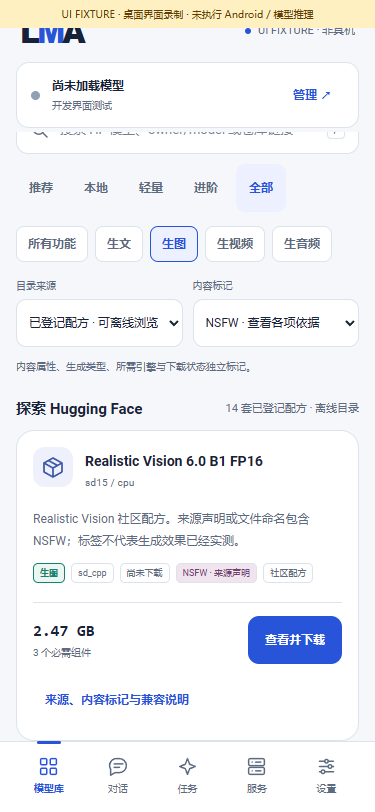
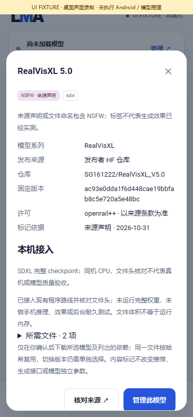
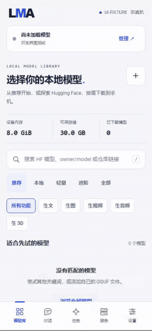
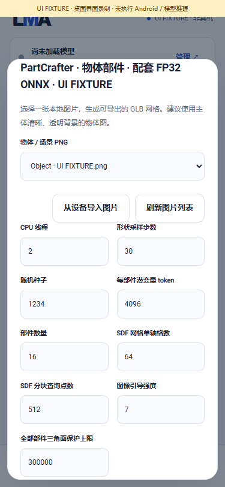
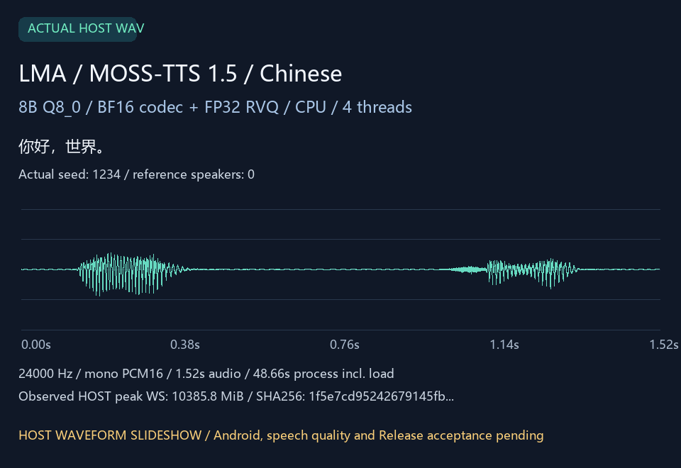
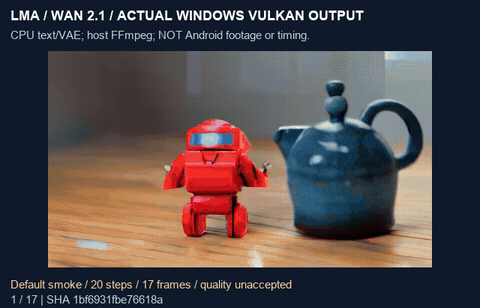

# LMA · Local model workbench for Android

[中文](README.md) · [Download v0.3.5](https://github.com/wikigsroom/LMA/releases/tag/v0.3.5) · [User guide](docs/USER_GUIDE.en.md) · [Documentation](docs/README.md) · [Detailed scenarios](#use-cases) · [Cases and failures](#case-studies)

**In development: v0.3.6 / code56; no new Release published.** This work adds the [official-compatible F5 Chinese frontend](docs/F5_FRONTEND.en.md), [on-phone Hunyuan3D Paint / PBR workflow](docs/LOCAL_MATERIALS.en.md) and a native BSA operator and [pinned flow / LoRA conversion components](docs/ULTRATEX_FLOW.en.md) needed by UltraTex. Development has **52 templates / 82 bundles / 17 extension engines plus text**. Every model and linguistic asset remains an explicit user choice. Complete D04 UltraTex, D05 UniForge, D08 SAM, D09 MV-SAM and D10 SUPRA workflows still need implementation: **all adaptations are not complete**. [Numbered status and full work list](docs/REMAINING_ADAPTATION.en.md) · [Current development evidence](verification/adaptation/status.json). The v0.3.5 cases and totals below remain published-version records, not current-source validation.

LMA lets users select, download, manage and run local models on an Android phone, with chat, multimodal jobs, artifacts and a local API. App updates deliver the foundation. Users explicitly choose every model and dependency. The APK contains no model weights and requires no ROOT, Termux, containers or other computing devices.

**v0.3.5 preserves the frozen program scope: F-01–F-12, existing text and selections 01–14, 16 and 17. Validation is program-only, as requested by the user.** Builds, packages, native contracts, production job logic, APIs and UI checks do not establish phone inference, image/audio quality, speed or screen-off endurance. Those remain untested. A catalogue entry does not establish that a Nubia Z20 can run it.

**v0.3.1 adds 44 optional community checkpoint recipes (30 image / 14 video) across 14 families. Of these, 28 have sourced NSFW labels.** Content labels distinguish publisher declarations, rating vocabularies, file markers, mirrors and unverified HF hints. These 44 community choices remain in v0.3.5; the 14 Wan video entries are training versions of one 1.3B family. See the [complete source, license, compatibility and usage guide](docs/COMMUNITY_MODELS.en.md).

Current development program checks: **37 suites / 13,076 assertions**, including F5 frontend 6,671, material geometry 61, Paint networks/worker 227, actual export CLI 17, BSA 47, UltraTex flow components 101, application expansion 592, all UI 687 and missing-code release protection 9, plus shared-foundation regressions. The original-signature development APK, package, ARM64/API28/16 KiB and Lint **0 errors / 16 existing warnings** are checked. No complete trained model or phone endurance test ran. [Six new screenshots / GIF / MP4](docs/MEDIA.md) accompany **C01–C36**; historical cases H01–H18 are retained.

<a id="install"></a>
## Install and use

1. Download `LMA-0.3.5-arm64-v8a.apk` from the Release and compare its hash with `SHA256SUMS`. Requires **64-bit Android 9 / API 28 or later**. The original signing identity is retained for upgrades and existing data.
2. Open LMA and allow notifications when prompted. For screen-off work, allow background activity and remove the relevant battery restrictions in Android settings. Installation and upgrades do not download models.
3. Open Models → Recommended / All / Local. **Recommended retains m08 → m06 → m01.** All supports HF keywords, repository IDs/URLs, pagination and discovery of every format. Local manages downloaded/imported models and unfinished transfers.
4. Filter by text, image, video, audio or 3D tags. Inspect architecture, recipe, backend, license, dependencies, pinned revision and size before explicitly downloading or importing with Android's document picker.
5. Open a model's settings in Local. Editable preset inputs save independently per model; excessive values clamp to the applicable model, recipe or application bound. Temporary job overrides preserve saved defaults.
6. Load a text model for chat or copy the local API address. For other models, choose Use, fill the capability-specific form, attach compatible references, review preflight and submit to the shared queue.
7. Inspect progress, cancel or explicitly retry from Tasks. Preview/export artifacts with parameters, seed, provenance and hashes, or restore them as a new editable request. Drafts are stored independently.

HF discovery and executable support are separate. Compatible files enter their matching text engine or multi-component recipe; arbitrary safetensors, GGUF or Diffusers repositories are not universally executable. Custom components can be registered through recipes. Missing components fail locally without implicit downloads or off-device execution.

<a id="models"></a>
Current APK: **v0.3.5 / code 55 / 67,747,539 bytes**, original signing identity retained. SHA256: `874ca36821f85a82f403b403bafa32116f55977607b79aa31414283ed628f4cf`. [Release inventory and validation](docs/releases/v0.3.5.md).

## Model and foundation scope

Every model is a peer, classified by output task, capability, engine, format, component, backend, license and installation tags. Uncensored / Abliterated is an independent label. Checked publisher declarations and unverified metadata hints are distinguished; neither implies measured refusal rates.

| Selection | Model / option | Local program route and boundary |
| --- | --- | --- |
| Existing | Text GGUF | llama.cpp, chat, SSE and per-model context/output constraints |
| 01, 02, 05 | SD 1.5, SDXL and both LoRA families | sd.cpp; base models and LoRAs are independently managed and matched |
| 03 | SD-Turbo, LCM checkpoint, LCM-LoRA | Dedicated sampling profiles; SD1.5/SDXL LCM-LoRA; explicit preparation and association where needed |
| 04 | Sana-Sprint 0.6B and separate Sana Edit | MNN with matching encoders, converted graphs and sampling rules; variants remain distinct |
| 06–08 | Z-Image-Turbo, FLUX.2-klein-4B, Qwen-Image-2.1 | Native sd.cpp multi-component routes with separate encoders, VAE and tokenizers |
| 09 | MOSS-TTS-Nano 100M | Local ORT, tokenizer and audio codec |
| 10 | Kokoro-82M / Piper / Matcha | sherpa-onnx; 54 Kokoro voices, pinned Piper Lessac / Matcha LJSpeech options |
| 11 | Qwen3-TTS 0.6B Base | Native GGML, reference audio and local codec |
| 12 | All nine frozen MOSS targets | TTS 1.0/1.5, original Local/1.5, TTSD, VoiceGenerator, original SoundEffect/v2 and Realtime; architecture-specific OpenMOSS, delay or RQ adapters |
| 13, 14 | SoulX-Podcast 1.7B, Stable Audio Open Small | Local language/acoustic/codec and audio sampling stages |
| 16 | Wan 2.1 T2V 1.3B Q4 | sd.cpp CPU/Vulkan with explicit components and video encoding |
| 17 | LTX-Video 2B 0.9.8 distilled | Original PixArt T5 F32 with 7-step generation / spatial upsampling / 3-step refinement; Google T5 Q5 single-scale remains a separate variant |

This release has **50 data-only recipe templates, 82 catalogue bundles (23 original + 44 community + 11 speech / single-image 3D + 4 MV imports), 17 extension engine families and the existing text engine**. These are program integration counts, not counts of models passing phone tests. See the [implementation matrix](docs/IMPLEMENTATION_V035.en.md).

## Speech, single-image and multiview 3D

| Number | Choice | Current route and boundary |
| --- | --- | --- |
| S01 | Kokoro PyTorch family | Matched INT8 English ONNX; raw `.pth` is not directly executable; existing 54 voices remain |
| S02 | MeloTTS Chinese | INT8 / FP32 ONNX, phones / tones lexicon and four normalization FSTs |
| S03 | F5-TTS v1 | Original safetensors and Vocos through local C++; reference WAV / transcript required; experimental Chinese frontend |
| S04 | OmniVoice | Q8 GGUF or original assets; local C++, auto / clone / design controls, complete WAV |
| D01–D02 | TRELLIS.2 / Pixal3D | Five single-image GGUF / CPU geometry / texture choices; local image → GLB → rotate / export |

All **16 configurations** in the requested [3080 collection](https://benchmark.sidcloud.cn/collections/3080-3d) were assessed: 12 newer and four older cases. This APK integrates subsets of two single-image architectures and the actual four-view Pixal3D MV route. Matched-export TripoSG / PartCrafter, Hunyuan3D shape and UltraShape refinement subsets are integrated. Six other configurations / five groups still need native ports. The smaller Melo choice is about 61 MB; the Pixal texture bundle is about 13 GB, not uniformly lightweight or guaranteed Z20 options.

[Four speech families, 11 bundles, licenses, D01–D16 audit, workflows, API, tests and media](docs/SPEECH_3D_EXPANSION.en.md) · [source audit](research/expansion/benchmark-audit.json). Downloads remain user-selected; no NSFW label is inferred for new families.

## New multiview route and diagnostics

Pixal3D MV now has four equal F16 / Q8_0 geometry / PBR choices: four calibrated RGBA PNG views → actual same-phone CPU fusion → GLB. **Matching publisher-manifest imports are available; a public weight-download endpoint has not been verified.** Import exact matching files, or explicitly choose compatible HF components through the custom MV recipe. Single-view flows are incompatible.

Stage timings and supported workers' process peak RSS persist even on failure. New observations retain earlier backend identity. Service shows power-save, idle, background and notification restrictions. Explicit diagnostic exports whitelist fields and exclude prompts, settings, paths and keys from that diagnostic object; existing logs still require separate review. These observations are not quality or endurance acceptance.

The benchmark still has **six incomplete configurations / five architecture groups**: UltraTex, UniForge3D, Hunyuan3D Paint, SAM 3D / MV-SAM3D, and SUPRA-Tex. They need actual native ports; generic catalogue management or passing tests do not implement them. [Workflow, cameras, imports, API, privacy, tests and remaining work](docs/MULTIVIEW_DIAGNOSTICS.en.md) · [Pinned source audit](research/portability/audit-v0.3.5.json).

## Local RF Shape and part geometry

Three equal custom recipes add TripoSG, PartCrafter objects and PartCrafter scenes through matched FP32 ONNX: native CPU image encoding → RF / part DiT → SDF VAE → an untextured, multipart GLB. **Matching local exports can be imported; no complete public matched download package is verified. Raw PyTorch is not directly executable.** The 82 catalogue bundles remain; templates increase to 50. Updating the App does not obtain model assets.

[Export, import, parameters, native design and limits](docs/RF_SHAPE.en.md) · [Numbered implementation and remaining work](docs/IMPLEMENTATION_V035.en.md). Complete checkpoint export, phone memory / speed / quality remain untested. Automatic segmentation, VLM part identification and texture generation are unimplemented extras. D04, D05, D07 Paint and D08–D10 remain actual native-port development in the [current audit](research/portability/audit-v0.3.5.json).

## Hunyuan3D shape and UltraShape refinement

Two equal optional recipes run `spatial_ort` on the phone CPU: reference PNG → Hunyuan3D geometry; PNG + coarse GLB → UltraShape refinement. They preserve source MoE routing, voxel RoPE / masking, VAE cache and SDF. Coarse input uses area + sharp-edge sampling and float16 positions. Matching local exports can be imported; a public complete ONNX package has not been verified.

[Conversion, components, controls, API and limitations](docs/SPATIAL_SHAPE.en.md) · [Numbered implemented/pending work](docs/IMPLEMENTATION_V035.en.md). Five built-in sparse CPU operators are building blocks, not full SAM, UniForge or SUPRA adapters. Separate Hunyuan Paint is still missing. No weights or model-specific data are added to the APK.

## Architecture and asset lifecycle

Bundles pin revisions, paths, sizes and SHA256 values for weights, encoders, VAE, codecs, tokenizer and voice resources. Management includes pause/resume, atomic installation, shared-reference protection, explicit updates, import and deletion. Running tasks lease their input assets. Some architectures require explicit preparation of user-owned source files with programs signed into the APK, followed by runtime association. Downloaded code and arbitrary user scripts are never executed.

Versioned internal adapters implement loading, stage progress, cancellation, errors and unloading. Resource admission and the common scheduler default to one large inference task at a time. Jobs freeze model identity, parameters and inputs. Artifacts are staged, validated and committed; interruption recovery reconciles existing results. A stage resumes only with a real checkpoint; otherwise the user explicitly retries it. There is no ComfyUI wiring, infinite canvas, public node system or plugin marketplace.

Original LTX multiscale runs CPU T5 → initial Vulkan sampling → CPU learned upsampling/AdaIN → Vulkan refinement → CPU VAE → local AVC. The two original T5 shards occupy about **17.74 GiB**, and the entire runtime bundle about **23.86 GiB**. This is not a Z20 suitability claim. The APK carries only upsampler structure; all 72 learned tensors reference separately acquired user assets. [Identity, settings and stages](docs/LTX_MULTISCALE.en.md).

## Local API and background operation

Default base URL: `http://127.0.0.1:8080/v1`, authenticated with the local API key shown in LMA. Existing `/models`, `/chat/completions` and SSE remain available. Multimodal work uses asynchronous `/jobs`, preflight, events, cancellation and authenticated artifact endpoints. UI and API share scheduling and validation. See the [API guide](docs/API.en.md). Optional LAN exposure still performs computation on this phone; LMA has no external inference provider.

A visible foreground service, stop notification and task-scoped wake locks support continued work after leaving the UI. Force-stop, vendor battery management, thermal pressure and memory limits can still terminate work. Recovery code is not evidence of prolonged screen-off operation on a Z20. Model licenses, storage requirements and runtime memory budgets are separate; LMA does not silently substitute a model.

## Screenshots and recordings

These show **v0.3.5 production pages with an explicitly labelled desktop bridge fixture**, without weight downloads or generated model content. Owned browsers close after recording.


[MP4](docs/media/development/community/community-ui.mp4) · [Components](docs/media/development/community/01-community-images.png) · [Settings](docs/media/development/community/02-image-source.png) · [Task form](docs/media/development/community/03-community-video.png) · [Queue](docs/media/development/community/05-community-local.png) · [Workbench recording](docs/media/development/release-workbench/release-workbench-ui.mp4)

## Validation, builds and documentation

[Release notes](docs/releases/v0.3.5.md) list program checks, APK identity and deliverables. The [validation policy](docs/PROGRAM_VALIDATION.en.md) records the user's decision to omit complete-model runtime acceptance. Current evidence is in [verification/program](verification/program/status.json); historical failures and earlier records retain their identity and are not current-APK model results.

Native Windows builds use JDK, Android SDK/NDK and CMake, without Docker, WSL or emulators. Local `signing/` material is preserved for upgrades and excluded from Git and release assets. [Build](docs/BUILD.en.md) · [Release workflow](docs/RELEASING.md) · [Contributing](CONTRIBUTING.md).

The [documentation index](docs/README.md) links model management, settings, tasks, background recovery, API, architecture details and historical research. LMA code is MIT; engines and user models retain their own terms. See [third-party notices](third_party/README.md).

<a id="contents"></a>
## Detailed usage and evidence routes

The following restores the detailed scenarios, API examples, generated artifacts and test cases that were lost when the README was shortened. v0.3.5 retains these detailed sections and adds speech / 3D scenarios; no new complete-model run is claimed. LMA is independent of LM Studio; the current app UI is primarily Chinese and the documentation is bilingual.

| Goal | Entry point |
| --- | --- |
| Operate the app | [30 scenarios C01–C30](#use-cases) |
| Integrate the phone API | [Four examples A01–A04](#api-examples) |
| Compare historical outputs and failures | [18 cases H01–H18](#case-studies) |
| Inspect current program coverage | [30 suites P01–P30](#verification) |
| Rebuild and diagnose | [Build](#build), [Z20/background limits](#z20), [troubleshooting](#troubleshooting) |
| Read the original development narrative | [Historical English README](docs/history/README-dev45.en.md), [repair notes](docs/releases/v0.3.1-readme.md) |

### Preserved curated text candidates

These candidates do not restrict HF discovery. Download size is not runtime RAM. Exact file identities remain in the [pinned catalogue](catalogue/verified-models.json) and app details. Recommended stays `m08 → m06 → m01`, with existing labels and provenance; imported files do not become checked entries because their names contain uncensored.

| ID | Candidate | Approximate download | Hint |
| --- | --- | ---: | --- |
| `m08` | Qwen 3 · 1.7B Abliterated | 1.11 GB | Chinese recommendation |
| `m06` | LFM 2.5 · 1.2B Uncensored | 731 MB | Lightweight recommendation |
| `m01` | Dolphin 3 · Qwen 0.5B Uncensored | 398 MB | Smallest starting candidate |
| `m04` | Dolphin 3 · Llama 1B Uncensored | 808 MB | Lightweight, English |
| `m05` | Gemma 3 · 1B Abliterated | 806 MB | Lightweight, multilingual |
| `m10` | LFM 2.5 · 2.6B Uncensored | 1.67 GB | Larger, reasoning |
| `m11` | Dolphin 3 · Qwen 3B Uncensored | 1.93 GB | Larger, Chinese |
| `m12` | Dolphin 3 · Llama 3B Uncensored | 2.02 GB | Larger, English |
| `m13` | Llama 3.2 · 3B Uncensored | 2.24 GB | Larger, English |
| `m14` | Qwen 3 · 4B Instruct 2507 Abliterated | 2.50 GB | Larger, Chinese |
| `m16` | Gemma 3 · 4B Abliterated v2 | 2.49 GB | Larger, multilingual |
| `m03` | Qwen 3.5 · 0.8B Abliterated | 528 MB | New architecture, experimental |
| `m09` | Qwen 3.5 · 2B Abliterated | 1.27 GB | New architecture, experimental |
| `m15` | Qwen 3.5 · 4B Uncensored · HauhauCS Aggressive | 2.71 GB | New architecture, experimental |

<a id="use-cases"></a>
## 30 complete usage scenarios

These describe operations and expected behavior, not newly passed physical-device tests. Current program checks and historical model evidence are listed separately below.

### C01 · Zero-model installation, startup and upgrade

- Open Models, Jobs, Service and Settings without choosing a model.
- Start the API and read health. Management works without weights; model output requires a model.
- Inspect existing files, unfinished transfers and model-specific settings after upgrades. Browsing starts no downloads or weight replacements.
- [Asset-control audit](docs/ASSET_CONTROL_AUDIT.en.md) · [foundation checks](verification/program/foundation.json)

### C02 · Recommended, All, HF search and file selection

- Recommended stays `m08 → m06 → m01`. Search All by keyword, `owner/model` or repository URL.
- Use sorting, pagination and format filters; inspect actual files and architectures after repository discovery.
- Compare quantization, size, pinned revision and hash before explicitly downloading. Arbitrary GGUF/safetensors files cannot use unrelated engines.
- [HF guide](docs/HF_MODELS.en.md) · [HF checks](verification/program/hub.json)

### C03 · Local transfers, pause, import and delete

- Search downloaded/imported models and unfinished transfers in Local. Pause and explicitly resume.
- Import through Android's document picker. File import and network resume differ; names do not replace full identity checks.
- Review every component in the download plan. Shared hashes and references protect files used by another bundle or active job.
- [Transfers](docs/MODEL_TRANSFERS.en.md) · [pause checks](verification/program/bundle-pause.json) · [document contracts](verification/program/document-input.json)

### C04 · Per-model settings and automatic clamping

- Open Local → model → Settings; edit context, output, threads, temperature or engine-specific preset inputs.
- Save different values for models A and B. Switching preserves each; excessive values clamp to model/recipe/application limits.
- Text context and output have joint bounds. Unknown GGUF metadata has an explicit fallback. Temporary job changes do not overwrite saved defaults.
- [Settings](docs/MODEL_SETTINGS.en.md) · [text checks](verification/program/text.json) · [migration](verification/program/migration.json)

### C05 · Chat and streaming text API

- Fully install and load a text model. Ask for three sentences about local models; inspect generation, stop and errors.
- Copy the current service address/key, query `/v1/models` and use the actual loaded model ID.
- Parse SSE events, not socket reads. Disconnect, stop and limits end generation; an idle API does not generate forever.
- [API](docs/API.en.md) · [backend checks](verification/program/backend.json) · [examples](#api-examples)

### C06 · SD 1.5 / SDXL image generation and LoRA

- Install a base and matching encoder resources, choose Use and enter a garden/wooden-house prompt.
- Optionally select a matching SD1.5 or SDXL LoRA and its strength; manage it independently.
- Preflight rejects mismatches, duplicates and missing assets. Jobs freeze model, adapter, strength and seed; results retain provenance.
- [Image selection](docs/CURATED_DIFFUSION.en.md) · [LoRA](docs/ADAPTERS.en.md) · [H01–H03](#case-studies)

### C07 · Community NSFW filters, source review and download

- Combine Registered, image/video and NSFW filters in All, or discover other candidates through HF.
- Inspect publisher, vocabulary, filename, mirror and HF evidence separately, along with licenses and components.
- Explicitly confirm the download plan. Local retains labels and independent settings.
- [All 44 recipes](docs/COMMUNITY_MODELS.en.md) · [community checks](verification/program/community.json)

### C08 · Sana-Sprint generation and Sana Edit conversion

- Text-to-image uses matched **Sana-Sprint 0.6B MNN**, 14 components, 1024² and 1–4 steps. About 6.29 GiB of assets is not a RAM estimate.
- Separate **Sana Edit** requires 15 components, a local PNG/JPEG, a fixed style prompt and its 512×512 route.
- Edit weights are not arbitrary text-to-image weights. Keep the failed 13-component gray-image attempt separate from matched recipes.
- [Sprint](docs/SANA_SPRINT.en.md) · [Edit](docs/MNN_SANA_EDIT.en.md) · [H04/H17](#case-studies)

### C09 · Z-Image, FLUX.2-klein and Qwen-Image

- Inspect matched diffusion, text encoder, VAE and tokenizer components; filenames do not establish compatibility.
- Edit supported sampling/geometry values, enter a prompt, preflight and submit.
- User files/hashes stay intact; required tokenizer handling occurs in memory. Cancellation publishes no partial result; a rerun creates a new job.
- [Z-Image](docs/ZIMAGE_TURBO.en.md) · [FLUX](docs/FLUX2_KLEIN.en.md) · [advanced images](docs/ADVANCED_DIFFUSION.en.md)

### C10 · Lightweight TTS and voice selection

- Compare exact MOSS Nano, Kokoro, Piper and Matcha combinations under All → Audio.
- Kokoro exposes local voice names; language, voice and speed rules belong to each model.
- Submit short text and inspect frozen voice/settings. Preview/export WAV artifacts; model and result deletion are independent.
- [Speech selection](docs/SPEECH_SELECTION.en.md) · [Nano](docs/MOSS_NANO_ENGINE.en.md) · [H07–H08](#case-studies)

### C11 · Qwen3-TTS, MOSS and SoulX reference audio

- Add authorized local reference audio, transcripts or speaker slots only when supported by the selected architecture.
- Qwen3-TTS Base, MOSS subtargets and SoulX have different input roles, codecs and budgets; follow each form.
- Budget exhaustion without natural termination remains explicit. Cancellation/recovery is not natural completion or quality acceptance.
- [Qwen3-TTS](docs/QWEN_TTS_ENGINE.en.md) · [MOSS](docs/MOSS_TTS15.en.md) · [SoulX](docs/SOULX_ENGINE.en.md)

### C12 · Sound effects and audio generation

- Choose MOSS SoundEffect or Stable Audio Open Small appropriately; a TTS engine is not a general music engine.
- Review prompt, sampling and duration constraints. Shorter requested output may not reduce fixed internal computation proportionally.
- Once users acquire components, encoding, diffusion and decoding/codec execute on the phone. Missing files fail locally.
- [Stable Audio](docs/STABLE_AUDIO_ENGINE.en.md) · [OpenMOSS](docs/OPENMOSS_ENGINE.en.md) · [RQ](docs/MOSS_RQ_ENGINE.en.md)

### C13 · Wan local text-to-video

- Choose **Wan 2.1 T2V 1.3B** or a matching EXP variant; inspect encoder, VAE, tokenizer and diffusion files.
- Save per-model geometry, frames, steps and decoding values; inspect resources before submission.
- Track encoding, sampling, decoding and local MP4 assembly. Historical last-frame artifacts remain; tile changes are not a claimed fix.
- Not interchangeable with Wan 14B/I2V, Wan 2.2 or video LoRA. [Video](docs/WAN_VIDEO.en.md) · [decoder](docs/WAN_DECODER.en.md)

### C14 · Exact legacy LTX variants and preparation

- Original **LTX 0.9.8 distilled multiscale** uses PixArt F32 T5 and 7 steps → spatial upscale/AdaIN → 3 steps.
- Google T5 Q5 single-scale is separate. LTX 2.x/2.3 cannot use the old adapter.
- Explicitly prepare user assets and confirm association. No learned tensors or model vocabulary are bundled.
- Original T5 shards total about 17.74 GiB; all assets about 23.86 GiB, not Z20 viability. [Route](docs/LTX_MULTISCALE.en.md) · [prepare](docs/MODEL_PREPARATION.en.md) · [associate](docs/MODEL_ASSEMBLY.en.md)

### C15 · Draft, preflight, shared queue and cancellation

- Save a draft and choose installed models/inputs. Preflight reports missing assets, effective values and resources without downloading or inference.
- Submit and inspect stages/errors in Jobs. Text and multimodal tasks share resources, normally with one large inference owner.
- Cancel queued/running jobs and verify release. Failure/cancellation commits no partial artifact; explicit retry creates a new job without rewriting history.
- [Workbench](docs/TASK_WORKBENCH.en.md) · [preflight](docs/TASK_PREFLIGHT.en.md) · [scheduler](docs/SCHEDULING.en.md)

### C16 · Interruption recovery, provenance and export

- Reopen and inspect interrupted jobs and committed results. Resuming steps needs a real checkpoint; otherwise explicitly retry.
- Restore a result as a new request and inspect model, parameters, seed and input hashes. Preview/export holds read references.
- Confirm storage cleanup. Deleting a model does not delete outputs or silently reacquire weights.
- [Recovery](docs/TASK_RECOVERY.en.md) · [inputs](docs/LOCAL_INPUTS.en.md) · [checks](verification/program/recovery.json)

### C17 · Leaving the UI, screen-off work and service

- Foreground ownership, visible notifications and on-demand locks support active requests after leaving the UI. Notification Stop ends service work.
- Permit background activity. Force-stop, boot restrictions, vendor power policy, heat and memory pressure can still interrupt work.
- Boot restore is optional for previously enabled models whose files remain. Initial authorization and asset choice cannot be skipped.
- [User guide](docs/USER_GUIDE.en.md) · [architecture](docs/ARCHITECTURE.en.md) · [limits](#z20)

### C18 · Independent updates and custom HF recipes

- Review pinned revisions, differences and additional bytes. Confirm a separate update plan without changing old identity.
- For supported architectures, choose weights/companions, review suggestions and register a recipe; suggestions do not imply installation.
- Switching active versions is separate from download. Old jobs retain identities and references; custom recipes do not become checked candidates.
- [Updates](docs/MODEL_UPDATES.en.md) · [HF recipes](docs/HF_RECIPES.en.md) · [suggestions](docs/COMPONENT_SUGGESTIONS.en.md)

### C19 · Chinese MeloTTS and Kokoro INT8

- Search MeloTTS Chinese in All, select INT8 or FP32, review model, tokens, tone lexicon and four FSTs, then explicitly download.
- Save speed, silence, threads and duration protection only for that model. Kokoro INT8 retains speaker choices; its frontend is English.
- Enter text, preflight and submit; listen / export a successful WAV. [Formats, terms and steps](docs/SPEECH_3D_EXPANSION.en.md)

### C20 · F5-TTS v1 reference voice

- Download original v1, Vocos and vocabulary; Chinese additionally needs the external pronunciation resources, none bundled in the APK.
- Import a 24 kHz mono WAV, 1–12 seconds, and supply its accurate transcript and new text; edit this model's steps / duration guard before submission.
- Missing pronunciation fails explicitly; Python segmentation / tone-sandhi parity is untested. [Inputs and limits](docs/SPEECH_3D_EXPANSION.en.md#12-inputs-frontends-and-licenses)

### C21 · OmniVoice assets and voice modes

- Select integrated Q8 GGUF or original model plus tokenizer / codec; component identities stay separate.
- Save auto / clone / design, language, description and target duration under this model; target duration clamps against the output guard.
- Clone needs WAV / transcript; design needs a description. Output is a complete WAV. [Workflow](docs/SPEECH_3D_EXPANSION.en.md)

### C22 · Image to GLB, preview and regeneration

- Select local TRELLIS.2 / Pixal3D, import one PNG / JPEG, and edit resolution, steps, face target and textures.
- Save defaults or a draft, preflight, then enqueue. Pixal 512 switches textures off; missing HR / texture files fail without downloads.
- Rotate / zoom, export GLB and provenance, or restore editable inputs. The demo cube is a synthetic program fixture. [Workflow and 16-case audit](docs/SPEECH_3D_EXPANSION.en.md)

<a id="foundation"></a>
### C23 · Generate 3D from four calibrated views

- Choose one of the four MV import bundles and verify all matching components. Unverified download sources cannot launch one-click transfers.
- In Local → Use, select front/right/back/left RGBA PNGs; confirm canonical cameras or provide real calibration. Edit independent settings, preflight, save a draft or explicitly enqueue.
- Preview/export GLB through the existing results library. Cancellation/failure cleans private sidecars; four independent single-image jobs are not MV fusion.
- [Complete MV guide](docs/MULTIVIEW_DIAGNOSTICS.en.md) · [Native tests](verification/program/multiview.json)

### C24 · Observe restrictions and export diagnostics

- Service displays current power-save, idle, background and notification states without an endurance claim.
- Explicit log export adds whitelisted observations from the latest 64 jobs. Supported workers report stage time/process RSS; already received information survives failure.
- The diagnostic object excludes prompts/settings/paths/keys; review existing logs separately. No automatic upload occurs.
- [Observation/privacy boundary](docs/MULTIVIEW_DIAGNOSTICS.en.md#5-observations-and-privacy) · [Contracts](verification/program/expansion.json)

### C25 · Select, convert and import a local shape model

- Choose your safetensors snapshot and run `tools/export_shape.py` offline to produce four FP32 graphs, their data, config and real-file hash manifest. This prepares assets, not an external inference service.
- Copy the export to the phone and explicitly import its manifest and each component. Missing data or incompatible config is not a complete installation. No guessed download URLs or update-triggered downloads.
- [Conversion and import instructions](docs/RF_SHAPE.en.md#3-offline-asset-conversion). Only tiny random graphs were checked in this round; no complete checkpoint export was run.

### C26 · Generate independently configured parts into GLB

- Select the matching PartCrafter object or scene export in Local → Use, attach a background-removed / white PNG and set 1–16 parts, aligned latent tokens and SDF grid.
- Excessive values clamp and settings stay with this model. Preflight does not run inference. Draft restoration requires a fresh unmeasured-model choice. TripoSG independently remains single-object.
- The GLB keeps separate meshes / nodes for preview, export or another request. The [UI recording](docs/media/development/shape/shape-ui.gif) is labelled as a fixture, never trained output.

### C27 · Diagnose graph, surface and resource failures

- Check config / image_encoder / flow / cache / query / data against one matched export. Renaming raw safetensors, FP16 or another architecture does not establish compatibility.
- Empty surfaces, triangle limits, invalid images and memory failures stop locally. Explicitly lower parameters and resubmit; partial artifacts are not published and execution never moves off-device.
- [161 checks](verification/program/shape.json) cover small reference graphs and 30 actual native processes, not Z20 capacity, speed or quality.

### C28 · Select an imported Hunyuan3D shape model

- Convert/import one matching config, four ONNX stages and actual data sidecars, then select the model in Local and attach a reference PNG.
- Tokens clamp to the installed export and settings belong to that model. Preflight/drafts reuse the shared flow before explicit queue submission.
- Output is untextured GLB. Paint and automatic background removal are excluded. [Full workflow](docs/SPATIAL_SHAPE.en.md)

### C29 · Refine coarse geometry with UltraShape

- Import a connected, static self-contained GLB with usable sharp edges and choose a reference PNG. Both roles are required.
- Independently set mesh scale, sample count, steps and grid. Same-phone refinement uses area/edge samples and voxel conditions. Cancellation waits for exit and publishes no partial result.
- [20 UI checks and recording](docs/media/development/spatial/manifest.json) · [API example](docs/SPATIAL_SHAPE.en.md#6-shared-job-api). These are program fixtures, not trained model runs.

### C30 · Diagnose refinement inputs, export identity and limits

- Invalid source revisions, dimensions, paths, missing components, no sharp edges or empty surfaces fail locally. No model substitution or off-device execution occurs.
- CPU MoE retains all expert weights; smaller query chunks do not remove weight memory. Resources remain unmeasured until actual observations exist.
- [188 native/CLI/preprocessing checks](verification/program/spatial.json) and [109 exported-ONNX sparse checks](verification/program/spatial-sparse.json) are distinct from missing complete adapters.

### C31 · Select the official-compatible F5 Chinese frontend (development)

- Explicitly select a prepared `f5-frontend.json` with the model, vocabulary and vocoder through the new recipe. Existing dictionary-based models remain independent.
- Segmentation, HMM, pronunciation, sandhi and F5 mixed-text rules execute on the phone. Unknown tokens follow official ID 0. Installation and browsing acquire no linguistic assets.
- [6,671 checks / 2,222 texts and instructions](docs/F5_FRONTEND.en.md) establish frontend program consistency, not speech quality.

### C32 · Generate local PBR textures for an existing GLB (development)

- Import a matched Paint config, sampler, five ONNX graphs and data files. Select the model in Local, then explicitly attach a reference PNG and an existing GLB.
- Independently edit steps, guidance, UV atlas and enhancement. All stages execute on the phone and produce GLB with embedded albedo / metallic-roughness; the current in-app preview displays embedded PBR materials.
- [Complete workflow, conversion and limits](docs/LOCAL_MATERIALS.en.md) · [Screenshots](docs/media/development/material/manifest.json) · [GIF](docs/media/development/material/material-ui.gif) · [MP4](docs/media/development/material/material-ui.mp4). Media uses labelled UI FIXTURE pages.

### C33 · Save, restore or cancel a material job (development)

- Missing PNG or GLB creates no job. Preflight checks input only; drafts retain typed artifact selections. Restoring renews the unmeasured-resource choice; repeated submission creates one job.
- Settings belong to the selected model and excessive values clamp to its bounds. Cancellation waits for the local child and removes its workspace; failure publishes no partial artifact.
- [Production Java checks](verification/adaptation/expansion.json) and [UI checks](verification/adaptation/ui.json) are distinct from complete trained-model runs.

### C34 · Check whether an architecture is actually integrated (development)

- The [machine-readable audit](research/portability/adaptation-current.json) tracks real networks, inputs, samplers, decoders and task adapters. Shared sparse operators do not complete an entire model.
- The development APK can validate new programs, while release tooling rejects completion claims with the five remaining ports. Full-model and phone runs remain waived under the user's policy.

### C35 · Inspect PBR materials in the result page (development)

- Decode embedded base-color and metallic/roughness PNGs, display their UVs and drag/zoom locally, without external texture requests or another viewer.
- File/pixel limits and unsupported GLB extensions produce an explanation; full export remains available. Closing the page releases preview resources. The [actual production UI fixture](docs/media/development/material/06-material-preview.png) is not a model-generated result.

### C36 · Explicitly convert UltraTex flow components (development)

- Developers select local FLUX.1 dev / FLUX.2 base weights and LoRA for offline export of actual networks with dynamic foreground, original positions and BSA. Existing destinations are preserved; source identity and hashes accompany each file.
- [101 publisher / actual native ORT / two-CLI checks](docs/ULTRATEX_FLOW.en.md). These are network components only: complete same-phone text / VAE / sampling / material orchestration still needs implementation and no runnable model is registered.

## Foundation stages in practice

Descriptors pin revision, path, size, SHA256, capabilities and dependencies. Versioned internal adapters implement load, progress, cancellation, errors and unload. Same-architecture variants reuse these routes; new architectures need actual adapters, not catalogue registration alone.

| Stage | Shared behavior |
| --- | --- |
| Acquisition | Explicit download/import; pause/resume, atomic installation, shared hashes and reference protection |
| Preparation | Bundled controlled conversion of user assets and explicit association; no downloaded programs or arbitrary scripts |
| Settings/inputs | Per-model schemas, editable presets and bounds; authenticated identity-pinned local/chunked inputs |
| Execution | Same-phone admission and persistent queue; immutable model/settings/adapters/inputs |
| Commit | Stage → validate → atomically commit; no partial output on failure/cancellation |
| Recovery | Reconcile, explicitly retry, protect references, confirm capacity; no fictional checkpoint resume |
| UI/API | Shared production validators, stores and scheduler |

No ComfyUI wiring, infinite canvas, public nodes, plugin marketplace or graph import. Internal engines are not user plugins. [Architecture](docs/ARCHITECTURE.en.md) · [foundation](docs/FOUNDATION.en.md) · [frozen plan](docs/MULTIMODAL_RELEASE_PLAN.en.md)

<a id="api-examples"></a>
## Local API: four copyable examples

The default listener is `http://127.0.0.1:8080`; model endpoints are under `/v1`. All public endpoints, including `/health`, events and artifact reads, require the current Bearer key. Never publish the actual key.

These PowerShell examples assume an **already connected phone**. Optional USB ADB forwarding transports requests only; computation stays on the phone. It is not an app prerequisite or evidence of a device test. On-phone HTTP clients use `127.0.0.1:8080` directly. An explicitly enabled LAN listener can use the phone IP without changing execution location.

### A01 · Zero-model health and installed models

```powershell
# Optional: already connected phone with authorized USB debugging
adb forward tcp:18080 tcp:8080
$lmaBase = 'http://127.0.0.1:18080'
# Set LMA_API_KEY in this terminal to the key displayed in Service
$lmaHeaders = @{ Authorization = "Bearer $env:LMA_API_KEY" }
Invoke-RestMethod "$lmaBase/health" -Headers $lmaHeaders
$lmaModels = Invoke-RestMethod "$lmaBase/v1/models" -Headers $lmaHeaders
$lmaModels.data | Select-Object id, loaded, task_tags
```

The list contains installed models only. Catalogue membership is not installation, loading or phone acceptance. `/v1/engines` lists registered engines.

### A02 · Non-streaming chat with the loaded text model

```powershell
$lmaTextModel = $lmaModels.data | Where-Object { $_.loaded -eq $true -and $_.task_tags -contains 'text' } | Select-Object -First 1
if (-not $lmaTextModel) { throw 'Load a text model in LMA first' }
$lmaChat = @{
    model = $lmaTextModel.id
    messages = @(@{ role = 'user'; content = 'Explain local models in three sentences.' })
    max_tokens = 128
    stream = $false
} | ConvertTo-Json -Depth 8
Invoke-RestMethod "$lmaBase/v1/chat/completions" -Method Post -Headers $lmaHeaders `
    -ContentType 'application/json; charset=utf-8' -Body $lmaChat -TimeoutSec 300
```

Clients supply their own messages and sampling values; the app's system prompt is not forced into external requests. Selected-model context/output limits still apply. Query IDs after model changes instead of guessing from names.

### A03 · Standard-library Python SSE chat client

```python
import json, os, urllib.request

base = "http://127.0.0.1:18080"  # USB forwarding above; on-phone listener uses :8080
headers = {"Authorization": "Bearer " + os.environ["LMA_API_KEY"]}
request = urllib.request.Request(base + "/v1/models", headers=headers)
with urllib.request.urlopen(request, timeout=30) as response:
    models = json.load(response)["data"]
model = next(item["id"] for item in models if item.get("loaded") is True and "text" in item.get("task_tags", []))
body = json.dumps({"model": model, "messages": [
    {"role": "user", "content": "Explain local models in three sentences."}
], "max_tokens": 128, "stream": True}).encode("utf-8")
request = urllib.request.Request(base + "/v1/chat/completions", body,
    {**headers, "Content-Type": "application/json"})
finished = False
with urllib.request.urlopen(request, timeout=300) as response:
    for raw in response:
        line = raw.decode("utf-8").strip()
        if not line.startswith("data:"):
            continue
        payload = line[5:].strip()
        if payload == "[DONE]":
            finished = True
            break
        event = json.loads(payload)
        if "error" in event:
            raise RuntimeError(event["error"])
        for choice in event.get("choices", []):
            print(choice.get("delta", {}).get("content") or "", end="", flush=True)
if not finished:
    raise RuntimeError("Stream ended without [DONE]")
```

Chat token streams differ from multimodal job events. Production clients need reconnect/timeout/incomplete-termination handling; missing termination is not complete success. [Full API guide](docs/API.en.md)

### A04 · Image preflight and persistent submission

```powershell
# Copy an installed bundle ID supporting image.generate from /v1/models
$lmaBundleId = 'REPLACE_WITH_INSTALLED_BUNDLE_ID'
$lmaJob = @{
    bundleId = $lmaBundleId
    type = 'image.generate'
    input = @{ prompt = 'A small garden with a wooden house' }
    parameters = @{ seed = 123 }
    # Set only after explicit consent to try an unmeasured recipe; no download
    allowUnmeasured = $true
} | ConvertTo-Json -Depth 8
$lmaPreflight = Invoke-RestMethod "$lmaBase/v1/jobs/preflight" -Method Post `
    -Headers $lmaHeaders -ContentType 'application/json' -Body $lmaJob
$lmaPreflight
# Review preflight first; continue only when valid and explicitly approved
$lmaJobHeaders = @{ Authorization = "Bearer $env:LMA_API_KEY"; 'Idempotency-Key' = 'garden-demo-001' }
$lmaAccepted = Invoke-RestMethod "$lmaBase/v1/jobs" -Method Post `
    -Headers $lmaJobHeaders -ContentType 'application/json' -Body $lmaJob
$lmaAccepted
```

`202` means queued, not generated. Use the returned job ID with `GET /v1/jobs/ID`, `POST /v1/jobs/ID/cancel` and explicit `POST /v1/jobs/ID/retry`. Identical requests with the same idempotency key reuse the job; changing the request conflicts. Disconnecting events does not cancel persistent work.

| Goal | Endpoint |
| --- | --- |
| Preflight / submit / list | `POST /v1/jobs/preflight`, `POST /v1/jobs`, `GET /v1/jobs` |
| JSON/SSE events | `GET /v1/jobs/ID/events`; request `Accept: text/event-stream` for SSE |
| Continue events | `after` or `Last-Event-ID`; stale cursors require reset/snapshot refresh |
| Results/raw bytes | `GET /v1/artifacts`, `GET /v1/artifacts/ID/content`; controlled Range support |
| Media | Explicit local import/authenticated chunk upload; roles must be supported by the engine |

Missing assets, engines, resources or permission to try an unmeasured recipe fail locally with reasons. The API downloads no models, fetches no remote inputs and forwards no inference off-device. [Preflight](docs/TASK_PREFLIGHT.en.md) · [uploads](docs/LOCAL_INPUTS.en.md) · [API fields/limits](docs/API.en.md)

<a id="ui-media"></a>
## Additional UI demonstrations and screenshots

The six current v0.3.5 flows have **34 community, eight workbench, 32 speech / 3D, 19 MV, 17 RF Shape and 20 Spatial interactions**, 30 screenshots, six GIFs and six MP4s. They use explicitly labelled desktop bridges, download no weights, and close owned browser resources afterward.

| Current image catalogue | Source/license/component details |
| --- | --- |
|  |  |

[Video sources/limits](docs/media/development/community/04-video-source.png) · [community manifest](docs/media/development/community/manifest.json)


[Workbench MP4](docs/media/development/release-workbench/release-workbench-ui.mp4) · [manifest](docs/media/development/release-workbench/manifest.json)

The following are **historical version-specific UI fixtures**, not current phone/model recordings:

| Scenario | Screenshots | GIF / recording |
| --- | --- | --- |
| Sana components/settings | [Components](docs/media/development/sana/01-sana-components.png), [settings](docs/media/development/sana/02-sana-settings.png) | [GIF](docs/media/development/sana/sana-ui.gif) / [MP4](docs/media/development/sana/sana-ui.mp4) |
| MOSS budget and models | [Limit](docs/media/development/openmoss/05-output-limit.png) | [GIF](docs/media/development/openmoss/openmoss-ui.gif) / [MP4](docs/media/development/openmoss/openmoss-ui.mp4) |
| Wan model workflow | [Guide](docs/WAN_VIDEO.en.md) | [GIF](docs/media/development/wan/wan-ui.gif) / [MP4](docs/media/development/wan/wan-ui.mp4) |
| LTX settings/queue | [Settings](docs/media/development/ltx/02-model-settings.png), [queue](docs/media/development/ltx/04-video-queue.png) | [GIF](docs/media/development/ltx/ltx-ui.gif) / [MP4](docs/media/development/ltx/ltx-ui.mp4) |
| Companion review | [Components](docs/media/development/components/02-companion-review.png), [plan](docs/media/development/components/03-complete-download-plan.png) | [Guide](docs/COMPONENT_SUGGESTIONS.en.md) |
| Voices / LoRA pairing | [Kokoro voices](docs/media/development/speech/02-kokoro-voices.png), [dependency](docs/media/development/curated/01-dependency-review.png) | [Paired task](docs/media/development/curated/03-paired-task.png) |
| Resource stops | [Resources](docs/media/development/resources/01-running.png), [stop reason](docs/media/development/resources/02-stopped-detail.png) | [Guide](docs/RUNTIME_RESOURCES.en.md) |
| Original library/API/theme | [Library](docs/media/01-library.png), [API](docs/media/05-api.png), [dark](docs/media/07-dark.png) | [Media guide](docs/MEDIA.md) |


[Speech choices](docs/media/development/expansion/01-speech-models.png) · [3D form](docs/media/development/expansion/03-3d-form.png) · [GLB preview](docs/media/development/expansion/05-glb-preview.png) · [MP4](docs/media/development/expansion/expansion-ui.mp4) · [32 page checks](docs/media/development/expansion/manifest.json)



[Import choices](docs/media/development/multiview/01-multiview-models.png) · [Four-view form](docs/media/development/multiview/03-four-view-form.png) · [Background observations](docs/media/development/multiview/05-background-observations.png) · [MP4](docs/media/development/multiview/multiview-ui.mp4) · [19 UI checks](docs/media/development/multiview/manifest.json)


### Current RF Shape pages




[Five screenshots / identities](docs/media/development/shape/manifest.json) · [MP4](docs/media/development/shape/shape-ui.mp4). Six current groups total 30 screenshots / six GIFs / six MP4s. Earlier media and evidence retain original Git identities.

### Hunyuan / UltraShape page workflow


[Five screenshots / hashes](docs/media/development/spatial/manifest.json) · [MP4](docs/media/development/spatial/spatial-ui.mp4). v0.3.4's 38 JSON and 40 media files retain original Git identities in the [archive](verification/history/v0.3.4-program-archive.json). Original cases and failures remain.

<a id="case-studies"></a>
## Historical test cases and actual artifacts

**No complete models are downloaded, copied or run for this documentation repair.** HOST means native Windows inference; UI FIXTURE means a simulated page bridge; PROGRAM means program/bounded-graph checks. None is Android acceptance. Older “not released” statements describe their own checkpoint; the current APK is v0.3.5.

| ID | Case/input | Historical result and boundary | Original records |
| --- | --- | --- | --- |
| H01 | SD1.5 prompts A/B/A, cancel during 20-step sampling and recover | HOST: complete reproducible PNGs; hashes are not image quality or phone performance | [SD1.5](docs/SD15_TRAINED.en.md) |
| H02 | SDXL, both LoRA architectures, strengths 0/1, LCM-LoRA combinations | HOST: base/style/counterfactual/cancel/recovery; low-step unclear subjects retained | [Variants and PNGs](docs/SD_VARIANTS_TRAINED.en.md) |
| H03 | SD-Turbo and LCM checkpoint preparation/full UNet comparisons | HOST: real SD-Turbo PNGs; LCM diagnostics and failed gates, not universal success | [Distilled models](docs/SD_DISTILLED_TRAINED.en.md), [app route](docs/LCM_APP_FLOW.en.md) |
| H04 | Sana 13-component generation attempt → matched 15-component editing | HOST: old gray-image failure retained; required-image fixed-style editing is a distinct capability | [Failure](docs/MNN_SANA_TRAINED.en.md), [editing](docs/MNN_SANA_EDIT.en.md) |
| H05 | FLUX robot/teapot, sailboat, steps, cancel and recovery | HOST: actual PNGs; tokenizer-header offset and 151,643 base-token comparisons separate from overall quality | [FLUX](docs/FLUX2_KLEIN.en.md) |
| H06 | Z-Image components, prompt/step changes, Java/native cancel/recovery | HOST: real PNG/provenance, restart/deletion checks; not Android performance | [Z-Image](docs/ZIMAGE_TURBO.en.md) |
| H07 | MOSS Nano three languages and negative controls | HOST: seven WAV runs/seven controls, 40 production-flow checks; quality/phones separate | [Nano](docs/MOSS_NANO_TRAINED.en.md) |
| H08 | Kokoro/Piper/Matcha voices, speed, import and recovery | HOST: 68 WAV runs/13 controls, 157 Java checks; no universal quality claim | [TTS](docs/TTS_TRAINED.en.md) |
| H09 | Qwen3-TTS ten languages, references, parameters and recovery | HOST: 18 successful WAVs/12 controls, 94 Java checks; some greedy short inputs reach 30-second budget | [Qwen3-TTS](docs/QWEN_TTS_TRAINED.en.md) |
| H10 | MOSS-TTS 1.5 complete components and Java/native agreement | HOST: dev.41 had 87 checks/five runs; reference reaches its cap without natural termination | [MOSS 1.5](docs/MOSS_TTS15.en.md) |
| H11 | MOSS prompt/drain/cache fixes and reference recheck | HOST: dev.43 Java 71 checks/four runs; 375-step truncation and 36/2 word-error failure retained | [Fix/failures](docs/MOSS_DELAY_FIX.en.md) |
| H12 | SoulX two/four speakers, reference text and full worker | HOST: 95 historical worker checks; synthetic reference PCM is not real-voice or Android quality acceptance | [Engine](docs/SOULX_ENGINE.en.md), [language](docs/SOULX_LANGUAGE.en.md) |
| H13 | Stable Audio T5 → DiT → decoder and cancellation | PROGRAM: bounded LiteRT graphs/subprocesses, not complete trained audio generation | [Audio engine](docs/STABLE_AUDIO_ENGINE.en.md) |
| H14 | Wan full video, tiled/temporal decode and independent VAE | HOST: last-frame artifacts remain in C++/upstream CPU VAE; first-frame display is insufficient | [Video](docs/WAN_VIDEO.en.md), [diagnosis](docs/WAN_DECODER.en.md) |
| H15 | LTX Google Q5 single-scale prompts and production worker | HOST: complete MP4; six strict floating-point failures and quality concerns remain, not original multiscale/phone evidence | [Flow](docs/LTX098_APP_FLOW.en.md), [precision](docs/LTX098_PRECISION.en.md) |
| H16 | Independent legacy LTX DiT/T5/VAE comparisons | HOST: component math/cancel/resource evidence; component passes do not close full-pipeline failures | [DiT](docs/LTX098_DIT.en.md), [sampling](docs/LTX098_SAMPLING.en.md), [T5](docs/LTX098_TEXT.en.md), [VAE](docs/LTX098_VAE.en.md) |
| H17 | Later Sana-Sprint and original PixArt multiscale LTX integration | PROGRAM: 448 Sana assertions; original LTX accepted at program scope, no new complete-model output | [Sana](docs/SANA_SPRINT.en.md), [LTX](docs/LTX_MULTISCALE.en.md), [v0.3.0](docs/releases/v0.3.0.md) |
| H18 | Community labels, headers, recipes, transfers and Local filtering | PROGRAM/UI: 814 community and 564 page assertions; not 44 complete-model runs | [Sources](docs/COMMUNITY_MODELS.en.md), [record](verification/program/community.json) |

### Image cases: historical actual host output

| FLUX robot/teapot | FLUX sailboat |
| --- | --- |
|  |  |

[FLUX originals/GIF/MP4/provenance](docs/FLUX2_KLEIN.en.md). Slideshow timing does not represent generation time.


[Z-Image GIF](docs/media/development/zimage-trained/zimage-trained.gif) · [cases](docs/ZIMAGE_TURBO.en.md)

| Sana Edit input | Actual host output |
| --- | --- |
|  |  |

[Source attribution](tests/fixtures/images/LICENSE.md): NASA public-domain example. This fixed-style case does not prove comprehensive identity preservation. [GIF](docs/media/development/sana-edit-trained/sana-host-outputs.gif) · [MP4](docs/media/development/sana-edit-trained/sana-host-outputs.mp4)

[SD1.5 contact sheet](docs/media/development/sd15-trained-contact-sheet.png) · [SD1.5 LoRA](docs/media/development/sd-variants-sd15-contact-sheet.png) · [SDXL LoRA](docs/media/development/sd-variants-sdxl-contact-sheet.png) · [actual-PNG GIF](docs/media/development/sd-variants-trained-slideshow.gif) · [MP4](docs/media/development/sd-variants-trained-slideshow.mp4)

### Speech cases: WAVs, waveforms and failed references



[English WAV](docs/media/development/openmoss-0.3.0-dev.43/openmoss-trained-en.wav) · [Chinese WAV](docs/media/development/openmoss-0.3.0-dev.43/openmoss-trained-zh.wav) · [failed reference WAV](docs/media/development/openmoss-0.3.0-dev.43/openmoss-trained-reference.wav) · [MP4 with actual audio](docs/media/development/openmoss-0.3.0-dev.43/openmoss-trained-speech.mp4) · [identity](docs/media/development/openmoss-0.3.0-dev.43/openmoss-trained-media.json)

[Lightweight TTS outputs](docs/TTS_TRAINED.en.md) · [Nano languages](docs/MOSS_NANO_TRAINED.en.md) · [Qwen3-TTS languages/references](docs/QWEN_TTS_TRAINED.en.md). Nonempty waveforms, matching hashes and duration are not audio-quality acceptance.

### Video cases: complete outputs and retained quality failures



[Wan MP4](docs/media/development/wan-trained/default.mp4) · [frames](docs/media/development/wan-trained/default-frames.png) · [independent VAE](docs/media/development/wan-quality/vae-comparison.png) · [failed-quality GIF](docs/media/development/wan-quality/legacy-default.gif)


[LTX MP4](docs/media/development/ltx-app-trained/video.mp4) · [HOST GIF](docs/media/development/ltx-app-trained/preview.gif) · [identity](docs/media/development/ltx-app-trained/manifest.json)


[Host comparison MP4](docs/media/development/ltx098-host-comparison.mp4) · [GIF](docs/media/development/ltx098-host-comparison.gif) · [sources/timing](docs/media/development/ltx098-host-media.json)


[Precision/failure analysis](docs/LTX098_PRECISION.en.md). Historical artifacts are not relabelled current successes. Desktop FFmpeg output is not Android MediaCodec execution.

<a id="verification"></a>
## Current program coverage and reproduction entry points

**v0.3.5 retains 27 preceding suites and adds P28–P30 shape, graph and sparse checks, rerunning affected suites.** Current total: **30 suites / 5,820 assertions**. Trained models, phone quality and endurance are untested. [Current counts and source fingerprints](verification/program/status.json) · [policy](docs/PROGRAM_VALIDATION.en.md)

| ID | Suite / assertions | Cases covered | Record |
| --- | --- | --- | --- |
| P01 | community · 818 | 44 recipes, content bases, identities, settings and production planning | [JSON](verification/program/community.json) |
| P02 | foundation · 995 | Zero-model startup, shared assets, transfers/import/delete, permissions | [JSON](verification/program/foundation.json) |
| P03 | backend · 138 | Text processes, proxy, stop, errors and ownership release | [JSON](verification/program/backend.json) |
| P04 | bundle-pause · 22 | Blocking-read pause/close and subsequent transfer release | [JSON](verification/program/bundle-pause.json) |
| P05 | document-input · 15 | Contracts/cancel/errors/close, not device SAF execution | [JSON](verification/program/document-input.json) |
| P06 | api · 68 | Real local sockets, authentication, routing and artifact protection | [JSON](verification/program/api.json) |
| P07 | workbench · 44 | Drafts/forms, immutable jobs, provenance and restored requests | [JSON](verification/program/workbench.json) |
| P08 | recovery · 47 | Reconciliation, cleanup, persistent state and authenticated reads | [JSON](verification/program/recovery.json) |
| P09 | inputs · 64 | Local/upload roles, integrity and reference protection | [JSON](verification/program/inputs.json) |
| P10 | text · 66 | Text bundles, defaults and context/output bounds | [JSON](verification/program/text.json) |
| P11 | migration · 69 | Legacy migration, independent settings and data preservation | [JSON](verification/program/migration.json) |
| P12 | scheduler · 151 | Shared text/multimodal resources, queue, cancel and release | [JSON](verification/program/scheduler.json) |
| P13 | preparations · 44 | Controlled preparation, cancel and source/output identity | [JSON](verification/program/preparations.json) |
| P14 | assemblies · 47 | Explicit association, missing assets, references and delete | [JSON](verification/program/assemblies.json) |
| P15 | diffusion · 197 | Diffusion settings, SD/SDXL/LoRA pairing and execution | [JSON](verification/program/diffusion.json) |
| P16 | mnn · 101 | Recipes, input constraints, stage protocol and artifact checks | [JSON](verification/program/mnn.json) |
| P17 | hub · 80 | HF queries/parsing, pagination, files and format boundaries | [JSON](verification/program/hub.json) |
| P18 | recipe-suggestions · 73 | Component hints, review and precise download plans | [JSON](verification/program/recipe-suggestions.json) |
| P19 | speech-voices · 70 | 54 Kokoro voices, model-specific values and invalid input | [JSON](verification/program/speech-voices.json) |
| P20 | sana-sprint · 448 | Tokenization, sampling math, bounded graphs and Sprint route | [JSON](verification/program/sana-sprint.json) |
| P21 | ui · 653 | Production pages, management, filters, settings, queue and results | [JSON](verification/program/ui.json) |
| P22 | ltx-official · 89 | Official identities, original T5/tokenizer and multiscale contracts | [JSON](verification/program/ltx-official.json) |
| P23 | ltx-multiscale-app · 280 | Original PixArt orchestration, bounded stages, cancel and commit | [JSON](verification/program/ltx-multiscale-app.json) |
| P24 | ltx-single-scale-app · 127 | Independent single-scale inputs/settings/processes/recovery | [JSON](verification/program/ltx-single-scale-app.json) |
| P25 | expansion · 533 | Speech / 3D contracts, real host fixture children, GLB, private-file cleanup, merged observations, diagnostic persistence and tiny F5 fixtures | [JSON](verification/program/expansion.json) |
| P26 | multiview · 63 | Actual upstream cameras/projection, 12 native worker rejection paths and observations | [JSON](verification/program/multiview.json) |
| P27 | shape · 161 | Pinned-source tiny random graphs, RF math, PNG preprocessing and 30 actual native worker processes | [JSON](verification/program/shape.json) |
| P28 | spatial · 188 | PNG/GLB, sharp-edge/float16, native success/failure and offline random safetensors conversion | [JSON](verification/program/spatial.json) |
| P29 | spatial-graphs · 60 | Pinned Hunyuan/UltraShape graphs, dynamic tokens, MoE, cache/query/schedule | [JSON](verification/program/spatial-graphs.json) |
| P30 | spatial-sparse · 109 | Five exported-ONNX CPU operations, source rules, dynamic support and malformed input | [JSON](verification/program/spatial-sparse.json) |

Additional records cover ARM64/API28, 40 native libraries/dependencies, 16 KiB ELF/ZIP alignment, original signing and APK identity. Android Lint: **zero errors / 16 existing warnings**. Current UI media contain no model-generated video.

The 29 v0.3.0 program files and media retain their [original Git identities](verification/history/v0.3.0-program-archive.json). Older failures remain historical. `release_ready` means program-policy compliance, not universal phone/checkpoint/quality acceptance.

<a id="z20"></a>
## Nubia Z20 and background limits

ARMv8 CPU is the text baseline. Starting settings are **four threads / context 2048 / output 512 tokens**, with switchable thinking off. Inspect your own workflow with smaller `m01` before comparing `m08`/`m06`. Larger/multimodal assets need more storage and RAM; these are starting settings, not benchmarks.

No Z20 is available. **Phone tokens/s, peak RAM, temperature and screen-off duration are unmeasured.** File size, headers, desktop inference and Android compilation do not establish checkpoint viability. Resources fail locally with reasons, never off-device inference.

Background output concerns active requests, not idle infinite generation. EOS, budgets, cancellation, force-stop, memory pressure or errors end work. Foreground ownership/notifications/locks and actual device endurance are different evidence.

<a id="build"></a>
## Native Windows build and scoped checks

Use full Git history, JDK 21, Python 3, SDK Platform 35 / Build Tools 35.0.1 and locked native NDK/CMake. No Docker, WSL, VM or Android emulator. Android Studio/Gradle files are supplied, not represented as an executed verification path.

```powershell
git clone git@github.com:wikigsroom/LMA.git
cd LMA
python tools/bootstrap_runtime.py
# Acquire/build locked native engines per BUILD, not model weights
python tools/build.py --sdk C:/path/to/Android/Sdk
python tools/verify_package.py
python tools/test_android_lint.py
```

Existing complete caches need not be fetched again. [Build guide](docs/BUILD.en.md) lists first-time multi-engine steps. The source ZIP excludes models, signing, build caches and re-fetchable native binaries. Historical identity checks require the full Git repository; the ZIP is not a configured development environment.

Run only checks relevant to a change. These require no complete trained models:

```powershell
python tools/test_backend.py
python tools/test_community.py
python tools/test_expansion.py
python tools/test_shape.py
python tools/test_text.py
python tools/test_scheduler.py
python tools/test_recovery.py
python tools/test_api.py
# With Node/Playwright/Edge; finally closes owned browser resources
node tests/ui-smoke.cjs
# Inspect saved evidence/source fingerprints without complete-model inference
python tools/program_evidence.py
```

Follow [Releasing](docs/RELEASING.md) before new packaging. After publication, **`python tools/check_repository.py --published` checks current links and the original tagged source ZIP without replacing assets**. Historical complete-model, ASR and endurance commands are not maintenance prerequisites.

Preserve local ignored `signing/` keys/passwords for upgrades. Never upload, print or replace them. Builds produce `dist/` APKs, hashes and records, without model weights or API credentials.

### Repository map

| Path | Contents |
| --- | --- |
| `app/` | Android app, production Java and offline pages |
| `native/` / `third_party/` | Engine integration, pinned upstream identities and licenses |
| `catalogue/` | Model/component/template metadata, content evidence and matrices |
| `research/` | Traceable bounded metadata, not preinstalled models |
| `tools/` / `tests/` | Build, program/UI checks and release tools |
| `verification/program/` | Current program evidence; historical model/version records stay separate |
| `docs/media/` | Current UI and version-labelled historical outputs/manifests |
| `docs/releases/` | Notes, numbered delivery/pending scope and this maintenance |

<a id="troubleshooting"></a>
## Troubleshooting

| Symptom | Check/action |
| --- | --- |
| Install/upgrade fails | ARM64, Android 9+, capacity, same signature; do not delete models to solve signing conflicts |
| HF item visible but unrunnable | Exact architecture, format, quantization and dependencies; discovery is not integration |
| Transfer failed/paused | Review Local and explicitly resume; renaming does not pass integrity checks |
| Context becomes smaller | Metadata, joint output/context or app bounds; inspect effective values |
| Missing voice/reference/negative prompt | Capability-specific form; unsupported input is not silently effective |
| API unreachable / 401 | Service, address/port/forwarding and current Bearer key |
| Chat stops | EOS/budget/cancel/system/engine cause; partial streams are not complete successes |
| Preflight rejects or queue waits | Resource owner, missing assets, settings or memory reason; no off-device bypass |
| Delete reports use | Active job/shared bundle/preview/export retains references |
| Gray images, artifacts, truncated speech | Inspect H cases/failures; nonempty files and passing programs do not establish quality |
| Upgrade downloads no models | Expected; choose user assets in All |
| Screen-off interruption | Android/vendor power policy, heat or RAM; permanent survival is not promised |

Reports need device/Android, app version, model ID/hash, effective settings, reproduction and sanitized logs. Exclude API keys, signing files, personal reference audio and unauthorized media. [Contributing](CONTRIBUTING.md)

## Extended documentation, history and maintenance

[User guide](docs/USER_GUIDE.en.md) · [settings](docs/MODEL_SETTINGS.en.md) · [workbench](docs/TASK_WORKBENCH.en.md) · [inputs](docs/LOCAL_INPUTS.en.md) · [API](docs/API.en.md) · [architecture](docs/ARCHITECTURE.en.md)

[Feasibility](docs/MULTIMODAL.en.md) · [foundation](docs/FOUNDATION.en.md) · [frozen plan](docs/MULTIMODAL_RELEASE_PLAN.en.md) · [asset audit](docs/ASSET_CONTROL_AUDIT.en.md) · [current implementation](docs/IMPLEMENTATION_V035.en.md) · [older validation](docs/VALIDATION.en.md) · [device tools, not executed](docs/DEVICE_ACCEPTANCE.en.md)

[Original English README](docs/history/README-dev45.en.md) · [original Chinese README](docs/history/README-dev45.zh.md) · [historical index](docs/history/Documentation-dev45.md) · [repair notes](docs/releases/v0.3.1-readme.md)

Authorized updates synchronize code, both languages, relevant media and changelogs with normal pushes. Documentation maintenance preserves APK/release assets; actual UI changes require refreshed recordings. Code is [MIT](LICENSE); engines and models retain their own licenses. [Third-party terms](third_party/README.md)
