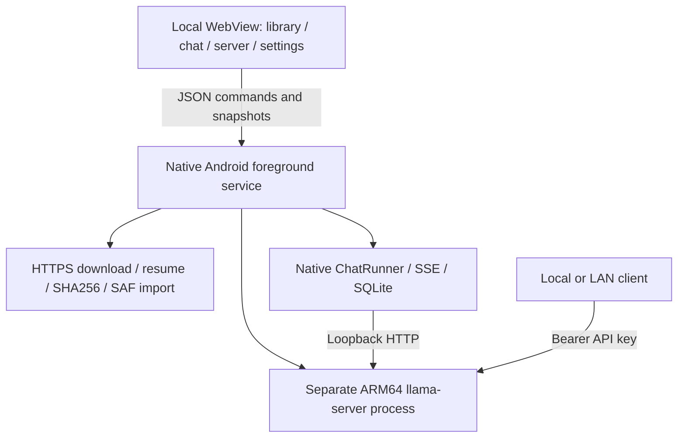

# LMA · Local models on Android

[中文](README.md) · [English](README.en.md) · [Releases](https://github.com/wikigsroom/LMA/releases) · [Documentation](docs/README.md) · [Changelog](CHANGELOG.md)

**Choose a local model, discover more on Hugging Face, download a compatible GGUF, chat locally, and serve an OpenAI-compatible API from an Android phone.**

LMA (Local Model App) brings a desktop model-workbench workflow into one APK: model selection, downloads, local chat, and an API server. It requires no ROOT, Termux, or separate server. This is an independent community project, unaffiliated with LM Studio. The application UI is currently primarily Chinese; the documentation is bilingual.

| Version | Platform | Backend | License | Stage |
| --- | --- | --- | --- | --- |
| **0.2.0 / versionCode 4** | Android 9+, ARM64 | llama.cpp, CPU | MIT for LMA code | Prerelease; physical-device acceptance pending |

> **Validation status:** A signed APK is available, with 226 desktop assertions and separate APK, native-library, and Android Lint checks. No physical Android device was available. Installation, actual model inference, tokens/s, and screen-off endurance have **not** been tested. Images and recordings use the shipped UI with explicitly simulated native state; they are **not phone inference recordings**. See [validation](docs/VALIDATION.en.md).

<p>
  
  
  
</p>

## Download and start

Download `LMA-0.2.0-arm64-v8a.apk` from the [v0.2.0 Release](https://github.com/wikigsroom/LMA/releases/tag/v0.2.0). The APK is about 10.9 MB and contains no model weights. Installation and runtime storage require additional space.

1. Install the APK, allow the installation source if Android asks, and open LMA.
2. In **模型库 / Model library**, use the preserved recommendations, or search HF through **全部 / All**, select a repository and a GGUF quantization, and tap **下载 / Download**. The original recommendation order remains `m08 → m06 → m01`.
3. Wait for GGUF, length, and publisher SHA256 verification, then tap **加载 / Load**. By default, the first completed download loads automatically if no model was previously selected.
4. Open **对话 / Chat** to send a message, or **服务 / Server** to copy the endpoint, key, and connection example.
5. For background serving, allow foreground-service notifications and open Android battery settings from the Server page. Vendor settings may also require background network, autostart, and unrestricted background activity.
6. After leaving the app or turning off the screen, a native foreground service owns downloads and inference. **停止服务 / Stop service** in its notification stops the model and current download. Work can be resumed later in LMA.

The first download needs networking; inference with downloaded weights runs locally. No LMA login or cloud inference API is required.

### Verify the package

```text
File: LMA-0.2.0-arm64-v8a.apk
SHA256: d8c16c7414ce5cc28c55fb3c2375c042e6735d53f73ebb5d4efa8388d7b130c1
Package: com.lma.app / versionCode 4
Signing certificate SHA256: 90444a717a55549e2094364d8d7d005cf8b7f4df24562da62cc1884a2f341c17
```

On Windows, run `Get-FileHash .\LMA-0.2.0-arm64-v8a.apk -Algorithm SHA256`. Release assets include hashes, the dedicated source ZIP, validation JSON, and the walkthrough video. Updates must use the same signing identity; personal builds have their own key.

## Multimodal expansion research

The next version, **v0.3.0**, must deliver the **complete local multimodal foundation plus runtime/recipe support for 01–14/16/17 together**: bundles/components/recipes, internal engines, model settings, jobs/artifacts and APIs. Models remain equal peers with task/dependency tags; preserve Recommended and use model selection → form → on-phone queue → artifacts. See [complete update requirements](docs/MULTIMODAL_RELEASE_PLAN.en.md) and the [delivery summary](docs/releases/v0.3.0-plan.md) for shared release gates, work packages and risks. No split releases or automatic deferral; no ComfyUI canvas/user-node/plugin/import ecosystem. v0.3.0 is unpublished. See the [development implementation record](docs/DEVELOPMENT.en.md) for code, 457 foundation checks, 216 UI checks and the full remaining work; this does not substitute for complete delivery.

Tokenization, encoders, sampling, codecs and export execute on the same Android phone without ROOT or off-device inference/fallbacks. HF provides discovery and explicit asset downloads. Supported architecture variants may reuse recipes; new architectures need native-engine/APK updates. Validate Z20 and newer devices separately. See [research/licenses](docs/MULTIMODAL.en.md), [foundation/migration](docs/FOUNDATION.en.md) and [tasks/background recovery](docs/WORKFLOWS.en.md). Full MOSS/SoulX retain research gates; listing/downloading is not execution support. **The public release remains v0.2.0. 0.3.0-dev adds part of the foundation and a compiled diffusion worker; complete model adaptation, unified APIs and physical-device acceptance remain unfinished.**

**App updates deliver the foundation; APKs contain no model weights and installation/upgrades trigger no model downloads.** Users choose a model/quantization/recipe and explicitly download that bundle with its disclosed dependencies. Install only what is needed and manage/settings/update/delete independently in Local. Recommendations are catalogue candidates; capability and installed/runnable status are separate. Preserve existing weights/settings without silent replacement. See [asset boundaries and A11 acceptance](docs/MULTIMODAL_RELEASE_PLAN.en.md).

## Features and workflow

| Page | Actions | State and lifecycle |
| --- | --- | --- |
| Model library | Preserved recommendations, HF discovery / quantization selection, dedicated Local manager, lightweight / advanced groups, evidence, downloads/resume, delete and imports | Download completion and model readiness are separate; chat and API share one loaded model |
| Chat | Streaming, stop generation, reasoning disclosure, code copy, SQLite history, new / previous sessions | A native thread reads SSE and persists received text roughly every 160ms; reopening restores it |
| Server | Start/stop, LAN switch, endpoint / key / curl copy, battery settings, log export | Localhost by default; LAN access is user-enabled and requires an API key |
| Settings | Application source/token preferences, auto-load, boot restore, service port and theme; link to Local model settings | Model parameters are configured independently on each downloaded model |

One model and one inference slot are used. Switching models reloads the engine; stop a running model before deleting its file. **Stop generation** cancels one reply; the notification's **Stop service** stops background work.

## Recommended, All, and Local

| Entry | Behavior |
| --- | --- |
| 推荐 / Recommended | Preserves `m08`, `m06`, `m01`, in that order, with their original labels and evidence; HF downloads never replace recommendations |
| 全部 / All and search | Queries the live HF model API by keyword, `owner/model`, or repository URL; sort by downloads, likes, or update date and navigate pages |
| Format | GGUF by default; **HF 全部格式 / All HF formats** discovers repositories beyond GGUF and links to their sources |
| File picker | Shows GGUF path, quantization, bytes and hash; pins the commit before paginating/selecting a file |
| 本地 / Local | Manages all downloaded built-in, HF and imported models, plus active/interrupted downloads; local search, individual model settings, load, pause, resume and delete |
| Lightweight / Advanced | Preserves the original curated groups |

All-format **discovery** does not imply every HF format can run on Android. This version serves text chat from compatible **single-file GGUF** weights. It does not directly run Safetensors, PyTorch, ONNX, MLX, split GGUFs, standalone vision projectors, or speech tasks, and does not automatically convert weights. GGUF architecture, quantization, template and RAM compatibility still require loading. This is not yet full feature parity with LM Studio.

Public models need no HF account. Automatic source selection tries HF, then HF Mirror; fixed sources are available. For gated/private repositories, save an optional HF token in Settings and accept the license on HF first. The token stays in private app preferences, is not returned to the UI/log export, and is sent only to the official HF HTTPS host. Authenticated requests use the official source; mirrors and CDN redirects receive no token. See the [HF and local-model guide](docs/HF_MODELS.en.md).

<p>
  
  
  
</p>

## Per-model settings

Open **Model library → 本地 / Local → a downloaded model’s settings icon**. Context, output limit, CPU threads, temperature, reasoning and system prompt are saved separately by model ID. Numeric controls support presets and custom text. Values above a bound reset automatically: context uses the GGUF architecture’s declared context length, output is at most configured context minus one, threads use available processors, and temperature uses the application range 0–2. Unknown context metadata is explicitly labeled with a temporary application fallback of 8192. Actual prompts/history can reduce available output further.

Switching/restoring models reads their own profiles. Legacy global inference preferences migrate to existing models. Editing the running model’s context, threads or reasoning reloads it; generation preferences apply to the next in-app chat. See the bilingual [per-model guide](docs/MODEL_SETTINGS.en.md) for limits, examples, persistence and external-API behavior.

<p></p>

[Model-settings GIF](docs/media/lma-model-settings.gif) · [中文说明](docs/MODEL_SETTINGS.md).

## Separate uncensored labels

The original 14 curated variants retain their checked publisher declarations, pinned commits, exact sizes and SHA256. They carry **无审查 / Uncensored** tags. Online HF names/tags that suggest uncensored or abliterated weights carry **无审查 · 元数据 / Uncensored · metadata**; this is an unverified hint. Ordinary models have no such label. Manual imports never gain verified status from their filenames.

The evidence gate applies to a checked label, not eligibility for general HF discovery. LMA adds no keyword blocklist, cloud moderation, or response-content filter to chat; system prompts remain editable. Publisher claims do not guarantee zero refusals, and independent refusal rates and phone inference have not been measured. See [tag evidence](docs/UNCENSORED_MODELS.en.md).

### Built-in candidates

All selected weights are `Q4_K_M` GGUF. These approximate decimal download sizes are **not RAM requirements**. Exact bytes, hashes, filenames, and revisions are in [models.json](app/src/main/assets/models.json).

| ID | Model | Download | Role |
| --- | --- | ---: | --- |
| `m01` | Dolphin 3 · Qwen 0.5B Uncensored | 398 MB | Smallest initial candidate |
| `m04` | Dolphin 3 · Llama 1B Uncensored | 808 MB | Lightweight, English |
| `m05` | Gemma 3 · 1B Abliterated | 806 MB | Lightweight, multilingual |
| `m06` | LFM 2.5 · 1.2B Uncensored | 731 MB | Recommended candidate |
| `m08` | Qwen 3 · 1.7B Abliterated | 1.11 GB | Recommended Chinese candidate |
| `m10` | LFM 2.5 · 2.6B Uncensored | 1.67 GB | Advanced, reasoning model |
| `m11` | Dolphin 3 · Qwen 3B Uncensored | 1.93 GB | Advanced, Chinese |
| `m12` | Dolphin 3 · Llama 3B Uncensored | 2.02 GB | Advanced, English |
| `m13` | Llama 3.2 · 3B Uncensored | 2.24 GB | Advanced, English |
| `m14` | Qwen 3 · 4B Instruct 2507 Abliterated | 2.50 GB | Advanced, Chinese |
| `m16` | Gemma 3 · 4B Abliterated v2 | 2.49 GB | Advanced, multilingual |
| `m03` | Qwen 3.5 · 0.8B Abliterated | 528 MB | Experimental architecture candidate |
| `m09` | Qwen 3.5 · 2B Abliterated | 1.27 GB | Experimental architecture candidate |
| `m15` | Qwen 3.5 · 4B Uncensored · HauhauCS Aggressive | 2.71 GB | Experimental architecture candidate |

### nubia Z20 and older phones

The APK targets **ARM64 Android 9+**, with an ARMv8.0 CPU baseline and optimized kernels selected at runtime. A starting configuration for Snapdragon 855+-class devices is **4 threads / 2048-token context / 512 output tokens / reasoning off / temperature 0.7**. Try `m01` first, then compare `m06` and `m08`. Use 3B–4B only after observing actual free memory, temperature, and sustained speed.

This configuration awaits device testing. **No Z20 throughput, peak-memory, thermal, or battery measurements exist.** RAM includes KV cache, working buffers, and Android overhead. If loading fails, close large apps, reduce context to 1024 / 512, and use a smaller model. Downloadability does not establish successful phone inference.

## Architecture and background serving



The UI handles interaction; native code owns transfers, SSE consumption, and the engine lifecycle. A `specialUse` foreground service shows a notification and stop action and holds CPU / Wi-Fi locks. An API-serving model keeps the service active while idle; no-work state releases resources.

`ProcessBuilder` starts the packaged native executable from the APK's native-library directory without ROOT or shell. Readiness requires `/health` and authenticated `/v1/models` with the expected alias; unexpected exits are retried at most three times. Boot restore is off by default and only attempts a previously enabled, still-present model when enabled.

**Background streaming means SSE can continue during an active generation request.** EOS, output limits, and cancellation still end a request. An ordinary Android application cannot guarantee permanent survival through force-stop, low memory, heat, or vendor power policies. First-run downloads, notification consent, and system battery settings are not silently bypassed.

The [architecture](docs/ARCHITECTURE.en.md) documents download states, process recovery, conversation persistence, and network boundaries.

## API integration

Default Base URL: `http://127.0.0.1:8080/v1`. For another device, enable LAN access and use the phone's displayed address. Each installation generates a random API key. The in-app copy example fills the endpoint, model ID, and actual key.

```bash
curl http://PHONE_IP:8080/v1/models \
  -H "Authorization: Bearer YOUR_LMA_API_KEY"

curl -N http://PHONE_IP:8080/v1/chat/completions \
  -H "Authorization: Bearer YOUR_LMA_API_KEY" \
  -H "Content-Type: application/json" \
  -d '{"model":"m08","messages":[{"role":"user","content":"Hello"}],"max_tokens":256,"stream":true}'
```

Replace `m08` with the ID returned by `/v1/models`. The documented surface is models, chat completions, and SSE, not every OpenAI endpoint. LAN uses HTTP; TLS and public tunneling are not built in. External clients send their own system messages and parameters; in-app settings primarily control in-app chat. See the [API guide](docs/API.en.md) for Python / PowerShell, stream parsing, and errors.

## Downloads and local data

Automatic selection tries Hugging Face and falls back to HF Mirror on connection or source-status failure; fixed sources are available. Only HTTPS and HTTPS redirects are accepted. Other custom hosts are not rewritten to the mirror.

Transfers run serially, validating `Content-Range`, length, GGUF magic, and known publisher SHA256. Hash failures are isolated as `.rejected`. A 12 GiB file limit and 64 MiB free-space reserve apply. Android's system file picker supports streamed GGUF import, without reading an entire model into Java memory.

Weights, progress, and SQLite history live in private app storage; uninstalling deletes them. Offline UI assets use no remote scripts or fonts. Log export redacts the current API key and excludes the chat database. Downloads contact the selected host; LAN clients can request inference only after LAN is enabled and they supply the key.

## Screenshots, recording, and GIFs

<p></p>

The media uses **the HTML / CSS / JavaScript shipped in the APK**, driven by an explicit demonstration bridge. A UI DEMO banner is always visible. Downloads are simulated, chat is scripted, and IP / API key values are placeholders. No Android runtime or model executes.

[Full MP4 recording](docs/media/lma-walkthrough.mp4) · [HF / Local GIF](docs/media/lma-hf-local.gif) · [API / theme GIF](docs/media/lma-api-theme.gif) · [Twelve screenshots and reproduction](docs/MEDIA.md) · [Media hashes and provenance](docs/media/manifest.json).

## Build from source

The verified path is **native Windows JDK 21, Python 3, Android SDK Platform 35 and Build Tools 35.0.1**. It uses no Gradle dependency downloads, NDK, Docker, WSL, or emulator. Android Studio / Gradle files are included, but that path has not been validated.

```powershell
git clone git@github.com:wikigsroom/LMA.git
cd LMA
python tools/bootstrap_runtime.py
python tools/build.py
```

The bootstrap downloads the pinned ServLlama 1.2.2 llama.cpp v0.4.1 ARM64 CPU bundle, checks SHA256, and extracts 14 libraries. Re-fetchable binaries are excluded from Git; the dedicated Release source ZIP contains them and verification records. The builder runs catalogue admission checks, AAPT2, javac, D8, zipalign, and apksigner and writes to `dist/`. Set `--sdk` or `ANDROID_SDK_ROOT` for a different SDK.

**Preserve local `signing/` for in-place upgrades.** The first build creates a local signing identity; private keys and passwords are never published. See [build instructions](docs/BUILD.en.md).

```powershell
python tools/test_protocol.py
python tools/test_backend.py
python tools/test_hub.py --live
python tools/test_sqlite.py
python tools/test_android_lint.py
node tests/ui-smoke.cjs
python tools/verify_package.py
python tools/build_acceptance.py
python tools/package_delivery.py
python tools/prepare_release.py
python tools/check_repository.py
```

UI work requires Node.js, Playwright, and Edge / Chromium. Set `LMA_PLAYWRIGHT` and `LMA_BROWSER` if necessary. Media additionally needs FFmpeg / FFprobe. Standalone Lint needs SDK Command-line Tools. All test pages and browser processes close in `finally`.

Current evidence is **85 backend + 45 HF logic + 25 protocol + 5 SQLite + 66 UI = 226 desktop assertions**, plus **5 live public HF metadata checks** and **Lint: 0 errors, 7 warnings**. Android framework adapters, host SQLite, and a test UI bridge are explicitly identified. Separate APK, signature, native-library, alignment, and author-evidence checks do not replace Android execution. **Physical-device checks: 0.** See [validation](docs/VALIDATION.en.md) and [`verification/`](verification/).

## Documentation and source layout

| Path | Contents |
| --- | --- |
| [Documentation index](docs/README.md) | All Chinese / English guides |
| [User guide](docs/USER_GUIDE.en.md) / [中文](docs/USER_GUIDE.md) | Installation, pages, background use, troubleshooting |
| [Architecture](docs/ARCHITECTURE.en.md) / [中文](docs/ARCHITECTURE.md) | Services, engine, downloads, chat, storage, boundaries |
| [Multimodal feasibility](docs/MULTIMODAL.en.md) / [中文](docs/MULTIMODAL.md) | Fully local image, speech, music and video; device ratings, Android evidence and licenses |
| [Foundation assessment](docs/FOUNDATION.en.md) / [中文](docs/FOUNDATION.md) | Shared multi-engine architecture, extension costs, migration and completion criteria |
| [Shared execution slot](docs/SCHEDULING.en.md) / [中文](docs/SCHEDULING.md) | Automatic switching among resident text, chat, API and local generation jobs |
| [Foundation and asset audit](docs/ASSET_CONTROL_AUDIT.en.md) / [中文](docs/ASSET_CONTROL_AUDIT.md) | Foundation-only updates, user-controlled model assets and task labels |
| [Requirements and releases](docs/MULTIMODAL_RELEASE_PLAN.en.md) / [中文](docs/MULTIMODAL_RELEASE_PLAN.md) | Complete v0.3.0 scope, 16 selected groups, flat tags and single-release acceptance |
| [Task execution](docs/WORKFLOWS.en.md) / [中文](docs/WORKFLOWS.md) | Forms, shared queue, internal stages, background ownership and recovery |
| [API](docs/API.en.md) / [中文](docs/API.md) | Client integration and SSE |
| [Build](docs/BUILD.en.md) / [中文](docs/BUILD.md) | Toolchain and verification |
| [HF and local models](docs/HF_MODELS.en.md) / [中文](docs/HF_MODELS.md) | Search, pagination, quantizations, Local management, compatibility and tokens |
| [Uncensored models](docs/UNCENSORED_MODELS.en.md) / [中文](docs/UNCENSORED_MODELS.md) | Complete model / author evidence |
| [Device acceptance](docs/DEVICE_ACCEPTANCE.en.md) / [中文](docs/DEVICE_ACCEPTANCE.md) | Compiled tools awaiting a real phone |
| [`app/src/main/java/com/lma/app/`](app/src/main/java/com/lma/app/) | Production Android code |
| [`app/src/main/assets/`](app/src/main/assets/) | Offline interface, catalogue, licenses |
| [`catalogue/`](catalogue/) / [`third_party/`](third_party/) | Model evidence, runtime locks, license notices |
| [`tools/`](tools/) / [`tests/`](tests/) / [`verification/`](verification/) | Build, audit, test tooling and results |
| [Changelog](CHANGELOG.md) / [release notes](docs/releases/) | Bilingual version history |

## Future updates and licensing

Each subsequent authorized LMA update must synchronize code, both READMEs / guides, affected screenshots and GIFs, `CHANGELOG.md`, and version notes before committing and pushing to `git@github.com:wikigsroom/LMA.git`. This standing instruction is recorded in [AGENTS.md](AGENTS.md), [CONTRIBUTING.md](CONTRIBUTING.md), and [the release procedure](docs/RELEASING.md). Do not force-push, rewrite published tags, or replace released assets with different bytes under the same filename.

`v0.1.2` was the first public repository release; `v0.2.0` adds broad HF discovery and Local management. Earlier 0.1.0 / 0.1.1 builds were local iterations. This release remains a prerelease while Android acceptance is outstanding.

For post-release documentation/tool updates, `python tools/check_repository.py --published` compares the immutable source archive with its tag while checking current public files and guides. Draft releases are resolved through the authenticated list to handle GitHub's draft-by-tag 404 behavior. Maintenance notes go in the Unreleased changelog; published APKs, tags, and assets are not rewritten.

LMA code uses [MIT](LICENSE). The CPU engine is supplied by [ServLlama 1.2.2](https://github.com/ArkaneFans/servllama/releases/tag/1.2.2), from a [pinned llama.cpp revision](https://github.com/ggml-org/llama.cpp/tree/b29c606e28a01b1bc8c1351026a0fa6e616bf6c4). Licenses and dependency notices are preserved in [third_party/](third_party/README.md). LMA's build did not run containers, WSL, or virtualized environments. Models and base models retain their publishers' licenses, and no weights are bundled in the APK or Git.

Development UI fixtures (visibly marked; no physical device or model output): [video](docs/media/development/foundation-ui.mp4) · [GIF](docs/media/development/foundation-ui.gif).

 

The development gateway can start independently, submit durable jobs and read events/artifacts without choosing/downloading models. See [development API](docs/API.en.md#030-dev2-independent-gateway-jobs-and-artifacts) and [progress](docs/DEVELOPMENT.en.md).

Internal progress (**0.3.0-dev.3 / code 7**, unpublished): signed speech worker paths for Kokoro / Piper / Matcha, three explicitly user-selected audio candidates and a speech form. 62 speech contract / host-process checks, 89 UI checks and package checks for 18 native files pass. There is no Android speech or endurance evidence; complete v0.3.0 remains unfinished. See [speech implementation and license boundaries](docs/TTS_ENGINE.en.md); [screenshots/video/GIF](docs/DEVELOPMENT.en.md) are visibly labeled UI fixtures.


Earlier checkpoint (**0.3.0-dev.5 / code 9**, unpublished): explicit HF component recipes for SD 1.5 / SDXL checkpoints, LoRAs and Kokoro / Piper / Matcha, with separate repositories, pinned revisions, declaration and download confirmation. Ordinary Git files verify blob identity and retain measured SHA256. 217 foundation, 74 HF and 112 UI checks pass. App updates deliver the foundation; users select/download/manage models. Complete adaptations, independent version updates and phone acceptance remain unfinished. See [recipes](docs/HF_RECIPES.en.md), [asset-control audit](docs/ASSET_CONTROL_AUDIT.en.md) and [checkpoint notes](docs/releases/v0.3.0-dev.5.md).

Earlier internal checkpoint (**0.3.0-dev.6 / code 10**, unpublished) adds a compiled MOSS Nano speech worker, arbitrary-text tokenization, audio codec output, explicit user-selected external weights and disposable private hardlinks. Eight HF component templates and 190 new host checks are available; no actual MOSS speech or Android acceptance has been recorded. Models remain independent user downloads, with no weights/tokenizers/voices in the APK. See [Nano implementation](docs/MOSS_NANO_ENGINE.en.md), [checkpoint notes](docs/releases/v0.3.0-dev.6.md) and [labeled screenshot/recording/GIF](docs/DEVELOPMENT.en.md). Full v0.3.0 remains unfinished.

Earlier internal checkpoint (**0.3.0-dev.7 / code 11**, unpublished) adds bundle [independent updates and rollback](docs/MODEL_UPDATES.en.md). Users select a version, review assets/settings and explicitly download; successful verification still needs separate activation consent. Old files/profiles and fixed API/job IDs remain intact; queued base/LoRA references prevent deletion. 302 foundation assertions include 62 version checks, with 132 UI checks and zero Lint errors. [Notes](docs/releases/v0.3.0-dev.7.md) and [labeled screenshots/recording/GIF](docs/DEVELOPMENT.en.md) are synchronized. Complete migration, selected-target integration and physical-device gates remain open; no new Release.

 

Earlier internal checkpoint (**0.3.0-dev.8 / code 12**, unpublished) adds [shared text-bundle execution](docs/TEXT_ENGINE.en.md): a ninth HF recipe, inspected GGUF context/dependent output limits, shared jobs and typed text artifacts, separate reasoning, copy and export. App updates still deliver only the foundation; users choose/download models. Recommendations and existing chat/API remain. 310 foundation, 66 added text-host and 147 UI checks pass, with zero Lint errors; these do not establish phone inference. Legacy migration, every selected model and physical-device gates remain in the same complete v0.3.0. No new Release. See [notes](docs/releases/v0.3.0-dev.8.md).

 

Earlier internal checkpoint (**0.3.0-dev.9 / code 13**, unpublished) adds [existing model migration](docs/MODEL_MIGRATION.en.md): verified GGUF reuse preserves IDs, sources, Recommended, content labels and per-model defaults, with shared task/version controls in the original details. Interrupted downloads stay paused until explicit resume. 69 added migration, 310 foundation and 156 UI checks pass; full model/device acceptance and automatic scheduling remain in the same v0.3.0. No new Release. See [notes](docs/releases/v0.3.0-dev.9.md) and [labeled media](docs/DEVELOPMENT.en.md).

 

Earlier internal checkpoint (**0.3.0-dev.10 / code 14**, unpublished) integrates persistent loading, chat, synchronous APIs and generation through a [shared execution slot](docs/SCHEDULING.en.md). Jobs wait for active replies, reap old children before switching and restore a resident the user still wants. Waiting is cancellable, with generation-specific stop ownership. APK updates remain foundation-only; users select/download/manage models. 43 added production-queue/host-child/HTTP checks and 167 UI checks accompany scoped regression/package evidence in [progress](docs/DEVELOPMENT.en.md); [screenshots/recording/GIF](docs/MEDIA.md) remain labeled fixtures. All selected models and physical-device gates remain in the same complete v0.3.0, without a new Release.

 

Earlier internal checkpoint (**0.3.0-dev.11 / code 15**, unpublished) adds [local input media](docs/LOCAL_INPUTS.en.md): Android document selection, service-owned private imports with cancellation, source filters and authenticated resumable chunk uploads. Jobs freeze IDs/hashes/metadata, protect queued/running references and rehash before worker startup. Existing production recipes remain prompt-only; the media form is an explicit contract fixture, without claimed voice cloning/image editing. 64 input/HTTP, 49 production-scheduler and 182 UI assertions pass, accompanied by 30 screenshots plus recording/GIF. All remaining pipelines and physical-Android gates remain in the same complete v0.3.0; no new Release. See [progress](docs/DEVELOPMENT.en.md) and [notes](docs/releases/v0.3.0-dev.11.md).

 

Earlier internal checkpoint (**0.3.0-dev.12 / code 16**, unpublished) adds [diffusion sampling and components](docs/DIFFUSION_ENGINE.en.md): split SD1.5/SDXL, SD-Turbo and both architectures' LCM checkpoints/LCM-LoRA, with frozen task samplers/CFG/step guards and preserved per-model settings. Java and shared C++ policies validate the plan; the native worker checks loaded tensor architecture. 83 added diffusion-host, 381 foundation and 194 UI checks pass alongside signed APK validation. 32 labeled fixture screenshots and recording/GIF are synchronized. The App updates the foundation; sixteen data templates install/download no models. Every selected target and physical-Android offline/quality/background/upgrade gate remains in the same complete v0.3.0; no new Release. See [notes](docs/releases/v0.3.0-dev.12.md).


Earlier internal checkpoint (**0.3.0-dev.14 / code 18**, unpublished). dev.14 adds the [Sana mobile / MNN pipeline](docs/MNN_SANA_ENGINE.en.md): a real ARM64 CPU worker, 13 user-selected components, whitelisted Qwen3 metadata, encoder release before diffusion, per-model CFG/token/thread controls and immutable job plans. Its 74 host/C++ checks perform no model inference. All 21 templates remain metadata with separately confirmed downloads. Foundation 445 and UI 208 checks pass; 37 screenshots and recording/GIF are explicit UI FIXTUREs. No Android image/endurance evidence exists. Every frozen target and release gate remains in the same complete v0.3.0, without a new Release. See [bilingual notes](docs/releases/v0.3.0-dev.14.md).

 

Current internal checkpoint (**0.3.0-dev.15 / code 19**, unpublished): [Qwen3-TTS 0.6B Base](docs/QWEN_TTS_ENGINE.en.md) adds a real ARM64 CPU worker, a complete two-GGUF local speech pipeline, optional reference WAV, independent sampling settings and actual timing/RTF recording. Shared `provides` discloses embedded tokenizer/predictor/speaker dependencies without duplicate downloads. Its 81 Java/C++ host checks exercise protocols and structural WAV only; pinned optional assets have header review, without model inference. All 22 templates remain metadata and never implicitly download models. Screenshots 38–39 and development recording/GIF remain UI FIXTUREs. App updates deliver the foundation; every full v0.3.0 target, real-output/quality/background gate remains, with no new Release. See [bilingual notes](docs/releases/v0.3.0-dev.15.md).
