# LMA · Android 本地模型工作台

<p></p>

**Logo 已定稿：21 号「钴蓝软胶」。** 采用鲸鱼套装小安卓结构，钴蓝鲸鱼服、青柠脸部与双天线、奶油色帽沿和腹部；17 号是结构蓝本。后续品牌形象使用该稿。[定稿记录与素材说明](docs/BRANDING.md) · [原始 PNG](output/imagegen/lma-logo-selection-20261102-batch3-whale17/21-cobalt-vinyl.png)。以下三批记录保留为选型历史。

**20261102 Logo 第三批：** [以 17 号鲸帽小安卓为结构蓝本的 21–30 十套新风格与配色](docs/LOGO_SELECTION_20261102_BATCH3.md) · [离线选型页](output/imagegen/lma-logo-selection-20261102-batch3-whale17/index.html)。保留鲸鱼帽、安卓双天线、帽内脸与右侧翘尾，提供原图和小尺寸对比。

**20261102 第二批 Logo 选型：** [11–20 安卓＋AI／安卓＋鲸鱼](docs/LOGO_SELECTION_20261102_BATCH2.md) · [离线选型页](output/imagegen/lma-logo-selection-20261102-batch2/index.html)。按新方向独立生成十套，保留第一批归档；含原图、小尺寸和配套形象。

**20261102 Logo 选型：** [10 套风格与编号总览](docs/LOGO_SELECTION_20261102.md) · [离线交互选型页](output/imagegen/lma-logo-selection-20261102/index.html)。使用用户指定的 sub2-image-gen／gpt-image-2.5 实际生成；支持多选、原图与小尺寸对比，尚未替换 App 图标。

**20261102 更新方向方案（规划，非当前 APK 功能）：** [完整方案](docs/UPDATE_DIRECTION_20261102.md) · [English](docs/UPDATE_DIRECTION_20261102.en.md) · [14 个语言模型的能力标签清单](docs/proposals/update-direction-20261102.json)。统一对话输入、四类媒体任务卡、可选本地工具调度、素材引用／任务链与同机合成；默认采用暗色调并保留用户已选主题；新增图片／视频／音频理解、原生输出、工具能力、组件与验证状态的独立选型标签。D01–D12 同一次功能交付，A01–A33 逐项验收；本文档更新不改变现有 APK，也不把候选标签当作已支持。

[English](README.en.md) · [下载 v0.3.13](https://github.com/wikigsroom/LMA/releases/tag/v0.3.13) · [使用手册](docs/USER_GUIDE.md) · [文档目录](docs/README.md) · [更新记录](CHANGELOG.md)

**v0.3.13 / code63 · 默认接口端口改为 52187。** 新安装及旧版使用默认 8080 的安装，升级后使用 `http://127.0.0.1:52187/v1`；开启内网访问后，电脑连接 `http://手机IP:52187/v1`。已有其他有效自定义端口保留；迁移仅执行一次，之后用户主动编辑的端口仍会保留。请同步修改客户端的接口地址。[端口迁移与验证](docs/API_PORT.md) · [本版说明](docs/releases/v0.3.13.md) · [本版程序证据](verification/releases/v0.3.13/status.json)。

本版：**62 套程序检查／15,122 项断言、796 项生产界面检查、24 项真机程序检查和 8 项空闲性能检查**。[真机录屏](docs/media/device/v0.3.13/physical-walkthrough.mp4) · [GIF](docs/media/device/v0.3.13/physical-walkthrough.gif)。

**本版内网实测：63 项检查／128 次 HTTP 请求通过**，核对 8080→52187 升级、配置保留及新 PNG／两段 WAV；锁屏 111.600 秒。[本版证据](verification/supplemental/v0.3.13/lan-http.json)。

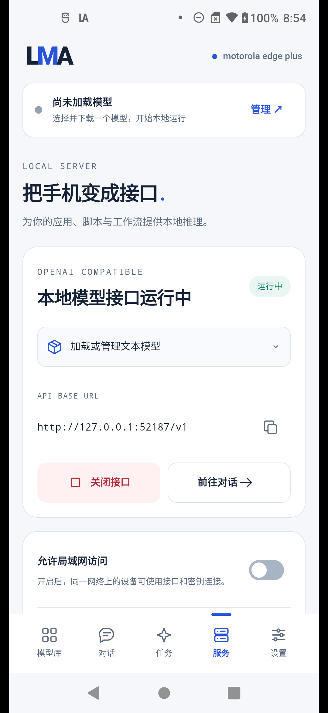

下面保留 v0.3.12 的 SDK、视频和内网测评及其原始 APK 身份。本次端口更新另做升级和内网 HTTP 验证，不将旧版长时间视频／3D 测评记为新版实跑。

**历史 v0.3.12/code62 · 正式本地多模态 API。** 自动公布已下载完整、配置有效的生文／生图／视频／语音／音乐／3D 模型；新增标准图片 PNG、语音 WAV 兼容层，复用逐模型参数、持久任务／上传／产物和可选择启用的原生 Sub2API 源码扩展。[用法与 SDK 案例](docs/LOCAL_API_V0312.md) · [完整实机联调与测评](docs/DEVICE_BENCHMARK_V0312.md) · [版本说明](docs/releases/v0.3.12.md)。

**生成任务不再设置固定耗时上限。** 用户主动停止、真实资源故障和输出／模型约束分别处理；120 秒同步 HTTP 等待不会终止后台生成。实机视频验收要求真实时长大于 5 秒。升级保留模型、设置和原签名；测评区分文件输出、生成质量、接口检查与后台耐久。

本版最终APK实机：**24项程序检查＋8项空闲性能＋28项真实SDK联调**通过；Wan CPU实际输出 **6.125秒／49帧**视频，耗时732秒，画质尚未通过。真实页面[GIF](docs/media/device/v0.3.12/physical-walkthrough.gif)／[录屏](docs/media/device/v0.3.12/physical-walkthrough.mp4)，原始[模型视频](docs/media/benchmarks/v0.3.12/wan-cpu-6s.mp4)。3D失败与候选包结果在测评中逐项披露。

**2026-11-02 内网 HTTP 补充验证：57项通过、128次真实请求。** PC物理网卡直接连接手机Wi-Fi，完成新图片、两段语音、任务/取消/上传/SSE与断点下载；已有6.125秒视频单独复测传输。模型目录中位延迟39.44ms，锁屏111.959秒；无ADB转发或代理。[完整报告与本地HTTP用例](docs/LAN_HTTP_TEST.md) · [57项证据](verification/supplemental/v0.3.12/lan-http.json)。原Release附件身份保留。

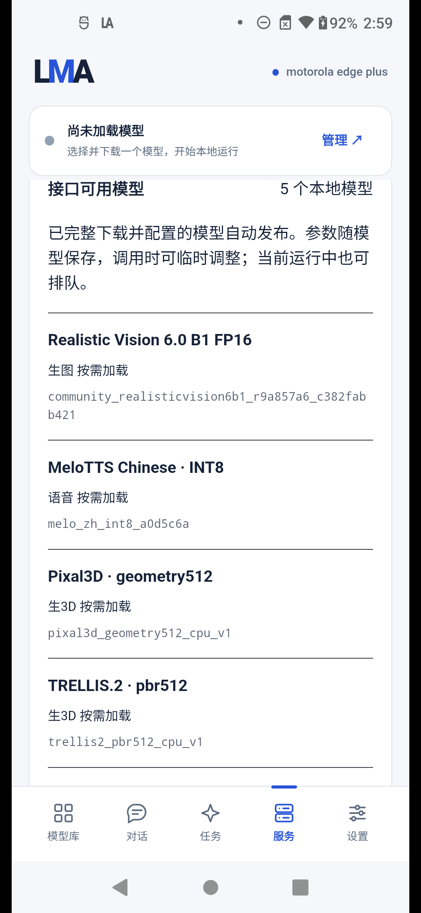


**历史 v0.3.11 / code61：已有 Wan 权重可直接选择 CPU，并已在当前手机产出视频。** 修复原生工作器仍拒绝 Android 软链接输入的问题，为固定名称的模型组件 / 四视图增加来源身份校验，并加入 3D 分阶段进度。Wan CPU 小尺寸计算 / 编码已贯通，一步画面近空白，未达可用画质；TRELLIS.2 / Pixal3D 的阶段、限时取消与未完成输出单独披露，不冒充全部模型成功。[操作、API 与真实结果](docs/ON_DEVICE_MODEL_REPAIR.md) · [真机模型记录](verification/releases/v0.3.11/physical-models.json) · [完整矩阵](docs/IMPLEMENTATION_V0311.md)。全部 **62 配方 / 82 包 / 18 扩展引擎加文本、14 项推荐**保留。

LMA（Local Model App）让用户在 Android 手机上选择、下载、管理和运行本地模型，提供聊天、生图、生视频、生音频、生 3D、任务队列、结果库与本机 API。它是独立社区项目，与 LM Studio 无隶属关系；界面主要为中文，文档提供中英双语。

**App 更新提供基座，模型由用户自行选择。** APK 不附模型权重、tokenizer、音色或语言表；安装、升级和浏览目录不触发模型下载。所有分词、推理、编码、解码、光栅与合成都在同一手机完成，无需 ROOT、Termux、Docker、WSL、虚拟机、其他计算设备或云推理。

**ARM64 / Android 9+，保留原签名升级。** 原有 F-01–F-12、生文、01–14／16／17、九个 MOSS 子目标、SD1.5 / SDXL LoRA 和 44 个社区配方完整保留。推荐保留生文前缀 `m08 → m06 → m01`，另加 11 个多模态条目；全部 / HF 搜索允许发现其他模型，本地管理已选资产。所有模型平级，以功能、基座、格式、内容和安装状态独立标签区分；NSFW / Uncensored 单独标注，不限制 HF 发现范围。

新增 3D / 视觉模型支持用户选择匹配的本地导出再导入，**尚未核实完整公开导出包下载地址**，不提供占位链接。HF 可发现不等于任意格式均可执行；原始 PyTorch 不能直接作为 Android 运行包。

常规程序门禁使用有界夹具且不下载模型。本版另外完成已安装资产的真实手机 API 联调与测评，生成不设固定执行时限。[当前程序门禁](verification/releases/v0.3.12/status.json)与[实机 SDK／模型结果](verification/releases/v0.3.12/physical-api.json)分别计数；文件生成不等于画质、全模型、Z20 资源或长期后台验收。

**许可证说明：** 自有代码为 MIT；随包 DISO CPU 表面提取组件适用 CC BY-NC 4.0 非商业条款，其他依赖与模型保留各自许可。见[完整说明](THIRD_PARTY_NOTICES.md)。

保留 v0.3.9 [真实手机页面 GIF](docs/media/device/v0.3.9/physical-walkthrough.gif) / [录屏 MP4](docs/media/device/v0.3.9/physical-walkthrough.mp4)：零模型页面与接口操作，另附锁屏 60 秒健康检查记录；不代表模型输出或长期耐久通过。桌面夹具与真实手机媒体分别标记。

详细用例 **C01–C75**、历史生成 / 失败案例 **H01–H18**、API 示例和历史测试记录均保留。新增[本地适配页面 GIF](docs/media/development/adaptation/adaptation-ui.gif) / [MP4](docs/media/development/adaptation/adaptation-ui.mp4) 与 [UltraTex 演示](docs/media/development/ultratex/ultratex-ui.gif)；均明确标记 UI FIXTURE，展示生产页面操作，不冒充手机或训练模型结果。原发布证据留在 `verification/program/` 与 `verification/history/`。

历史 v0.3.10 的[旧主机检查偏差](verification/releases/v0.3.10/validation-deviation.json)原样保留，不计入本版程序或手机通过。本轮部分手机模型实跑已另获明确授权并单独记录。

<a id="contents"></a>
## 阅读路线

| 想做什么 | 本页入口 | 详细文档 |
| --- | --- | --- |
| 安装、下载和第一次使用 | [安装](#install)、[C01–C05](#use-cases) | [使用手册](docs/USER_GUIDE.md)、[HF 与本地模型](docs/HF_MODELS.md) |
| 选择生图、生视频或生音频方案 | [支持范围](#models)、[C06–C14](#use-cases) | [完整实现矩阵](docs/IMPLEMENTATION_V0311.md)、[社区模型](docs/COMMUNITY_MODELS.md) |
| 管理模型、独立参数、任务和结果 | [C03–C04、C15–C18](#use-cases) | [模型参数](docs/MODEL_SETTINGS.md)、[任务工作台](docs/TASK_WORKBENCH.md) |
| 在程序中调用手机模型 | [API 示例](#api-examples) | [API](docs/API.md)、[输入与上传](docs/LOCAL_INPUTS.md) |
| 看页面、生成案例和失败对照 | [当前页面](#ui-media)、[历史案例 H01–H18](#case-studies) | [媒体说明](docs/MEDIA.md)、[历史完整 README](docs/history/README-dev45.zh.md) |
| 查证测试范围、重建和排错 | [程序检查](#verification)、[构建](#build)、[排错](#troubleshooting) | [程序验证策略](docs/PROGRAM_VALIDATION.md)、[构建指南](docs/BUILD.md) |

<a id="models"></a>
## 模型范围与选择逻辑

所有模型平级。**生文／生图／生视频／生音频／生 3D**、能力、引擎、格式、组件、后端、许可、内容标记和安装状态是独立维度。HF 全格式发现不等于所有格式可运行；架构、配套组件与手机资源都必须满足所选路线。

| 编号 | 模型／方案 | 本机程序路线与边界 |
| --- | --- | --- |
| 既有 | 文本 GGUF | llama.cpp；聊天、SSE、逐模型上下文和输出约束 |
| 01、02、05 | SD 1.5、SDXL、两者 LoRA | sd.cpp；基础模型与 LoRA 独立管理，检查架构配对 |
| 03 | SD-Turbo、LCM checkpoint、LCM-LoRA | 独立采样配置；需要时显式本地准备与关联 |
| 04 | Sana-Sprint 0.6B、独立 Sana Edit | MNN；各自匹配编码器、转换图和采样规则，不混用变体 |
| 06–08 | Z-Image-Turbo、FLUX.2-klein-4B、Qwen-Image-2.1 | sd.cpp 多组件路线；编码器、VAE、分词资源分别管理 |
| 09 | MOSS-TTS-Nano 100M | ORT、分词与音频 codec 均在手机执行 |
| 10 | Kokoro-82M／Piper／Matcha | sherpa-onnx；54 个 Kokoro 音色、固定 Piper Lessac／Matcha LJSpeech 方案 |
| 11 | Qwen3-TTS 0.6B Base | 原生 GGML、参考音频与本机 codec |
| 12 | MOSS 九个冻结子目标 | TTS 1.0／1.5、Local 原版／1.5、TTSD、VoiceGenerator、SoundEffect 原版／v2、Realtime；OpenMOSS、delay 或 RQ 适配 |
| 13、14 | SoulX-Podcast 1.7B、Stable Audio Open Small | 本机语言、声学、codec 与音频采样路线 |
| 16 | Wan 2.1 T2V 1.3B Q4 | sd.cpp CPU／Vulkan、显式组件、本机视频编码 |
| 17 | LTX-Video 2B 0.9.8 distilled | 原始 PixArt T5 F32＋7 步／空间放大／3 步；Google T5 Q5 单尺度保留独立身份 |

当前基座有 **62 个数据型配方模板、18 类扩展引擎及原有文本引擎**；模型包为 **23 套原有＋44 套社区＋11 套语音 / 单图 3D＋4 套 MV 校验导入＝82 套**。模板、模型包、引擎和架构分别计数，不代表全部模型已在手机实测。[机器可读实现矩阵](catalogue/release-0.3.11-implementation.json)

### 语音、单图与多视图生 3D

| 编号 | 选择 | 当前接入与边界 |
| --- | --- | --- |
| S01 | Kokoro PyTorch 系列 | 新增匹配 INT8 ONNX 英文方案；原始 `.pth` 不直接执行，既有 54 音色保留 |
| S02 | MeloTTS Chinese | 中文 ONNX INT8 / FP32、phones / tones 词典与四份 FST |
| S03 | F5-TTS v1 | 原版 safetensors＋Vocos，本机 C++；参考 WAV / 文本必填，配套官方兼容中文前端 |
| S04 | OmniVoice | Q8 GGUF / 原版两种选择，本机 C++；自动 / 克隆 / 描述音色，完整 WAV |
| D01–D02 | TRELLIS.2 / Pixal3D | 五个单图 GGUF / CPU 几何或贴图选择，本地图片 → GLB → 预览 / 导出 |

已对指定 [3080 生 3D 测评](https://benchmark.sidcloud.cn/collections/3080-3d)的 16 条配置完成来源梳理；当前基座已补齐所选模型的有界 CPU 适配。完整模型效果和 GPU 原流程未复现，内存限制与导出匹配要求分别披露。最小 Melo 包约 61 MB、部分 3D 资产达到 GB 级，不统一称为轻量。

[四类语音、11 套文件与许可、D01–D16 完整评估、操作 / API / 测试 / 截图](docs/SPEECH_3D_EXPANSION.md) · [来源审计](research/expansion/benchmark-audit.json)。下载由用户选择，新增模型没有推断 NSFW 标签。

### 新增多视图与可导出诊断

Pixal3D MV 新增 F16 / Q8_0 的几何 / PBR 四个选择，四张已标定的 RGBA PNG → 同一本机 CPU 多视图融合 → GLB。**当前仅提供精确哈希校验导入，尚无已核实的公开权重下载端点**；已有匹配文件可导入，其他 HF 来源可使用自选 MV 配方。不能用单图 flow 代替，也不自动下载组件。

新增阶段耗时与支持 worker 的进程峰值 RSS；任务失败后保留已收到的观察，后续测量不会抹掉后端身份。服务页显示省电、待机、后台与通知限制；主动导出的诊断对象使用字段白名单，不含提示词、参数、路径或密钥。它不表示已经验证模型质量或锁屏耐久。

[四视图、相机约定、导入、API、诊断、63 项专项与剩余移植工作](docs/MULTIVIEW_DIAGNOSTICS.md) · [本次固定源码审计](research/portability/audit-v0.3.5.json)

### 新增 RF 形状与部件几何

TripoSG / PartCrafter 物体 / PartCrafter 场景新增三个平级自选配方，通过配套 FP32 ONNX 在手机 CPU 执行图片编码、RF / 部件 DiT、SDF VAE 与网格导出。输出无贴图 GLB，部件独立节点。**当前只支持用户匹配导出后导入；没有已核实公开整套下载包，不直接执行原始 PyTorch。** 82 个目录包数量保留，当前模板总数为 62；用户资产不随 App 更新自动取得。

[转换、导入、参数、原生实现、API 与限制](docs/RF_SHAPE.md) · [本轮编号实现与待办](docs/IMPLEMENTATION_V035.md)。完整训练权重转换、手机内存 / 速度 / 质量未测。这些是 v0.3.5 的历史边界；后续已加入抠图、VLM 部件识别、Paint 及 P01–P06 有界适配，见[当前审计](research/portability/adaptation-current.json)。

### 新增 Hunyuan3D 形状与 UltraShape 精修

两条平级自选配方在手机 CPU 运行：参考 PNG → Hunyuan3D 形状；PNG＋粗 GLB → UltraShape 精修。保留真实 MoE 路由、voxel RoPE / mask、VAE cache / SDF，粗网格采用面积＋锐边采样及 FP16 舍入。当前通过匹配导出 / 显式导入取得模型，没有核实公开完整 ONNX 下载包。

[当前转换、组件、参数与同机流程](docs/ADAPTER_PROFILES.md) · [编号收口](docs/REMAINING_ADAPTATION.md)。原 v0.3.5 形状 / 精修与稀疏算子说明继续保留为历史；本版另有完整 SAM、UniForge、SUPRA、UltraTex 与 Paint 应用适配。

### 社区生图／生视频与内容标签

v0.3.1 的 44 个可选 checkpoint 覆盖 14 个系列：**30 个生图、14 个生视频**。其中 **28 个有 NSFW 来源标记**（生图、视频各 14 个），1 个只有 HF 敏感标记，15 个没有充分内容声明。视频条目是同一 **NSFW Wan 1.3B 的 EXP E01–E14**，不是 14 种视频架构；作者建议 E14，LMA 未据此承诺效果。

| 显示依据 | 如何理解 |
| --- | --- |
| 来源声明／文件标记 | 发布者模型卡或精确文件名明确标记；不等于独立效果测试 |
| 分级词表 | 作者提供相应分级词项；与全部输出内容的保证不同 |
| 镜像声明 | 标注镜像身份、原作者和许可冲突；Pony 镜像尤其需要核对修改版条款 |
| HF 标签／名称提示 | 未逐个核对的发现线索；不冒充作者声明 |
| 敏感／内容未标注 | 不把“不适合所有受众”直接当作 NSFW 能力，也不推断未标注模型只能生成一般内容 |

Uncensored／Abliterated 与 NSFW 分别标注，不互相替代。作者声明不代表 LMA 已测拒答率。完整 44 个文件、来源、固定 revision、许可、组件与兼容边界见[社区模型指南](docs/COMMUNITY_MODELS.md)，既有文本标签依据见[作者声明核对](docs/UNCENSORED_MODELS.md)。

### 既有精选文本候选

下表是保留的精选目录，不限制用户通过 HF 搜索其他本地模型；下载体积不等于运行内存。精确文件身份以[固定清单](catalogue/verified-models.json)和 App 详情为准。

| ID | 候选 | 参考下载体积 | 用途提示 |
| --- | --- | ---: | --- |
| `m08` | Qwen 3 · 1.7B Abliterated | 1.11 GB | 中文推荐候选 |
| `m06` | LFM 2.5 · 1.2B Uncensored | 731 MB | 轻量推荐候选 |
| `m01` | Dolphin 3 · Qwen 0.5B Uncensored | 398 MB | 最小起步候选 |
| `m04` | Dolphin 3 · Llama 1B Uncensored | 808 MB | 轻量、英文 |
| `m05` | Gemma 3 · 1B Abliterated | 806 MB | 轻量、多语言 |
| `m10` | LFM 2.5 · 2.6B Uncensored | 1.67 GB | 进阶、思考模型 |
| `m11` | Dolphin 3 · Qwen 3B Uncensored | 1.93 GB | 进阶、中文 |
| `m12` | Dolphin 3 · Llama 3B Uncensored | 2.02 GB | 进阶、英文 |
| `m13` | Llama 3.2 · 3B Uncensored | 2.24 GB | 进阶、英文 |
| `m14` | Qwen 3 · 4B Instruct 2507 Abliterated | 2.50 GB | 进阶、中文 |
| `m16` | Gemma 3 · 4B Abliterated v2 | 2.49 GB | 进阶、多语言 |
| `m03` | Qwen 3.5 · 0.8B Abliterated | 528 MB | 新架构、实验候选 |
| `m09` | Qwen 3.5 · 2B Abliterated | 1.27 GB | 新架构、实验候选 |
| `m15` | Qwen 3.5 · 4B Uncensored · HauhauCS Aggressive | 2.71 GB | 新架构、实验候选 |

**推荐页先保留生文 `m08 → m06 → m01` 及原标签 / 来源，随后加入 11 个生图 / 生视频 / 生音频 / 生 3D 条目。** HF 下载和自定义导入不会自动进入推荐，也不会因文件名含 uncensored 而变成已核对条目。

<a id="install"></a>
## 安装与首次启动

1. 从 [v0.3.11 Release](https://github.com/wikigsroom/LMA/releases/tag/v0.3.11) 下载 `LMA-0.3.11-arm64-v8a.apk`；需要 64 位 Android 9／API 28 或以上。
2. 对照同页 `SHA256SUMS` 核对安装包。Windows 示例：

   ```powershell
   Get-FileHash .\LMA-0.3.11-arm64-v8a.apk -Algorithm SHA256
   ```

3. 打开 App，按系统提示允许通知。若要退出界面或锁屏继续工作，在 Android 设置中允许后台活动并取消相关电池限制。
4. App 初次启动可零模型使用管理界面和接口；选择、下载、导入或加载模型都是独立操作。
5. 保持原签名升级安装，已有模型与设置继续保留。自行签名的 APK 不能直接覆盖另一签名的安装。

| 安装包身份 | v0.3.11 / code61 |
| --- | --- |
| 字节数 | `71062169` |
| SHA256 | `0184a42bbb5dca34888f45be71ef365c8f7e2082db02af31d10310f8763b10a1` |
| 签名证书 SHA256 | `90444a717a55549e2094364d8d7d005cf8b7f4df24562da62cc1884a2f341c17` |

Release 附 APK、源码 ZIP、验证 ZIP、截图 ZIP、10 组桌面 GIF / MP4、另附真实手机模型 GIF / MP4、构建与源码清单、说明和哈希。历史真机媒体保留原版本；本版故障诊断不公开用户任务提示词或素材。[版本说明](docs/releases/v0.3.11.md)

<a id="use-cases"></a>
## 完整使用场景 C01–C75

以下是操作用例及应有行为，不是新增的真机测试通过清单。当前程序检查与历史实测证据分别见下文。

### C01 · 零模型安装、启动与升级

- 打开 App，先查看“模型”“任务”“服务”和设置；不选择任何模型。
- 启动本机接口，读取健康状态；没有模型时不能产生模型输出，但管理和健康接口可使用。
- 从旧版升级后检查原文件、未完成下载和独立参数。浏览目录不创建下载任务、不替换已有权重。
- 对照：[资产控制约定](docs/ASSET_CONTROL_AUDIT.md)、[基座检查](verification/program/foundation.json)。

### C02 · 推荐、全部、HF 搜索与文件选择

- “推荐”保留生文前缀 `m08 → m06 → m01`，另有 11 个多模态条目；在“全部”输入关键词、`owner/model` 或 HF 仓库链接。
- 使用排序、分页和格式筛选；选择“HF 全部格式”发现其他格式，再检查具体可用文件和架构。
- 打开量化文件详情，比较大小、固定版本与哈希后明确添加下载；任意 GGUF 或 safetensors 不能直接套用无关引擎。
- 对照：[HF 与本地模型](docs/HF_MODELS.md)、[HF 检查](verification/program/hub.json)。

### C03 · 本地下载、暂停、导入和删除

- 在“本地”搜索已下载／导入模型和未完成传输；暂停当前下载，再明确续传。
- 已有文件可通过系统文件选择器导入；导入校验与网络续传分别处理，不能用文件名代替完整身份。
- 多组件模型先展示整个下载计划；同一哈希可复用，删除一个包不会清掉仍被其他包或活动任务引用的文件。
- 对照：[模型传输](docs/MODEL_TRANSFERS.md)、[暂停检查](verification/program/bundle-pause.json)、[系统输入合约](verification/program/document-input.json)。

### C04 · 参数跟着模型走，超限自动归位

- 打开“本地 → 模型 → 设置”，在可编辑选择框中输入上下文、输出上限、线程、温度或该引擎专有参数。
- 例如为 A 保存上下文 2048，为 B 保存不同值；切换回 A 后仍读到 A 的配置。超出模型／配方／应用上限的输入回填有效边界。
- 文本输出与上下文联合约束；未知 GGUF 元数据使用明确兜底，不伪造模型最高值。任务临时参数不覆盖保存的默认值。
- 对照：[模型设置](docs/MODEL_SETTINGS.md)、[文本检查](verification/program/text.json)、[迁移检查](verification/program/migration.json)。

### C05 · 本地聊天与文本流式接口

- 完整安装并加载文本模型，在聊天中输入“用三句话解释本地模型”；观察生成、停止与错误提示。
- “服务”复制当前地址和密钥；先查 `/v1/models`，使用实际已加载模型 ID 调用聊天接口。
- SSE 按事件解析，不能把一次网络读取当作一个 token；断开、停止或达到上限后结束生成，不在空闲时自动无限输出。
- 对照：[API](docs/API.md)、[后端检查](verification/program/backend.json)、[调用示例](#api-examples)。

### C06 · SD 1.5／SDXL 文生图与 LoRA

- 选择基础模型及配套编码资源，完整取得后点击“使用”，输入“小花园中的木屋”等提示词。
- 如需风格适配，另选兼容的 SD1.5 或 SDXL LoRA，编辑强度；基础模型和 LoRA 都由用户单独管理。
- 预检拒绝架构错配、重复适配器或缺少依赖；任务冻结实际模型、适配器、强度与 seed，结果可回看来源。
- 对照：[生图选择](docs/CURATED_DIFFUSION.md)、[LoRA](docs/ADAPTERS.md)、[历史 H01–H03](#case-studies)。

### C07 · 社区 NSFW 模型筛选、来源核对与下载

- 在“模型 → 全部”组合选择“已登记”“生图／生视频”和 NSFW 内容筛选；也可通过 HF 搜索其他候选。
- 打开“来源、内容标记与兼容说明”，区分作者声明、词表、文件名、镜像和 HF 提示，核对许可及组件。
- 点击“查看并下载”并确认计划；切换到“本地”后仍保留内容标签和模型独立设置。
- 对照：[44 个完整配方与来源](docs/COMMUNITY_MODELS.md)、[社区检查](verification/program/community.json)。

### C08 · Sana-Sprint 文生图与 Sana Edit 图片转换

- 文生图选匹配的 **Sana-Sprint 0.6B MNN**，确认 14 个组件，使用该配方 1024²、1–4 步约束；资产约 6.29 GiB，不代表运行内存。
- 图片转换另选 **Sana Edit**：需要 15 个匹配组件、本地 PNG／JPEG、固定风格提示词与 512×512 输入路线。
- 不把 Edit 权重当成任意文生图模型；旧 13 组件灰图失败与后来匹配的流程分开记录。
- 对照：[Sprint](docs/SANA_SPRINT.md)、[Edit](docs/MNN_SANA_EDIT.md)、[历史 H04／H17](#case-studies)。

### C09 · Z-Image、FLUX.2-klein 与 Qwen-Image

- 选择对应多组件配方，核对主权重、文本编码器、VAE 和分词资源；不能混用同名文件。
- 在模型设置中编辑本引擎支持的步数、几何参数等，再输入提示词、预检和提交。
- 原始用户文件及 SHA 不改写；必要分词处理在内存完成。取消不发布半成品，重新运行创建新任务。
- 对照：[Z-Image](docs/ZIMAGE_TURBO.md)、[FLUX](docs/FLUX2_KLEIN.md)、[高级生图](docs/ADVANCED_DIFFUSION.md)。

### C10 · 轻量 TTS 与音色选择

- 在“全部 → 生音频”比较 MOSS Nano、Kokoro、Piper 和 Matcha，选择精确模型组合。
- Kokoro 使用本地音色名称选择框；不同模型的语言、音色和速度范围各自校验，不能把某个模型的选项复制成通用能力。
- 输入短文本，检查任务中冻结的音色和参数；结果按 WAV 预览／导出，模型删除与结果删除互相独立。
- 对照：[语音选择](docs/SPEECH_SELECTION.md)、[Nano](docs/MOSS_NANO_ENGINE.md)、[历史 H07–H08](#case-studies)。

### C11 · Qwen3-TTS、MOSS 与 SoulX 参考音频

- 只在所选架构支持时添加本地参考音频、对应原文或说话人槽位；使用有权使用的声音素材。
- Qwen3-TTS Base、MOSS 各子目标和 SoulX 的输入角色、codec 与时长预算不同，以各自表单为准。
- 若输出达到预算而未自然结束，结果和结束原因应如实显示；取消／恢复不能被写成自然完成或质量通过。
- 对照：[Qwen3-TTS](docs/QWEN_TTS_ENGINE.md)、[MOSS](docs/MOSS_TTS15.md)、[SoulX](docs/SOULX_ENGINE.md)。

### C12 · 音效与音频生成

- 按目标选择 MOSS SoundEffect 或 Stable Audio Open Small，而不是把任何 TTS 模型当成通用音乐模型。
- 检查提示词、采样与时长约束；固定长度内部计算不一定随较短输出请求等比例降成本。
- 用户明确取得所需组件后，文本编码、扩散、codec／解码都在手机执行；缺组件在本机失败。
- 对照：[Stable Audio](docs/STABLE_AUDIO_ENGINE.md)、[MOSS OpenMOSS](docs/OPENMOSS_ENGINE.md)、[RQ](docs/MOSS_RQ_ENGINE.md)。

### C13 · Wan 本地文生视频

- 选择 **Wan 2.1 T2V 1.3B** 或匹配的社区 EXP 变体，核对文本编码器、VAE、分词资源与扩散权重。
- 在模型设置中保存分辨率、帧数、步数和解码分块等；先检查资源，再提交视频任务。
- 进度分别记录编码、采样、解码与本机 MP4 合成；历史末帧伪影仍公开保留，不以改分块参数宣称修复。
- 1.3B 配方不支持直接替换为 Wan 14B／I2V、Wan 2.2 或视频 LoRA。[方案](docs/WAN_VIDEO.md) · [解码诊断](docs/WAN_DECODER.md)

### C14 · 旧 LTX 的精确变体与本地准备

- 原始 **LTX-Video 0.9.8 distilled 多尺度**使用 PixArt F32 T5、原始分词与 7 步→空间放大／AdaIN→3 步路线。
- 旧 Google T5 Q5 单尺度为独立变体，不能用它冒充原始多尺度；LTX 2.x／2.3 也不能套用旧适配器。
- 需要时先显式准备用户已有文件，再确认关联运行包；APK 不含学习张量或模型专用词表。
- 原始 T5 两分片约 17.74 GiB，完整运行资产约 23.86 GiB，不适合作为 Z20 可运行承诺。[完整路线](docs/LTX_MULTISCALE.md) · [准备](docs/MODEL_PREPARATION.md) · [关联](docs/MODEL_ASSEMBLY.md)

### C15 · 草稿、预检、共用队列与取消

- 先保存草稿，选择已安装模型和明确输入；预检显示缺失资产、有效参数和资源原因，不启动下载或推理。
- 提交后在“任务”查看阶段、进度与错误；默认单个大型任务占用推理资源，文本和多模态共用调度器。
- 取消排队／运行任务后检查引用释放；取消或失败不提交半成品。用户明确重试时创建新任务，旧记录保持不变。
- 对照：[工作台](docs/TASK_WORKBENCH.md)、[预检](docs/TASK_PREFLIGHT.md)、[调度](docs/SCHEDULING.md)。

### C16 · 中断恢复、结果来源与导出

- 重新打开 App 后查看中断状态与已提交结果；只有存在真实 checkpoint 才能续步，否则需要明确重试。
- 从结果恢复新请求，检查模型身份、有效参数、seed 和输入哈希；预览／导出期间保护正在读取的资产。
- 清理历史和结果前查看容量与确认；删除模型不自动删除已生成结果或静默重新取得同名权重。
- 对照：[恢复](docs/TASK_RECOVERY.md)、[本地输入](docs/LOCAL_INPUTS.md)、[恢复检查](verification/program/recovery.json)。

### C17 · 退出页面、锁屏与本机接口

- 通过可见前台服务、通知和按需唤醒锁维持正在进行的请求；从通知停止服务可终止工作。
- 按需允许系统后台活动。强制停止、重启限制、厂商省电、发热和内存压力仍会中断，不能保证永久存活。
- 开机恢复是用户可选项，仅恢复原先启用且文件仍在的模型；首次资产选择、系统授权和下载不能静默跳过。
- 对照：[使用手册](docs/USER_GUIDE.md)、[架构](docs/ARCHITECTURE.md)、[后台边界](#z20)。

### C18 · 独立模型更新与 HF 自选配方

- 查看模型新版本的固定 revision、文件差异和新增下载量；确认后生成独立更新计划，不改写旧版身份。
- 对支持的 HF 架构，可逐项选择主权重与配套组件、审阅建议，再登记自选配方；建议不表示已安装。
- 切换当前版本与下载是独立动作；旧任务仍引用旧身份，删除受引用保护。自选配方不冒充已核对候选。
- 对照：[模型更新](docs/MODEL_UPDATES.md)、[HF 配方](docs/HF_RECIPES.md)、[配套建议](docs/COMPONENT_SUGGESTIONS.md)。

### C19 · 中文 MeloTTS 与 Kokoro INT8

- 在“全部”搜索 MeloTTS Chinese，选择 INT8 或 FP32，核对主模型、tokens、声调词典与四份 FST 后主动下载。
- 在“本地”编辑语速、停顿、线程和时长保护，只影响此模型。Kokoro INT8 复用既有音色选择，当前包限英文前端。
- 输入文本、预检并提交；成功后试听 / 导出 WAV。[格式、许可与步骤](docs/SPEECH_3D_EXPANSION.md)

### C20 · F5-TTS v1 参考音色

- 下载原版 v1、Vocos 与词表；中文还需所列拼音字典，App 不内置这些资源。
- 导入 24 kHz 单声道、1–12 秒 WAV，填写准确参考文本和新朗读文本，编辑本模型的步数与时长保护后提交。
- 缺发音明确报错；中文分词 / 变调未验证与官方 Python 完全一致。[输入与边界](docs/SPEECH_3D_EXPANSION.md#12-输入前端与许可)

### C21 · OmniVoice 资产与音色模式

- 选择 Q8 集成 GGUF，或原版模型＋分词器 / codec，组件身份独立。
- 在此模型设置选择 auto / clone / design，编辑语言、描述和目标时长；时长随保护上限归位。
- clone 提供匹配 WAV / 文本；design 填写音色描述。本版返回完整 WAV。[完整操作](docs/SPEECH_3D_EXPANSION.md)

### C22 · 单图生 GLB、预览与再次生成

- 在“本地 → 生 3D”选择 TRELLIS.2 或 Pixal3D，导入单张 PNG / JPEG，编辑分辨率、步数、面数与贴图。
- 保存设置或草稿，预检后主动入队。512 Pixal 自动关闭贴图；缺高分辨率 / 纹理组件会报错，不补下载。
- 拖动旋转、缩放，导出 GLB 与生成记录，或恢复输入后重新提交。演示立方体是合成程序夹具。[操作与 16 项评估](docs/SPEECH_3D_EXPANSION.md)

<a id="foundation"></a>
### C23 · 四张标定视图生成 3D

- 选择 MV 的四个校验导入方案之一，检查并导入全部匹配组件；没有核实下载端点时不能点击一键下载。
- 在“本地 → 使用”分别选择正面 / 右侧 / 背面 / 左侧 RGBA PNG，确认标准转台或填写真实相机参数；编辑独立设置后预检、保存草稿或明确入队。
- 结果沿用 GLB 预览 / 导出；取消和失败清理私有侧文件。四次单图任务不等于多视图融合。
- 对照：[多视图完整方案](docs/MULTIVIEW_DIAGNOSTICS.md)、[原生专项](verification/program/multiview.json)。

### C24 · 观察后台限制与导出诊断

- 在“服务”查看当前省电、待机、后台活动和通知状态；状态不代表已完成锁屏耐久测试。
- 主动导出日志时，新增最近 64 条任务的诊断对象。支持的 worker 记录阶段耗时 / 进程 RSS，失败后已收到的信息仍持久化。
- 诊断字段白名单不含提示词 / 参数 / 路径 / 密钥；原有日志仍需自行脱敏，不会自动上传。
- 对照：[观察范围与隐私](docs/MULTIVIEW_DIAGNOSTICS.md#5-观察与诊断)、[程序检查](verification/program/expansion.json)。

### C25 · 选择本地形状模型并离线转换导入

- 自行选择 TripoSG / PartCrafter safetensors 快照，用 `tools/export_shape.py` 离线生成四张 FP32 ONNX、data、配置及带真实哈希的清单；转换不是远程推理服务。
- 将结果复制手机，明确导入清单及对应组件；缺 data 或不匹配配置不算安装完成。不提供猜测的下载地址，也不随更新下载权重。
- [完整转换与导入步骤](docs/RF_SHAPE.md#3-离线转换)。本轮只用随机小网络验证，未执行完整权重转换。

### C26 · 按模型设置部件数量并生成 GLB

- 在“本地 → 使用”选择 PartCrafter 物体 / 场景的对应导出，指定一张白底或已去背景 PNG；设置 1–16 部件、512 对齐的 tokens 和 16 对齐的 grid。
- 超限归位且设置只跟随该模型；预检不执行推理，草稿恢复后需重新选择是否尝试未测配方。TripoSG 独立保持单物体。
- 输出在一个 GLB 中保留独立 mesh / node，可预览、导出或重新请求。[程序页面演示](docs/media/development/shape/shape-ui.gif)明确为夹具，不是训练模型输出。

### C27 · 排查形状导出、曲面与资源失败

- 按清单核对同一来源的 config / image_encoder / flow / cache / query / data；原始 safetensors、FP16、其他架构图不能只改后缀使用。
- 空曲面、三角面保护超限、图片不合规或内存不足时本机报错；可明确降低参数后重新提交，不发布部分结果、不外转推理。
- [161 项专项](verification/program/shape.json)覆盖随机小图对照与 30 次实际 native 进程；不代表 Z20 内存 / 速度 / 模型质量通过。

### C28 · 选择本地 Hunyuan3D 形状模型

- 用户转换并导入同一批配置、四个 ONNX 图和实际 data；在“本地”选择模型并附参考 PNG。
- tokens 按实际导出约束归位，设置只影响本模型；预检 / 草稿复用现有流程，明确尝试后进入本机队列。
- 输出无贴图 GLB；独立 Paint 和自动抠图不在此配方内。[完整方案](docs/SPATIAL_SHAPE.md)

### C29 · 用图片和粗 GLB 进行 UltraShape 精修

- 导入自包含、连接正确且含锐边的粗 GLB，选择参考 PNG；缺任一角色不能提交。
- 独立设置网格比例、采样数、步数和 grid。精修使用面积＋锐边 / voxel 条件；取消等待进程退出，不发布半成品。
- [20 项页面检查与录制](docs/media/development/spatial/manifest.json) · [任务 API 示例](docs/SPATIAL_SHAPE.md#6-同一任务-api)。这些不是完整训练模型实跑。

### C30 · 检查精修输入、导出身份与资源保护

- source revision、尺寸、路径、缺组件、无锐边或空曲面不符时本机失败，不替换模型或外部执行。
- CPU MoE 仍需全部专家权重；缩小查询块不能消除权重内存。没有当前设备观察时资源继续标为未测。
- [188 项 native / CLI 检查](verification/program/spatial.json)与[109 项实际 ONNX sparse 对照](verification/program/spatial-sparse.json)分别记录；共用算子不等于完整模型适配。

### C31 · 选择 F5 官方兼容中文前端

- 在新 F5 配方中明确选择用户准备的 `f5-frontend.json`，与该模型权重、vocab、vocoder 一起导入；旧拼音字典模型继续独立保留。
- 完整分词、HMM、多音字、变调和 F5 混合文本规则在手机执行；未知词元遵循官方 ID 0。语言资产不会随 App 安装或浏览自动下载。
- [6,671 项 / 2,222 组文本对照与操作](docs/F5_FRONTEND.md)。这证明前端程序一致性，不代表语音质量已验证。

### C32 · 给已有 GLB 生成本地 PBR 贴图

- 明确导入同批 Paint 配置、采样程序、五个 ONNX 图及 data；在“本地”选择该模型，附参考 PNG 和已有 GLB。
- 独立编辑采样步数、引导、UV 图集和增强开关。全流程在手机完成，输出内嵌 albedo / metallic-roughness 的 GLB；几何预览目前不显示贴图。
- [完整方案、转换和边界](docs/LOCAL_MATERIALS.md) · [截图清单](docs/media/development/material/manifest.json) · [GIF](docs/media/development/material/material-ui.gif) · [MP4](docs/media/development/material/material-ui.mp4)。页面是明确标注的 UI FIXTURE。

### C33 · 保存、恢复或取消材质任务

- 缺 PNG 或 GLB 时不入队。预检只检查输入，草稿保存明确的素材角色；恢复后重新确认未测资源，连续点击只创建一个任务。
- 参数跟随模型保存，过大值归位；其他模型的设置不受影响。取消等待本地进程退出并回收私有目录，失败不发布半成品。
- [Java 生产检查](verification/adaptation/expansion.json)、[页面检查](verification/adaptation/ui.json)与完整模型实跑分开记录。

### C34 · 判断模型流程是否真正适配

- 查看[编号收口](docs/REMAINING_ADAPTATION.md)、[实际 CPU 方案](docs/ADAPTER_PROFILES.md)与当前证据；区别目录发现、配方 / 代码、程序检查和未测手机效果。
- 本版 P01–P06 有实际适配器、转换工具、表单、工作器与检查；任意未实现 HF 架构仍明确不支持，不以标签冒充。

### C35 · 在结果页检查 PBR 材质

- 结果页直接解码 GLB 内嵌基础色、金属 / 粗糙度贴图，按 UV 显示，支持拖动旋转和缩放；无需外部查看器或网络贴图。
- 超出文件 / 贴图内存上限或不支持的 GLB 扩展会显示具体原因，仍可导出完整文件。关闭页面后释放预览资源。[实际页面夹具截图](docs/media/development/material/06-material-preview.png)不是模型生成结果。

### C36 · 显式转换 UltraTex 网络与完整运行包

- 用户选择本地 FLUX.1 / FLUX.2、编码器、tokenizer、VAE、albedo / MR LoRA 和材质解码器，使用 `tools/export_ultratex.py` 离线生成匹配清单。
- 本版加入同机文本、tile VAE / BN、packing / Euler / CFG、双材质和 PBR 工作器；既有目录拒绝覆盖，所有资产逐文件记录哈希。
- [107 项 flow 检查及完整应用方案](docs/ADAPTER_PROFILES.md)。仍未执行完整训练模型，不把随机网络的输出称为模型效果。


## 保留的操作与验证场景 C37–C48

这些是可执行的程序使用逻辑与错误处理场景；不声称已运行完整训练模型。完整逐步说明见[本地适配指南](docs/ADAPTER_PROFILES.md)。

| 编号 | 操作 | 可检查的结果 / 证据 |
| --- | --- | --- |
| C37 | 选择 UltraTex FLUX.1 或 FLUX.2，显式导入完整编码器、双材质、VAE / BN 组件 | 配方分开管理；缺组件和错配置拒绝；独立网络、CLI 与工作器检查 |
| C38 | 选择 UniForge 四张 RGBA，调整结构 / 形状 / 材质步数再预检 | 自有联合流程，四个素材角色及独立设置；不复制单图运行 |
| C39 | 单图 SAM 导入匹配 MoGe / 条件 / MoT / 解码器 | 辅助来源 pin、占据 / pose / FlexiCubes 核对；输出顶点色和辅助通道 |
| C40 | MV-SAM 选择四图及含 DA3 的配套导出 | 四视图必需，SS 预热 / 回放与深度融合有独立检查 |
| C41 | SUPRA 选择既有网格、参考 RGBA 与 camera.json | 内容识别相机 JSON，错误格式 / 缺角色不入队，原网格 PBR 路线 |
| C42 | 安装独立 DIS 模型，选择 PNG，再加入生图任务 | `image.generate`，同机 alpha 输出路径；UI 不伪造抠图结果 |
| C43 | 安装 VLM＋mmproj，改上下文到 512，再填过大输出上限 | 输出归位为 511；请求类型 `text.generate`，严格部件 JSON |
| C44 | 导入 XYZ＋单位法线 JSON，选择 VAE mean / sample | 正确 MIME / schema、点数与乘积预算、真实点编码 / FPS / 后验检查 |
| C45 | RF / 点云选择 publisher_octree 或 publisher_flash | 真实原始提取 CPU 内核对照；初始深度不超过目标深度 |
| C46 | PartCrafter 显式选择前景、VLM 部件和后续 Paint / UltraTex | 默认不启用；阶段引用 / 哈希 / 参数记录，几何后只提交一个最终 GLB |
| C47 | 准备阶段中取消、删除辅助模型或让任一阶段失败 | 不提交半成品、不自动下模型、不远端回退，工作目录和引用回收 |
| C48 | 修改必需代码 / 测试记录后尝试发版 | 完整性检查拒绝；原 v0.3.5 文件及证据保持原身份，当前证据独立存放 |

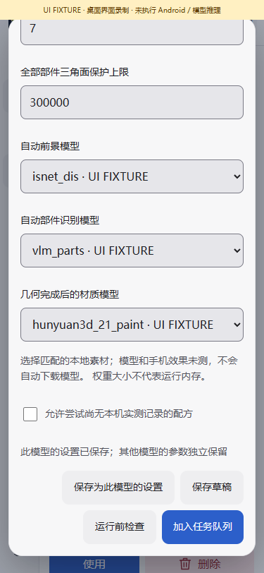

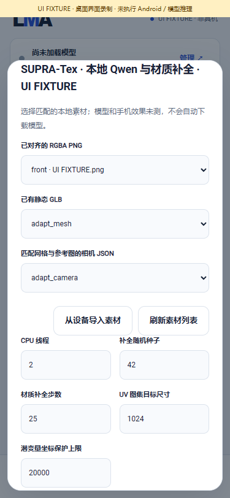


## 基座如何工作

模型／组件／配方描述固定 revision、文件路径、大小、SHA256、能力和依赖。版本化内部引擎适配器负责加载、阶段进度、取消、错误和卸载；新增同架构变体复用描述与调度，新架构需要实际适配，不能靠目录登记冒充可运行。

| 环节 | 共用行为 |
| --- | --- |
| 取得资产 | 明确下载／导入；暂停／续传、原子安装、共享哈希、使用引用与删除保护 |
| 准备与关联 | 由 APK 内置受控程序转换用户已有资产，再明确关联；不执行下载的程序或任意用户脚本 |
| 参数与输入 | 每模型 schema、可编辑预设、超限归位；本地素材与分块上传均鉴权并固定身份 |
| 执行 | 同一手机、共用资源准入和持久队列；任务冻结模型、参数、适配器与输入 |
| 提交结果 | 暂存→校验→原子提交；保存来源，取消／失败不发布半成品 |
| 恢复与清理 | 对账已有结果、显式重试、引用保护、容量确认；不假装无 checkpoint 续步 |
| 接口与界面 | 共用生产校验器、任务存储和调度，不因入口不同绕过约束 |

不构建 ComfyUI 连线、无限画布、公共用户节点、插件市场或图导入。内部版本化引擎不是用户插件体系。[架构](docs/ARCHITECTURE.md) · [基座需求](docs/FOUNDATION.md) · [完整冻结计划](docs/MULTIMODAL_RELEASE_PLAN.md)

<a id="api-examples"></a>
## 本机 API：可复制的调用示例

默认服务为 `http://127.0.0.1:52187`，模型接口位于 `/v1`；所有公开接口包括 `/health`、事件和产物读取都需要 Bearer 密钥。App“服务”页提供当前密钥与连接示例，勿把真实密钥放进截图或提交。

以下 PowerShell 例子面向**已连接手机的客户端**。可选 USB ADB 转发只转发请求，推理仍在手机；它不是 App 用户的必装条件，也不是本项目的真机测试记录。手机上的 HTTP 客户端直接使用 `127.0.0.1:52187`。若主动开启 LAN，可改为手机地址，计算位置不变。

### A01 · 零模型健康检查和已安装模型列表

```powershell
# 可选：已连接、已授权 USB 调试的手机
adb forward tcp:18080 tcp:52187
$lmaBase = 'http://127.0.0.1:18080'
# 先在当前终端设置 LMA_API_KEY 为“服务”页的密钥
$lmaHeaders = @{ Authorization = "Bearer $env:LMA_API_KEY" }
Invoke-RestMethod "$lmaBase/health" -Headers $lmaHeaders
$lmaModels = Invoke-RestMethod "$lmaBase/v1/models" -Headers $lmaHeaders
$lmaModels.data | Select-Object id, loaded, task_tags
```

列表只包含用户已安装模型；目录不等于安装，安装不等于加载或手机验收。`/v1/engines` 可查看实际注册引擎。

### A02 · 已加载文本模型的非流式对话

```powershell
$lmaTextModel = $lmaModels.data | Where-Object { $_.loaded -eq $true -and $_.task_tags -contains 'text' } | Select-Object -First 1
if (-not $lmaTextModel) { throw '请先在 App 加载一个文本模型' }
$lmaChat = @{
    model = $lmaTextModel.id
    messages = @(@{ role = 'user'; content = '用三句话解释本地模型。' })
    max_tokens = 128
    stream = $false
} | ConvertTo-Json -Depth 8
Invoke-RestMethod "$lmaBase/v1/chat/completions" -Method Post -Headers $lmaHeaders `
    -ContentType 'application/json; charset=utf-8' -Body $lmaChat -TimeoutSec 300
```

外部客户端发送自己的消息和采样参数；LMA 不把 App 系统提示词强制注入外部请求。上下文和输出仍受所选模型的约束。切换模型后重新读取实际 ID，不从显示名称猜测。

### A03 · 流式对话的 Python 客户端

```python
import json, os, urllib.request

base = "http://127.0.0.1:18080"  # 上面的 USB 转发；手机本机为 :52187
headers = {"Authorization": "Bearer " + os.environ["LMA_API_KEY"]}
request = urllib.request.Request(base + "/v1/models", headers=headers)
with urllib.request.urlopen(request, timeout=30) as response:
    models = json.load(response)["data"]
model = next(item["id"] for item in models if item.get("loaded") is True and "text" in item.get("task_tags", []))
body = json.dumps({"model": model, "messages": [
    {"role": "user", "content": "Explain local models in three sentences."}
], "max_tokens": 128, "stream": True}).encode("utf-8")
request = urllib.request.Request(base + "/v1/chat/completions", body,
    {**headers, "Content-Type": "application/json"})
finished = False
with urllib.request.urlopen(request, timeout=300) as response:
    for raw in response:
        line = raw.decode("utf-8").strip()
        if not line.startswith("data:"):
            continue
        payload = line[5:].strip()
        if payload == "[DONE]":
            finished = True
            break
        event = json.loads(payload)
        if "error" in event:
            raise RuntimeError(event["error"])
        for choice in event.get("choices", []):
            print(choice.get("delta", {}).get("content") or "", end="", flush=True)
if not finished:
    raise RuntimeError("Stream ended without [DONE]")
```

此例展示聊天 token 流；多模态任务事件采用不同结构。生产客户端还应处理重连、超时和不完整结束，不能把缺少结束标记的断线计为完整成功。[完整 API 与 SSE 说明](docs/API.md)

### A04 · 生图预检、持久入队、查询和取消

```powershell
# 从 /v1/models 复制一个已完整安装且支持 image.generate 的模型包 ID
$lmaBundleId = 'REPLACE_WITH_INSTALLED_BUNDLE_ID'
$lmaJob = @{
    bundleId = $lmaBundleId
    type = 'image.generate'
    input = @{ prompt = 'A small garden with a wooden house' }
    parameters = @{ seed = 123 }
    # 仅在用户明确同意尝试未测配方后设置；不会触发下载
    allowUnmeasured = $true
} | ConvertTo-Json -Depth 8
$lmaPreflight = Invoke-RestMethod "$lmaBase/v1/jobs/preflight" -Method Post `
    -Headers $lmaHeaders -ContentType 'application/json' -Body $lmaJob
$lmaPreflight
# 先审阅预检结果；仅在条件满足且用户确认执行后继续
$lmaJobHeaders = @{ Authorization = "Bearer $env:LMA_API_KEY"; 'Idempotency-Key' = 'garden-demo-001' }
$lmaAccepted = Invoke-RestMethod "$lmaBase/v1/jobs" -Method Post `
    -Headers $lmaJobHeaders -ContentType 'application/json' -Body $lmaJob
$lmaAccepted
```

提交返回 `202` 和任务标识只表示入队。按返回记录中的任务 ID 调用 `GET /v1/jobs/ID`；取消用 `POST /v1/jobs/ID/cancel`，明确重试用 `POST /v1/jobs/ID/retry`。同一幂等键＋相同请求复用原任务，改变请求产生冲突。事件连接断开不取消持久任务。

| 目标 | 接口 |
| --- | --- |
| 预检／提交／列表 | `POST /v1/jobs/preflight`、`POST /v1/jobs`、`GET /v1/jobs` |
| JSON 或 SSE 任务事件 | `GET /v1/jobs/ID/events`；SSE 发送 `Accept: text/event-stream` |
| 事件续读 | `after` 或 `Last-Event-ID`；过旧游标按 reset 重新读取任务快照 |
| 结果与原始字节 | `GET /v1/artifacts`、`GET /v1/artifacts/ID/content`；支持受控 Range |
| 媒体输入 | 显式本地导入／鉴权分块上传；角色必须由所选引擎声明 |

缺资产、缺引擎、资源不足或未授权尝试未测配方都在本机返回原因；接口不下载模型、不抓取远程素材、不转交外部推理。[预检](docs/TASK_PREFLIGHT.md) · [素材上传](docs/LOCAL_INPUTS.md) · [API 全部字段与限制](docs/API.md)

<a id="ui-media"></a>
## 当前页面、截图与录屏

### 历史真实 Android 页面 · v0.3.9

实际 motorola edge plus / Android 12，已安装模型为 0。[复现、23 项程序检查与边界](docs/DEVICE_ACCEPTANCE.md)。以下是真机屏幕，与后文桌面夹具分开。

| 手机推荐页 | 手机本地接口页 |
| --- | --- |
| 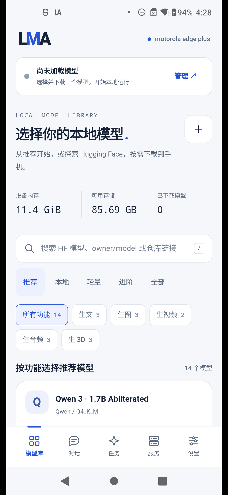 |  |

[实际录屏 MP4](docs/media/device/v0.3.9/physical-walkthrough.mp4) · [GIF](docs/media/device/v0.3.9/physical-walkthrough.gif) · [媒体身份](docs/media/device/v0.3.9/manifest.json)。60 秒锁屏检查针对接口健康与服务存活，没有生成 token。


当前 10 组为 **v0.3.11 生产页面＋明确标记的桌面交互夹具（UI FIXTURE）**，共 58 张截图 / 10 GIF / 10 MP4。社区 / 工作台 / 语音与 3D / MV / RF / Spatial / 材质 / UltraTex / 本地辅助 / 推荐分类分别检查 38 / 8 / 32 / 19 / 17 / 20 / 34 / 38 / 23 / 37 项交互（最后一组为多模态推荐）。未下载权重、未产生模型输出；录制后关闭全部测试浏览器资源。[完整媒体索引](docs/MEDIA.md)


[社区 MP4](docs/media/development/community/community-ui.mp4) · [媒体与源码身份](docs/media/development/community/manifest.json)

| 生图目录与内容标签 | 来源、许可与组件 |
| --- | --- |
| 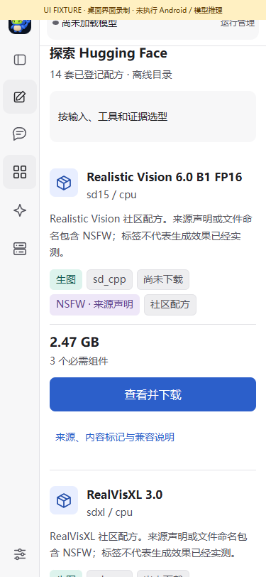 | 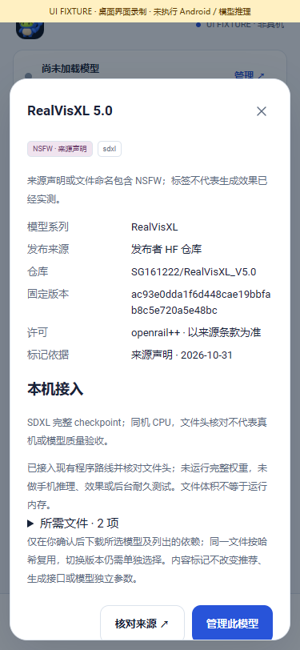 |

[视频目录](docs/media/development/community/03-community-video.png) · [视频来源与限制](docs/media/development/community/04-video-source.png) · [本地管理](docs/media/development/community/05-community-local.png)

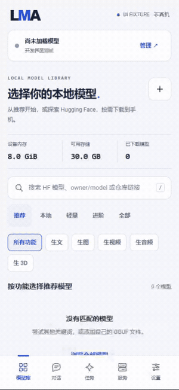

[工作台 MP4](docs/media/development/release-workbench/release-workbench-ui.mp4) · [工作台媒体身份](docs/media/development/release-workbench/manifest.json)

以下入口补回旧版演示的可发现性，**都是对应历史版本的界面夹具**：

| 场景 | 截图 | GIF／录屏 |
| --- | --- | --- |
| Sana-Sprint 组件、设置、提交和队列 | [14 组件](docs/media/development/sana/01-sana-components.png)、[独立参数](docs/media/development/sana/02-sana-settings.png) | [GIF](docs/media/development/sana/sana-ui.gif)／[MP4](docs/media/development/sana/sana-ui.mp4) |
| MOSS 组件、参数和输出上限 | [输出上限](docs/media/development/openmoss/05-output-limit.png) | [GIF](docs/media/development/openmoss/openmoss-ui.gif)／[MP4](docs/media/development/openmoss/openmoss-ui.mp4) |
| Wan 模型和参数 | [使用说明](docs/WAN_VIDEO.md) | [GIF](docs/media/development/wan/wan-ui.gif)／[MP4](docs/media/development/wan/wan-ui.mp4) |
| LTX 参数和视频队列 | [模型设置](docs/media/development/ltx/02-model-settings.png)、[队列](docs/media/development/ltx/04-video-queue.png) | [GIF](docs/media/development/ltx/ltx-ui.gif)／[MP4](docs/media/development/ltx/ltx-ui.mp4) |
| HF 配套文件确认 | [组件审阅](docs/media/development/components/02-companion-review.png)、[下载计划](docs/media/development/components/03-complete-download-plan.png) | [方案](docs/COMPONENT_SUGGESTIONS.md) |
| TTS 音色与 LoRA 配对 | [Kokoro 音色](docs/media/development/speech/02-kokoro-voices.png)、[基础模型依赖](docs/media/development/curated/01-dependency-review.png) | [配对任务](docs/media/development/curated/03-paired-task.png) |
| 运行资源与停止原因 | [资源](docs/media/development/resources/01-running.png)、[停止详情](docs/media/development/resources/02-stopped-detail.png) | [资源说明](docs/RUNTIME_RESOURCES.md) |
| 原始文本模型库、接口和深色主题 | [模型库](docs/media/01-library.png)、[接口](docs/media/05-api.png)、[深色](docs/media/07-dark.png) | [原始演示](docs/MEDIA.md) |


[语音选择](docs/media/development/expansion/01-speech-models.png) · [3D 表单](docs/media/development/expansion/03-3d-form.png) · [GLB 预览](docs/media/development/expansion/05-glb-preview.png) · [MP4](docs/media/development/expansion/expansion-ui.mp4) · [32 项页面检查](docs/media/development/expansion/manifest.json)


[四个导入选择](docs/media/development/multiview/01-multiview-models.png) · [四图表单](docs/media/development/multiview/03-four-view-form.png) · [后台观察](docs/media/development/multiview/05-background-observations.png) · [MP4](docs/media/development/multiview/multiview-ui.mp4) · [19 项页面检查](docs/media/development/multiview/manifest.json)


### RF 形状当前页面

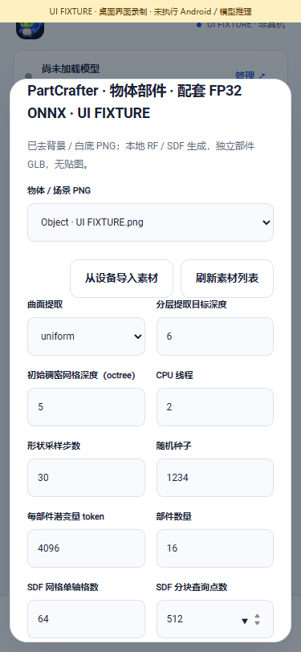

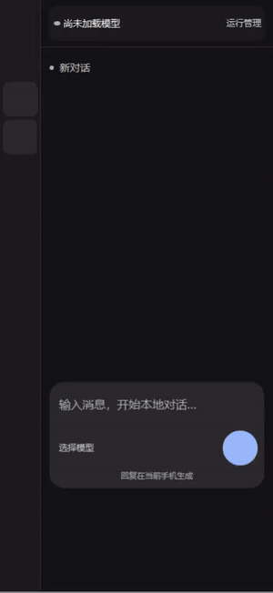

[5 张截图 / 身份清单](docs/media/development/shape/manifest.json) · [MP4](docs/media/development/shape/shape-ui.mp4)。这六组保留原有场景，另有材质 / UltraTex / 本地辅助三组；本版合计 58 张截图 / 10 GIF / 10 MP4。旧版媒体和证据按原 Git 身份保留。

### Hunyuan / UltraShape 页面流程


[五张截图及哈希](docs/media/development/spatial/manifest.json) · [MP4](docs/media/development/spatial/spatial-ui.mp4)。v0.3.4 的 38 JSON 与 40 媒体文件按原 Git blob 保留于[历史归档](verification/history/v0.3.4-program-archive.json)；旧案例和失败不被当前记录覆盖。

## 保留的推荐案例 C49–C54

### C49 · 首次启动与推荐数量

进入模型 → 推荐，显示 14 项，前三项仍是原有生文顺序。点击生图 / 生视频 / 生音频 / 生 3D，分别看到 3 / 2 / 3 / 3 项；打开和筛选不下载。[逐项选择理由与固定身份](docs/RECOMMENDED_MODELS.md)。

### C50 · 生图风格与标签

SD-Turbo 提供少步数 512 像素起步配置；Realistic Vision 适合写实风格，AOM2 适合插画。后两项保留来源 NSFW 标签。先查看 VAE 等依赖，再明确点击下载；推荐不表示画质已验。

### C51 · 视频变体与资源检查

可选 Wan2.1 Q4 或社区 E14，二者是 Wan1.3B 同架构的不同权重，均需 Vulkan。完整包约 4.74 / 6.76 GB。先采用低分辨率短片并检查内存 / 空间，E14 保留来源 NSFW 声明。

### C52 · 轻量语音与独立设置

Melo INT8 用于中文 / 英文，Kokoro INT8 使用已适配英文音色，OmniVoice Q8 提供自动 / 参考 / 描述音色控制。明确下载一个后，“本地”出现该任务和逐模型参数；其他推荐不会被安装。

### C53 · 几何或材质 3D

选择 TRELLIS geometry512、TRELLIS PBR512 或 Pixal geometry512。在“使用”中附本机参考图、选择匹配的几何 / 材质配置并检查资源。这些是 CPU 长任务，进入推荐不表示手机性能已验。

### C54 · 升级、全部、本地与验证

原签名升级保留既有选择和资产。推荐仅是元数据，全部保留 82 套登记包及 HF 发现。新增 37 项页面检查覆盖身份、内容标签、模拟显式下载、无自动下载、回退和 320px 布局；真实手机分类检查与模拟传输、完整模型实跑分别记录。


## v0.3.10 任务故障场景 C55–C60

| 编号 | 操作 / 观察 | 预期与实际边界 |
| --- | --- | --- |
| C55 | 两次 TRELLIS.2 和一次 Pixal3D 启动错误 | 硬链接 EACCES；共享私有软链接回退真机小文件探针通过，无需重下权重 |
| C56 | 当前手机执行 Wan GPU 预检 | 明确提示 Vulkan 1.2 不满足，不新增任务、不自动切 CPU |
| C57 | 原生 stderr 无换行且后续返回 JSON 错误 | 生产协议夹具保留具体错误、退出码和有效参数 |
| C58 | 逐条清理终态失败 | 备份并核对身份后删除；2 成功 / 5 素材 / 5 已安装模型和参数保留 |
| C59 | 用户自行导入独立 Wan CPU JSON | 用户确认安装；组件身份可复用，未替用户导入或试跑，完整输出和速度未测 |
| C60 | 保留已有模型检查管理接口 | 23 项真机程序检查与 10 项故障探针分别计数，不算完整模型通过 |

[逐条报告与修复](docs/TASK_FAILURES.md) · [故障证据](verification/releases/v0.3.10/task-diagnostics.json)。

## v0.3.11 真机模型场景 C61–C65

| 编号 | 操作 | 预期 / 本轮观察 |
| --- | --- | --- |
| C61 | 在本地 Wan 参数中选择 CPU | 同一模型 ID / 权重，独立保存，不新增下载 |
| C62 | 提交 CPU 128×128 / 5 帧 / 1 步与 4 步 | 176 / 347.04 秒均产生真机 MP4；画面近空白，未达可用画质，APK / 文件哈希分别记录 |
| C63 | 使用自有方块图运行 TRELLIS / Pixal | 接受租约内普通输入，真实阶段区分计算与早期路径故障 |
| C64 | 到达预算后取消 | 仅取消本次任务 / 进程，不以占位 GLB 冒充完成 |
| C65 | 暂存文件与来源不匹配或父目录越界 | 原生身份 / 文件名 / 目录约束拒绝，其他模型设置保持独立 |

[完整复核与边界](docs/ON_DEVICE_MODEL_REPAIR.md) · [一步手机视频](docs/media/models/v0.3.11/wan-cpu-128.mp4) · [四步手机视频](docs/media/models/v0.3.11/wan-cpu-128-four-steps.mp4) · [一步诊断 GIF](docs/media/models/v0.3.11/wan-cpu-128.gif)。

<a id="case-studies"></a>
## 历史案例测试与真实产物

这些是已保存的开发阶段案例，未在本轮重跑为新的通过。HOST 表示原生 Windows 主机，UI FIXTURE 表示模拟桥接页面，PROGRAM 表示程序或有界小图检查；原始记录不能替代 Android 验收。本轮另获授权的手机模型检查见 C61–C65；当前安装包以上方 v0.3.12 为准。

| 编号 | 案例及输入／操作 | 当时观察与明确边界 | 原始说明／证据 |
| --- | --- | --- | --- |
| H01 | SD1.5：不同提示词 A／B／A、20 步采样中取消和恢复 | HOST：完整 PNG、恢复可复现；图片质量和手机性能不由哈希证明 | [实际权重与生产流程](docs/SD15_TRAINED.md) |
| H02 | SDXL、SD1.5／SDXL LoRA 强度 0／1、LCM-LoRA 组合 | HOST：基础／风格／反事实／取消恢复；低步数有主体不清问题，保留原图 | [变体验证与全部 PNG](docs/SD_VARIANTS_TRAINED.md) |
| H03 | SD-Turbo 与 LCM checkpoint 准备、完整 UNet 对照 | HOST：SD-Turbo 真实 PNG；LCM 候选诊断和错误门槛保留，不将候选称为全部通过 | [蒸馏与 LCM](docs/SD_DISTILLED_TRAINED.md)、[产品流程](docs/LCM_APP_FLOW.md) |
| H04 | Sana 原 13 组件文生图尝试→匹配 15 组件图片编辑 | HOST：旧灰图失败保留；后续必选本地图片、固定风格编辑有真实输出，不能混成同一能力 | [原失败](docs/MNN_SANA_TRAINED.md)、[图片编辑](docs/MNN_SANA_EDIT.md) |
| H05 | FLUX.2-klein：机器人与茶壶、帆船、步数变化／取消恢复 | HOST：真实 PNG；分词头导致的词项偏移已定位，151,643 基础词项等独立对照与完整模型质量分开 | [方案、原始报告与媒体](docs/FLUX2_KLEIN.md) |
| H06 | Z-Image：四组件、不同提示词与步数、生产 Java／原生取消恢复 | HOST：实际 PNG、来源和删除／重启检查；非 Android 性能结果 | [完整案例](docs/ZIMAGE_TURBO.md) |
| H07 | MOSS Nano：三语输出、错误控制及生产 Java→原生流程 | HOST：7 次 WAV 输出／7 个控制、40 项生产流程检查；音质与真机另验 | [Nano 实测与三语音频](docs/MOSS_NANO_TRAINED.md) |
| H08 | Kokoro／Piper／Matcha：音色、速度、导入、取消恢复 | HOST：68 次 WAV／13 个控制、157 项生产 Java 检查；不承诺所有文本和声音质量 | [TTS 实测与音频](docs/TTS_TRAINED.md) |
| H09 | Qwen3-TTS：十语言、参考输入、参数和取消恢复 | HOST：18 个成功 WAV／12 个控制、94 项 Java 检查；部分贪心短文本触及 30 秒预算，质量问题保留 | [Qwen3-TTS 实测](docs/QWEN_TTS_TRAINED.md) |
| H10 | MOSS-TTS 1.5：完整组合、真实进度、原生／Java 一致性 | HOST：dev.41 的 87 项／5 次运行；参考模式达到预算而未自然结束 | [1.5 案例与产物](docs/MOSS_TTS15.md) |
| H11 | MOSS 提示／排空／缓存修正与参考模式复核 | HOST：dev.43 Java 71 项／4 次运行；参考模式 375 步截断，识别 36／2 词错误仍是失败 | [修正与失败记录](docs/MOSS_DELAY_FIX.md) |
| H12 | SoulX：两／四说话人、参考原文、完整生产 worker | HOST：历史 95 项完整 worker 检查；合成参考 PCM 不等于真实人声音质或 Android 验收 | [SoulX 基座](docs/SOULX_ENGINE.md)、[语言链路](docs/SOULX_LANGUAGE.md) |
| H13 | Stable Audio：T5→DiT→解码和错误／取消 | PROGRAM：有界 LiteRT 小图与子进程；不是完整训练音频生成案例 | [音频引擎与范围](docs/STABLE_AUDIO_ENGINE.md) |
| H14 | Wan：完整视频、分块／时间解码、独立上游 VAE 对照 | HOST：末帧伪影未修复；同一 latent 在 C++／上游 CPU VAE 对照中复现，不能只展示首帧称成功 | [实际视频](docs/WAN_VIDEO.md)、[画质诊断](docs/WAN_DECODER.md) |
| H15 | 旧 LTX Google Q5 单尺度：真实提示词视频、生产 Java／原生路径 | HOST：有完整 MP4；严格浮点六项失败与画质问题保留，不是原始 PixArt 多尺度或手机证据 | [业务与产物](docs/LTX098_APP_FLOW.md)、[精度诊断](docs/LTX098_PRECISION.md) |
| H16 | 旧 LTX DiT／T5／VAE 分阶段独立对照 | HOST：组件级数值、取消与资源分别留证；组件通过不能关闭完整链路失败 | [DiT](docs/LTX098_DIT.md)、[采样](docs/LTX098_SAMPLING.md)、[T5](docs/LTX098_TEXT.md)、[VAE](docs/LTX098_VAE.md) |
| H17 | Sana-Sprint 与原始 PixArt 多尺度 LTX 后续接入 | PROGRAM：Sana 448 项；原始 LTX 路线以程序集成验收，无新增完整模型输出 | [Sana](docs/SANA_SPRINT.md)、[LTX](docs/LTX_MULTISCALE.md)、[v0.3.0](docs/releases/v0.3.0.md) |
| H18 | v0.3.1 社区内容来源、文件头、配方、下载与本地筛选 | PROGRAM／UI：814 项社区检查、564 项全页检查；不代表 44 个完整 checkpoint 实跑 | [来源清单](docs/COMMUNITY_MODELS.md)、[程序记录](verification/program/community.json) |

### 生图案例：实际主机结果

| FLUX：机器人与茶壶 | FLUX：帆船 |
| --- | --- |
|  |  |

[FLUX 原图、GIF、MP4 与来源](docs/FLUX2_KLEIN.md)；轮播不代表生成耗时。


[Z-Image GIF](docs/media/development/zimage-trained/zimage-trained.gif) · [原始案例](docs/ZIMAGE_TURBO.md)

| Sana Edit：用户输入 | Sana Edit：实际主机输出 |
| --- | --- |
|  |  |

输入为 NASA 公有领域样例，[素材来源](tests/fixtures/images/LICENSE.md)。这是固定图片编辑案例，不证明全面身份保持。[GIF](docs/media/development/sana-edit-trained/sana-host-outputs.gif) · [MP4](docs/media/development/sana-edit-trained/sana-host-outputs.mp4)

[SD1.5 原图联系表](docs/media/development/sd15-trained-contact-sheet.png) · [SD1.5 LoRA 对照](docs/media/development/sd-variants-sd15-contact-sheet.png) · [SDXL LoRA 对照](docs/media/development/sd-variants-sdxl-contact-sheet.png) · [实际 PNG 轮播 GIF](docs/media/development/sd-variants-trained-slideshow.gif) · [MP4](docs/media/development/sd-variants-trained-slideshow.mp4)

### 语音案例：原始 WAV、波形与失败样例

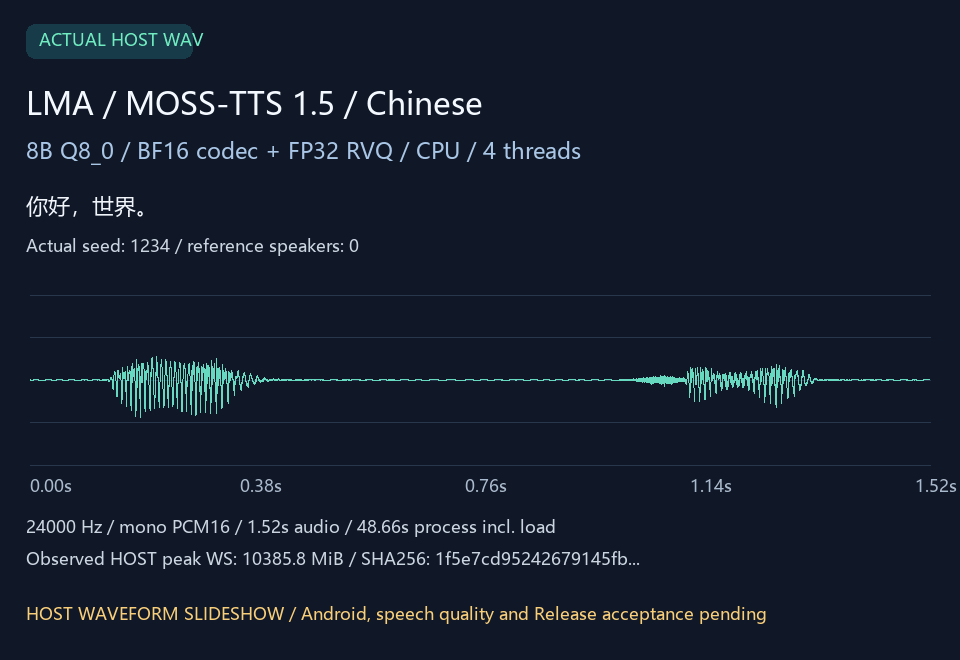

[英文 WAV](docs/media/development/openmoss-0.3.0-dev.43/openmoss-trained-en.wav) · [中文 WAV](docs/media/development/openmoss-0.3.0-dev.43/openmoss-trained-zh.wav) · [参考模式 WAV（失败保留）](docs/media/development/openmoss-0.3.0-dev.43/openmoss-trained-reference.wav) · [带实际音轨 MP4](docs/media/development/openmoss-0.3.0-dev.43/openmoss-trained-speech.mp4) · [媒体身份](docs/media/development/openmoss-0.3.0-dev.43/openmoss-trained-media.json)

[三套轻量 TTS 的 WAV 与波形](docs/TTS_TRAINED.md) · [MOSS Nano 三语音频](docs/MOSS_NANO_TRAINED.md) · [Qwen3-TTS 十语言／参考案例](docs/QWEN_TTS_TRAINED.md)。波形非空、哈希相同或输出时长都不等于语音质量通过。

### 视频案例：完整视频与未通过的画质

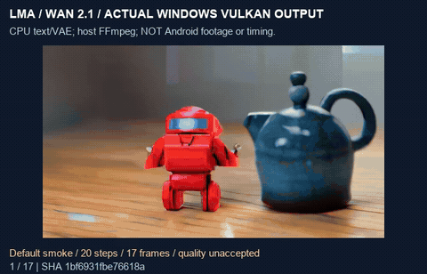

[完整 Wan MP4](docs/media/development/wan-trained/default.mp4) · [所有帧](docs/media/development/wan-trained/default-frames.png) · [独立 VAE 对照](docs/media/development/wan-quality/vae-comparison.png) · [失败画质 GIF](docs/media/development/wan-quality/legacy-default.gif)

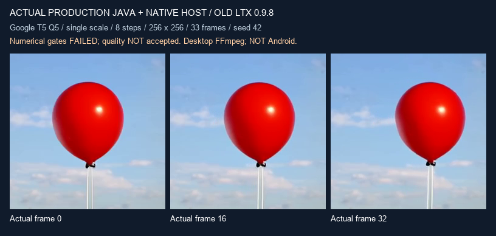

[完整 LTX MP4](docs/media/development/ltx-app-trained/video.mp4) · [带 HOST 标签 GIF](docs/media/development/ltx-app-trained/preview.gif) · [媒体身份](docs/media/development/ltx-app-trained/manifest.json)

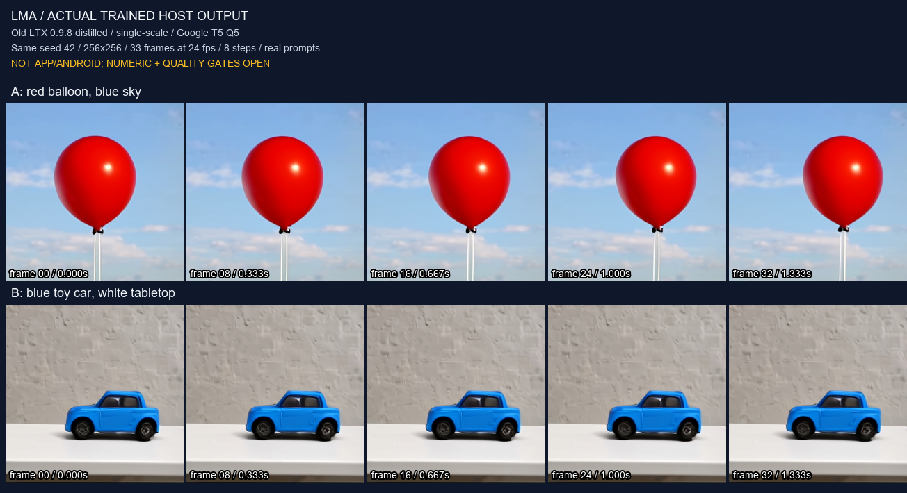

[独立主机对照 MP4](docs/media/development/ltx098-host-comparison.mp4) · [GIF](docs/media/development/ltx098-host-comparison.gif) · [来源与时序](docs/media/development/ltx098-host-media.json)

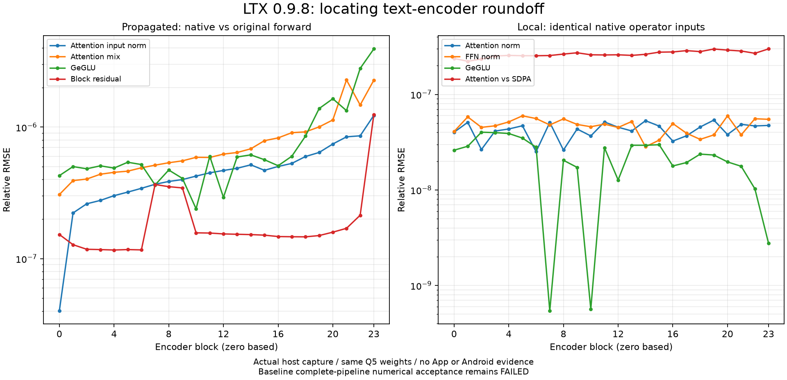

[精度诊断与完整失败边界](docs/LTX098_PRECISION.md)。以上原始媒体不重录、不改写为本版成功，也不将历史桌面 FFmpeg 编码当成 Android MediaCodec 验收。

<a id="verification"></a>
## 当前程序检查覆盖与复核入口

**v0.3.12：62 组／15,115 项程序断言，75 份门禁与构建记录；794 项生产页面检查。** 最终签名 APK 完成 24 项真机程序、8 项空闲性能和28项真实 SDK 联调；空闲快照 p50／p95为275.88／286.75ms，主线程最大间隔27ms。实际推理、画质、候选包与长期后台边界见[测评](docs/DEVICE_BENCHMARK_V0312.md)。41个ARM64库、原签名、16KiB对齐、Lint0错误／16个既有警告以及十组桌面演示均已核验。

**历史 v0.3.11：60 组 / 15,063 项程序断言，73 份门禁记录另附状态清单；完整生产页面 794 项，其中推荐分类 37 项。** 41 个 ARM64 原生库、Android 9+、16 KiB 对齐、原签名和 Lint 0 错误 / 16 个原有警告通过。10 组桌面 UI 为 58 PNG / 10 GIF / 10 MP4，815 个历史证据文件保持身份；8 项性能保留核对不属于本版延迟实测。另有 23 项真机程序检查及 60.239 秒锁屏 API 健康检查；授权手机模型成功与限时未完成结果单独记录，不加入上述门禁数量。历史 [v0.3.10 的 10 项故障检查](verification/releases/v0.3.10/task-diagnostics.json)及原五条失败报告保留。

[当前程序检查与 62 个配方](docs/IMPLEMENTATION_V0312.md) · [本版记录与源码指纹](verification/releases/v0.3.12/status.json) · [验证策略](docs/PROGRAM_VALIDATION.md)

下面保留 **v0.3.5 历史 30 组 / 5,820 项** 及其原记录入口，便于对照；本版数量以上面的 v0.3.11 清单为准。

| 编号 | 套件／断言 | 覆盖的案例 | 记录 |
| --- | --- | --- | --- |
| P01 | community · 818 | 44 配方、内容依据、固定身份、独立参数与生产任务规划 | [JSON](verification/program/community.json) |
| P02 | foundation · 995 | 零模型启动、包管理、组件共享、下载／导入／删除与权限 | [JSON](verification/program/foundation.json) |
| P03 | backend · 138 | 文本引擎进程、代理、停止、错误与占用释放 | [JSON](verification/program/backend.json) |
| P04 | bundle-pause · 22 | 阻塞读取中暂停、关闭、后续队列释放 | [JSON](verification/program/bundle-pause.json) |
| P05 | document-input · 15 | 文档输入合约、取消、错误和资源关闭；不是手机 SAF 实跑 | [JSON](verification/program/document-input.json) |
| P06 | api · 68 | 实际本机 socket 的鉴权、路由、任务与结果保护 | [JSON](verification/program/api.json) |
| P07 | workbench · 44 | 草稿、表单、不可变任务、结果来源与重新请求 | [JSON](verification/program/workbench.json) |
| P08 | recovery · 47 | 中断对账、清理、持久状态、鉴权结果读取 | [JSON](verification/program/recovery.json) |
| P09 | inputs · 64 | 本地输入、上传、角色和完整性／引用保护 | [JSON](verification/program/inputs.json) |
| P10 | text · 66 | 文本包、逐模型默认值、上下文／输出限制 | [JSON](verification/program/text.json) |
| P11 | migration · 69 | 旧设置迁移、独立配置与原数据保留 | [JSON](verification/program/migration.json) |
| P12 | scheduler · 151 | 文本／多模态资源槽、排队、取消和释放 | [JSON](verification/program/scheduler.json) |
| P13 | preparations · 44 | 本地受控准备、取消、原文件与输出身份 | [JSON](verification/program/preparations.json) |
| P14 | assemblies · 47 | 显式关联、缺组件提示、引用与独立删除 | [JSON](verification/program/assemblies.json) |
| P15 | diffusion · 197 | 扩散任务参数、SD／SDXL／LoRA 配对与执行合约 | [JSON](verification/program/diffusion.json) |
| P16 | mnn · 101 | MNN 配方、输入约束、阶段协议和结果校验 | [JSON](verification/program/mnn.json) |
| P17 | hub · 80 | HF 搜索／仓库解析、分页、文件选择及格式边界 | [JSON](verification/program/hub.json) |
| P18 | recipe-suggestions · 73 | 配套组件建议、人工确认和精确下载计划 | [JSON](verification/program/recipe-suggestions.json) |
| P19 | speech-voices · 70 | 54 个 Kokoro 音色、模型专属参数和非法选择 | [JSON](verification/program/speech-voices.json) |
| P20 | sana-sprint · 448 | 分词、采样数学、有界小图和匹配 Sprint 路线 | [JSON](verification/program/sana-sprint.json) |
| P21 | ui · 653 | 生产页面、模型管理、组合筛选、设置、队列和结果 | [JSON](verification/program/ui.json) |
| P22 | ltx-official · 89 | 官方身份、原始 T5／分词与多尺度配置合约 | [JSON](verification/program/ltx-official.json) |
| P23 | ltx-multiscale-app · 280 | 原始 PixArt 多尺度编排、有界阶段、取消与产物提交 | [JSON](verification/program/ltx-multiscale-app.json) |
| P24 | ltx-single-scale-app · 127 | 独立单尺度路线、输入／参数／进程和取消恢复 | [JSON](verification/program/ltx-single-scale-app.json) |
| P25 | expansion · 533 | 语音 / 单图 / MV 合约、真实主机子进程夹具、GLB、清理、诊断合并持久化与微型 F5 前端 | [JSON](verification/program/expansion.json) |
| P26 | multiview · 63 | 上游真实相机 / 投影、12 个 native 进程拒绝路径与运行观察 | [JSON](verification/program/multiview.json) |
| P27 | shape · 161 | 固定源码随机小图 / RF 数学 / PNG 对照，30 次实际 native 形状流程与拒绝路径 | [JSON](verification/program/shape.json) |
| P28 | spatial · 188 | PNG / GLB、锐边 / FP16、实际 native 成败与离线随机 safetensors 转换 | [JSON](verification/program/spatial.json) |
| P29 | spatial-graphs · 60 | 固定 Hunyuan / UltraShape 小图、动态 tokens、MoE、cache / query / schedule | [JSON](verification/program/spatial-graphs.json) |
| P30 | spatial-sparse · 109 | 五个实际 ONNX CPU 算子、源规则、动态支持与错误输入 | [JSON](verification/program/spatial-sparse.json) |

上述 v0.3.5 历史包包含 40 个原生库和六组媒体；本版已扩展至 41 个库和九组媒体。两版页面录屏均为 UI FIXTURE，不是模型生视频产物。

v0.3.0 的 29 个程序文件与旧媒体[按原 Git 身份归档](verification/history/v0.3.0-program-archive.json)；更早模型失败和程序记录仍保留。`release_ready` 表示符合程序发行策略，不表示所有手机／权重／质量通过。

<a id="z20"></a>
## 努比亚 Z20 与后台运行边界

文本基线为 ARMv8 CPU，起步可用 **4 线程／2048 上下文／512 输出 tokens**，可切换的思考模式默认关闭。先用 `m01` 小模型核对自己的使用流程，再按实际资源比较 `m08`、`m06`；3B–4B 和多模态资产需要更多存储与运行内存。这是配置起点，不是手机测速结论。

当前没有可用 Z20 真机，**没有测得本机 tokens/s、峰值内存、温度或锁屏持续时长**。文件体积、参数量、头部检查、主机生成和 Android 编译都不能证明该手机能运行某个 checkpoint；大模型资源不足时本机给出原因，不转出手机执行。

“后台持续输出”指活跃请求生成期间仍可输出。EOS、输出上限、取消、系统强停、内存压力或错误都会结束请求；不是无人请求时无限生成，也不能绕过厂商省电策略。前台通知、停止入口和按需锁的实现与真实手机耐久验收分别记录。

<a id="build"></a>
## 原生 Windows 构建与开发复核

需要完整 Git 历史、JDK 21、Python 3、Android SDK Platform 35／Build Tools 35.0.1；原生引擎按锁定 NDK／CMake 构建。当前验证路径为 Windows 原生工具链，不使用 Docker、WSL、虚拟机或 Android 模拟器。Android Studio／Gradle 配置供开发参考，未将其说成已验证路径。

```powershell
git clone git@github.com:wikigsroom/LMA.git
cd LMA
python tools/bootstrap_runtime.py
# 按 BUILD.md 取得／构建锁定的原生引擎；不是下载模型权重
python tools/build.py --sdk C:/path/to/Android/Sdk
python tools/verify_package.py
python tools/test_android_lint.py
```

已有完整原生缓存时无需重复获取；首次重建的多引擎命令、锁文件和注意事项见[构建指南](docs/BUILD.md)。源码 ZIP 不携带模型、签名、构建缓存或可重新获取的原生库；历史身份检查仍需要完整 Git 仓库，不能把 ZIP 当作已配置开发环境。

只运行与改动相关的程序检查；以下均为程序入口，不要求完整训练模型：

```powershell
python tools/test_backend.py
python tools/test_community.py
python tools/test_expansion.py
python tools/test_shape.py
python tools/test_text.py
python tools/test_scheduler.py
python tools/test_recovery.py
python tools/test_api.py
# 有 Node／Playwright／Edge 时运行，finally 关闭测试页面与浏览器
node tests/ui-smoke.cjs
# 核对现有记录及其源码指纹，不执行完整模型
python tools/program_evidence.py
```

发布前更新证据、打包和准备附件按[发布流程](docs/RELEASING.md)执行。**已发布版本后续仅修文档时，用 `python tools/check_repository.py --published` 核对当前链接与原标签源码包，不重写已发布附件。** 不运行历史指南中的完整模型、ASR 或长时耐久命令作为本次维护前置要求。

私钥与口令仅保存在本机忽略的 `signing/`，不要上传、打印或替换；升级应保留原签名。程序生成 `dist/` APK、SHA256 和构建记录，公开资料不包含权重或 API 密钥。

### 仓库地图

| 路径 | 内容 |
| --- | --- |
| `app/` | Android 应用、生产 Java 与离线页面资源 |
| `native/`、`third_party/` | 本地引擎集成、固定上游身份与许可说明 |
| `catalogue/` | 模型／组件／模板、内容依据和实现矩阵元数据 |
| `research/` | 可追溯来源与受控研究元数据，不是预装模型 |
| `tools/`、`tests/` | 原生构建、程序验证、界面及发布工具 |
| `verification/program/` | 当前程序证据；旧模型／版本记录另有历史目录 |
| `docs/media/` | 当前 UI 与明确分版的历史生成、录屏和来源清单 |
| `docs/releases/` | 版本说明、编号实现／待办和本次文档维护记录 |

<a id="troubleshooting"></a>
## 常见问题与排错

| 现象 | 检查与处理 |
| --- | --- |
| 安装失败／无法覆盖 | 是否 ARM64、Android 9+、空间足够、签名一致；不要先删除用户模型来解决签名冲突 |
| HF 搜索能看到，但无法运行 | 发现不等于适配；核对格式、精确架构、量化和全部依赖，不只看后缀 |
| 下载暂停或失败 | 在“本地”查看原因后明确续传；校验失败不能改名冒充成功，网络镜像与模型身份分开 |
| 修改上下文后自动变小 | 模型 metadata、输出联合限制或应用上限生效；在该模型设置中检查有效值 |
| 某模型没有负面提示词／音色／参考输入 | 表单按能力显示，不支持的输入不会静默当成有效参数 |
| 接口连接失败／401 | 接口是否启动、地址／端口／转发是否正确、当前 Bearer 密钥是否匹配 |
| 聊天流中断 | 检查 EOS／token 上限、取消、系统停止或引擎错误；不把部分流计为完整成功 |
| 任务一直等待或预检拒绝 | 查看当前资源槽、缺组件、参数与内存原因；不通过外部推理绕过 |
| 删除时提示正在使用 | 活动任务、共享模型或预览／导出仍持有引用；先结束相关操作 |
| 灰图、末帧伪影或语音截断 | 查对应 H 案例与原始失败；非空文件和程序通过不表示效果通过 |
| 更新 App 后没有新增模型 | 这是预期行为：基座升级不替用户下载模型；在“全部”自行选择 |
| 锁屏后停止 | 检查系统后台／电池限制、温度和内存；仍不能承诺永久存活 |

问题报告请给出手机／Android、LMA 版本、模型 ID／哈希、有效参数、复现步骤与已脱敏日志。不要附真实 API 密钥、私钥、个人参考音频或未经许可的素材。[贡献约定](CONTRIBUTING.md)

## 文档、历史与许可

[完整文档目录](docs/README.md) · [中文手册](docs/USER_GUIDE.md) · [English guide](docs/USER_GUIDE.en.md) · [模型参数](docs/MODEL_SETTINGS.md) · [共用任务](docs/TASK_WORKBENCH.md) · [输入](docs/LOCAL_INPUTS.md) · [API](docs/API.md) · [后台架构](docs/ARCHITECTURE.md)

[多模态可行性研究](docs/MULTIMODAL.md) · [基座评估](docs/FOUNDATION.md) · [冻结需求](docs/MULTIMODAL_RELEASE_PLAN.md) · [用户资产核对](docs/ASSET_CONTROL_AUDIT.md) · [当前实现](docs/IMPLEMENTATION_V035.md) · [旧验证资料](docs/VALIDATION.md) · [设备验收工具（未执行）](docs/DEVICE_ACCEPTANCE.md)

[完整历史中文 README](docs/history/README-dev45.zh.md) · [完整历史英文 README](docs/history/README-dev45.en.md) · [历史文档索引](docs/history/Documentation-dev45.md) · [本次文档修复](docs/releases/v0.3.1-readme.md)

后续授权更新同步代码、双语文档、相关媒体和更新说明，并普通推送至本仓库。文档维护不更换 APK、不覆盖历史附件；只有实际界面变化才重录相应页面。代码采用 [MIT](LICENSE)，引擎与用户模型分别遵循各自许可，见 [third_party/README.md](third_party/README.md)。


## v0.3.12 API scenarios / 接口用例

| ID | 场景 / Scenario | 操作与结果 / Action and expected result |
| --- | --- | --- |
| C66 | 自动发现 / Discovery | Download/configure an eligible local model; `/v1/models` and Service list it without loading. |
| C67 | 模型状态 / State | Unloaded/busy entries remain discoverable; incomplete or unsupported assets stay in Local management. |
| C68 | SDK 生图 / Images | `images.generate(n=1,response_format="b64_json")` returns genuine PNG or a real error, never a job JSON disguised as success. |
| C69 | SDK 语音 / Speech | Explicit WAV binary output; missing MP3 or unknown voice fails before generation. |
| C70 | 长视频任务 / Video | Async `video.generate`, same-phone codec and artifact retrieval; physical duration must exceed 5 seconds. |
| C71 | 图生 3D / Image-to-mesh | Upload owned media, select declared role, preflight and enqueue without invented text; inspect real failure causes. |
| C72 | 超时与重试 / Retry | A 504 preserves the job; original key/body reuses it, changed body conflicts, defaults remain frozen. |
| C73 | 多人归属 / Ownership | The source gateway binds caller/job/upload/artifact/phone identity; other callers receive 404. |
| C74 | 断点下载 / Media | Range, stale If-Range and ETag return actual bytes/statuses; content stays authenticated. |
| C75 | 不限时与取消 / No deadline | Generation has no elapsed-time cutoff; explicit cancel stops only the selected task and releases its slot. |

[Detailed current examples / 本版完整示例](docs/LOCAL_API_V0312.md) · [English](docs/LOCAL_API_V0312.en.md). Earlier C01–C48 and H01–H18 remain above with their historical evidence identities.
