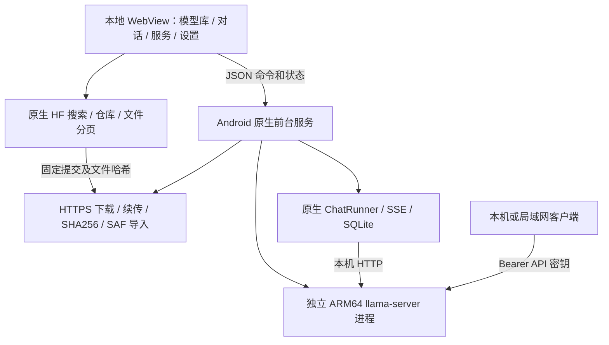

# LMA · Android 本地模型工作台

> **当前开发：0.3.0-dev.39 / code43。** 新增 Wan 2.1 T2V 1.3B Q4 本地视频方案：CPU 文字编码 / VAE、Vulkan 扩散和同手机 MP4 编码，复用全部 / HF / 本地、独立参数、共用任务与结果管理。四组件由用户明确下载或导入，APK 只交付基座。GPU 不可用时明确失败；实际 GPU 运算记录与设备枚举分开核验。[完整使用方案](docs/WAN_VIDEO.md) · [本轮实现与完整待办](docs/releases/v0.3.0-dev.39.md)。

dev.39 验证：**22 组、3,057 项通过**，包括完整四组件主机推理与实际应用业务；开发 APK61,325,834字节、原签名、35份原生库核对通过。默认视频后段有块状伪影，完整画质 / 数值 / 手机 / 正式 Release 仍待完成。[开发包说明](docs/releases/v0.3.0-dev.39.md)。


主机实际模型输出、生产页面演示、Android 编译、独立数值 / 画质与真机验收分别记录。正式完整 Release 仍受全部冻结目标和手机门槛约束。

> **保留 dev.38：0.3.0-dev.38 / code42。** 新增 Z-Image-Turbo 完整四组件可选模型，接通全部 / HF / 本地、独立八步参数、共用队列、取消恢复和结果管理。完整哈希支持复用已有匹配文件，登记与浏览不自动下载或安装。App 继续只更新基座，推荐顺序与用户资产保留。[完整方案与操作](docs/ZIMAGE_TURBO.md) · [本轮实现及全部待办](docs/releases/v0.3.0-dev.38.md)。


主机生成、页面演示和 Android 编译分别记录；完整数值、画质、资源及手机验收尚未完成，正式 Release 未发布。

> **保留 dev.37：0.3.0-dev.37 / code 41。** 新增可由用户自行下载的 FLUX.2-klein 4B 完整四组件方案，接入 HF / 全部 / 本地、独立参数、不可变任务和结果管理。修复 Qwen 分词文件头造成的编号偏移，并完成全部词项及多语言输入的官方对照。App 仅更新基座；推荐顺序、用户模型与旧任务保留。[方案与使用](docs/FLUX2_KLEIN.md) · [编号实现、完整待办与验证边界](docs/releases/v0.3.0-dev.37.md)。真实 Windows CPU 执行、界面夹具、Android 编译和真机/画质验收分别记录；完整 v0.3.0 Release 尚未发布。

| 实际本地文生图：机器人与茶壶 | 实际本地文生图：帆船 |
|---|---|
|  |  |

[完整图片、GIF 与视频展示](docs/FLUX2_KLEIN.md#5-实际证据与复现)；展示不代表生成速度或手机录像。

> **保留 dev.36：0.3.0-dev.36 / code 40。** 更正 Sana Edit 的实际用途：新增完整 15 组件、本地 PNG/JPEG 必选、固定提示词与 512×512 图片转换；接入独立参数、不可变任务、真实取消恢复和结果保存。App 只更新基座，所有模型仍由用户选择/下载/管理。共用上传接口修复超限请求偶发连接中断。[完整使用逻辑](docs/MNN_SANA_EDIT.md) · [编号实现和全部待办](docs/releases/v0.3.0-dev.36.md) · [实际产物 MP4](docs/media/development/sana-edit-trained/sana-host-outputs.mp4) · [GIF](docs/media/development/sana-edit-trained/sana-host-outputs.gif)。原 Sana 文生图目标仍待完成；实际主机运行、Android 编译、界面夹具与未完成的真机/正式 Release 验收分别记录。

| 用户本地输入（公有领域样例） | 实际主机模型输出（非手机录屏） |
|---|---|
|  |  |

[中文](README.md) · [English](README.en.md) · [下载 / Releases](https://github.com/wikigsroom/LMA/releases) · [文档导航](docs/README.md) · [更新记录](CHANGELOG.md)

dev.38 验证：**22 组、3,022 项通过**，包括 117 项官方分词对照、35 项完整 Z-Image 原生检查和 100 项应用业务检查；APK 签名 / 依赖 / 16 KiB 对齐通过，Lint 0 错误 / 17 警告。真实主机执行、Android 编译和仍待完成的真机 / 正式 Release 验收分别记录。

> **dev.35 历史记录（模型用途已由 dev.36 更正）。** Sana 匹配变体已接入完整真实组件验证与生产 Java 导入 / 运行 / 采样取消 / 恢复链路。修复 CFG 编码 batch、浮点 mask、实际采样进度、单步调度与写入结果。13 个组件共 1,505,181,194 字节，全部由用户自行选择；APK 只更新基座。主机运行与 Android 编译分别留证，当前样例未呈现所需主体，画质仍未通过。[运行与使用](docs/MNN_SANA_TRAINED.md) · [编号交付 / 全部待办](docs/releases/v0.3.0-dev.35.md) · [实际产物 MP4](docs/media/development/sana-trained/sana-host-outputs.mp4) · [GIF](docs/media/development/sana-trained/sana-host-outputs.gif)。不是手机运行或完整 Release 验收。

> **保留 dev.34：配套文件管理。** 新增 HF 配套组件检查：同一固定版本分页查看文件名建议，用户勾选后才应用；不覆盖已有选择、不登记模型、不自动下载。35 套现有配方中 19 套提供 49 条文件提示，Sana 可检查完整 13 组件；歧义与未查全目录保留手选。旧模型 ID、参数和任务保持。[方案与使用](docs/COMPONENT_SUGGESTIONS.md) · [编号交付与完整待办](docs/releases/v0.3.0-dev.34.md) · [MP4](docs/media/development/components/components-ui.mp4) · [GIF](docs/media/development/components/components-ui.gif)。这是选择基座与元数据检查，不代表模型推理或手机验收，完整版本门槛保留。

| 配套组件确认（界面夹具） | 完整下载计划（界面夹具） |
|---|---|
|  |  |

保留[Nano 与本地音色选择](docs/SPEECH_SELECTION.md)，以下同为桌面界面夹具。

| 可选语音模型（界面夹具） | 本地音色名称与上限（界面夹具） |
|---|---|
|  |  |

保留[生图选择与通用 LoRA 依赖](docs/CURATED_DIFFUSION.md)，以下同为桌面页面夹具。

| LoRA 基础模型依赖（界面夹具） | 配对并提交任务（界面夹具） |
|---|---|
|  |  |

继续保留[共用运行资源保护](docs/RUNTIME_RESOURCES.md)：任务、加载、聊天及 API 可保存停止摘要，并由用户明确重试。以下界面为桌面夹具。

| 运行资源（界面测试数据） | 已保存的停止详情（界面测试数据） |
|---|---|
|  |  |

保留[旧 LTX 本地视频生产闭环](docs/LTX098_APP_FLOW.md)，详见下列界面及实际主机媒体。Google/community T5 Q5 单尺度变体不等于官方默认；原六项数值失败未改写。

| 本地视频参数（界面测试数据） | 视频任务与取消（界面测试数据） |
|---|---|
|  |  |

实际主机训练验证：22 个完整组件 / 9.45 GB，生产 Java 队列执行后得到 256×256 / 33 帧视频，七个中间文件与最终 MP4 保留原基线字节。[实际 MP4](docs/media/development/ltx-app-trained/video.mp4) · [HOST GIF](docs/media/development/ltx-app-trained/preview.gif)；原数值失败与手机门槛保留。


保留 [MOSS Realtime 增量音频与边生成边听](docs/AUDIO_STREAMING.md)，包含模型独立开关、鉴权缓存和最终 WAV 一致性检查；完整训练语音与手机验收仍待完成。

保留[草稿 / 结果再生成](docs/TASK_WORKBENCH.md)、[运行前检查](docs/TASK_PREFLIGHT.md)、[任务恢复 / 历史 / 容量](docs/TASK_RECOVERY.md)，以及推荐 m08→m06→m01、HF 全部 / 搜索、本地管理与模型独立设置。

当前检查与历史实验在[证据索引](verification/development/status.json)中分开标记；[LCM 生产准备 / 关联 / 生成](docs/LCM_APP_FLOW.md)的完整训练主机证据保留在对应 dev.28 提交，原像素失败 8 > 5 保留。下列模型专项属于 dev.24 及其对应提交，“APK 不变”仅描述当时的更新；原失败和完整同版要求保留。

新增[LCM 小型原生准备基座](docs/LCM_LOCAL_PREPARATION.md)：完整 3.44 GB 来源校验后生成 5,696 字节条件组件，24 原生进程 / 105 项检查与真实训练出图、取消恢复分别记录；Android 编译独立于手机执行。附[编号实现与完整待办](docs/releases/v0.3.0-dev.24-lcm-preparation.md)和真实 HOST 图片 / GIF / MP4。新 C++ 组件像素比较最大差值 8 超过预设上限 5，候选保持未通过；准备程序尚未接入 App，画质与完整版本仍待验收；APK 及生产输入不变。

新增[SD-Turbo 与独立 LCM checkpoint 训练验证](docs/SD_DISTILLED_TRAINED.md)：两组10个原生进程 / 6 PNG，SD-Turbo 另经完整生产 HF 配方、2对象导入、80项 Java / 绑定检查、5真实 worker / 3 PNG；LCM 定位遗漏条件并完成30次完整 UNet 数值前向与原生修复候选出图。质量 / 完整官方管线 / 手机验收仍未关闭；LCM 候选不是产品准备方案。双语指南、原图 / GIF / MP4 和[编号实现 / 完整待办](docs/releases/v0.3.0-dev.24-sd-distilled.md)同步，生产源码和 APK 字节保持不变。

> **历史开发：0.3.0-dev.24 / code 28。** 修正扩散 worker 的加载/生成进度，补充 [SD 1.5 真实权重验证](docs/SD15_TRAINED.md)与[旧 LTX 调制顺序诊断](docs/LTX098_MODULATION.md)；LTX 新候选仍未通过冻结数值门槛。[本轮编号实现与全部待办](docs/releases/v0.3.0-dev.24.md)。App 仅更新基座，模型仍由用户自行选择、下载或导入；完整 v0.3.0 与手机验收尚未完成。

新增 [SDXL / 双架构 LoRA / LCM-LoRA 真实训练验证](docs/SD_VARIANTS_TRAINED.md)：五个新固定对象，加既有 SD1.5 / 外部词表共七个唯一对象，覆盖标准对照、风格强度 0 / 1、LCM 权重反事实、组合与取消恢复，以及生产 Java 的完整导入和实际原生子进程。[实际 PNG / 联系图 / GIF / MP4](docs/SD_VARIANTS_TRAINED.md#4-实际图片与演示媒体)与[编号实现 / 全部待办](docs/releases/v0.3.0-dev.24-sd-variants.md)同步。低步数样例有主体不清等画质问题，质量和 Android 仍待验收；APK 字节不变，完整 Release 未完成。

新增 [Qwen3-TTS真实训练验证](docs/QWEN_TTS_TRAINED.md)：完整920MB冻结配方、十语言/参考/参数/取消恢复、18成功WAV/12控制，以及94项生产Java检查、两对象完整导入和6个真实worker子进程。[原始音频与波形媒体](docs/QWEN_TTS_TRAINED.md#3-实测与媒体)与[编号实现/完整待办](docs/releases/v0.3.0-dev.24-qwen-tts.md)分别记录主机、手机与质量范围；贪心短文本达到30秒预算仍需质量核查。本轮仅开发工具/证据/文档，APK字节不变，完整Release未完成。

此前 [Kokoro/Piper/Matcha真实训练验证](docs/TTS_TRAINED.md)：三套完整配方、Kokoro54音色、68次实际WAV输出/13控制、157项生产Java检查、完整导入和12个真实worker子进程；附[原始音频与波形媒体](docs/TTS_TRAINED.md#3-实际结果与媒体)及[编号实现/完整待办](docs/releases/v0.3.0-dev.24-tts.md)。本轮仅增加开发工具/证据/文档，APK字节不变；手机、质量、许可与完整Release仍待验收。

此前 [MOSS Nano 真实资产与用户导入指南](docs/MOSS_NANO_TRAINED.md)：固定11组件清单、7次实际WAV输出及7个控制、40项生产Java→原生主机检查；提供[三语音频和波形媒体](docs/MOSS_NANO_TRAINED.md#本轮实际结果)。[编号实现与全部待办](docs/releases/v0.3.0-dev.24-moss-nano.md)。该次仅增加清单/工具/文档，APK字节不变；语音质量、Android与完整Release仍未验收。

Android 版的本地模型管理、下载、对话和 API 服务应用。当前修订版本为 **0.2.0 / ARM64 / Android 9+**。

安装包：[v0.2.0 Release](https://github.com/wikigsroom/LMA/releases/tag/v0.2.0) 中的 `LMA-0.2.0-arm64-v8a.apk`，约 10.9 MB。模型权重由用户在应用中选择下载，APK 不含模型权重。LMA（Local Model App）是独立社区项目，与 LM Studio 无隶属关系；当前应用界面主要为中文，文档提供中英双语。

> **预发布状态：** 已签名构建，通过 226 项桌面断言和 APK / 原生库 / Android Lint 检查。当前没有可用 Android 真机；安装、实际推理、速度和后台耐久未实测。以下图片、视频与 GIF 来自随 APK 分发的实际界面，原生状态为明确的演示数据，**不是手机推理实录**。

<p>
  
  
  
</p>

## 阅读路线

| 需求 | 中文 | English |
| --- | --- | --- |
| 安装、页面操作、后台与排错 | [使用手册](docs/USER_GUIDE.md) | [User guide](docs/USER_GUIDE.en.md) |
| HF 搜索、量化选择、本地管理与支持范围 | [HF 与本地模型](docs/HF_MODELS.md) | [HF and local models](docs/HF_MODELS.en.md) |
| 模型独立参数、可编辑预设和自动归位 | [模型设置](docs/MODEL_SETTINGS.md) | [Per-model settings](docs/MODEL_SETTINGS.en.md) |
| 既有模型清单与独立无审查标签依据 | [标签与作者依据](docs/UNCENSORED_MODELS.md) | [Tags and publisher evidence](docs/UNCENSORED_MODELS.en.md) |
| 技术实现、生命周期、存储与网络 | [架构](docs/ARCHITECTURE.md) | [Architecture](docs/ARCHITECTURE.en.md) |
| 生图 / 语音 / 音乐 / 视频的 Android 可行性 | [多模态扩展核查](docs/MULTIMODAL.md) | [Multimodal feasibility](docs/MULTIMODAL.en.md) |
| 多模型、多引擎共用基座与迁移路线 | [基座评估](docs/FOUNDATION.md) | [Foundation assessment](docs/FOUNDATION.en.md) |
| App 基座更新、用户自主选择与管理模型、功能标签 | [需求核对](docs/ASSET_CONTROL_AUDIT.md) | [Foundation and asset audit](docs/ASSET_CONTROL_AUDIT.en.md) |
| v0.3.0 完整范围、平级标签与单版验收 | [需求与发版计划](docs/MULTIMODAL_RELEASE_PLAN.md) | [Requirements and releases](docs/MULTIMODAL_RELEASE_PLAN.en.md) |
| 本地素材导入、分块上传、输入角色与引用保护 | [本地输入](docs/LOCAL_INPUTS.md) | [Local inputs](docs/LOCAL_INPUTS.en.md) |
| 文本驻留、聊天 / API 与任务的自动切换 | [共用执行槽](docs/SCHEDULING.md) | [Shared execution](docs/SCHEDULING.en.md) |
| 任务表单、共用队列、内部执行与后台 | [任务执行方案](docs/WORKFLOWS.md) | [Task execution](docs/WORKFLOWS.en.md) |
| curl、Python、PowerShell 和 SSE | [API 接入](docs/API.md) | [API integration](docs/API.en.md) |
| 工具链、重建和验证 | [构建](docs/BUILD.md) | [Build](docs/BUILD.en.md) |
| 已通过检查与实测边界 | [验证](docs/VALIDATION.md) | [Validation](docs/VALIDATION.en.md) |
| 真机验收工具 | [设备验收](docs/DEVICE_ACCEPTANCE.md) | [Device acceptance](docs/DEVICE_ACCEPTANCE.en.md) |
| 截图、录屏和 GIF 的生成 | [双语媒体说明](docs/MEDIA.md) | [Bilingual media guide](docs/MEDIA.md) |
| 后续同步与发布 | [贡献约定](CONTRIBUTING.md)、[发布流程](docs/RELEASING.md) | [Contributing](CONTRIBUTING.md), [Releasing](docs/RELEASING.md) |

## 多模态扩展研究

下一版本 **v0.3.0** 一次性交付**完整本地多模态基座及 01–14 / 16 / 17 的运行支持与适配配方**：共用模型包 / 组件 / 配方、内部引擎模块、独立参数、任务 / 产物和 API。所有模型平级，按生文 / 生图 / 生视频 / 生音频及基座依赖标签筛选，保留既有推荐；交互为模型选择 → 任务表单 → 本机队列 → 结果。完整范围、工作包、风险及同一发布门槛见[版本更新需求](docs/MULTIMODAL_RELEASE_PLAN.md)和[交付摘要](docs/releases/v0.3.0-plan.md)。不拆分版本，不将必需模型默认顺延，不建设 ComfyUI 画布 / 用户节点 / 插件生态 / 图导入。v0.3.0 尚未发布。开发代码、当前检查结果及完整剩余项见[开发实施记录](docs/DEVELOPMENT.md)；这不替代完整交付。

全部分词、编码器、采样、codec 与导出在同一 Android 手机执行，无需 ROOT，无外部推理 / 回退。HF 用于搜索和显式资产下载。同架构变体可复用已有配方，新架构需要原生引擎 / APK 更新；Z20 与较新设备分别验收。源码 / 许可见[研究](docs/MULTIMODAL.md)，迁移见[基座评估](docs/FOUNDATION.md)，后台与恢复见[任务方案](docs/WORKFLOWS.md)。完整 MOSS / SoulX 仍有研究关卡，登记 / 下载不计可运行。**当前公开版本仍为 v0.2.0。0.3.0-dev 已加入部分基座及文本、扩散和语音运行代码，完整模型适配、统一 API 与真机验收尚未完成。**

**App 更新只更新基座，APK 不打包模型权重，也不因安装 / 升级下载模型。** 用户自行选择模型 / 量化 / 配方，点击下载后才安装所选包及已展示的必需组件；可只装所需模型，在“本地”独立管理、设置、更新或删除。推荐是候选列表，功能标签与“已安装 / 可运行”分开。已有模型和参数升级保留，不静默替换权重。详见[资产边界与 A11 验收](docs/MULTIMODAL_RELEASE_PLAN.md)。

## 运行方案



同时加载一个模型、一个推理槽。界面退出不会主动取消原生下载与生成；下载完成与加载完成是两个阶段。模型加载后，本地对话和外部 API 共用同一引擎。应用内“停止生成”只取消当前回复，通知中的“停止服务”结束后台工作。完整状态机和恢复规则见架构文档。

## 操作演示

<p></p>

[完整 MP4 视频](docs/media/lma-walkthrough.mp4) · [HF 与本地管理 GIF](docs/media/lma-hf-local.gif) · [模型设置 GIF](docs/media/lma-model-settings.gif) · [API / 深色主题 GIF](docs/media/lma-api-theme.gif) · [全部截图](docs/MEDIA.md) · [来源与文件哈希](docs/media/manifest.json)。顶部全程显示 UI DEMO；HF 元数据与下载进度为模拟状态，对话为脚本文本，IP 和密钥为示例，没有执行 Android 或模型。录制脚本位于 `tools/capture_media.cjs`，结束时自动关闭所有测试页面和浏览器。

## 安装包核对

```text
APK SHA256: d8c16c7414ce5cc28c55fb3c2375c042e6735d53f73ebb5d4efa8388d7b130c1
包名: com.lma.app / versionCode 4
签名证书 SHA256: 90444a717a55549e2094364d8d7d005cf8b7f4df24562da62cc1884a2f341c17
```

可运行 `Get-FileHash .\LMA-0.2.0-arm64-v8a.apk -Algorithm SHA256`。后续升级须使用同一签名来源；自行构建会使用自己的密钥。Release 同时提供源码 ZIP、SHA256、验证 JSON 和演示视频。

## 使用

1. 将 APK 传到手机并安装；如果系统提示，允许当前文件管理器安装此 APK。
2. 打开“模型库”。“推荐”保留已选好的 `m08 → m06 → m01` 和原标签；“全部”及搜索可发现其他 HF 模型，选择仓库，再选择所需 GGUF 量化文件并下载。也能通过 HTTPS 直链添加或从设备导入 GGUF。
3. 下载完成后可在“本地”的模型设置中选择预设或手动填写参数，再点击“加载模型”。默认情况下，第一个下载完成的模型会自动加载。进入“对话”即可本地聊天。
4. 到“服务”页面设置电池优化豁免，并允许前台服务通知。努比亚等厂商系统可能还要在应用管理中允许后台运行、自启动和后台网络。
5. 模型加载成功后即提供 API。返回桌面或锁屏后，推理与下载由原生前台服务继续执行。通知中的“停止服务”会停止模型及当前下载。

首次下载需要网络；下载完成后的文本推理不依赖云端。应用不需要 ROOT、Termux、Docker 或 WSL。

## 推荐、全部与本地

| 入口 | 使用逻辑 |
| --- | --- |
| 推荐 | 原有 `m08`、`m06`、`m01` 的模型、顺序、标签及作者依据保留；HF 下载不会自动加入推荐 |
| 全部 / 搜索 | 动态查询 HF 公共模型 API，支持关键词、`owner/model`、HF 仓库链接、下载量 / 喜欢数 / 更新时间排序及前后分页；不是固定 14 项清单 |
| 格式筛选 | 默认 GGUF；选择“HF 全部格式”可检索其他格式的模型仓库，查看来源及其 GGUF 转换版本 |
| 文件选择 | 显示 GGUF 文件名、量化、大小与哈希；仓库提交固定后分页，不随 `main` 漂移；选择后添加下载任务 |
| 本地 | 集中管理内置、HF 和手动导入的已下载模型，以及进行中 / 中断的下载；可本地搜索、设置各模型参数、加载、暂停、续传和删除 |
| 轻量 / 进阶 | 保留原有精选目录的分组，便于比较既有候选 |

“全部格式”指 **HF 仓库发现范围**。当前运行器提供兼容的**单文件 GGUF 文本对话**，不直接运行 Safetensors、PyTorch、ONNX、MLX、分片 GGUF、视觉投影器或语音任务，也不会自动转换权重。即便是 GGUF，架构、量化、模板和内存仍需实际加载确认；LMA 目前还不是 LM Studio 的全部功能复刻。

公开模型无需 HF 账号。默认自动尝试 Hugging Face，失败后使用 HF Mirror；可在设置固定下载源。受限 / 私有仓库可在“设置 → Hugging Face 访问”保存可选 HF 令牌，并先在 HF 接受模型许可。令牌仅保存于应用私有设置，不回传到页面、日志或导出；设置后访问官方源，且不会随重定向发送给镜像或 CDN。详见 [HF 支持说明](docs/HF_MODELS.md)。

<p>
  
  
  
</p>

## 每个模型的参数

在“模型库 → 本地”点击已下载模型的设置图标，选择预设或直接输入数值。上下文上限读取该 GGUF 的架构元数据，超限自动回填；输出上限最多为所选上下文减一，实际可生成量还取决于输入与历史。读取不到模型上限时明确显示临时应用上限 8192。线程按设备处理器数限制，温度支持 0–2。

保存后参数跟随模型 ID，切换模型自动使用各自配置；旧版全局参数会迁移到已有模型。当前模型的上下文、线程、思考变更触发重载，输出、温度和系统提示词用于下次应用内对话。完整规则、例子、迁移与 API 边界见[模型设置说明](docs/MODEL_SETTINGS.md)。

<p></p>

## 已实现

- 保留 14 个原有精选 GGUF 和 3 个推荐。模型支持范围扩展为 HF 发现与兼容 GGUF 下载，普通模型同样可添加。
- “无审查”是独立标签：精选条目核对作者声明；在线 HF 名称 / 标签命中时显示“无审查 · 元数据”，不冒充已核对。普通模型不显示该标签；手动导入不会仅凭名称获得已核对标记。
- 14 个内置候选均固定具体仓库提交、准确字节数及 SHA256。通过 HF Mirror 元数据与实际字节探测核对；下载完整文件后再计算哈希比对。自定义链接没有预期哈希时只做格式、长度与本地哈希检查。
- 原生后台下载和独立原生推理进程；WebView 仅承载随包分发的本地界面。
- 本地聊天、SSE 流式显示、停止生成、思考过程、代码复制、SQLite 对话历史；中断后保存已收到的内容。
- OpenAI 兼容的 `/v1/models`、`/v1/chat/completions` 和 SSE；每次安装生成独立 API 密钥。
- 默认仅监听本机，可开启局域网访问。上下文、输出上限、CPU 线程、温度、思考和系统提示词改为每个模型独立保存；数值支持下拉预设和手动编辑，超限自动归位。端口等应用偏好仍在设置页。
- 运行日志导出、浅色 / 深色主题、可选开机解锁后恢复服务、进程异常退出后的有限恢复。

## 内置候选模型

全部选定文件为 `Q4_K_M` GGUF，下表使用十进制近似体积，**文件体积不等于运行内存**。精确字节数、文件名、固定版本和哈希见 [models.json](app/src/main/assets/models.json)；[作者依据清单](docs/UNCENSORED_MODELS.md)逐项链接固定说明。

| ID | 无审查模型 | 下载体积 | 定位 |
| --- | --- | ---: | --- |
| `m01` | Dolphin 3 · Qwen 0.5B Uncensored | 398 MB | 最小起步候选 |
| `m04` | Dolphin 3 · Llama 1B Uncensored | 808 MB | 轻量、英文 |
| `m05` | Gemma 3 · 1B Abliterated | 806 MB | 轻量、多语言 |
| `m06` | LFM 2.5 · 1.2B Uncensored | 731 MB | 推荐候选 |
| `m08` | Qwen 3 · 1.7B Abliterated | 1.11 GB | 中文推荐候选 |
| `m10` | LFM 2.5 · 2.6B Uncensored | 1.67 GB | 进阶、思考模型 |
| `m11` | Dolphin 3 · Qwen 3B Uncensored | 1.93 GB | 进阶、中文 |
| `m12` | Dolphin 3 · Llama 3B Uncensored | 2.02 GB | 进阶、英文 |
| `m13` | Llama 3.2 · 3B Uncensored | 2.24 GB | 进阶、英文 |
| `m14` | Qwen 3 · 4B Instruct 2507 Abliterated | 2.50 GB | 进阶、中文 |
| `m16` | Gemma 3 · 4B Abliterated v2 | 2.49 GB | 进阶、多语言 |
| `m03` | Qwen 3.5 · 0.8B Abliterated | 528 MB | 新架构、实验候选 |
| `m09` | Qwen 3.5 · 2B Abliterated | 1.27 GB | 新架构、实验候选 |
| `m15` | Qwen 3.5 · 4B Uncensored · HauhauCS Aggressive | 2.71 GB | 新架构、实验候选 |

原有推荐顺序固定为 `m08 → m06 → m01`。上表列出既有精选，不限制 HF 搜索或新增下载。自定义文件即使名称中含 uncensored，也不会自动变成已核对的条目。作者声明不保证绝不拒答；LMA 未独立实测拒答率，也没有逐个候选的 Android 推理记录。

## 努比亚 Z20 起步配置

为骁龙 855+ 提供 ARMv8 CPU 基线内核，默认 **4 线程 / 2048 上下文 / 512 输出 tokens / 关闭可切换的思考模式**。优先用 Dolphin 3 Qwen 0.5B 验证流程，再比较 Qwen 3 1.7B 或 LFM 2.5 1.2B。3B–4B 候选需要结合实际可用内存、温度和持续速度决定是否使用。

**当前没有连接 Z20 真机，未测量任何模型在手机上的 tokens/s、峰值内存或锁屏持续时长。** 目录中的候选、支持的架构和静态库检查不等于具体 GGUF 在该手机上已成功推理。

后台服务通过前台通知、CPU 唤醒锁和 Wi-Fi 锁维持工作。Android、厂商省电策略、用户强行停止、内存不足和发热仍可能终止或影响服务，无法承诺永久存活。一次请求会在 EOS、输出上限或客户端取消时结束；“后台持续输出”指请求生成期间仍可流式输出，不表示无限生成。

开机恢复为用户可选项，仅恢复此前启用且文件仍在的模型。系统是否允许开机启动以前台服务及厂商策略为准；失败后重新打开应用可再次恢复。应用没有静默跳过首次下载、通知和系统电池设置的机制。

## 接口

本机默认地址：`http://127.0.0.1:8080/v1`。局域网开启后，请使用“服务”页面展示的手机地址。同网设备连接时需要相同 API 密钥；局域网接口使用 HTTP。

```bash
curl http://PHONE_IP:8080/v1/chat/completions \
  -H "Authorization: Bearer YOUR_LMA_API_KEY" \
  -H "Content-Type: application/json" \
  -d '{"model":"m08","messages":[{"role":"user","content":"你好"}],"stream":true}'
```

请从 `/v1/models` 获取当前模型 ID；模型别名对应目录 ID，例如 `m08`。应用内“复制连接示例”会填入当前地址、模型 ID 和实际密钥。

## 本地构建

主构建路径使用 **Windows 原生 JDK + Android SDK**，已实际验证，不需要 Gradle 联网拉取插件、NDK、模拟器或虚拟化环境。

需要 JDK 21（`java`、`javac`、`keytool` 在 PATH）、Python 3、Android SDK Platform 35 和 Build Tools 35.0.1。

在本目录执行：

```powershell
python tools/bootstrap_runtime.py
python tools/build.py
python tools/test_protocol.py
python tools/test_backend.py
python tools/test_hub.py --live
python tools/test_sqlite.py
python tools/test_android_lint.py
python tools/verify_package.py
```

首次获取源码可执行 `git clone git@github.com:wikigsroom/LMA.git`，然后进入 `LMA/`。Git 不提交可重新获取的原生二进制；先运行上述 bootstrap，再构建。专门的 Release 源码 ZIP 带有原生库与验证记录。

可通过 `python tools/build.py --sdk C:/path/to/Android/Sdk` 指定 SDK。预编译引擎缓存位于 `third_party/cache/`；已有完整原生库时，构建无需再次下载引擎。

`tools/build.py` 执行 AAPT2、javac、D8、zipalign 和 apksigner，生成 `dist/` 中的 APK、SHA256 与构建记录。应用源码和资源也可导入 Android Studio；标准 Gradle 路径未在本次运行中执行。

**升级需保留本机 `signing/` 目录。** 私钥与随机口令只保存在该目录，已加入 `.gitignore`，不会放进 APK。更换签名会导致无法覆盖安装原版本；不要把签名私钥或口令公开上传。

本轮通过 85 项桌面后端、45 项 HF 逻辑、25 项协议、5 项 SQLite 查询和 66 项界面检查，共 226 项桌面断言；另有 5 项实时公开 HF 元数据检查。桌面后端执行真实生产 Java、TLS 连接与子进程，但使用明确的 Android 框架替身；没有运行 ARM 模型。

Android SDK 独立 Lint 对全部 16 个生产 Java 文件执行默认检查，结果为 0 错误、7 警告；需要 SDK Command-line Tools。14 个原生库的二进制 API 标记均为 28，15 个启动参数与固定上游版本吻合。这些均为静态证据，详细警告与待实测项目见 docs/VALIDATION.md。

界面检查可在安装 Playwright 的 Node 环境执行 `node tests/ui-smoke.cjs`。`LMA_PLAYWRIGHT` 可指定 Playwright 模块路径，`LMA_BROWSER` 可指定 Edge / Chromium 路径。测试使用明确的原生桥接测试数据，不运行模型，结束时关闭所有测试页面及浏览器。

完整发布前还执行 `python tools/build_acceptance.py`、`python tools/package_delivery.py`、`python tools/prepare_release.py` 和 `python tools/check_repository.py`。真实 Android 验收需要已授权的 ARM64 真机；工具不会启动模拟器。原始、可核对的检查记录整理在 [`verification/`](verification/)。

## 文件与验证

- `app/src/main/java/com/lma/app/`：原生服务、下载、推理进程、聊天、WebView 桥接。
- `app/src/main/assets/`：离线界面、模型目录及许可。
- `catalogue/research-source.json`：此前调查数据的本项目副本，构建不依赖上级目录。
- `catalogue/verified-models.json`：14 个条目的固定版本、大小、SHA256 与字节探测记录。
- `catalogue/architecture-check.json`：真实 GGUF 架构与固定上游源码、已打包原生库的静态对照。
- `catalogue/uncensored-policy.json`、`catalogue/uncensored-evidence.json`：14 个内置无审查版本的准入依据、固定作者说明及对应权重哈希。
- `third_party/runtime-lock.json`：上游发行包及每个原生库的 SHA256。
- `third_party/runtime-audit.json`：固定上游源码、启动参数、鉴权及 CPU 内核发现的静态核对。
- `docs/ARCHITECTURE.md`：后台生命周期、数据和接口边界。
- `docs/VALIDATION.md`：本轮复查结果、修复清单及尚未完成的验收。
- `docs/COMPLETION_AUDIT.md`：用户要求的逐项完成条件、当前证据和真机阻塞项。
- `docs/DEVICE_ACCEPTANCE.md`：真实 Android 验收工具的构建和运行方式。
- `docs/UNCENSORED_MODELS.md`：无审查模型清单、处理方式和作者依据。

LMA 自有代码使用 MIT 许可。llama.cpp 及其依赖保留各自许可；模型按各来源仓库的许可使用。目录中的“uncensored / abliterated”社区命名不保证任意问题都不拒答，也不代表模型能力已经过本应用实测。

## 后续更新约定

每次后续修改需同步更新代码、中英文 README / 配套文档、受影响截图与 GIF、[CHANGELOG.md](CHANGELOG.md) 及对应[版本说明](docs/releases/)，完成检查后提交并推送 `git@github.com:wikigsroom/LMA.git`。此要求已写入 [AGENTS.md](AGENTS.md)；具体执行见 [CONTRIBUTING.md](CONTRIBUTING.md) 和 [RELEASING.md](docs/RELEASING.md)。不覆盖已发布版本的不同字节附件，不强制推送，不改写已有标签。

`v0.1.2` 是本仓库首次公开发布的版本；此前 0.1.0 / 0.1.1 为本地迭代，不伪造历史 Release。当前发布按预发布标记，真机验收范围保留在发布说明中。

发布后的文档 / 工具维护使用 `python tools/check_repository.py --published`，核对不可变源码附件与发布标签，并检查当前文档和公开文件。草稿发行通过已认证列表定位，避免 GitHub 按标签查询草稿的 404；维护变更记录在 CHANGELOG 的后续维护段，不改写已公开的 APK、标签或附件。

开发界面演示（固定标记为测试数据，非真机、非模型输出）：[视频](docs/media/development/foundation-ui.mp4) · [GIF](docs/media/development/foundation-ui.gif)。

 

开发接口现可独立启停、提交持久任务并读取事件 / 产物；它不选择或下载模型。详见[开发 API](docs/API.md#030-dev2独立接口任务与结果)和[实施记录](docs/DEVELOPMENT.md)。

内部开发进度（**0.3.0-dev.3 / code 7**，未发布）：新增 Kokoro / Piper / Matcha 的签名语音 worker、三套由用户选择下载的生音频候选及语音专用表单。62 项语音契约 / 主机进程检查、89 项界面检查及 18 个原生文件的包校验通过；没有 Android 语音输出或耐久证据，完整 v0.3.0 尚未完成。实现与许可边界见[语音基座说明](docs/TTS_ENGINE.md)，[截图 / 视频 / GIF](docs/DEVELOPMENT.md)均标记为界面夹具。


早前内部检查点（**0.3.0-dev.5 / code 9**，未发布）：HF 组件配方支持明确选择 SD 1.5 / SDXL checkpoint、LoRA、Kokoro / Piper / Matcha 的配套文件，跨仓库固定版本，单独登记与下载确认；普通 Git 文件核对 blob 身份并保存实际 SHA256。217 项基座、74 项 HF、112 项 UI 检查通过。App 只更新基座，用户自主选择 / 下载 / 管理模型；完整模型适配、独立版本更新和真机验收仍未完成。见[双语配方指南](docs/HF_RECIPES.md)、[需求核对](docs/ASSET_CONTROL_AUDIT.md)和[开发更新说明](docs/releases/v0.3.0-dev.5.md)。

早前内部检查点（**0.3.0-dev.6 / code 10**，未发布）新增编译的 MOSS Nano 语音 worker、任意新文本分词、音频 codec 输出，以及用户明确选择的外置权重与临时私有硬链接。HF 组件模板增至八种，新增 190 项主机检查；尚无实际 MOSS 语音或 Android 验收记录。模型独立下载，APK 不携带权重 / 词表 / 音色。详见 [Nano 实现](docs/MOSS_NANO_ENGINE.md)、[检查点说明](docs/releases/v0.3.0-dev.6.md)及[带标识的截图 / 录屏 / GIF](docs/DEVELOPMENT.md)。完整 v0.3.0 尚未完成。

早前内部检查点（**0.3.0-dev.7 / code 11**，未发布）新增通用模型包的[独立版本更新与回退](docs/MODEL_UPDATES.md)：用户选择新版本，核对组件和参数后明确下载；校验完成仍需单独确认切换。旧资产 / 参数保留，API 与既有任务固定 ID 不变；排队任务保护主模型和 LoRA 不被删除。302 项基座（含 62 项版本检查）、132 项 UI、Lint 0 错误；[更新说明](docs/releases/v0.3.0-dev.7.md)及[截图 / 录屏 / GIF](docs/DEVELOPMENT.md)已同步。完整迁移、全部模型适配和真机验收仍未完成，未创建新 Release。

 

早前内部检查点（**0.3.0-dev.8 / code 12**，未发布）新增[文本模型包共用执行](docs/TEXT_ENGINE.md)：第九种 HF 配方、GGUF 实际上下文 / 输出联动、统一任务与纯文本结果、独立思考预览、复制与导出。App 仍只更新基座，模型须用户选择下载；推荐和旧聊天 / API 保留。310 项基座、66 项新增文本主机检查、147 项 UI 检查及 0 个 Lint 错误；不是手机推理验收。旧记录迁移、全部模型适配和物理设备门槛仍属同一完整 v0.3.0，未创建新 Release。见[更新说明](docs/releases/v0.3.0-dev.8.md)。

 

早前内部检查点（**0.3.0-dev.9 / code 13**，未发布）接入[已有模型迁移](docs/MODEL_MIGRATION.md)：校验并复用原 GGUF，保留原 ID、来源、推荐、内容标签及独立参数；原详情可进入共用任务和模型版本管理。旧下载在重启 / 升级后暂停，须用户明确继续。69 项新增主机迁移、310 项基座、156 项 UI 检查通过；完整模型与物理 Android 验收、自动调度仍在同一 v0.3.0 内继续，不创建新 Release。见[更新说明](docs/releases/v0.3.0-dev.9.md)、[截图 / 录屏 / GIF](docs/DEVELOPMENT.md)。

 

历史内部检查点（**0.3.0-dev.10 / code 14**，未发布）将常驻文本加载、聊天、同步 API 与生成任务接入[共用执行槽](docs/SCHEDULING.md)：等待当前回复结束，回收旧进程后切换，空闲后恢复用户仍希望运行的文本模型；等待可取消，停止意愿按代次保留。App 仅更新基座，模型仍由用户自主选择 / 下载 / 管理。43 项新增生产队列 / 主机子进程 / HTTP 调度检查、167 项 UI、既有回归与 APK 检查见[实施记录](docs/DEVELOPMENT.md)；[截图 / 录屏 / GIF](docs/MEDIA.md)均标记界面夹具。完整模型与物理 Android 门槛仍须在同一 v0.3.0 完成，无新 Release。

 

早前内部检查点（**0.3.0-dev.11 / code 15**，未发布）新增[本地输入素材](docs/LOCAL_INPUTS.md)：Android 文件选择、前台服务私有导入、独立取消、素材 / 结果筛选，以及鉴权分块上传。任务固定输入 ID / SHA256 / 元数据，排队与执行租约保护删除，启动引擎前复核完整 hash。现有生产配方仍只接受文字；输入表单演示为明确契约夹具，不代表已支持语音克隆 / 图像编辑。64 项素材 / HTTP、49 项生产调度和 182 项 UI 检查通过；30 张截图与录屏 / GIF 已同步。其余全部模型管线和物理 Android 验收继续属于同一完整 v0.3.0，无新 Release。见[进展](docs/DEVELOPMENT.md)与[更新说明](docs/releases/v0.3.0-dev.11.md)。

 

此前内部检查点（**0.3.0-dev.12 / code 16**，未发布）接入[扩散采样与组件管线](docs/DIFFUSION_ENGINE.md)：SD1.5 / SDXL 分离组件、SD-Turbo、两种架构的 LCM checkpoint / LCM-LoRA，LCM 配对后固定本次采样、CFG 与步数上限，保留模型独立设置。Java 与原生 C++ 核对策略，实际加载后核对张量架构。83 项新增扩散主机检查、381 项基座、194 项 UI 和签名 APK 检查通过；32 张带 UI FIXTURE 标识的截图及录屏 / GIF 同步。App 只更新基座，十六种数据模板不会安装或下载模型。全部所选目标与物理 Android 离线输出、质量、后台及升级验收仍属同一完整 v0.3.0，无新 Release。见[更新说明](docs/releases/v0.3.0-dev.12.md)。


早前内部检查点（**0.3.0-dev.14 / code 18**，未发布）。dev.14 接入 [Sana 移动管线 / MNN](docs/MNN_SANA_ENGINE.md)：真实 ARM64 CPU worker、13 个用户自选组件、Qwen3 metadata 白名单、分阶段释放编码器、独立 CFG / token / 线程参数与不可变任务快照。74 项主机 / C++ 检查不包含模型推理；全部 21 个模板仍只登记元数据、由用户确认下载。445 项基座与 208 项界面检查通过；37 张截图及录屏 / GIF 均标识 UI FIXTURE。没有 Android 生图 / 耐久证据，完整 v0.3.0 的冻结目标和发布门槛保持不变，未创建新 Release。 见[双语更新说明](docs/releases/v0.3.0-dev.14.md)。

 

较早内部检查点（**0.3.0-dev.15 / code 19**，未发布）：[Qwen3-TTS 0.6B Base](docs/QWEN_TTS_ENGINE.md) 新增真实 ARM64 CPU worker、两个用户自选 GGUF 的完整本机语音管线、可选参考 WAV、独立采样参数及真实耗时 / RTF 记录。共享 `provides` 描述文件内含依赖，详情无需重复下载词表 / 预测器 / speaker encoder。81 项主机 Java / C++ 检查仅验证协议与结构 WAV；固定版本可选包只核对文件头，未运行模型。现有 22 个模板仍为元数据，不隐式下载。截图 38–39 与开发录屏 / GIF 保留 UI FIXTURE。App 仅交付基座，完整 v0.3.0 的全部目标、真实输出 / 质量 / 后台门槛继续保留；未创建新 Release。见[双语更新说明](docs/releases/v0.3.0-dev.15.md)。

内部检查点（**0.3.0-dev.16 / code 20**，未发布）：[MOSS Delay 原生 CPU 管线](docs/MOSS_DELAY_ENGINE.md)接入用户自选 first-class 主模型 / 解码器和可选参考编码器、独立文本 / 音频采样与共用任务。176 项 Java / C++ 主机检查包含固定上游 Delay 自检；结构 WAV 不是生成语音。23 个配方均为元数据；APK 不带模型或自动下载。截图 40–41 与录屏 / GIF 为 UI FIXTURE。完整 v0.3.0 的所有目标和物理设备门槛保留，未创建新 Release。见[双语更新说明](docs/releases/v0.3.0-dev.16.md)。

早前内部检查点（**0.3.0-dev.17 / code 21**，未发布）：[MOSS Local-v1.5 / SoundEffect-v2 原生基座](docs/OPENMOSS_ENGINE.md)接入两个独立 CPU 管线、用户自选主干 / extras、内含依赖标签、可选双声道参考、每模型独立参数与共用任务 / 回执。180 项 Java / C++ 检查包含 6 次实际主机子进程与固定上游音效采样公式；没有完整模型或 Android 推理。全部 25 个模板仅为元数据，不自动下载；SoundEffect 固定 30 秒 latent 成本已披露。截图 42–47、录屏 / GIF 为 UI FIXTURE。所有冻结目标和物理设备门槛继续属于同一完整 v0.3.0，未创建新 Release。见[双语更新说明](docs/releases/v0.3.0-dev.17.md)。

内部检查点（**0.3.0-dev.18 / code 22**，未发布）：[MOSS 原生基座](docs/OPENMOSS_ENGINE.md)扩展 TTS、v1.5、TTSD、VoiceGenerator 四个平级配方，按 32 / 16 路和 8B / 1.7B 布局校验，支持成对说话人参考与每模型声音描述 / 语言参数。真实生成网格的上下文检查在 prefill 前执行，超限直接失败。459 项限定 Java / C++ 检查（18 次实际主机子进程）、521 项基座、265 项 UI 检查通过；29 个模板仍只含元数据，APK 无模型数据。截图 48–52 与录屏 / GIF 是 UI FIXTURE，未执行完整模型或 Android。全部冻结目标与真机门槛仍属于同一完整 v0.3.0，尚无新 Release。见[双语说明](docs/releases/v0.3.0-dev.18.md)。

 


内部检查点（**0.3.0-dev.19 / code 23**，未发布）：新增[旧 Local / Realtime 原生 RQ 基座](docs/MOSS_RQ_ENGINE.md)，分别接入 4 层深度架构、三个用户自选 GGUF、独立词表校验、预算保护与共用任务；[旧 SoundEffect](docs/OPENMOSS_ENGINE.md#7-dev19旧-soundeffect-的环境声音字段)按官方处理器绑定环境声音。Realtime 当前为单次完整文本到 WAV，不宣称实时音频流。178 项 RQ 检查包含 10 次真实主机子进程、14 项 GGUF 元数据校验与两个合成微型计算图；openmoss 514、基座 550、UI 280 项检查通过。32 个配方均为元数据，模型仍由用户选择 / 下载 / 管理；24 个原生文件、原签名 APK 不带模型资产。55 张截图与刷新录屏 / GIF 均为 UI FIXTURE。九个 MOSS 子目标的代码路线已分别接入，完整模型、手机和耐久验收仍待完成，所有冻结目标继续属于同一完整 v0.3.0；无新 Release。见[双语更新说明和编号交付表](docs/releases/v0.3.0-dev.19.md)。

<p></p>

内部检查点（**0.3.0-dev.20 / code 24**，未发布）：[Stable Audio Open Small 本地基座](docs/STABLE_AUDIO_ENGINE.md)加入同机 LiteRT CPU 的 T5 → DiT → 解码器顺序执行、四份用户自选组件、独立可编辑参数和固定长度成本说明。144 项限定检查含 6 次实际 LiteRT 微型图运行及 6 次真实主机子进程；它们没有运行训练 checkpoint。33 个配方只含元数据；561 项基座、287 项 UI 检查通过，原签名 APK 不含权重 / 词表。截图 56–58 与录屏 / GIF 为 UI FIXTURE。14 的整模型音频、SoulX / 旧 LTX 以及全部冻结范围和真机验收继续属于同一完整 v0.3.0；未创建新 Release。见[编号交付与更新说明](docs/releases/v0.3.0-dev.20.md)。

 

源码后续更新（APK 仍为 dev.20）：[SoulX 原生音频计算底层](docs/SOULX_DSP.md)加入三种参考前端、sinc 重采样、Flow 数值更新和 HiFT 频谱 / NSF；153 项限定检查及 Android ARM64/API28 静态库编译，覆盖30 / 120秒 F0。该库尚未接入 APK，完整 SoulX 执行器、模型输出与真机证据仍待完成。推荐、标签、用户自选下载与现有截图 / GIF 不变；见[本轮编号交付和完整待办](docs/releases/v0.3.0-dev.20-soulx-dsp.md)。

源码后续更新（APK仍为dev.20）：[SoulX训练参考模型与声学重建](docs/SOULX_REFERENCE.md)已运行真实 S3Tokenizer v2 / CAMPPlus / Flow / HiFT 权重。参考145项、训练重建253项通过，原始图 /张量身份、63组阶段和12组相同输入比较均核对；未训练声学244项、DSP155项回归仍通过。参考 /声学执行器通过 ARM64/API28/16KiB编译。目标码仍来自合成PCM编码；Qwen3文字到语义码、完整TTS、App绑定与真机仍待完成。研究执行器不进APK、模型资产不进Git，不创建提前Release；见[本轮编号实现与完整待办](docs/releases/v0.3.0-dev.20-soulx-reference.md)。

源码后续更新（APK仍dev.20）：[SoulX语言与完整主机链路](docs/SOULX_LANGUAGE.md)已运行全部训练Qwen3 /S3 /CAMPPlus /Flow /HiFT，以两段新文字输出24kHz WAV。语言546项 /20次原生子进程、整链路60项 /5次原生子进程通过；官方与较早社区词表分开验证，实际原始HF logits、RAS /历史和运行中取消均核对。ARM64 /API28 /16KiB编译通过，执行器未进APK。参考PCM为合成输入，没有语音质量、App或手机验收结论；模型与WAV留在忽略目录，完整范围 /Release门槛保留。见[编号实现与完整待办](docs/releases/v0.3.0-dev.20-soulx-language.md)。

> **此前 dev.23 基础：运行模型关联。** [运行模型关联](docs/MODEL_ASSEMBLY.md)让用户明确复用已准备的 20 个组件，并随后自行下载或导入缺少的两项 T5 依赖；共享任务、引用保护、独立删除及原模型设置保留。App 只更新基座，不自动取得模型。原签名 APK 含 29 个原生文件和无学习数据的结构资源。主机组装和界面检查不能替代 Android 准备/关联/生成/锁屏实测；旧视频六项浮点失败及全部冻结范围仍阻塞完整版本。[本轮编号已完成与全部待办](docs/releases/v0.3.0-dev.23.md) · [关联确认截图](docs/media/development/66-assembly-review.png) · [录屏](docs/media/development/foundation-ui.mp4) · [GIF](docs/media/development/foundation-ui.gif)（UI FIXTURE）。以下 v0.2.0 是保留的公开版本说明。


内部检查点（**0.3.0-dev.21 / code25**，未发布）：[SoulX App 本地音频基座](docs/SOULX_ENGINE.md)接入同机 CPU 的参考编码 → 完整 Qwen3 → Flow / HiFT → WAV、14份用户自选组件（包括40字节已训练声源参数）、S1–S4配套参考原文、模型独立联合参数及共享任务 / API。222项契约和95项完整训练生产worker检查通过；两说话人新文字生成4.84秒WAV，四说话人明确截断用例通过，参考PCM为合成输入，不能据此认定音质或Android可用。582项基座、295项UI检查通过；34个配方均为元数据，原签名APK含27个原生文件、无权重 / 词表 / 声源数据。59–61截图与刷新录屏 / GIF明确为UI FIXTURE。目标13仍缺完整的已核对公开用户下载候选、真实语音质量及手机验收；其余全部冻结目标与后台门槛仍属同一完整v0.3.0。见[本轮编号实现与待办](docs/releases/v0.3.0-dev.21.md)。

 

## dev.21 源码后续：旧版 LTX DiT（未发布）

冻结目标17的 [LTX-Video 2B 0.9.8 原生DiT](docs/LTX098_DIT.md)已实现独立C++ / GGML CPU与Vulkan前向。675项检查、80次原生子进程、48次官方PyTorch数值对照通过，覆盖2 / 3 / 28层未训练小宽度网络和F32 / F16密集权重；完整715张量 / 1,923,385,472参数布局与固定检查点头一致。Android ARM64 / API28 / 16KiB仅编译，尚未执行；研究组件不进入APK。该首次DiT检查点未验证训练权重与采样；新增进展见下节，T5 / VAE / 完整视频 / App / 手机仍待验收。APK与UI媒体仍dev.21，公开Release仍v0.2.0。见[本轮编号实现与完整待办](docs/releases/v0.3.0-dev.21-ltx-dit.md)。

## dev.21 源码后续：旧 LTX 训练 DiT 与采样（未发布）

新增[显式检查点获取、本地流式转换与原生八步采样](docs/LTX098_SAMPLING.md)：715张量 /1,923,385,472参数的完整旧版训练DiT，独立F16 /F32 GGUF，官方PyTorch与RTX3060 Vulkan前向 /8步latent对照。**692项检查 /58个真实原生子进程 /111个误差记录通过**；训练velocity最大误差6.91414e-6，最终latent最大3.57628e-6。22数学案例完全一致，未训练CPU /Vulkan轨迹、取消 /错误资产 /既有文件保护分别验证；probe与sampler均通过ARM64 /API28 /16KiB编译。

输入是12个latent token与5个人工caption embedding token，**没有T5 /tokenizer、VAE、视频输出、App接入或Android执行**；主机资源与时间不代表手机性能。外部检查点 /GGUF不进入APK，默认不下载；模型仍由用户自主选择和管理。本轮未改App /UI媒体 /APK版本；F-01–F-12、01–14 /16 /17及全部冻结子目标 /真机 /后台 /质量仍属同一完整v0.3.0，尚未发布。见[本轮编号交付与完整待办](docs/releases/v0.3.0-dev.21-ltx-sampling.md)。

## dev.21 源码后续：旧 LTX T5 文本编码（未发布）

新增[原生T5组件与复现](docs/LTX098_TEXT.md)：外部量化存储、临时F32矩阵计算、原始外部分词配置、逐token原始embedding和真实计算中取消。**491项检查 /76个真实原生子进程通过**；完整24层 /219张量 /4,762,310,656参数与独立Transformers解量化参考对照，训练最大误差 `3.27826e-6`。全部32000学习词条 /分数及归一化表一致，额外100个sentinel定义单独加载；27分词、8未训练、6padding案例通过，Android ARM64 /API28 /16KiB仅编译。

本轮是主机文本组件证据，尚无未量化权重 /提示词质量、完整训练256-token成功、VAE /视频 /App /手机结论。模型资产继续由用户选择和管理，不进入APK，不随安装升级自动下载；推荐 /全部 /搜索 /本地及平级标签要求保持。APK /UI媒体仍dev.21，全部冻结范围保留在同一完整v0.3.0。见[编号已实现 /待办与资源限制](docs/releases/v0.3.0-dev.21-ltx-text.md)。


## dev.21 源码后续：旧 LTX 训练 VAE（未发布）

[九段本地VAE解码方案与复现](docs/LTX098_VAE.md)新增完整132张量 /552,814,641参数的旧版训练解码器，原始BF16转F32，外部ONNX /数据不进入APK。噪声先在归一化latent空间混合，通道统计与时间条件保持原始语义；九段CPU会话依次卸载，输出原始RGB浮点帧。主机验证、ARM64/API28/16KiB编译、完整提示词视频、App与手机验收分别记录，见[本轮编号交付与全部待办](docs/releases/v0.3.0-dev.21-ltx-vae.md)。APK/UI媒体仍dev.21，完整v0.3.0范围保持。


**本轮验证 / Validation:**355 checks /36 actual native children /31 guards /40 comparison records pass. 四种几何 /条件与44个独立原始参考逐段对照，最大中间误差1.14441e-4、最终帧2.14577e-6；单会话装卸、重复结果及真实ORT计算中取消通过。主机Windows峰值工作集观测最大1,238,388,736字节，不代表手机内存；ARM64/API28/16KiB仅编译。完整视频 /质量 /App /手机 /Release仍未验收。


### 旧 LTX 真实提示词视频：独立主机管线

[完整中文方案](docs/LTX098_PIPELINE.md) / [English](docs/LTX098_PIPELINE.en.md) / [编号实现与同版完整待办](docs/releases/v0.3.0-dev.21-ltx-pipeline.md)。新增真实提示词 → 完整训练 T5 → 旧版 28 层 DiT 八步采样 → 九段训练 VAE → RGB / MP4 的独立开发链路，以及可移植 RNG / 张量还原 / 帧封装的 Android ARM64 编译。固定为单尺度、Google/community Q5 文本变体；官方默认多尺度 / PixArt 权重身份、画质、App 与真机验收分别保留待办。模型资产继续由用户选择和管理，APK / UI 媒体继续沿用 dev.21；组件早期记录保持各自历史范围。

当前完整原始前向对照有 **6 项浮点门槛未通过**：163 项检查中 157 通过，两个最终 RGB 对照通过；测试保持 exit 1，严格数值验收 / App / 真机 / 完整 Release 均未通过。详见[误差与待修复项](docs/LTX098_PIPELINE.md)。下方媒体仅展示实际实验产物，带 NUMERIC + QUALITY GATES OPEN 标记。

真实主机产物（非 App 录屏，非 Android 验收）：[MP4](docs/media/development/ltx098-host-comparison.mp4) / [GIF](docs/media/development/ltx098-host-comparison.gif) / [来源与时序记录](docs/media/development/ltx098-host-media.json)。


### 旧 LTX 文本精度定位与隔离候选

[中文诊断](docs/LTX098_PRECISION.md) / [English](docs/LTX098_PRECISION.en.md) / [本轮编号实现与全部待办](docs/releases/v0.3.0-dev.21-ltx-precision.md)。新增 314 个训练中间张量对照、628 份原始张量身份核对与误差重算、120 项同原生输入的算子比较；带观测的原生和原始参考最终 embedding 均保持既有字节结果。隔离精度候选与生产编码器分别标识，未进入 APK。完整链路仍有六项浮点门槛失败；诊断不替代严格数值 / 质量 / App / 真机验收，全部冻结范围保持同一个完整 v0.3.0。


两种候选各完成三次完整训练 T5 的 A/B/A 重复；组合候选的 A / B embedding 最大误差为2.861e-6 /1.192e-6。两次 A 的八步视频轨迹探测仍分别为0.003953 /0.003829，均超过原0.003门槛并返回exit 1，不能算作完整链路修复。

### 原生旧 LTX 本机资产准备（源码后续，未发布）

[中文方案](docs/LTX098_PREPARE.md) / [English](docs/LTX098_PREPARE.en.md) / [本轮编号与完整待办](docs/releases/v0.3.0-dev.21-ltx-prepare.md)。新增不依赖 Python 的可移植 safetensors → DiT GGUF 流式组件，Windows / Android ARM64 编译通过。156 检查 / 46 组失败保护 / 51 原生子进程；完整 6.34 GB 训练源转换为 3.85 GB GGUF，与独立 Python 结果整文件 SHA 一致，主机峰值工作集 13.22 MiB。[来源图](docs/media/development/ltx098-native-prepare.png)为实际主机转换数据。用户资产继续显式选择 / 获取，原始文件保留；无模型数据进基座。App 用户入口、完整数值修复和手机验收仍待完成，不改现有 APK、不发布新 Release、不缩减完整 v0.3.0。

### 旧 VAE 原生资产准备与真实解码（源码后续，未发布）

[中文方案](docs/LTX098_VAE_PREPARE.md) / [English](docs/LTX098_VAE_PREPARE.en.md) / [本轮编号与完整待办](docs/releases/v0.3.0-dev.21-ltx-vae-prepare.md)。新增同机可编译的 VAE 流式准备器与共用原生 I/O 基座；九图无内联学习参数，全部权重 / 统计量从用户已选 checkpoint 读取。18 资产 /2.212 GB 与 Python 整文件字节身份一致；243 检查、25 组失败保护、31 原生子进程，四次真实训练解码与 40 个原始前向对照通过。[实际主机图](docs/media/development/ltx098-vae-prepared-decode.png)使用合成 latent，不是提示词视频或手机实录。DiT 156 项回归通过。App 用户流程、完整数值修复与全部冻结范围 / 手机 / Release 门槛仍待完成；APK 保持 dev.21。
