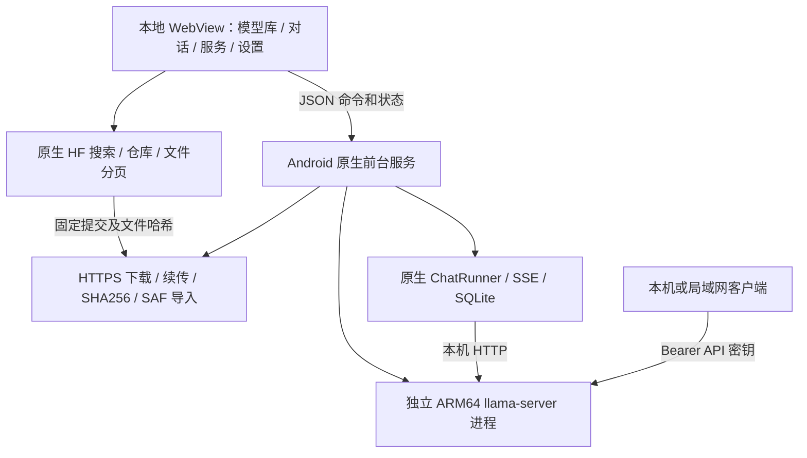

# LMA · Android 本地模型工作台

[中文](README.md) · [English](README.en.md) · [下载 / Releases](https://github.com/wikigsroom/LMA/releases) · [文档导航](docs/README.md) · [更新记录](CHANGELOG.md)

Android 版的本地模型管理、下载、对话和 API 服务应用。当前修订版本为 **0.2.0 / ARM64 / Android 9+**。

安装包：[v0.2.0 Release](https://github.com/wikigsroom/LMA/releases/tag/v0.2.0) 中的 `LMA-0.2.0-arm64-v8a.apk`，约 10.9 MB。模型权重由用户在应用中选择下载，APK 不含模型权重。LMA（Local Model App）是独立社区项目，与 LM Studio 无隶属关系；当前应用界面主要为中文，文档提供中英双语。

> **预发布状态：** 已签名构建，通过 226 项桌面断言和 APK / 原生库 / Android Lint 检查。当前没有可用 Android 真机；安装、实际推理、速度和后台耐久未实测。以下图片、视频与 GIF 来自随 APK 分发的实际界面，原生状态为明确的演示数据，**不是手机推理实录**。

<p>
  
  
  
</p>

## 阅读路线

| 需求 | 中文 | English |
| --- | --- | --- |
| 安装、页面操作、后台与排错 | [使用手册](docs/USER_GUIDE.md) | [User guide](docs/USER_GUIDE.en.md) |
| HF 搜索、量化选择、本地管理与支持范围 | [HF 与本地模型](docs/HF_MODELS.md) | [HF and local models](docs/HF_MODELS.en.md) |
| 模型独立参数、可编辑预设和自动归位 | [模型设置](docs/MODEL_SETTINGS.md) | [Per-model settings](docs/MODEL_SETTINGS.en.md) |
| 既有模型清单与独立无审查标签依据 | [标签与作者依据](docs/UNCENSORED_MODELS.md) | [Tags and publisher evidence](docs/UNCENSORED_MODELS.en.md) |
| 技术实现、生命周期、存储与网络 | [架构](docs/ARCHITECTURE.md) | [Architecture](docs/ARCHITECTURE.en.md) |
| 生图 / 语音 / 音乐 / 视频的 Android 可行性 | [多模态扩展核查](docs/MULTIMODAL.md) | [Multimodal feasibility](docs/MULTIMODAL.en.md) |
| 多模型、多引擎共用基座与迁移路线 | [基座评估](docs/FOUNDATION.md) | [Foundation assessment](docs/FOUNDATION.en.md) |
| v0.3.0 完整范围、平级标签与单版验收 | [需求与发版计划](docs/MULTIMODAL_RELEASE_PLAN.md) | [Requirements and releases](docs/MULTIMODAL_RELEASE_PLAN.en.md) |
| 任务表单、共用队列、内部执行与后台 | [任务执行方案](docs/WORKFLOWS.md) | [Task execution](docs/WORKFLOWS.en.md) |
| curl、Python、PowerShell 和 SSE | [API 接入](docs/API.md) | [API integration](docs/API.en.md) |
| 工具链、重建和验证 | [构建](docs/BUILD.md) | [Build](docs/BUILD.en.md) |
| 已通过检查与实测边界 | [验证](docs/VALIDATION.md) | [Validation](docs/VALIDATION.en.md) |
| 真机验收工具 | [设备验收](docs/DEVICE_ACCEPTANCE.md) | [Device acceptance](docs/DEVICE_ACCEPTANCE.en.md) |
| 截图、录屏和 GIF 的生成 | [双语媒体说明](docs/MEDIA.md) | [Bilingual media guide](docs/MEDIA.md) |
| 后续同步与发布 | [贡献约定](CONTRIBUTING.md)、[发布流程](docs/RELEASING.md) | [Contributing](CONTRIBUTING.md), [Releasing](docs/RELEASING.md) |

## 多模态扩展研究

下一版本 **v0.3.0** 一次性交付**完整本地多模态基座及 01–14 / 16 / 17 的运行支持与适配配方**：共用模型包 / 组件 / 配方、内部引擎模块、独立参数、任务 / 产物和 API。所有模型平级，按生文 / 生图 / 生视频 / 生音频及基座依赖标签筛选，保留既有推荐；交互为模型选择 → 任务表单 → 本机队列 → 结果。完整范围、工作包、风险及同一发布门槛见[版本更新需求](docs/MULTIMODAL_RELEASE_PLAN.md)和[交付摘要](docs/releases/v0.3.0-plan.md)。不拆分版本，不将必需模型默认顺延，不建设 ComfyUI 画布 / 用户节点 / 插件生态 / 图导入。v0.3.0 尚未发布。

全部分词、编码器、采样、codec 与导出在同一 Android 手机执行，无需 ROOT，无外部推理 / 回退。HF 用于搜索和显式资产下载。同架构变体可复用已有配方，新架构需要原生引擎 / APK 更新；Z20 与较新设备分别验收。源码 / 许可见[研究](docs/MULTIMODAL.md)，迁移见[基座评估](docs/FOUNDATION.md)，后台与恢复见[任务方案](docs/WORKFLOWS.md)。完整 MOSS / SoulX 仍有研究关卡，登记 / 下载不计可运行。**扩展尚未加入 APK、未有 LMA 真机生成证据；当前仍为 v0.2.0 文本 GGUF 和原演示素材。**

**App 更新只更新基座，APK 不打包模型权重，也不因安装 / 升级下载模型。** 用户自行选择模型 / 量化 / 配方，点击下载后才安装所选包及已展示的必需组件；可只装所需模型，在“本地”独立管理、设置、更新或删除。推荐是候选列表，功能标签与“已安装 / 可运行”分开。已有模型和参数升级保留，不静默替换权重。详见[资产边界与 A11 验收](docs/MULTIMODAL_RELEASE_PLAN.md)。

## 运行方案



同时加载一个模型、一个推理槽。界面退出不会主动取消原生下载与生成；下载完成与加载完成是两个阶段。模型加载后，本地对话和外部 API 共用同一引擎。应用内“停止生成”只取消当前回复，通知中的“停止服务”结束后台工作。完整状态机和恢复规则见架构文档。

## 操作演示

<p></p>

[完整 MP4 视频](docs/media/lma-walkthrough.mp4) · [HF 与本地管理 GIF](docs/media/lma-hf-local.gif) · [模型设置 GIF](docs/media/lma-model-settings.gif) · [API / 深色主题 GIF](docs/media/lma-api-theme.gif) · [全部截图](docs/MEDIA.md) · [来源与文件哈希](docs/media/manifest.json)。顶部全程显示 UI DEMO；HF 元数据与下载进度为模拟状态，对话为脚本文本，IP 和密钥为示例，没有执行 Android 或模型。录制脚本位于 `tools/capture_media.cjs`，结束时自动关闭所有测试页面和浏览器。

## 安装包核对

```text
APK SHA256: d8c16c7414ce5cc28c55fb3c2375c042e6735d53f73ebb5d4efa8388d7b130c1
包名: com.lma.app / versionCode 4
签名证书 SHA256: 90444a717a55549e2094364d8d7d005cf8b7f4df24562da62cc1884a2f341c17
```

可运行 `Get-FileHash .\LMA-0.2.0-arm64-v8a.apk -Algorithm SHA256`。后续升级须使用同一签名来源；自行构建会使用自己的密钥。Release 同时提供源码 ZIP、SHA256、验证 JSON 和演示视频。

## 使用

1. 将 APK 传到手机并安装；如果系统提示，允许当前文件管理器安装此 APK。
2. 打开“模型库”。“推荐”保留已选好的 `m08 → m06 → m01` 和原标签；“全部”及搜索可发现其他 HF 模型，选择仓库，再选择所需 GGUF 量化文件并下载。也能通过 HTTPS 直链添加或从设备导入 GGUF。
3. 下载完成后可在“本地”的模型设置中选择预设或手动填写参数，再点击“加载模型”。默认情况下，第一个下载完成的模型会自动加载。进入“对话”即可本地聊天。
4. 到“服务”页面设置电池优化豁免，并允许前台服务通知。努比亚等厂商系统可能还要在应用管理中允许后台运行、自启动和后台网络。
5. 模型加载成功后即提供 API。返回桌面或锁屏后，推理与下载由原生前台服务继续执行。通知中的“停止服务”会停止模型及当前下载。

首次下载需要网络；下载完成后的文本推理不依赖云端。应用不需要 ROOT、Termux、Docker 或 WSL。

## 推荐、全部与本地

| 入口 | 使用逻辑 |
| --- | --- |
| 推荐 | 原有 `m08`、`m06`、`m01` 的模型、顺序、标签及作者依据保留；HF 下载不会自动加入推荐 |
| 全部 / 搜索 | 动态查询 HF 公共模型 API，支持关键词、`owner/model`、HF 仓库链接、下载量 / 喜欢数 / 更新时间排序及前后分页；不是固定 14 项清单 |
| 格式筛选 | 默认 GGUF；选择“HF 全部格式”可检索其他格式的模型仓库，查看来源及其 GGUF 转换版本 |
| 文件选择 | 显示 GGUF 文件名、量化、大小与哈希；仓库提交固定后分页，不随 `main` 漂移；选择后添加下载任务 |
| 本地 | 集中管理内置、HF 和手动导入的已下载模型，以及进行中 / 中断的下载；可本地搜索、设置各模型参数、加载、暂停、续传和删除 |
| 轻量 / 进阶 | 保留原有精选目录的分组，便于比较既有候选 |

“全部格式”指 **HF 仓库发现范围**。当前运行器提供兼容的**单文件 GGUF 文本对话**，不直接运行 Safetensors、PyTorch、ONNX、MLX、分片 GGUF、视觉投影器或语音任务，也不会自动转换权重。即便是 GGUF，架构、量化、模板和内存仍需实际加载确认；LMA 目前还不是 LM Studio 的全部功能复刻。

公开模型无需 HF 账号。默认自动尝试 Hugging Face，失败后使用 HF Mirror；可在设置固定下载源。受限 / 私有仓库可在“设置 → Hugging Face 访问”保存可选 HF 令牌，并先在 HF 接受模型许可。令牌仅保存于应用私有设置，不回传到页面、日志或导出；设置后访问官方源，且不会随重定向发送给镜像或 CDN。详见 [HF 支持说明](docs/HF_MODELS.md)。

<p>
  
  
  
</p>

## 每个模型的参数

在“模型库 → 本地”点击已下载模型的设置图标，选择预设或直接输入数值。上下文上限读取该 GGUF 的架构元数据，超限自动回填；输出上限最多为所选上下文减一，实际可生成量还取决于输入与历史。读取不到模型上限时明确显示临时应用上限 8192。线程按设备处理器数限制，温度支持 0–2。

保存后参数跟随模型 ID，切换模型自动使用各自配置；旧版全局参数会迁移到已有模型。当前模型的上下文、线程、思考变更触发重载，输出、温度和系统提示词用于下次应用内对话。完整规则、例子、迁移与 API 边界见[模型设置说明](docs/MODEL_SETTINGS.md)。

<p></p>

## 已实现

- 保留 14 个原有精选 GGUF 和 3 个推荐。模型支持范围扩展为 HF 发现与兼容 GGUF 下载，普通模型同样可添加。
- “无审查”是独立标签：精选条目核对作者声明；在线 HF 名称 / 标签命中时显示“无审查 · 元数据”，不冒充已核对。普通模型不显示该标签；手动导入不会仅凭名称获得已核对标记。
- 14 个内置候选均固定具体仓库提交、准确字节数及 SHA256。通过 HF Mirror 元数据与实际字节探测核对；下载完整文件后再计算哈希比对。自定义链接没有预期哈希时只做格式、长度与本地哈希检查。
- 原生后台下载和独立原生推理进程；WebView 仅承载随包分发的本地界面。
- 本地聊天、SSE 流式显示、停止生成、思考过程、代码复制、SQLite 对话历史；中断后保存已收到的内容。
- OpenAI 兼容的 `/v1/models`、`/v1/chat/completions` 和 SSE；每次安装生成独立 API 密钥。
- 默认仅监听本机，可开启局域网访问。上下文、输出上限、CPU 线程、温度、思考和系统提示词改为每个模型独立保存；数值支持下拉预设和手动编辑，超限自动归位。端口等应用偏好仍在设置页。
- 运行日志导出、浅色 / 深色主题、可选开机解锁后恢复服务、进程异常退出后的有限恢复。

## 内置候选模型

全部选定文件为 `Q4_K_M` GGUF，下表使用十进制近似体积，**文件体积不等于运行内存**。精确字节数、文件名、固定版本和哈希见 [models.json](app/src/main/assets/models.json)；[作者依据清单](docs/UNCENSORED_MODELS.md)逐项链接固定说明。

| ID | 无审查模型 | 下载体积 | 定位 |
| --- | --- | ---: | --- |
| `m01` | Dolphin 3 · Qwen 0.5B Uncensored | 398 MB | 最小起步候选 |
| `m04` | Dolphin 3 · Llama 1B Uncensored | 808 MB | 轻量、英文 |
| `m05` | Gemma 3 · 1B Abliterated | 806 MB | 轻量、多语言 |
| `m06` | LFM 2.5 · 1.2B Uncensored | 731 MB | 推荐候选 |
| `m08` | Qwen 3 · 1.7B Abliterated | 1.11 GB | 中文推荐候选 |
| `m10` | LFM 2.5 · 2.6B Uncensored | 1.67 GB | 进阶、思考模型 |
| `m11` | Dolphin 3 · Qwen 3B Uncensored | 1.93 GB | 进阶、中文 |
| `m12` | Dolphin 3 · Llama 3B Uncensored | 2.02 GB | 进阶、英文 |
| `m13` | Llama 3.2 · 3B Uncensored | 2.24 GB | 进阶、英文 |
| `m14` | Qwen 3 · 4B Instruct 2507 Abliterated | 2.50 GB | 进阶、中文 |
| `m16` | Gemma 3 · 4B Abliterated v2 | 2.49 GB | 进阶、多语言 |
| `m03` | Qwen 3.5 · 0.8B Abliterated | 528 MB | 新架构、实验候选 |
| `m09` | Qwen 3.5 · 2B Abliterated | 1.27 GB | 新架构、实验候选 |
| `m15` | Qwen 3.5 · 4B Uncensored · HauhauCS Aggressive | 2.71 GB | 新架构、实验候选 |

原有推荐顺序固定为 `m08 → m06 → m01`。上表列出既有精选，不限制 HF 搜索或新增下载。自定义文件即使名称中含 uncensored，也不会自动变成已核对的条目。作者声明不保证绝不拒答；LMA 未独立实测拒答率，也没有逐个候选的 Android 推理记录。

## 努比亚 Z20 起步配置

为骁龙 855+ 提供 ARMv8 CPU 基线内核，默认 **4 线程 / 2048 上下文 / 512 输出 tokens / 关闭可切换的思考模式**。优先用 Dolphin 3 Qwen 0.5B 验证流程，再比较 Qwen 3 1.7B 或 LFM 2.5 1.2B。3B–4B 候选需要结合实际可用内存、温度和持续速度决定是否使用。

**当前没有连接 Z20 真机，未测量任何模型在手机上的 tokens/s、峰值内存或锁屏持续时长。** 目录中的候选、支持的架构和静态库检查不等于具体 GGUF 在该手机上已成功推理。

后台服务通过前台通知、CPU 唤醒锁和 Wi-Fi 锁维持工作。Android、厂商省电策略、用户强行停止、内存不足和发热仍可能终止或影响服务，无法承诺永久存活。一次请求会在 EOS、输出上限或客户端取消时结束；“后台持续输出”指请求生成期间仍可流式输出，不表示无限生成。

开机恢复为用户可选项，仅恢复此前启用且文件仍在的模型。系统是否允许开机启动以前台服务及厂商策略为准；失败后重新打开应用可再次恢复。应用没有静默跳过首次下载、通知和系统电池设置的机制。

## 接口

本机默认地址：`http://127.0.0.1:8080/v1`。局域网开启后，请使用“服务”页面展示的手机地址。同网设备连接时需要相同 API 密钥；局域网接口使用 HTTP。

```bash
curl http://PHONE_IP:8080/v1/chat/completions \
  -H "Authorization: Bearer YOUR_LMA_API_KEY" \
  -H "Content-Type: application/json" \
  -d '{"model":"m08","messages":[{"role":"user","content":"你好"}],"stream":true}'
```

请从 `/v1/models` 获取当前模型 ID；模型别名对应目录 ID，例如 `m08`。应用内“复制连接示例”会填入当前地址、模型 ID 和实际密钥。

## 本地构建

主构建路径使用 **Windows 原生 JDK + Android SDK**，已实际验证，不需要 Gradle 联网拉取插件、NDK、模拟器或虚拟化环境。

需要 JDK 21（`java`、`javac`、`keytool` 在 PATH）、Python 3、Android SDK Platform 35 和 Build Tools 35.0.1。

在本目录执行：

```powershell
python tools/bootstrap_runtime.py
python tools/build.py
python tools/test_protocol.py
python tools/test_backend.py
python tools/test_hub.py --live
python tools/test_sqlite.py
python tools/test_android_lint.py
python tools/verify_package.py
```

首次获取源码可执行 `git clone git@github.com:wikigsroom/LMA.git`，然后进入 `LMA/`。Git 不提交可重新获取的原生二进制；先运行上述 bootstrap，再构建。专门的 Release 源码 ZIP 带有原生库与验证记录。

可通过 `python tools/build.py --sdk C:/path/to/Android/Sdk` 指定 SDK。预编译引擎缓存位于 `third_party/cache/`；已有完整原生库时，构建无需再次下载引擎。

`tools/build.py` 执行 AAPT2、javac、D8、zipalign 和 apksigner，生成 `dist/` 中的 APK、SHA256 与构建记录。应用源码和资源也可导入 Android Studio；标准 Gradle 路径未在本次运行中执行。

**升级需保留本机 `signing/` 目录。** 私钥与随机口令只保存在该目录，已加入 `.gitignore`，不会放进 APK。更换签名会导致无法覆盖安装原版本；不要把签名私钥或口令公开上传。

本轮通过 85 项桌面后端、45 项 HF 逻辑、25 项协议、5 项 SQLite 查询和 66 项界面检查，共 226 项桌面断言；另有 5 项实时公开 HF 元数据检查。桌面后端执行真实生产 Java、TLS 连接与子进程，但使用明确的 Android 框架替身；没有运行 ARM 模型。

Android SDK 独立 Lint 对全部 16 个生产 Java 文件执行默认检查，结果为 0 错误、7 警告；需要 SDK Command-line Tools。14 个原生库的二进制 API 标记均为 28，15 个启动参数与固定上游版本吻合。这些均为静态证据，详细警告与待实测项目见 docs/VALIDATION.md。

界面检查可在安装 Playwright 的 Node 环境执行 `node tests/ui-smoke.cjs`。`LMA_PLAYWRIGHT` 可指定 Playwright 模块路径，`LMA_BROWSER` 可指定 Edge / Chromium 路径。测试使用明确的原生桥接测试数据，不运行模型，结束时关闭所有测试页面及浏览器。

完整发布前还执行 `python tools/build_acceptance.py`、`python tools/package_delivery.py`、`python tools/prepare_release.py` 和 `python tools/check_repository.py`。真实 Android 验收需要已授权的 ARM64 真机；工具不会启动模拟器。原始、可核对的检查记录整理在 [`verification/`](verification/)。

## 文件与验证

- `app/src/main/java/com/lma/app/`：原生服务、下载、推理进程、聊天、WebView 桥接。
- `app/src/main/assets/`：离线界面、模型目录及许可。
- `catalogue/research-source.json`：此前调查数据的本项目副本，构建不依赖上级目录。
- `catalogue/verified-models.json`：14 个条目的固定版本、大小、SHA256 与字节探测记录。
- `catalogue/architecture-check.json`：真实 GGUF 架构与固定上游源码、已打包原生库的静态对照。
- `catalogue/uncensored-policy.json`、`catalogue/uncensored-evidence.json`：14 个内置无审查版本的准入依据、固定作者说明及对应权重哈希。
- `third_party/runtime-lock.json`：上游发行包及每个原生库的 SHA256。
- `third_party/runtime-audit.json`：固定上游源码、启动参数、鉴权及 CPU 内核发现的静态核对。
- `docs/ARCHITECTURE.md`：后台生命周期、数据和接口边界。
- `docs/VALIDATION.md`：本轮复查结果、修复清单及尚未完成的验收。
- `docs/COMPLETION_AUDIT.md`：用户要求的逐项完成条件、当前证据和真机阻塞项。
- `docs/DEVICE_ACCEPTANCE.md`：真实 Android 验收工具的构建和运行方式。
- `docs/UNCENSORED_MODELS.md`：无审查模型清单、处理方式和作者依据。

LMA 自有代码使用 MIT 许可。llama.cpp 及其依赖保留各自许可；模型按各来源仓库的许可使用。目录中的“uncensored / abliterated”社区命名不保证任意问题都不拒答，也不代表模型能力已经过本应用实测。

## 后续更新约定

每次后续修改需同步更新代码、中英文 README / 配套文档、受影响截图与 GIF、[CHANGELOG.md](CHANGELOG.md) 及对应[版本说明](docs/releases/)，完成检查后提交并推送 `git@github.com:wikigsroom/LMA.git`。此要求已写入 [AGENTS.md](AGENTS.md)；具体执行见 [CONTRIBUTING.md](CONTRIBUTING.md) 和 [RELEASING.md](docs/RELEASING.md)。不覆盖已发布版本的不同字节附件，不强制推送，不改写已有标签。

`v0.1.2` 是本仓库首次公开发布的版本；此前 0.1.0 / 0.1.1 为本地迭代，不伪造历史 Release。当前发布按预发布标记，真机验收范围保留在发布说明中。

发布后的文档 / 工具维护使用 `python tools/check_repository.py --published`，核对不可变源码附件与发布标签，并检查当前文档和公开文件。草稿发行通过已认证列表定位，避免 GitHub 按标签查询草稿的 404；维护变更记录在 CHANGELOG 的后续维护段，不改写已公开的 APK、标签或附件。
