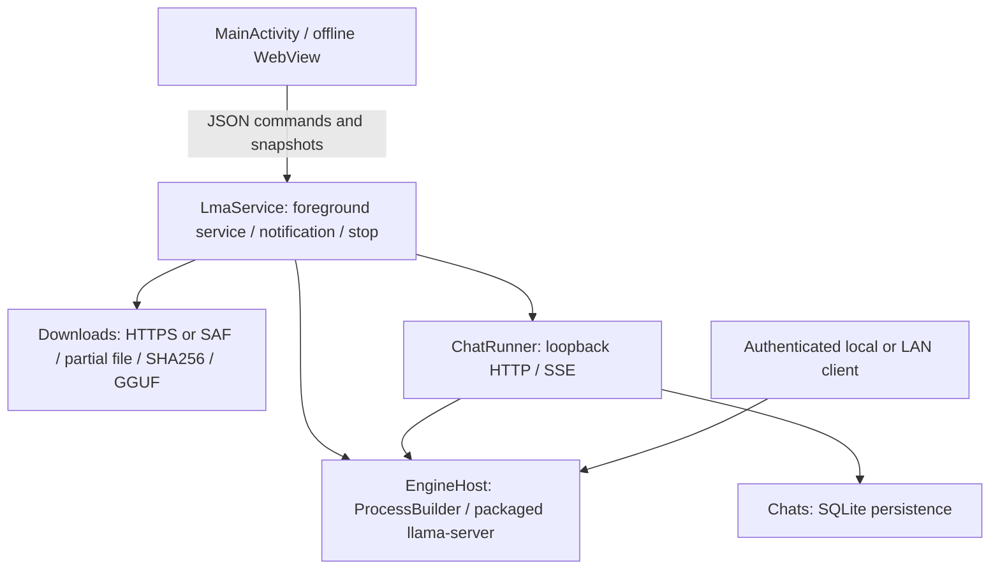

# LMA 0.2.0 architecture

Current dev.30: [old-LTX local video flow](LTX098_APP_FLOW.en.md) / [中文](LTX098_APP_FLOW.md), with [numbered delivery and complete same-release scope](releases/v0.3.0-dev.30.md). Sequential T5/Vulkan DiT/VAE/phone AVC connects independent settings, the shared queue and artifacts. Existing asset records stay immutable; users explicitly associate the new variant. Official-variant, numerical/quality/Android and complete Release gates remain open.

dev.29 historical checkpoint: [incremental local audio and playback](AUDIO_STREAMING.en.md) / [中文](AUDIO_STREAMING.md), with [numbered delivery and the full same-release scope](releases/v0.3.0-dev.29.md). Model-scoped opt-in streaming, bounded shared previews and verified full WAV publication. Trained Realtime/Android acceptance remains open; historical failures stay recorded.

This guide describes the current APK. Unimplemented multimodal expansion follows the [current requirements/release plan](MULTIMODAL_RELEASE_PLAN.en.md): equal peer models with task/dependency tags, forms and an on-phone queue, without a ComfyUI canvas/node ecosystem. See [local tasks/background](WORKFLOWS.en.md), [source research](MULTIMODAL.en.md) and [foundation/migration](FOUNDATION.en.md).

## HF discovery and Local management

`LmaApp` owns `HubCatalog`; `HubClient` queries HF using native HTTPS. Search and file requests have separate serial workers. Generation counters prevent stale searches replacing newer results; cursors support backward/forward navigation. A repository commit is pinned before tree pagination. Metadata is bounded at 8 MiB per response, 24 repositories per search page, and 100 tree entries per file page. Metadata browsing does not start a foreground service or promise permanent background execution; the inference service remains independent.

The bridge dispatches metadata/token commands directly. A download command can select only repository/commit/path values already present in the native file page. `LmaService.addHubModel` validates and persists the model, then reuses Store/Downloads. A deterministic repository/revision/path ID deduplicates HF entries and never changes the `m08 → m06 → m01` recommendations. Local collects installed models and unfinished tasks from every source.

All HF formats expands repository discovery, while the picker offers GGUF and explains disabled split, projector, oversized and known non-text files. Architecture, quantization and RAM compatibility still require loading. Ordinary models need no uncensored attribute; checked publisher labels and unverified metadata hints remain distinct. See [HF compatibility](HF_MODELS.en.md).

Optional HF tokens stay in private SharedPreferences; the page receives only a configured boolean. Authenticated requests use the official origin. Net rechecks every redirect and authorizes only the default official HF HTTPS endpoint, without sending tokens to CDNs, mirrors or custom hosts. Public requests retain mirror fallback. Active API/HF keys are redacted from logs and backups are disabled; hardware encryption or real gated-repository acceptance is not claimed.

Pause finalization now persists the terminal state and retires the download job under the same lock, preventing a concurrent disconnect from leaving a finished worker marked pausing.

[中文](ARCHITECTURE.md) · [Documentation](README.md)

## Runtime path

Native downloads and the engine outlive individual WebView pages. Returning to the interface reads durable transfer state and SQLite conversations. JSON commands carry request IDs; matching native success/failure acknowledgements drive draft clearing and settings completion.

## Engine and process lifecycle

The CPU runtime is llama.cpp v0.4.1 from ServLlama 1.2.2, recorded upstream commit `b29c606e28a01b1bc8c1351026a0fa6e616bf6c4`. Fourteen native libraries include an ARMv8.0 baseline and optimized ARMv8/9 kernels selected at runtime. Optional OpenCL and Hexagon modules are omitted.

Android extracts packaged ELF libraries to `nativeLibraryDir`. `ProcessBuilder` directly starts `libllama-server.so`, using that directory for dependent libraries. No shell, ROOT, or code downloaded into writable app storage is executed. The API key is passed through environment configuration and redacted from logs.

The engine uses CPU, one inference slot, and batch size 64. Threads and context are configurable. `--reasoning off|auto|on` is passed to the pinned version; models may ignore it. Startup waits for the old process to exit, probes the port, and requires both healthy `/health` and authenticated `/v1/models` with the expected alias. Loading times out after five minutes. Unexpected exits permit at most three recovery attempts; persistent failure keeps logs and stops retries.

## Catalogue and uncensored evidence

The generated catalogue joins research selections, exact GGUF metadata, and publisher-evidence records. Built-ins must be publisher-declared uncensored variants with matching repository, revision, and hash. Author claims and actual refusal-rate measurements remain separate. The app has no added keyword/content moderation layer; user-provided weights remain unclassified.

Model cards are data, never executed instructions. The evidence audit normalizes card bodies, checks explicit claims, and records attribution plus pinned URLs and hashes. Known organization renames and incorrect front matter are documented rather than blindly trusting tags. Full weights still require a completed SHA256 check on download.

## Downloads and storage

Private app storage contains models, transfer records, and SQLite data. Uninstalling removes them. Local paths use restricted IDs rather than user-controlled filenames. HTTPS redirects are checked. Range responses validate `Content-Range`; status 200 restarts writing; status 416 reaches verification only when total length matches.

Automatic mode first tries Hugging Face, then HF Mirror on connection/source failure. Initial primary connection/header timeouts are 8/10 seconds; transfer reads use 30 seconds. Other custom hosts are not rewritten. Downloads queue serially, cap a file at 12 GiB, and reserve 64 MiB. SAF imports stream bytes without loading a GGUF into Java memory; interrupted imports restart.

Known hash mismatches move to `.rejected`, which deletion also cleans. Cross-service per-model locks prevent simultaneous writes during rapid restarts. States include queued, downloading, pausing, verifying, done, paused, and error. On reconstruction, interrupted downloading/verifying entries can resume; user-paused entries remain paused.

## Chat and persistence

Native threads perform HTTP requests and SSE consumption. Content and reasoning are persisted roughly every 160ms; cancellation or failure retains saved text. Combined response text is capped at 1 MiB and oversized SSE events are rejected.

History selects at most 16 messages as complete user/assistant pairs from the most recent 32 rows. Empty failed replies and corresponding user turns are skipped; interrupted nonempty replies remain. Character budgeting is conservative, not a precise tokenizer, so a large current prompt or system message may still exceed model context. Engine errors appear in the conversation. External clients control their own messages and generation parameters.

## Android background behavior

A visible `specialUse` foreground service exposes Stop and holds CPU / Wi-Fi locks. An API-serving model keeps it active while idle; no-work state releases locks and foreground state. Optional boot restore accepts protected boot/app-update broadcasts and attempts only previously enabled, present models. Android force-stop, memory pressure, thermal management, and vendor policies cannot be bypassed reliably by an ordinary application.

No physical Android device was available. These implementation details and static checks do not establish actual background endurance.

## Per-model profiles

`Store` atomically persists `profiles` and `metadata` by model ID in `models-state.json`. Upgrade migration freezes legacy global inference preferences into existing models before removing the old keys. `GgufMetadata` reads bounded architecture/context metadata and caches file size/mtime. `ModelSettings` enforces native model, device and shared-context bounds, with an explicitly labeled application fallback when metadata is unknown.

The Local model settings dialog combines presets and editable inputs. Saving validates natively and returns actual values. Only changes to the active profile’s load parameters reload its engine; active in-app generation blocks those changes. Other profiles remain independent. `EngineHost` and `ChatRunner` request settings by explicit model ID. External API generation parameters remain request-controlled. See [limits and migration](MODEL_SETTINGS.en.md).

## UI and network boundaries

WebView loads packaged assets from a virtual HTTPS origin. File access, external network requests, and remote pages in the JavaScript-bridge context are blocked. Names, generated text, logs, and code are escaped rather than executing model HTML.

The default listener is `127.0.0.1:8080`; LAN switches to `0.0.0.0`. Inference requires an installation-specific random key. LAN is HTTP without built-in TLS/public tunneling. Exported logs redact the active key and exclude the chat database. Download connections and publisher-card links are distinct from inference traffic.

dev.14 adds the [Sana mobile / MNN pipeline](MNN_SANA_ENGINE.en.md): a real ARM64 CPU worker, 13 user-selected components, whitelisted Qwen3 metadata, encoder release before diffusion, per-model CFG/token/thread controls and immutable job plans. Its 74 host/C++ checks perform no model inference. All 21 templates remain metadata with separately confirmed downloads. Foundation 445 and UI 208 checks pass; 37 screenshots and recording/GIF are explicit UI FIXTUREs. No Android image/endurance evidence exists. Every frozen target and release gate remains in the same complete v0.3.0, without a new Release.

## dev.23: explicit preparation-to-runtime association

`ModelAssemblies` reads APK-signed metadata. `AssemblyPlan` binds preparation and target manifests with unique role mappings in the actual runtime. `TaskInput → LocalJobs → PreparedModelAssembly` reuses persistent jobs and the execution slot, fully verifies leased prepared files and invokes `BundleStore.adoptAvailableLocal`. Incomplete targets remain paused/uninstalled; neither downloader nor generation engine is invoked. API discovery includes user-selected partial runtime records and current plan fingerprints, allowing subsequent explicit dependency acquisition. Cancellation racing atomic commit retains verified cache while the task remains cancelled with no media. Restart starts no downloads. See [contracts and evidence boundaries](MODEL_ASSEMBLY.en.md).
