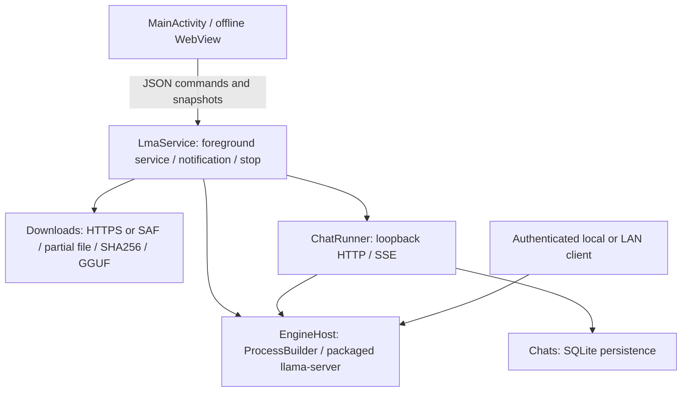

# LMA 0.1.2 architecture

[中文](ARCHITECTURE.md) · [Documentation](README.md)

## Runtime path

Native downloads and the engine outlive individual WebView pages. Returning to the interface reads durable transfer state and SQLite conversations. JSON commands carry request IDs; matching native success/failure acknowledgements drive draft clearing and settings completion.

## Engine and process lifecycle

The CPU runtime is llama.cpp v0.4.1 from ServLlama 1.2.2, recorded upstream commit `b29c606e28a01b1bc8c1351026a0fa6e616bf6c4`. Fourteen native libraries include an ARMv8.0 baseline and optimized ARMv8/9 kernels selected at runtime. Optional OpenCL and Hexagon modules are omitted.

Android extracts packaged ELF libraries to `nativeLibraryDir`. `ProcessBuilder` directly starts `libllama-server.so`, using that directory for dependent libraries. No shell, ROOT, or code downloaded into writable app storage is executed. The API key is passed through environment configuration and redacted from logs.

The engine uses CPU, one inference slot, and batch size 64. Threads and context are configurable. `--reasoning off|auto|on` is passed to the pinned version; models may ignore it. Startup waits for the old process to exit, probes the port, and requires both healthy `/health` and authenticated `/v1/models` with the expected alias. Loading times out after five minutes. Unexpected exits permit at most three recovery attempts; persistent failure keeps logs and stops retries.

## Catalogue and uncensored evidence

The generated catalogue joins research selections, exact GGUF metadata, and publisher-evidence records. Built-ins must be publisher-declared uncensored variants with matching repository, revision, and hash. Author claims and actual refusal-rate measurements remain separate. The app has no added keyword/content moderation layer; user-provided weights remain unclassified.

Model cards are data, never executed instructions. The evidence audit normalizes card bodies, checks explicit claims, and records attribution plus pinned URLs and hashes. Known organization renames and incorrect front matter are documented rather than blindly trusting tags. Full weights still require a completed SHA256 check on download.

## Downloads and storage

Private app storage contains models, transfer records, and SQLite data. Uninstalling removes them. Local paths use restricted IDs rather than user-controlled filenames. HTTPS redirects are checked. Range responses validate `Content-Range`; status 200 restarts writing; status 416 reaches verification only when total length matches.

Automatic mode first tries Hugging Face, then HF Mirror on connection/source failure. Initial primary connection/header timeouts are 8/10 seconds; transfer reads use 30 seconds. Other custom hosts are not rewritten. Downloads queue serially, cap a file at 12 GiB, and reserve 64 MiB. SAF imports stream bytes without loading a GGUF into Java memory; interrupted imports restart.

Known hash mismatches move to `.rejected`, which deletion also cleans. Cross-service per-model locks prevent simultaneous writes during rapid restarts. States include queued, downloading, pausing, verifying, done, paused, and error. On reconstruction, interrupted downloading/verifying entries can resume; user-paused entries remain paused.

## Chat and persistence

Native threads perform HTTP requests and SSE consumption. Content and reasoning are persisted roughly every 160ms; cancellation or failure retains saved text. Combined response text is capped at 1 MiB and oversized SSE events are rejected.

History selects at most 16 messages as complete user/assistant pairs from the most recent 32 rows. Empty failed replies and corresponding user turns are skipped; interrupted nonempty replies remain. Character budgeting is conservative, not a precise tokenizer, so a large current prompt or system message may still exceed model context. Engine errors appear in the conversation. External clients control their own messages and generation parameters.

## Android background behavior

A visible `specialUse` foreground service exposes Stop and holds CPU / Wi-Fi locks. An API-serving model keeps it active while idle; no-work state releases locks and foreground state. Optional boot restore accepts protected boot/app-update broadcasts and attempts only previously enabled, present models. Android force-stop, memory pressure, thermal management, and vendor policies cannot be bypassed reliably by an ordinary application.

No physical Android device was available. These implementation details and static checks do not establish actual background endurance.

## UI and network boundaries

WebView loads packaged assets from a virtual HTTPS origin. File access, external network requests, and remote pages in the JavaScript-bridge context are blocked. Names, generated text, logs, and code are escaped rather than executing model HTML.

The default listener is `127.0.0.1:8080`; LAN switches to `0.0.0.0`. Inference requires an installation-specific random key. LAN is HTTP without built-in TLS/public tunneling. Exported logs redact the active key and exclude the chat database. Download connections and publisher-card links are distinct from inference traffic.
