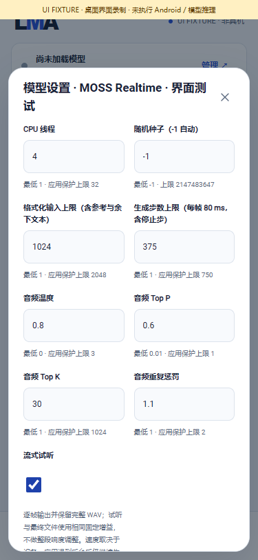
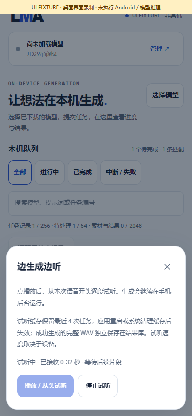

# 本机增量音频与流式试听

[English](AUDIO_STREAMING.en.md) · [原生布局](MOSS_RQ_ENGINE.md) · [本轮交付与完整待办](releases/v0.3.0-dev.29.md)

内部 **0.3.0-dev.29 / code 33** 将 MOSS Realtime 的逐帧解码接入生产任务、接口和试听页面。用户仍一次提交完整文本；这不是增量文本会话，也不承诺达到实时播放速度。完整训练模型的语音质量、手机资源与 Android 执行尚未验收。

## 1. 使用逻辑

1. 在“全部 / 搜索”选择匹配的 `moss_realtime_rq_cpu_v1` 配方。用户自行选择并下载或导入对应主干、24 kHz codec、BPE tokenizer 三个 GGUF；安装、升级或浏览页面不会下载模型。
2. 在“本地 → 模型详情 → 模型设置”开启 **流式试听**。默认关闭，选择随该模型独立保存；已排队请求保持提交时的不可变参数。旧 Local 等其他配方不会因此启用流式解码。
3. 在“使用模型”中填写完整文本，可选择已导入的 1–10 秒、24 kHz 单声道参考 WAV，然后明确提交到共享队列。生成上限仍按此模型参数约束，最高 750 个编码步，含停止步。
4. 首个片段出现后，“任务 → 边生成边听 → 播放”从开头逐段试听。打开面板不会自动播放。停止、关闭面板或切到后台会释放页面的播放资源；前台服务中的生成继续运行，直到完成、取消、出错或服务结束。
5. 成功时在结果库取得完整 PCM16 WAV，继续使用原有预览、导出、来源记录和再次生成逻辑。试听片段不会直接成为成功结果。

| 模型设置 | 边生成边听（明确的合成协议测试数据） |
|---|---|
|  |  |

[录屏](media/development/audio/audio-ui.mp4) · [GIF](media/development/audio/audio-ui.gif) · [媒体清单](media/development/audio/manifest.json)。这些媒体录制实际生产页面，原生桥接和 PCM 是标明的测试数据，没有执行模型或 Android。

## 2. 同手机处理链

```text
用户选择本地资产与本模型设置
  → 同一任务队列 / 执行锁 / 模型及输入租约
  → Android 自带的 MOSS Realtime 原生子进程
  → 每个非 EOS 编码帧 → 同一 codec 的有状态解码 → PCM16 片段
  → 应用私有试听缓存 → 同机页面 / 已鉴权客户端
  → 完整 WAV 与已发送 PCM 的格式、采样数、SHA256 一致
  → 原有产物提交 → 成功结果
```

没有远端执行、重复加载第二份 codec 或把已完成 WAV 再切片冒充增量输出。复用固定上游 `mudler/moss-tts.cpp` revision `ee722b8e9205ee9b1b1c398a4e87e4e393e9be41` 的状态解码器，通过受审计的构建副本暴露方法，原上游检出保持不改。每个真实非停止帧含 16 路编码，解码成 1,920 个单声道采样，即 **80 ms 音频内容**；它表示内容时长，不表示计算仅需 80 ms。每层保留有界 KV 窗口，不重新解码全部前缀。

整段模式保留上游结束后的全段 RMS 响度调整（增益最多 ±3 dB）。流式模式使用固定单位增益，对片段和最终 WAV 使用相同的有限值检查、限幅与 PCM16 量化；不会在结束后改变已试听的采样。因此两种模式的响度可能不同，开启流式试听是明确的模型设置。

## 3. 共用协议、缓存和错误边界

`lma.audio-stream/1` 是基座中的有界 PCM 通道；目前注册的生产提供方是 MOSS Realtime。通道支持 8–48 kHz、1–2 声道、PCM16，小于等于 120 秒 / 24 MiB、4,096 个片段，单片最多 4,800 个采样帧。该范围是传输保护范围，不代表其他模型已经支持。Realtime 将其收紧为 24 kHz / 单声道 / 每片 1,920 帧 / 本次步数上限。

片段必须从序号与采样偏移 0 连续递增；拒绝格式变更、越界、截断、非规范 Base64、重复 / 迟到片段和缺少结束边界。子进程正常结束后，再检查最终 WAV 的格式、总采样数和 PCM SHA256，完全一致才允许提交产物。PCM 不进入任务 JSON、任务事件或日志。

私有缓存最多保留最近 **4** 次任务，只有一个活动写入者；开启下一次时回收最旧终态缓存。每次应用启动清理旧试听缓存，不重跑模型。缓存也可能被系统回收。完整产物、用户模型、下载进度与设置独立保存。取消 / 失败 / 中断的缓存明确标为部分内容，没有完整结果 ID；页面停止试听不取消任务。缓存不可用时，用户可在模型设置中关闭流式试听，继续整段生成。

## 4. API

复用既有 Bearer key、请求约束和同一手机任务。可先预检，再提交：

```json
{
  "bundleId": "YOUR_INSTALLED_REALTIME_BUNDLE",
  "type": "speech.synthesize",
  "input": {"prompt": "由用户填写的完整文本"},
  "parameters": {"streamAudio": true, "maxNewTokens": 375},
  "allowUnmeasured": true
}
```

提交仍为 `POST /v1/jobs`；`allowUnmeasured` 只表示本次明确接受未测资源条件，不跳过组件和参数校验。

| 请求 | 行为 |
|---|---|
| `GET /v1/jobs/{id}/audio?after=0` | 返回格式、状态、总片段数 `nextSequence`、总采样帧、完整结果 ID 及最多 32 条片段描述；`cursor` 是本页结束位置 |
| `GET /v1/jobs/{id}/audio/{sequence}` | 返回该不可变片段的交错小端 PCM16 二进制，`application/octet-stream`、`X-Audio-Format: pcm_s16le` |
| `HEAD` 同路径 | 相同状态和长度，无内容体 |

客户端按顺序读取片段，再以返回的 `cursor` 继续查询；`state=streaming` 时可能暂时没有新片段。成功状态是 `succeeded`，且 `artifactId` 指向独立的完整 WAV。其他终态只表示部分试听。未开始或已过期返回资源不可用，错误游标返回 400。片段无需单独下载模型；浏览器 UI 使用同源私有路径，公共 API 继续拒绝浏览器 Origin。没有新增 WebSocket、远端推理地址或任意执行入口。

## 5. 验证范围

- 生产 `NativeWorker`、存储和鉴权接口：8 个实际主机子进程，其中 6 个在完整 WAV 存在前被观察到片段；包含错序、采样率、结束缺失 / 重复、迟到、内容不一致和取消对照。
- 生产 `LocalJobs`：成功、失败、取消、服务中断与结果 ID 的对应关系；部分 PCM 不进入任务记录或成功产物。
- 真实 GGML codec 图：固定上游的**未训练小型双声道夹具**，完整与部分编码深度、10 帧跨滑窗；流式对整段最大误差约 `5.59e-8`，门槛 `1e-3`。它不是完整 16/32 路、24 kHz 训练 codec 的质量验证。
- 生产页面：保存模型设置、无自动播放、真实 Web Audio 排程、顺序播放、停止 / 关闭释放、缓存过期和错序停止；没有下载或生成真实模型。

Android ARM64 编译、原签名 APK、当前回归和媒体分别留证。完整训练 Realtime 语音、首次声音耗时、持续速度 / RTF、内存、手机后台与全部冻结目标仍需完成。开发检查点不发布为完整 v0.3.0。
