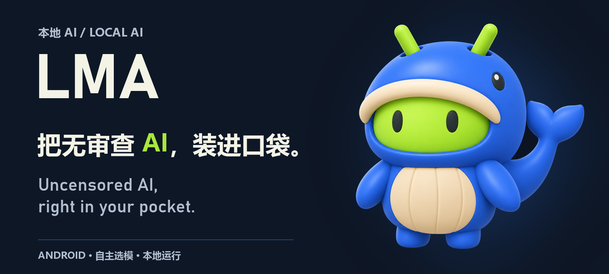
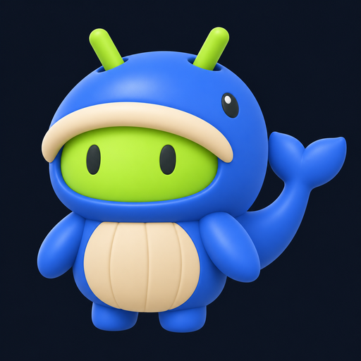

# LMA 品牌与 Logo 定稿 / Final logo

**标语已定稿 / Final slogan：04 号（本地 AI／无审查组）。**

**把无审查 AI，装进口袋。**

**Uncensored AI, right in your pocket.**

与 21 号「钴蓝软胶」配套使用；中英 README 已采用同一双语横幅，并保留可复制的文字。The selected slogan is paired with Cobalt Vinyl 21. Both READMEs use the same bilingual banner and accessible text.

**用户已于 2026-11-02 明确定稿：21 号「钴蓝软胶 / Cobalt Vinyl」。** 后续 LMA 品牌形象使用这一稿，保留鲸鱼套装安卓的轮廓与钴蓝／青柠／奶油配色。17 号仅为结构蓝本，其他编号保留为设计档案。

**The user finalized option 21, Cobalt Vinyl, on 2026-11-02.** Subsequent LMA branding follows this whale-costume Android design and its cobalt/lime/cream palette. Option 17 remains the structural blueprint; other directions are archived.

| 用途 / Purpose | 文件 / File | 规格 / Specification |
| --- | --- | --- |
| 原始定稿图 / Native selected artwork | [21-cobalt-vinyl.png](../output/imagegen/lma-logo-selection-20261102-batch3-whale17/21-cobalt-vinyl.png) | 1254 × 1254 PNG; native returned bytes preserved |
| 标准方形 Logo / Canonical square logo | [lma-logo.png](media/branding/lma-logo.png) | 512 × 512 PNG; byte-identical copy of the existing 21 preview |
| README 双语横幅 / Bilingual README banner | [lma-banner.png](media/branding/lma-banner.png) | 1600 × 720 PNG; approved logo 21 and exact slogan 04 |
| 横幅与标语记录 / Banner and slogan provenance | [banner.json](media/branding/banner.json) | Final bilingual wording, source identity, palette and banner hash |
| 生成与选型记录 / Provenance and selection | [第三批清单 / Manifest](../output/imagegen/lma-logo-selection-20261102-batch3-whale17/manifest.json) | Final selection: 21; structural reference: 17 |
| 选型历史 / Selection history | [第三批说明 / Batch 3](LOGO_SELECTION_20261102_BATCH3.md) | All ten variants retained |

形象要点：大鲸鱼帽与帽内安卓脸、帽顶双天线、侧面鲸鱼眼、短鳍手臂、短脚、奶油色腹部、右侧上翘分叉鲸尾。以已有原图为视觉依据；不用其他候选的材质或配色替换定稿。

Key features: oversized whale hood around the Android face, twin top antennae, separate whale side eye, short flipper arms and feet, cream belly, and a raised forked tail on the right. Use the existing image as the visual reference, retaining its selected rendering and palette.

原始图 SHA256 / Native artwork SHA256:

`f224b6e0fb1030fa894557bf6961d5d3e5d3b00430c5a0077bf9b85f3831282f`

标准方形 Logo SHA256 / Canonical square-logo SHA256:

`3155c4601396c8623c20879b903e317747a94a7b840be307bcc93fde988c8bea`

当前定稿图为带深色底的栅格 PNG；README 横幅复用原始 21 号图像并进行背景与文字排版。Android launcher/adaptive icon、正式透明／单色／矢量素材与应用内形象接入仍待实现；原始定稿图与已发布 APK／附件保留。

The finalized artwork is an opaque dark-background raster PNG. The README banner reuses the original 21 artwork with derived background composition and exact bilingual text. Its alpha mask is a banner-only layout aid. Production transparent/monochrome/vector/adaptive assets and in-app branding remain integration work; native artwork and published APK assets are preserved.

| 编号 / ID | 已完成 / Completed |
| --- | --- |
| C01 | 用户定稿 21，并写入仓库工作约定 / Final selection persisted in repository instructions |
| C02 | 中英 README、统一素材、清单与更新说明 / Bilingual READMEs, canonical asset, metadata and notes |

| 编号 / ID | 待处理 / Pending |
| --- | --- |
| P01 | 按 21 号实施正式 Android 图标及配套形象接入 / Production icon and in-app integration |
| P02 | 原 D01–D12 及冻结模型范围 / Existing functional plan and frozen model scope |

## 横幅与标语 / Banner and slogan

定稿文字保留逗号、句号与 AI 两侧空格。04 是“本地 AI／无审查”组的编号。品牌主张强调手机本地运行与无审查模型选择；产品继续保留完整 HF 发现流程和独立标签，模型兼容性及运行结果仍按实际能力说明。

The selected wording, punctuation and spacing are preserved. ID 04 belongs to the local-AI / uncensored set. Branding highlights phone-local AI and uncensored model choice; broad HF discovery and separate tags remain in place, with compatibility and behavior described by actual support.

[横幅生成工具](../tools/render_brand_banner.py) 使用已有 Logo 与本机字体排版；没有重新请求生图，也没有启动浏览器或虚拟化。背景分离仅用于当前横幅，不构成正式透明 Logo 母版。已检查原尺寸及 390px 宽静态缩略图；这不是手机或浏览器验收。

The local renderer composes existing artwork and local typography without new AI generation, browsers or virtualization. The banner-only derived mask is not a production transparent logo master. Visual review covers the native banner and a static 390px-wide preview, not phone/browser acceptance.

重建 / Rebuild: `python tools/render_brand_banner.py`（需要 Pillow）。默认使用 Windows 的 Microsoft YaHei 与 Bahnschrift 系统字体；其他环境可用 `--font-zh` 和 `--font-display` 指定本机字体路径。System fonts are not copied into the repository. [素材检查 / Artifact checks](media/branding/banner-validation.json).

| 编号 / ID | 本轮完成 / Completed |
| --- | --- |
| C03 | 04 号双语标语及定稿记录 / Exact slogan and persisted choice |
| C04 | 21 号 Logo 配套双语横幅与中英文 README / Banner and READMEs |
| C05 | 本地重建工具、来源及素材检查 / Renderer, provenance and scoped checks |
