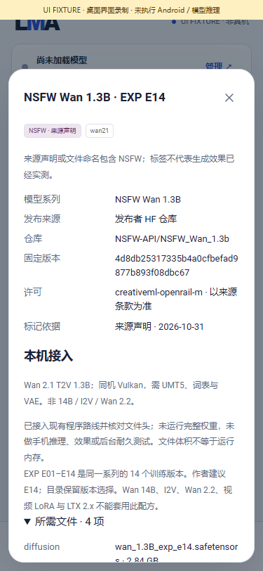

# 社区生图 / 生视频模型与内容标记

[English](COMMUNITY_MODELS.en.md) · [README](../README.md) · [v0.3.1 更新](releases/v0.3.1.md)

v0.3.1 新增 **14 个系列、44 个可选 checkpoint 配方：生图 30 个版本、生视频 14 个版本**。其中 **28 个有明确的 NSFW 来源标记：生图 14 个、生视频 14 个，来自 8 个系列**。另有 1 个仅具 HF 敏感受众标记，15 个内容声明不足。登记目录合计 67 套配方。这里统计权重版本，不将同一系列的多个训练版本说成多个独立架构。

所有模型平级，功能、架构、引擎、依赖、内容属性、安装状态和验证依据分别标注。推荐严格保留 **m08 → m06 → m01**。APK 只提供程序与元数据，权重及配套文件仍由用户明确选择；所有推理都在同一台 Android 手机上。

## 使用顺序

1. 进入“模型 → 全部”。选择“已登记配方”可离线浏览随 App 提供的目录；选择全部来源 / HF 仓库搜索可继续发现其他仓库。“已登记配方”不受 HF 格式筛选影响。
2. 将“生图 / 生视频”与“NSFW / 敏感 · HF 标记 / 内容未标注”组合筛选。仅输入 NSFW 搜索时，按内容分类匹配，避免把“未确认 NSFW”的否定说明当成命中。
3. 打开“来源、内容标记与兼容说明”，核对发布者 / 镜像、固定版本、许可、引擎、组件和限制；再进入原有管理页检查下载清单。
4. 明确点击下载后，仅将所选配方及已列出的依赖交给原有断点续传管理器。相同哈希的组件复用；选择系列不会自动下载所有版本。
5. “本地”保留已下载模型及未完成的传输，可以暂停、继续、删除和编辑该配方的独立参数。原有预设输入框可自行编辑、超限归位，内容筛选不修改参数。
6. 选择“使用”，按能力填写输入、核对本次参数并提交共用队列。取消、结果管理和本机接口沿用已有流程。

## 标记依据

| 标记 | 含义与限制 |
| --- | --- |
| NSFW · 来源声明 | 固定版本发布者模型卡有明确声明，不代表已测生成效果。 |
| NSFW · 分级词表 | 作者文档列出 NSFW 分级；App 不附示例作品或生成提示词。 |
| NSFW · 文件标记 | 发布者所选权重的文件名明确包含 NSFW。 |
| NSFW · 镜像声明 | 镜像转述声明，不冒充原作者的独立确认。 |
| NSFW · HF 标签 / 名称提示 | 实时搜索元数据，未逐项核对作者、权重或架构。 |
| 敏感 · HF 标签 | `not-for-all-audiences` 是更宽的受众标记，单独存在不等于已确认 NSFW 生成能力。 |
| 内容未标注 | 尚无足够声明，不等于承诺模型仅输出普通内容。 |

原有文本 Uncensored / Abliterated 标签独立保留。不因“无过滤”、基础架构相同或缺少安全检查器就自动标成 NSFW。HF 作者元数据机制见[官方模型卡说明](https://huggingface.co/docs/hub/model-cards)。

## 登记系列

| 编号 | 系列 | 版本数 | NSFW 版本数 | 功能 | 程序路线 |
| --- | --- | ---: | ---: | --- | --- |
| 01 | [DreamShaper](https://huggingface.co/Lykon/DreamShaper) | 1 | 0 | Image | sd15 / cpu |
| 02 | [Realistic Vision](https://huggingface.co/SG161222/Realistic_Vision_V6.0_B1_noVAE) | 2 | 1 | Image | sd15 / cpu |
| 03 | [RealVisXL](https://huggingface.co/SG161222/RealVisXL_V3.0) | 3 | 3 | Image | sdxl / cpu |
| 04 | [Juggernaut](https://huggingface.co/RunDiffusion/Juggernaut-XL-v9) | 3 | 1 | Image | sdxl / cpu |
| 05 | [NoobAI](https://huggingface.co/Laxhar/noobai-XL-1.1) | 1 | 0 | Image | sdxl / cpu |
| 06 | [Illustrious](https://huggingface.co/OnomaAIResearch/Illustrious-xl-early-release-v0) | 4 | 0 | Image | sdxl / cpu |
| 07 | [Animagine](https://huggingface.co/cagliostrolab/animagine-xl-3.1) | 3 | 2 | Image | sdxl / cpu |
| 08 | [CyberRealistic](https://huggingface.co/cyberdelia/CyberRealistic) | 3 | 0 | Image | sd15 / cpu |
| 09 | [CyberIllustrious](https://huggingface.co/cyberdelia/CyberIllustrious) | 1 | 0 | Image | sdxl / cpu |
| 10 | [Pony Diffusion](https://huggingface.co/LyliaEngine/Pony_Diffusion_V6_XL) | 1 | 1 | Image | sdxl / cpu |
| 11 | [Kohaku](https://huggingface.co/KBlueLeaf/Kohaku-XL-Zeta) | 2 | 1 | Image | sdxl / cpu |
| 12 | [OrangeMix](https://huggingface.co/WarriorMama777/OrangeMixs) | 5 | 5 | Image | sd15 / cpu |
| 13 | [Counterfeit](https://huggingface.co/gsdf/Counterfeit-V3.0) | 1 | 0 | Image | sd15 / cpu |
| 14 | [NSFW Wan 1.3B](https://huggingface.co/NSFW-API/NSFW_Wan_1.3b) | 14 | 14 | Video | wan21 / vulkan |

## 兼容与资源边界

- SD 1.5 / SDXL 沿用完整 checkpoint、配套 CLIP 数据与 CPU 引擎。Realistic Vision no-VAE 条目明确增加固定版本的 SD VAE MSE 依赖；已有 SD1.5 / SDXL 生图 LoRA 配对能力保留。
- 14 个视频配方全部是 **Wan 2.1 T2V 1.3B**，使用同机 Vulkan、共用 UMT5 编码器、词表和 Wan VAE。EXP E01–E14 是同一个系列的训练版本；作者建议 E14，LMA 未测效果。作者报告的旧版质量问题不改写为通过，本目录不预登记旧版。见[发布者模型卡](https://huggingface.co/NSFW-API/NSFW_Wan_1.3b)。
- **Wan 14B、I2V、Wan 2.2、视频 LoRA、新 LTX 2.x / 2.3 不适用这些配方**。旧 motion helper 针对更早 Wan checkpoint，EXP 系列不需要它。HF 中仍可发现这些仓库；[兼容性调研](../research/community/compatibility-survey.json)记录具体不适配原因，发现不等于可执行。
- 当前 LTX 引擎仍是独立的旧 0.9.8 路线。Qwen-Image / Z-Image 基础路线保持原样，其他微调或 LoRA 必须明确匹配架构与组件规则，不能仅看文件后缀接入。
- 文件头检查确认 checkpoint 组件、交叉注意力维度或 Wan 层数 / patch 形状，不证明预测语义、效果、峰值内存或 Android 驱动兼容。模型卡中的具体设置可能仍需调整；界面只开放当前参数 schema 已支持的设置。
- 目前没有可用真机。完整 SDXL 和多组件视频包可能超出努比亚 Z20 的实际资源范围；文件大小不等于运行内存，登记条目不代表承诺该手机能运行。本机资源检查继续生效。

## 来源、许可与后续维护

完整内容见[来源选择](../catalogue/community-sources.json)、[有界 API / 文件头记录](../research/community/metadata.json)、[生成配方](../catalogue/community-bundles.json)和[逐组件证据](../catalogue/community-bundle-evidence.json)。27 个来源仓库中包含 1 个只提供 VAE 依赖的仓库。记录固定版本、大小、发布者 LFS SHA256、模型卡哈希 / 短声明依据、文件头哈希与架构检查结果，不保存权重、预览或模型卡图库。
Pony V6 明确标为镜像，HF 许可字段与转述的修改版 Fair AI 条款冲突；界面提示冲突并提供原作者来源。不能将 HF 许可标识当成完整商用授权。Juggernaut 不同版本及其他系列也保留各自的许可声明；APK 许可不替代模型权重许可。
离线生成使用 `python tools/community_catalogue.py`、`python tools/build_bundle_catalogue.py`。明确更新元数据时使用 `--refresh --origin https://huggingface.co`，或明确注明的 HF 镜像。工具只请求 API、模型卡和严格 Range 文件头；服务器忽略 Range 时拒绝读取。配方 ID 含完整描述的内容哈希，声明变更不会覆盖用户已安装的不可变配方；权重和设置仍由用户控制。

## 程序证据与页面演示

专门的目录 / 生产 Java 检查覆盖全部 44 个配方、独立参数约束、功能路线、标记来源、非法来源链接，以及用户 HF 配方中的标签保留。页面检查覆盖筛选、明确下载、本地管理、来源详情和窄屏。未下载、复制或执行完整训练模型，不声称真机、画质或耐久已通过。

[MP4 录屏](media/development/community/community-ui.mp4) · [页面素材说明](media/development/community/manifest.json)

## 固定文件清单

| 编号 | 版本 | 大小 GiB | 内容依据 | 来源文件 |
| --- | --- | ---: | --- | --- |
| 01 | DreamShaper 8 | 1.99 | none | [DreamShaper_8_pruned.safetensors](https://huggingface.co/Lykon/DreamShaper/blob/228d79cb20811466f5c5710aa91f05dabd0b8a14/DreamShaper_8_pruned.safetensors) |
| 02 | Realistic Vision 6.0 B1 FP16 | 1.99 | publisher_card | [Realistic_Vision_V6.0_NV_B1_fp16.safetensors](https://huggingface.co/SG161222/Realistic_Vision_V6.0_B1_noVAE/blob/9a857a696b9aabbf509073e0aa55ec8200b6ef7d/Realistic_Vision_V6.0_NV_B1_fp16.safetensors) |
| 03 | Realistic Vision 5.1 FP16 | 1.99 | none | [Realistic_Vision_V5.1_fp16-no-ema.safetensors](https://huggingface.co/SG161222/Realistic_Vision_V5.1_noVAE/blob/1e9f017a7b1eaefb63a1900ea6c5953d2739fd21/Realistic_Vision_V5.1_fp16-no-ema.safetensors) |
| 04 | RealVisXL 3.0 | 6.46 | publisher_card | [RealVisXL_V3.0.safetensors](https://huggingface.co/SG161222/RealVisXL_V3.0/blob/5dd66d6fe796ff7b5a31595e5d0ac2f6a39e7ad9/RealVisXL_V3.0.safetensors) |
| 05 | RealVisXL 4.0 | 6.46 | publisher_card | [RealVisXL_V4.0.safetensors](https://huggingface.co/SG161222/RealVisXL_V4.0/blob/26dfe44930964cd70d0a817b6d1cc945c130e38d/RealVisXL_V4.0.safetensors) |
| 06 | RealVisXL 5.0 | 6.46 | publisher_card | [RealVisXL_V5.0_fp16.safetensors](https://huggingface.co/SG161222/RealVisXL_V5.0/blob/ac93e0dda1f6d448cae19bbfab8c5e720a5e48bc/RealVisXL_V5.0_fp16.safetensors) |
| 07 | Juggernaut 9 | 6.62 | none | [Juggernaut-XL_v9_RunDiffusionPhoto_v2.safetensors](https://huggingface.co/RunDiffusion/Juggernaut-XL-v9/blob/cf419233522daa0b9ea36c3aff98fa2cab1fb0fb/Juggernaut-XL_v9_RunDiffusionPhoto_v2.safetensors) |
| 08 | Juggernaut X | 6.62 | publisher_filename | [Juggernaut-X-RunDiffusion-NSFW.safetensors](https://huggingface.co/RunDiffusion/Juggernaut-X-v10/blob/35e4f3ccbe745c3e1221715d04a452aaa1ee5761/Juggernaut-X-RunDiffusion-NSFW.safetensors) |
| 09 | Juggernaut XI | 6.62 | none | [Juggernaut-XI-byRunDiffusion.safetensors](https://huggingface.co/RunDiffusion/Juggernaut-XI-v11/blob/f836518c7a75f47a9e26bc661ff9509ef2ceb7c0/Juggernaut-XI-byRunDiffusion.safetensors) |
| 10 | NoobAI XL 1.1 | 6.62 | hf_sensitive_tag | [NoobAI-XL-v1.1.safetensors](https://huggingface.co/Laxhar/noobai-XL-1.1/blob/814a274af2b8097c0828819d561ec74c7d0c6cea/NoobAI-XL-v1.1.safetensors) |
| 11 | Illustrious XL 0.1 | 6.46 | none | [Illustrious-XL-v0.1.safetensors](https://huggingface.co/OnomaAIResearch/Illustrious-xl-early-release-v0/blob/dca0dac303e6dc4b0c31d8001bc685b89b5d0204/Illustrious-XL-v0.1.safetensors) |
| 12 | Illustrious XL 1.0 | 6.46 | none | [Illustrious-XL-v1.0.safetensors](https://huggingface.co/OnomaAIResearch/Illustrious-XL-v1.0/blob/89d625482edf06d545b740265482f5c8fb2cadb0/Illustrious-XL-v1.0.safetensors) |
| 13 | Illustrious XL 1.1 | 6.46 | none | [Illustrious-XL-v1.1.safetensors](https://huggingface.co/OnomaAIResearch/Illustrious-XL-v1.1/blob/8d966ec810874502d56a22ec9130dab6ef74c5ff/Illustrious-XL-v1.1.safetensors) |
| 14 | Illustrious XL 2.0 | 6.46 | none | [Illustrious-XL-v2.0.safetensors](https://huggingface.co/OnomaAIResearch/Illustrious-XL-v2.0/blob/69459c1fe6f46db41ab31e6114f05acc0e06bcaa/Illustrious-XL-v2.0.safetensors) |
| 15 | Animagine XL 3.1 | 6.46 | none | [animagine-xl-3.1.safetensors](https://huggingface.co/cagliostrolab/animagine-xl-3.1/blob/483f0c322568ed13697ed01dd0be07204746d12b/animagine-xl-3.1.safetensors) |
| 16 | Animagine XL 4.0 | 6.46 | publisher_rating | [animagine-xl-4.0.safetensors](https://huggingface.co/cagliostrolab/animagine-xl-4.0/blob/2b7c1b397761bf5bd3cc42e5b39ec99314a75a96/animagine-xl-4.0.safetensors) |
| 17 | Animagine XL 4.0 OPT | 6.46 | publisher_rating | [animagine-xl-4.0-opt.safetensors](https://huggingface.co/cagliostrolab/animagine-xl-4.0/blob/2b7c1b397761bf5bd3cc42e5b39ec99314a75a96/animagine-xl-4.0-opt.safetensors) |
| 18 | CyberRealistic 9 FP16 | 1.99 | none | [CyberRealistic_V9_FP16.safetensors](https://huggingface.co/cyberdelia/CyberRealistic/blob/99827f96edd717dacb28c68560680c201c55df05/CyberRealistic_V9_FP16.safetensors) |
| 19 | CyberRealistic XL 10 FP16 | 6.46 | none | [CyberRealisticXLPlay_V10.0_FP16.safetensors](https://huggingface.co/cyberdelia/CyberRealisticXL/blob/c04ae13b465d19763561a834d625a3d504a4f315/CyberRealisticXLPlay_V10.0_FP16.safetensors) |
| 20 | CyberRealistic Pony 18 F16 | 6.46 | none | [CyberRealisticPony_V18.0_F16.safetensors](https://huggingface.co/cyberdelia/CyberRealisticPony/blob/bf85880a58614199d0391c93151211be2832bb8c/CyberRealisticPony_V18.0_F16.safetensors) |
| 21 | CyberIllustrious 10 FP16 | 6.46 | none | [CyberIllustrious_V10_FP16.safetensors](https://huggingface.co/cyberdelia/CyberIllustrious/blob/8a6f01bba289d7e76f3123c01f0a16ef742fd771/CyberIllustrious_V10_FP16.safetensors) |
| 22 | Pony Diffusion V6 XL | 6.46 | mirror_card | [ponyDiffusionV6XL_v6StartWithThisOne.safetensors](https://huggingface.co/LyliaEngine/Pony_Diffusion_V6_XL/blob/14885f1c01d7723bcbf676773def286c1fd733bc/ponyDiffusionV6XL_v6StartWithThisOne.safetensors) |
| 23 | Kohaku XL Zeta | 6.46 | publisher_rating | [kohaku-xl-zeta.safetensors](https://huggingface.co/KBlueLeaf/Kohaku-XL-Zeta/blob/c14affd9483ac7603cfff3f06b05da22a06deaa6/kohaku-xl-zeta.safetensors) |
| 24 | Kohaku XL Epsilon rev3 | 6.46 | none | [kohaku-xl-epsilon-rev3.safetensors](https://huggingface.co/KBlueLeaf/Kohaku-XL-Epsilon-rev3/blob/680841c3ca6283b7795db608315c4472304648d4/kohaku-xl-epsilon-rev3.safetensors) |
| 25 | AbyssOrangeMix 2 NSFW FP16 | 1.99 | publisher_card | [Models/AbyssOrangeMix2/Pruned/AbyssOrangeMix2_nsfw_pruned_fp16_with_VAE.safetensors](https://huggingface.co/WarriorMama777/OrangeMixs/blob/ec9df50045e9687fd7ea8116db84c4ad5c4a4358/Models/AbyssOrangeMix2/Pruned/AbyssOrangeMix2_nsfw_pruned_fp16_with_VAE.safetensors) |
| 26 | AbyssOrangeMix 3 A1B | 1.99 | publisher_card | [Models/AbyssOrangeMix3/AOM3A1B_orangemixs.safetensors](https://huggingface.co/WarriorMama777/OrangeMixs/blob/ec9df50045e9687fd7ea8116db84c4ad5c4a4358/Models/AbyssOrangeMix3/AOM3A1B_orangemixs.safetensors) |
| 27 | AbyssOrangeMix 3 A1 | 1.99 | publisher_card | [Models/AbyssOrangeMix3/AOM3A1_orangemixs.safetensors](https://huggingface.co/WarriorMama777/OrangeMixs/blob/ec9df50045e9687fd7ea8116db84c4ad5c4a4358/Models/AbyssOrangeMix3/AOM3A1_orangemixs.safetensors) |
| 28 | AbyssOrangeMix 3 A3 | 1.99 | publisher_card | [Models/AbyssOrangeMix3/AOM3A3_orangemixs.safetensors](https://huggingface.co/WarriorMama777/OrangeMixs/blob/ec9df50045e9687fd7ea8116db84c4ad5c4a4358/Models/AbyssOrangeMix3/AOM3A3_orangemixs.safetensors) |
| 29 | VividOrangeMix NSFW | 1.99 | publisher_card | [Models/VividOrangeMix/VividOrengeMix_NSFW.safetensors](https://huggingface.co/WarriorMama777/OrangeMixs/blob/ec9df50045e9687fd7ea8116db84c4ad5c4a4358/Models/VividOrangeMix/VividOrengeMix_NSFW.safetensors) |
| 30 | Counterfeit 3 FP16 | 3.95 | none | [Counterfeit-V3.0_fp16.safetensors](https://huggingface.co/gsdf/Counterfeit-V3.0/blob/d8ce63b3eb8e9102e54b3fcc07f9cb7a28ef30fc/Counterfeit-V3.0_fp16.safetensors) |
| 31 | NSFW Wan 1.3B · EXP E01 | 2.64 | publisher_card | [wan_1.3B_exp_e1.safetensors](https://huggingface.co/NSFW-API/NSFW_Wan_1.3b/blob/4d8db25317335b4a0cfbefad9877b893f08dbc67/wan_1.3B_exp_e1.safetensors) |
| 32 | NSFW Wan 1.3B · EXP E02 | 2.64 | publisher_card | [wan_1.3B_exp_e2.safetensors](https://huggingface.co/NSFW-API/NSFW_Wan_1.3b/blob/4d8db25317335b4a0cfbefad9877b893f08dbc67/wan_1.3B_exp_e2.safetensors) |
| 33 | NSFW Wan 1.3B · EXP E03 | 2.64 | publisher_card | [wan_1.3B_exp_e3.safetensors](https://huggingface.co/NSFW-API/NSFW_Wan_1.3b/blob/4d8db25317335b4a0cfbefad9877b893f08dbc67/wan_1.3B_exp_e3.safetensors) |
| 34 | NSFW Wan 1.3B · EXP E04 | 2.64 | publisher_card | [wan_1.3B_exp_e4.safetensors](https://huggingface.co/NSFW-API/NSFW_Wan_1.3b/blob/4d8db25317335b4a0cfbefad9877b893f08dbc67/wan_1.3B_exp_e4.safetensors) |
| 35 | NSFW Wan 1.3B · EXP E05 | 2.64 | publisher_card | [wan_1.3B_exp_e5.safetensors](https://huggingface.co/NSFW-API/NSFW_Wan_1.3b/blob/4d8db25317335b4a0cfbefad9877b893f08dbc67/wan_1.3B_exp_e5.safetensors) |
| 36 | NSFW Wan 1.3B · EXP E06 | 2.64 | publisher_card | [wan_1.3B_exp_e6.safetensors](https://huggingface.co/NSFW-API/NSFW_Wan_1.3b/blob/4d8db25317335b4a0cfbefad9877b893f08dbc67/wan_1.3B_exp_e6.safetensors) |
| 37 | NSFW Wan 1.3B · EXP E07 | 2.64 | publisher_card | [wan_1.3B_exp_e7.safetensors](https://huggingface.co/NSFW-API/NSFW_Wan_1.3b/blob/4d8db25317335b4a0cfbefad9877b893f08dbc67/wan_1.3B_exp_e7.safetensors) |
| 38 | NSFW Wan 1.3B · EXP E08 | 2.64 | publisher_card | [wan_1.3B_exp_e8.safetensors](https://huggingface.co/NSFW-API/NSFW_Wan_1.3b/blob/4d8db25317335b4a0cfbefad9877b893f08dbc67/wan_1.3B_exp_e8.safetensors) |
| 39 | NSFW Wan 1.3B · EXP E09 | 2.64 | publisher_card | [wan_1.3B_exp_e9.safetensors](https://huggingface.co/NSFW-API/NSFW_Wan_1.3b/blob/4d8db25317335b4a0cfbefad9877b893f08dbc67/wan_1.3B_exp_e9.safetensors) |
| 40 | NSFW Wan 1.3B · EXP E10 | 2.64 | publisher_card | [wan_1.3B_exp_e10.safetensors](https://huggingface.co/NSFW-API/NSFW_Wan_1.3b/blob/4d8db25317335b4a0cfbefad9877b893f08dbc67/wan_1.3B_exp_e10.safetensors) |
| 41 | NSFW Wan 1.3B · EXP E11 | 2.64 | publisher_card | [wan_1.3B_exp_e11.safetensors](https://huggingface.co/NSFW-API/NSFW_Wan_1.3b/blob/4d8db25317335b4a0cfbefad9877b893f08dbc67/wan_1.3B_exp_e11.safetensors) |
| 42 | NSFW Wan 1.3B · EXP E12 | 2.64 | publisher_card | [wan_1.3B_exp_e12.safetensors](https://huggingface.co/NSFW-API/NSFW_Wan_1.3b/blob/4d8db25317335b4a0cfbefad9877b893f08dbc67/wan_1.3B_exp_e12.safetensors) |
| 43 | NSFW Wan 1.3B · EXP E13 | 2.64 | publisher_card | [wan_1.3B_exp_e13.safetensors](https://huggingface.co/NSFW-API/NSFW_Wan_1.3b/blob/4d8db25317335b4a0cfbefad9877b893f08dbc67/wan_1.3B_exp_e13.safetensors) |
| 44 | NSFW Wan 1.3B · EXP E14 | 2.64 | publisher_card | [wan_1.3B_exp_e14.safetensors](https://huggingface.co/NSFW-API/NSFW_Wan_1.3b/blob/4d8db25317335b4a0cfbefad9877b893f08dbc67/wan_1.3B_exp_e14.safetensors) |

## 元数据约定

模型包的可选 `content` 对象包括 `classification`（`nsfw`、`sensitive`、`unclassified`）、`basis`（上述来源类别）、简短 `summary`、`sourceUrl`、可选固定 `sourceRevision`、`checkedAt` 及 `modelQualityTested: false`。原生 `ContentMetadata` 校验分类与依据组合、公开来源链接；`ModelBundle.tags().content` 输出独立的 `content:*`、`content_basis:*` 标签。HF 组件选择通过 `RecipeCatalogue` 保留这些元数据，声明变化参与不可变配方身份计算。
