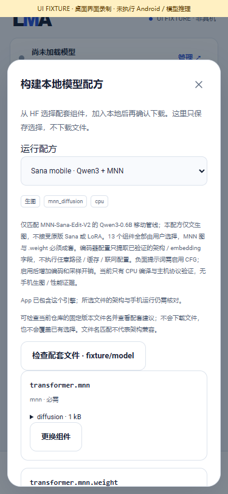
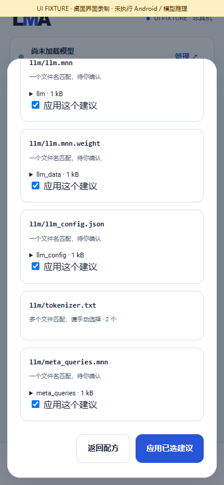

# HF companion-file review and confirmation

[中文](COMPONENT_SUGGESTIONS.md) · [English](COMPONENT_SUGGESTIONS.en.md) · [Full pending scope](releases/v0.3.0-dev.34.md)

dev.34 adds companion-file checking to existing recipes, reducing repetitive selection when names identify complete components. Reviewing suggestions, applying bindings, declaring a model and downloading it remain separate user actions. App updates deliver foundation code, filename hints and metadata, with no weights, learned vocabularies, voices or prompt codes.

## User flow

1. Open a repository's files from All/HF search, choose the component-recipe flow, then select the architecture recipe. Recommended and flat model records with separate output-task and foundation tags remain intact.
2. Optionally select a primary component manually, then check companions. The scan reads directory metadata, including later pages, from **one pinned commit** of the current file repository. It downloads no model. A selected primary is optional; unambiguous files can be proposed first and explicitly confirmed.
3. Review repository, commit, role, path, size and integrity information. Sana graph/`.weight` pairing uses the full exact path. Duplicate basenames in different folders remain ambiguous; list order never chooses a winner. Existing manual bindings are retained.
4. Check the unique suggestions to apply. Required roles start checked, optional roles unchecked. An unchecked required component stays missing and blocks declaration. Arbitrary file payloads and stale forms cannot replace existing bindings.
5. Select unresolved roles manually. Multi-repository models can switch repository in the component picker, return and check that pinned repository separately. Each binding keeps its own provenance. Only complete required selections enable declaration and download-plan review.
6. A newly declared model remains uninstalled. Review the complete plan, reuse and licenses, then separately choose download. Existing pause/resume/import/delete, independent parameters, queue and artifact flows continue unchanged.

A capped/incomplete directory disables suggestion application; a single file on a partial listing is not claimed to be globally unique. Errors allow retry/manual selection. Stop cancels subsequent checks and invalidates old results. An already-issued metadata request may finish, but cannot restore results after cancellation or a template change.

## Coverage and boundaries

There are **35 existing recipes**, with **49 declarative filename hints across 19 recipes**. These include Sana's thirteen components, the complete Nano profile's filenames, Kokoro/Piper/Matcha/Qwen TTS files, OpenMOSS extras and standard companions for some image/video recipes. Other roles retain manual selection; an extension alone never establishes pairing.

These counts describe selection rules, **not trained execution or Android acceptance of 35 models**. Matching names still require architecture, export, quantization, codec, tokenizer, license and device checks. They grant no extra source-model capabilities or verified uncensored classification to user-composed profiles.

| Situation | Behavior |
|---|---|
| One filename match in a complete pinned inventory | Reviewable suggestion, requiring explicit confirmation |
| Multiple matches, duplicate basename folders, cross-role overlap | Manual selection, no guessed winner |
| Incomplete inventory | No uniqueness claim or suggestion application |
| Existing manual choice | Retained without replacement |
| Changed recipe, bindings or review | Previous confirmation is invalid |
| Missing assets/engine, access restrictions or insufficient resources | Explain locally; no automatic model fetch or off-device inference |

## Foundation and evidence

`RecipeSuggestions` consumes recipe `matchFiles`/`matchSibling` data. The UI, queue and controller add no model-ID branches. `HubClient.inventory` reuses production HF pagination and commit validation, with bounds of eight pages/2,048 candidate assets. It rejects duplicate paths/cursors, mixed repositories/commits, blocked files and invalid hints.

Reviews remain temporary draft metadata, checked through a native review ID and binding fingerprint. Confirmation sends roles only; native checked records supply the actual files. Declaration/download remain separate. Matching hints are excluded from model identity: comparison with dev.33's exact original template produces the same Sana model ID and manifest for the same components, preserving parameter identity.

[Production checks](../verification/development/recipe-suggestions.json) exercise the real Java client/controller/persistent store with explicit HTTP metadata and byte fixtures. They cover pagination, thirteen components, ambiguity, paired paths, confirmed merges, historical identity, cancellation, stale changes, errors and zero asset downloads. Current HF/backend regressions are also recorded. None executes models.

[UI manifest](media/development/components/manifest.json) · [MP4](media/development/components/components-ui.mp4) · [GIF](media/development/components/components-ui.gif). Production pages use a simulated bridge: no actual downloads, inference or phone execution.

| Selection/check entry — UI fixture | Pinned companion review — UI fixture |
|---|---|
|  |  |

| Separate complete download plan — UI fixture | Ambiguity — UI fixture |
|---|---|
|  |  |

Metadata API reference: [official HF Hub API](https://huggingface.co/docs/hub/api). This feature only reads directory metadata and calls no inference service.

The complete single v0.3.0 still requires F01–F12, existing text, selections 01–14/16/17 and every frozen subtarget. Original LCM/LTX numerical failures, actual quality/resources, three loads per model, 15-minute screen-off, one-hour API and upgrade acceptance remain open. All inference/media stages must run on the same no-ROOT Android phone, without external fallback or ComfyUI canvas/user-node/plugin systems. No physical-phone acceptance exists; this is not a complete formal Release.
