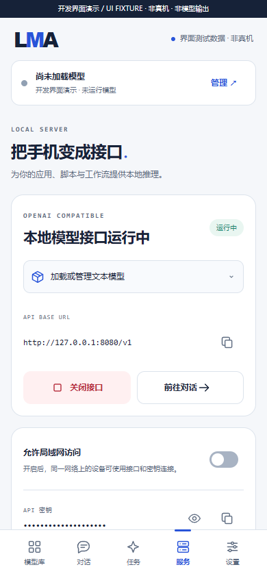
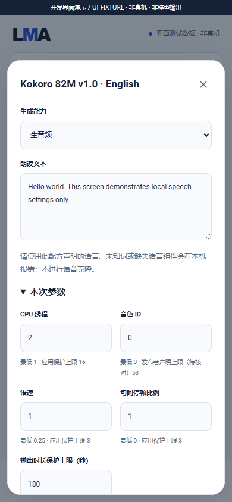
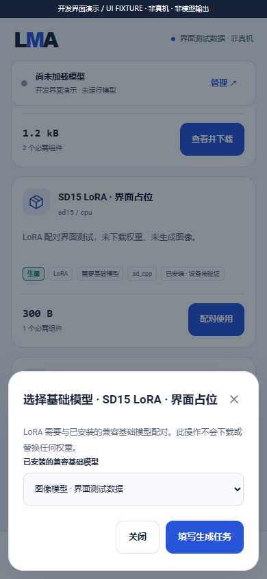
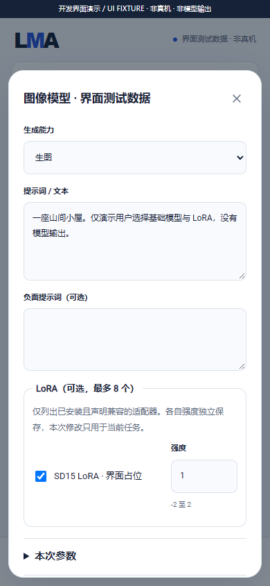
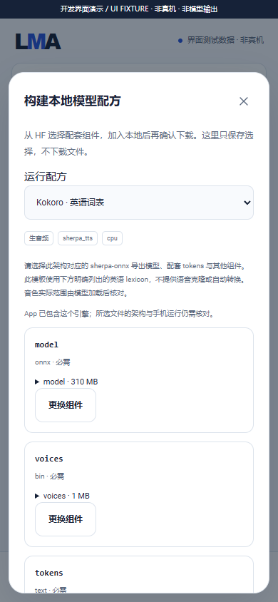
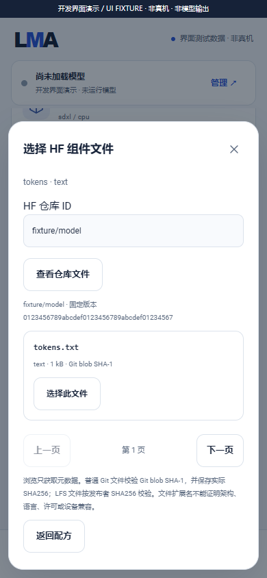

# v0.3.0 development status and evidence

[中文](DEVELOPMENT.md) · [Full scope](MULTIMODAL_RELEASE_PLAN.en.md) · [Build](BUILD.en.md) · [English home](../README.en.md)

The current public release remains **v0.2.0**. This branch is **0.3.0-dev.20 / versionCode 24**, not the complete v0.3.0, and has no new Release. F-01–F-12, selections 01–14/16/17 and frozen subtargets still belong to one delivery; these are internal implementation checkpoints.

## Implemented development code

| Area | Current behavior | Evidence boundary |
| --- | --- | --- |
| Stable Audio Open Small | 手机 LiteRT CPU 顺序 T5 / DiT / 解码、四组件与每模型参数 / same-phone stages and user assets | 144 scoped checks; 6 actual tiny-graph runs, no full-model / Android acceptance |
| Bundles/components | `lma.model-bundle/1` and `/2`, pinned revisions/sizes/SHA256 or Git blob identity with measured SHA256, shared content objects, atomic installation, pause/resume, explicit folder import, deletion/reference protection | Byte fixtures and real host HTTP transfers, not model inference |
| Independent model versions | User-selected pinned target, component/profile review, separate transfer/activation, retained old files, rollback, last 64 switches and queued-reference protection | 62 real host storage/failure/transfer checks; Android upgrades remain unverified; see [version guide](MODEL_UPDATES.en.md) |
| User control | Declaration, browsing and planning create no transfers; downloads require a separate action; missing assets fail locally; interrupted transfers pause for manual resumption | Does not install the entire catalogue or implicitly download models |
| Settings | Per-bundle settings, editable presets, numerical clamping, joint shape checks and immutable submitted snapshots | Recipe limits and device budgets are separate; unknown maxima are not verified |
| UI | Legacy text and bundles share a flat list; text/image/video/audio filters, bundle details, task forms, queue and artifacts; Recommended stays m08 → m06 → m01 | All contains pinned candidates and user manifests; dev.18 offers twenty-nine explicit HF component templates without universal architecture support |
| Jobs/artifacts | One heavy job, submit/cancel/retry, persistent events, private results, hashes/provenance, system export and image/WAV/MP4 inspection/ranged preview | Bounded AtomicFile JSON currently stores these records; existing chat SQLite remains; legacy text shares migration/scheduling; target input pipelines and device acceptance remain open |
| Unified gateway | Start with zero models; authenticated model/engine/job/event/artifact Range routes; public text proxy applies profile bounds and tracks leases; native text stays on a separate loopback port/secret | Production HTTP/stores use real host sockets and explicit execution fixtures; no model downloads or inference redirects |
| Sana mobile MNN | Pinned CPU worker, 13 matched components, sanitized configuration, per-model settings and real process binding | 74 host/C++ checks, no phone/image outputs; see [Sana guide](MNN_SANA_ENGINE.en.md) |
| Native speech | Qwen3-TTS Base, MOSS Delay first-class and openmoss TTS/v1.5/TTSD/VoiceGenerator/Local-v1.5/SoundEffect-v2; independent settings and actual process binding | 81 / 176 / 459 scoped checks; no model speech/device acceptance; [Qwen](QWEN_TTS_ENGINE.en.md) / [Delay](MOSS_DELAY_ENGINE.en.md) / [six recipes](OPENMOSS_ENGINE.en.md) |
| Android execution | Signed-in sd.cpp ARM64 CPU worker, data-only model bundles, external user-supplied vocabularies, child lifetime bound to its host | Compiled/packaged, **no phone inference**; upstream architectures do not prove accepted recipes |
| Video path | Generated raw frames feed Android MediaCodec/MediaMuxer; repeated still images cannot masquerade as motion output | Native generation and Android encoding still need physical-device validation; no LMA video output evidence |
| Background | Foreground ownership of transfers/jobs, process cancellation, interrupted-state reconciliation without invented checkpoints, two-hour job protection limit | Screen-off, memory pressure, OEM power policies, thermals and reboot behavior remain unmeasured |

The APK contains foundation code, engines, catalogue/tag/recipe metadata and notices, **without weights or model-specific vocabulary/tokenizer/voice/language assets**. [vocab_external.cpp](../native/vocab_external.cpp) replaces upstream embedded vocabularies. Zero-model startup is valid. The user sees the complete selected components, total size and reusable assets before downloading. App updates preserve existing models/settings and do not silently replace weights.

Custom manifests gain neither device-validated nor checked-uncensored status. Unmeasured recipes require explicit consent and may fail locally on resources/operators/components. Dev.10 shares automatic scheduling among existing chat/synchronous APIs and jobs, waiting for replies and reaping old children before switching. Asset adoption is implemented; physical upgrades and complete model acceptance remain required.

## Current development evidence

[verification/development](../verification/development/status.json) keeps this evidence separate from historical v0.2.0 records. **These checks do not satisfy complete release acceptance.**

| Check | Result | What it establishes |
| --- | --- | --- |
| Foundation core | 521 assertions | Component integrity, real HTTP resumption, shared references, independent settings, queue ownership/cancellation/restart, artifacts and ranged reads |
| API/transport | 67 assertions | Auth, zero-model state, JSON/framing limits, idempotency/cancel/events, exact artifacts/Range/leases and text policy; actual host sockets, not Android inference |
| Legacy backend/proxy | 98 assertions | Host Android adapters exercising downloads, actual child processes, HTTP SSE and per-model settings |
| HF logic | 78 assertions | Search, pinned revisions, pagination/selection and token boundaries, not universal HF execution |
| MOSS Delay | 176 assertions | Production Java/actual host children and pinned upstream Delay/sampler/de-delay self-test; structural WAV fixtures |
| MOSS native six recipes | 459 checks | 349 Java / 110 C++, 18 actual host children; actual upstream prompt/sound functions, budget/reference checks; structural WAVs, no neural inference |
| Diffusion | 174 assertions | Production planning/binding, actual host protocol children and shared C++ policy; no model images |
| Local input media | 64 assertions | Actual private files, production WAV inspection, authenticated resumable chunks and immutable input receipts/leases; not Android media decoding |
| Shared scheduler | 49 assertions | Production queue/resident/chat/API, real host children and loopback HTTP, cancellation and reaping; no Android inference |
| UI | 265 assertions | Actual HTML/CSS/JS with explicit simulated native state; recommendation/tag/download/form/queue/narrow-screen regressions |
| Native package | 23 ARM64 files | Pinned hashes, resolved dependencies, Android API 28, 16 KiB ELF/APK alignment, original signing identity, asset allowlist |
| Phone inference/endurance | 0 | No actual image/audio/motion-video or sustained screen-off inference evidence |

sd.cpp is pinned to `be486498eadc29dc3cd234d944c2180ed42b1415`, ggml to `a5915eb0e47adef21c3f25b889a008925ea838c2`, built using project-local NDK 30.0.16248370 on native Windows. The added worker SHA256 is `01e6c0a37fc56bb9268d0890c71d8dae57bd0ac41922cb2ec64ad6e5e7fd1d3c`. See [engine-lock.json](../third_party/engine-lock.json) for hashes/notices. Only actual compiled modules are registered, without empty providers counted as support.

The SD1.5 candidate combines [Second State’s pinned GGUF](https://huggingface.co/second-state/stable-diffusion-v1-5-GGUF/tree/031b5f5df991f511b3f5fa8fed6d99048ababb69) and the [original CLIP merges](https://huggingface.co/stable-diffusion-v1-5/stable-diffusion-v1-5/blob/451f4fe16113bff5a5d2269ed5ad43b0592e9a14/tokenizer/merges.txt), totaling 1,567,293,035 bytes under the source CreativeML Open RAIL-M terms. Only metadata, publisher hashes and the small vocabulary were checked, without downloading weights. The vocabulary exactly matches the pinned engine’s original data. Recipe metadata ships with the App; user-selected assets do not. An unselected catalogue candidate is not a downloaded Local model. This is not accepted execution support; see [bundle-evidence.json](../catalogue/bundle-evidence.json).

## Remaining work in the same release

1. Physically validate [shared scheduling](SCHEDULING.en.md), model adoption and independent updates on Android across modalities, cancellation, recovery and upgrades. The 49 host scheduler assertions and dev.9 adoption do not replace device gates.
2. All selected 01–14/16/17 assets, complete pipelines, subtargets and SD1.5/SDXL LoRA pairings. Native MNN, Qwen and MOSS Delay code is integrated; remaining audio, complete MOSS/SoulX and older LTX implementations remain. Every existing route still requires real-model and physical-Android acceptance.
3. Extend async/text APIs to remaining engines and their actual input pipelines, modality compatibility and physical lifecycle acceptance. Existing text now shares the slot; new engines must reuse this scheduling boundary. See [API behavior](API.en.md#030-dev2-independent-gateway-jobs-and-artifacts).
4. Finish measured admission profiles, thermals, per-recipe/device input acceptance, stage/checkpoint capability handling, cross-modality load/unload and upgrade migration verification.
5. Obtain physical-Android offline outputs for new inputs on every frozen subtarget, quality/cancellation/cleanup checks, A7 fifteen-minute screen-off tasks and one-hour alternating service evidence. No device is available.
6. Pass all A1–A11/R-01–R-05 gates and produce complete source/APK/docs/actual feature media/Release. Development builds cannot substitute for delivery; publishing tools reject `-dev`.

## Development UI media

Every frame carries “UI FIXTURE · not a physical device · not model output”. Transfer, installation and sampling states are fixtures, with no model-weight downloads or generated artifacts.

 

[Video](media/development/foundation-ui.mp4) · [GIF](media/development/foundation-ui.gif) · [Media hashes/provenance](media/development/manifest.json)

Browser pages, contexts and processes close in `finally`. No Docker, WSL, virtual machine or Android emulator is used.

## dev.3 speech integration

Add a compiled sherpa_tts ARM64 worker and Kokoro / Piper / Matcha adapters. Three complete candidate recipes remain explicit user-selected audio / TTS / CPU assets. NativeWorker shares process ownership, speech parameters, duration protection, PCM WAV and effective-parameter / waveform provenance. Code dependencies come from the pinned official release, never model downloads. Package checks include 23 new notice originals and exact dependency closure; some model-data licenses still require review.

**62 new TTS contract / actual host child-process assertions** cover components, bounds, cancellation, exits, completion protocol and private request cleanup; output is arbitrary fixture bytes, not speech. 89 UI checks pass. Waveforms, pronunciation, actual RAM / speed / heat, Android log binding and endurance have no device evidence. Selection 10 remains unaccepted. All other selected models/recipes, unified scheduling and physical-device gates remain mandatory for the same v0.3.0. See [speech foundation](TTS_ENGINE.en.md).

## dev.4 explicit peer-adapter pairing

Add data-only `lma.adapter/1` declarations with SD 1.5/SDXL architecture, pipeline and optional model-ID restrictions. LoRAs remain image-library peers. Explicitly select an installed base or up to eight compatible adapters in a base task form, with independent saved strengths and bounded task edits. Missing bases never trigger model selection/download.

Tasks/API freeze IDs, scales and adjustments; execution atomically leases the complete base/adapter group, protects in-use assets and resolves private component paths into the existing native `loras` array. Provenance retains adapter manifests. 45 new host checks bring the foundation total to 130, with 97 UI checks. These are arbitrary-byte/UI fixtures, not LoRA output.

No checked LoRA download candidate is added. Real SD 1.5/SDXL/LCM recipes, quantized compatibility and effect acceptance remain open. See [pairing](ADAPTERS.en.md) and the [foundation/user-asset audit](ASSET_CONTROL_AUDIT.en.md). This is `0.3.0-dev.4 / code 8`; complete v0.3.0 remains unfinished and unpublished.

## dev.5: user-selected HF components and integrity

Seven signed-App data templates cover complete SD 1.5/SDXL checkpoints, respective LoRAs, and English Kokoro/Piper/Matcha recipes. Users explicitly choose every component, including files from separate frozen HF repositories; fixed dependencies are disclosed. Registration only saves a manifest; downloading requires a separate confirmation. Flat peers retain image/audio and independent engine tags, without App-triggered model downloads.

Schema 2 adds Git blob identity, measured SHA256 receipts, task component provenance and role-separated import paths; schema 1 remains compatible. 87 additional recipe/integrity assertions bring foundation checks to 217; HF has 74 and UI 112. These are scoped host/UI checks, not phone or universal-HF acceptance. See [workflow and limitations](HF_RECIPES.en.md) and [checkpoint notes](releases/v0.3.0-dev.5.md).

## dev.6: MOSS Nano execution and private asset workspaces

Add a compiled ARM64 SentencePiece/ONNX/codec speech worker, an eighth HF component template, explicit external-data selection, private leased hardlinks and shared ORT conflict checks. 190 new host checks cover Java contracts/real child processes and hardlinks, executed C++ reference validation and dependency identity. All tokenizer, voice and weight data stays user-selected. See [complete route, bounds, sources and limitations](MOSS_NANO_ENGINE.en.md) and [checkpoint notes](releases/v0.3.0-dev.6.md). No actual MOSS speech or device evidence exists; 09 and every complete-v0.3.0 target remain mandatory.

## dev.7: user-controlled model versions

Bundles gain a native version index, component/license/profile review, explicit download/folder import, separate activation and rollback. Old settings and immutable task provenance remain intact; stale consent is rejected. App installation/upgrades still start no model transfers; only foundation code is added. Queued/running base and LoRA references prevent deletion.

302 foundation checks include 62 version assertions; 132 UI checks pass. Screenshots 17–21 and refreshed [recording](media/development/foundation-ui.mp4)/[GIF](media/development/foundation-ui.gif) retain UI FIXTURE labels. See [workflow/failure rules](MODEL_UPDATES.en.md) and [checkpoint notes](releases/v0.3.0-dev.7.md). Legacy unification, every selected target and device gates still block complete v0.3.0; no new Release is created.

## dev.8: text bundles join shared execution

The ninth HF recipe accepts an explicitly selected complete text GGUF. The existing signed llama runtime implements `LocalEngine`, sharing profiles, leases, jobs, cancellation, artifacts and provenance through a private authenticated loopback endpoint per task. Saving/execution inspect GGUF context and UI/native code jointly clamp output limits. Effective schemas stay separate from immutable manifests; an incompatible record does not disable the library.

66 added checks execute actual host files/children/HTTP with literal test output, without model inference. Foundation checks total 310 and UI 147; Lint has zero errors and ten warnings. The APK has 50 production Java sources and the same 19 native files, without new model assets. Typed local JSON preserves response/reasoning and supports safe text preview, copy and export. See the [guide](TEXT_ENGINE.en.md), [receipt](../verification/development/text.json) and [notes](releases/v0.3.0-dev.8.md).

Screenshots 22–24 and the updated recording/GIF retain UI FIXTURE labels. Complete legacy migration, chat/API scheduling, every selected model and physical Android acceptance remain open. All queued jobs still require stopping the legacy persistent text service first. No new Release.

## dev.9: existing models share assets and profiles

Existing complete GGUF files are locally adopted with hardlinks, measured receipts and an atomic original-ID binding; no network transfer or implicit model load is involved. Original model details open shared tasks/version management, and duplicate library/API rows are suppressed. Legacy and bundle editors share defaults; loaded-context changes reload through the engine-owned lease. Restored unfinished downloads require explicit resume.

69 added host migration checks and 156 UI checks pass. Text 66, TTS 62, Nano 190, API 67, backend 98, HF 76 and foundation 310 remain scoped host/UI evidence. See the [migration guide](MODEL_MIGRATION.en.md), [receipt](../verification/development/migration.json) and [notes](releases/v0.3.0-dev.9.md). Screenshots 25–26 and refreshed recording/GIF retain UI FIXTURE labels. Full automatic scheduling, every selected pipeline and physical-Android installation/upgrade/output/endurance still block the same complete v0.3.0; no new Release.

## dev.10: shared execution and automatic text switching

Production `LocalJobs`, resident `EngineHost`, `ChatRunner` and `ApiHost` share a cancellable FIFO slot. Jobs wait for replies, reap actual children and recheck available memory/temperature before starting. Idle restoration uses only a model the user still wants; stop/replacement generations and late cleanup remain isolated. Jobs persist and text history remains, without model assets or implicit downloads.

43 added assertions compile the production job runner and execute actual host children/loopback HTTP, cancellation, API closure, resident/service stops, deferred reaping and retained assets/profiles. UI checks total 167. Development media contains 28 screenshots plus labeled fixture recording/GIF. Every model and physical upgrade/resources/quality/background gate remains open. See [guide](SCHEDULING.en.md), [receipt](../verification/development/scheduler.json) and [notes](releases/v0.3.0-dev.10.md).

## Dev.11: local media and task references

[Local inputs](LOCAL_INPUTS.en.md) adds explicit document import, foreground copying/cancellation, PNG/JPEG/WAV/MP4 inspection and source hashes; bounded authenticated uploads use 256 KiB chunks and explicit continuation. Tasks select imports/previous results through signed engine roles, freeze receipts, protect queued/execution references and rehash before startup. Existing production engines remain prompt-only; actual remaining input pipelines need individual integration.

64 new file/WAV/actual-HTTP assertions pass. Production scheduling now has 49, including actual child input consumption, corruption rejection and cancellation cleanup. UI totals 182; 30 screenshots plus MP4/GIF remain explicit fixtures. The same 19 native files carry no new weights. The Android picker/image/video codecs and full device gates remain unverified. See [notes](releases/v0.3.0-dev.11.md) and [input receipt](../verification/development/inputs.json).

## dev.12: diffusion components and low-step sampling

Seven added data templates bring the total to sixteen. SD1.5/SDXL complete/split components, SD-Turbo, LCM checkpoints and matching SD1.5/SDXL LCM-LoRA use frozen task-specific `diffusionPlan` metadata. Requested settings stay separate; retry derives a new plan, leased execution rechecks it and native code validates sampling and loaded tensor architecture. No weights or implicit model downloads.

83 added checks comprise 56 production Java/actual-host-child protocol and 27 executed shared-C++ policy assertions; child output is JSON, not images. Foundation totals 381 (189 recipe/integrity), UI 194. 32 screenshots plus MP4/GIF retain UI FIXTURE. 58 production Java sources, 19 native files and Lint 0 errors/13 warnings. Other architectures, complete pinned licenses/quality/resources and physical-Android gates remain in the same complete v0.3.0. See [guide](DIFFUSION_ENGINE.en.md), [receipt](../verification/development/diffusion.json) and [notes](releases/v0.3.0-dev.12.md).

## dev.13 · Advanced diffusion and video parameters

dev.13 [Z-Image/FLUX/Qwen/Wan bindings](ADVANCED_DIFFUSION.en.md) add four user-selected component recipes, strict roles, actual sampler/scheduler/flowShift bindings and Qwen/Wan geometry constraints. Diffusion 174 (Java 117/C++ 57), foundation 425 (recipe/integrity 233) and UI 203 assertions pass; 35 screenshots plus recording/GIF are explicit UI FIXTUREs. Family checks do not prove scale or distillation; no model/Android outputs exist. The App updates only the foundation; twenty templates never download implicitly. Every target/device gate remains in the same complete v0.3.0, without a new Release.

## dev.14 · Real Sana MNN engine and asset boundary

dev.14 adds the [Sana mobile / MNN pipeline](MNN_SANA_ENGINE.en.md): a real ARM64 CPU worker, 13 user-selected components, whitelisted Qwen3 metadata, encoder release before diffusion, per-model CFG/token/thread controls and immutable job plans. Its 74 host/C++ checks perform no model inference. All 21 templates remain metadata with separately confirmed downloads. Foundation 445 and UI 208 checks pass; 37 screenshots and recording/GIF are explicit UI FIXTUREs. No Android image/endurance evidence exists. Every frozen target and release gate remains in the same complete v0.3.0, without a new Release.

## dev.15: Qwen speech and embedded components

Internal checkpoint (**0.3.0-dev.15 / code 19**, unpublished): [Qwen3-TTS 0.6B Base](QWEN_TTS_ENGINE.en.md) adds a real ARM64 CPU worker, a complete two-GGUF local speech pipeline, optional reference WAV, independent sampling settings and actual timing/RTF recording. Shared `provides` discloses embedded tokenizer/predictor/speaker dependencies without duplicate downloads. Its 81 Java/C++ host checks exercise protocols and structural WAV only; pinned optional assets have header review, without model inference. All 22 templates remain metadata and never implicitly download models. Screenshots 38–39 and development recording/GIF remain UI FIXTUREs. App updates deliver the foundation; every full v0.3.0 target, real-output/quality/background gate remains, with no new Release. See [bilingual notes](releases/v0.3.0-dev.15.md).

Internal checkpoint (**0.3.0-dev.16 / code 20**, unpublished): the [MOSS Delay native CPU pipeline](MOSS_DELAY_ENGINE.en.md) adds a user-selected first-class backbone/decoder, optional reference encoder, independent text/audio sampling and shared jobs. Its 176 Java/C++ host checks include the pinned upstream Delay self-test; structural WAVs are not generated speech. All 23 recipes are metadata; APKs carry no model assets or implicit downloads. Screenshots 40–41 and recording/GIF remain UI FIXTUREs. Every complete v0.3.0 target and physical-device gate remains, without a new Release. See [bilingual notes](releases/v0.3.0-dev.16.md).

Internal checkpoint (**0.3.0-dev.17 / code 21**, unpublished): the [native MOSS Local-v1.5 / SoundEffect-v2 foundation](OPENMOSS_ENGINE.en.md) adds two distinct CPU pipelines, explicit backbone/extras assets, embedded dependency tags, optional stereo reference, per-model settings and shared jobs/receipts. Its 180 Java/C++ checks include six actual host children and pinned upstream sound sampling primitives, without full model or Android inference. All 25 templates remain data-only and never auto-download. SoundEffect discloses its fixed 30-second latent cost. Screenshots 42–47 and recording/GIF are UI FIXTUREs. Every frozen target and physical-device gate remains in the same complete v0.3.0; no new Release. See the [bilingual notes](releases/v0.3.0-dev.17.md).

Internal checkpoint (**0.3.0-dev.18 / code 22**, unpublished): the [native MOSS foundation](OPENMOSS_ENGINE.en.md) adds four equal-peer TTS/v1.5/TTSD/VoiceGenerator recipes with explicit 32/16-codebook and 8B/1.7B layout validation, paired speaker references and per-model voice/language instructions. An actual generation-grid context guard runs before prefill and rejects overflow. 459 scoped Java/C++ checks (18 actual host children), 521 foundation and 265 UI assertions pass. All 29 templates stay metadata-only; no model assets are bundled. Screens 48–52 and refreshed recording/GIF are UI FIXTURE, without full-model or Android inference. All frozen targets and physical gates remain in one complete v0.3.0; no new Release. See [bilingual notes](releases/v0.3.0-dev.18.md).

 

Internal dev.19 / 内部 dev.19：[旧 Local / Realtime 原生 RQ](MOSS_RQ_ENGINE.md) / [English](MOSS_RQ_ENGINE.en.md) 与旧 SoundEffect 环境声音绑定完成源码接入；32 个用户自选配方仅为元数据，所有模型仍由用户下载 / 管理，APK 仅更新基座。178 RQ / 514 openmoss / 550 foundation / 280 UI checks are scoped, not full-model or phone acceptance. Realtime currently supports one text request returning a complete WAV, without incremental audio/text streaming. Nine MOSS subtargets have distinct code routes but remain individually unaccepted on Android. F-01–F-12、01–14 / 16 / 17、全部冻结子目标及 A1–A11 / R-01–R-05 继续属于同一完整 v0.3.0；15 分钟锁屏 / 1 小时交替 API / 升级资产保留未实测，不创建新 Release。See [bilingual notes / 编号交付](releases/v0.3.0-dev.19.md)。

Internal checkpoint (**0.3.0-dev.20 / code 24**, unpublished): the [Stable Audio Open Small foundation](STABLE_AUDIO_ENGINE.en.md) adds sequential same-phone LiteRT CPU T5 → DiT → decoder execution, four user-selected assets, editable model-specific limits and fixed-length cost disclosure. 144 scoped assertions include 6 actual LiteRT tiny-graph runs and 6 host child processes, without a trained checkpoint. All 33 recipes are metadata only; 561 foundation / 287 UI checks pass. The original-signature APK has no weights/vocabulary. Screens 56–58 and recording/GIF are UI FIXTURE. Complete Stable Audio, SoulX/old LTX and every frozen target/device gate remain within the same complete v0.3.0; no new Release. See [numbered delivery notes](releases/v0.3.0-dev.20.md).

## dev.20 source follow-up: SoulX audio primitives

[Implementation/reproduction](SOULX_DSP.en.md) · [Numbered delivery](releases/v0.3.0-dev.20-soulx-dsp.md). 153 scoped assertions / 49 host children / 29 guards cover three frontends, Flow and HiFT numerical operations, including 30/120-second NSF. The ARM64/API28 static library is not connected to the APK or registered as model execution support. Trained checkpoints/model audio/physical Android remain zero. Complete scope and Release gates are unchanged; development APK/UI media remain dev.20.

## dev.20 source follow-up: full acoustic networks

[SoulX acoustic export/native execution](SOULX_ACOUSTIC.en.md) · [Numbered delivery](releases/v0.3.0-dev.20-soulx-acoustic.md). Four complete Flow/HiFT graphs, learned source, native ORT/CPU and cancellation;244 scoped checks /12 host children /57 completed graph runs /one actual ORT termination, all UNTRAINED. ARM64/API28/16KiB compilation passes; DSP155 checks /49 children /31 guards pass. Not registered in the APK/model tasks. Language/reference networks, complete trained speech and physical Android remain pending under the same full frozen release scope.
