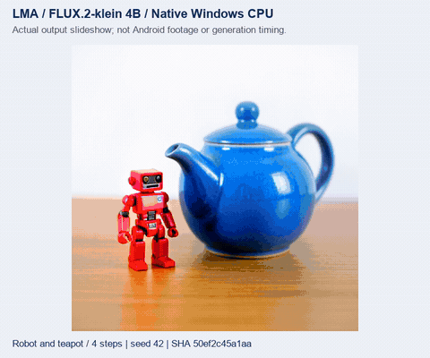

# FLUX.2-klein 4B 本地文生图

[English](FLUX2_KLEIN.en.md) · [项目首页](../README.md) · [本轮更新](releases/v0.3.0-dev.37.md) · [本地 API](API.md)

LMA 将 FLUX.2-klein 4B 的蒸馏版接入已有的模型、下载、设置、任务和结果管理。App 更新只交付运行基座；用户主动选择四个配套组件后，才在本机下载或导入。全部文本分词、编码、扩散和图片解码都使用本机 CPU，没有远程推理入口。

本轮提供 Windows CPU 的真实完整权重验证、生产 Java/native 调用、独立分词对照和 Android ARM64 编译证据。**这些证据不等于 Android 真机、图像质量、全部模型数值或完整 v0.3.0 验收。** 原冻结 07 目标仍须完成这些要求。Sana 图片编辑是另一项平级能力，不替代冻结 04 文生图。

## 1. 选择和取得模型

1. 打开“模型 → 全部”，筛选“生图”，选择 **FLUX.2-klein 4B · Q4_0**。原“推荐”顺序保持 `m08 → m06 → m01`。
2. 查看完整组件、体积和设备状态。浏览、安装 App、启动接口和缺件检查都不开始下载。
3. 点击下载，或明确选择本地完整文件导入。只有这份模型方案的四个组件进入下载计划；缺少任何一个组件都不能以部分权重执行。
4. 下载可暂停、续传；文件按完整 SHA-256 校验。“本地”栏目管理已取得的模型。卸载模型、删除结果和清理任务历史是独立操作。

也可在 HF 搜索中选择匹配的组件方案。文件名建议只帮助查找文件，须由用户确认；它不证明架构匹配。多种量化文件并存时保留手选，不把 `base`、9B 或另一版 Qwen 编码器自动当作此蒸馏方案。

| 组件 | 固定来源 | 完整字节数 |
|---|---|---:|
| 扩散模型 Q4_0 | [leejet/FLUX.2-klein-4B-GGUF](https://huggingface.co/leejet/FLUX.2-klein-4B-GGUF/tree/3b1f5a9dc3abb32238b053aeb3d823c30afdacbd) | 2,460,378,560 |
| Qwen3-4B Q4_K_M 文本编码器 | [unsloth/Qwen3-4B-GGUF](https://huggingface.co/unsloth/Qwen3-4B-GGUF/tree/22c9fc8a8c7700b76a1789366280a6a5a1ad1120) | 2,497,281,312 |
| 原版完整 FLUX.2 VAE | [官方 klein 4B 的 VAE](https://huggingface.co/black-forest-labs/FLUX.2-klein-4B/tree/e7b7dc27f91deacad38e78976d1f2b499d76a294/vae) | 168,120,878 |
| 配套 Qwen merges | [官方 tokenizer 数据](https://huggingface.co/black-forest-labs/FLUX.2-klein-4B/blob/e7b7dc27f91deacad38e78976d1f2b499d76a294/tokenizer/merges.txt) | 1,671,853 |
| **合计** | 四个运行组件，均不进入 APK | **5,127,452,603** |

精确路径、版本与全文件 SHA 在[资产清单](../research/flux2_trained/assets.json)。该方案使用原版完整 VAE，未用 small decoder 替代。目录 ID 为 `flux2_klein4b_q4_0_catalogue_v1`；HF 自选拥有独立 `hfb_…` 身份。它们按同一套业务管理，不覆盖原模型和旧任务。

## 2. 参数跟随模型

从“本地 → 模型详情 → 模型设置”编辑。输入框允许自填和选择预设，超限归位至这份模型声明的上限。保存只影响以后的任务；已提交任务保留原模型、提示词、参数和执行计划。

| 参数 | 此方案规则 | 限制来源 |
|---|---|---|
| 宽、高 | 默认 1024；64–2048，16 对齐 | 应用保护与管线对齐，不能理解为全尺寸画质/内存已验收 |
| 步数 | 1–4，默认 4 | 蒸馏采样方案 |
| CFG | 固定 1 | 本方案关闭 CFG |
| 负面提示词 | 不支持；界面关闭，提交非空值拒绝 | 不静默忽略用户输入 |
| 采样器 / 调度器 | `euler` / `flux2` | 固定配套策略 |
| CPU 线程 | 1–64，默认 4 | 应用保护；不是手机性能保证 |
| seed | `-1` 随机，或 0–2,147,483,647 | 随机值在执行时固定并记录 |
| flowShift | 0 自动，或 0–32 | 自动值交给匹配引擎 |
| VAE 分块 | 默认开启 | 在本机解码；仍需评估完整运行资源 |

这份方案用于文字生成图片，不借用 Sana Edit 的输入图或固定风格提示词。FLUX.2-klein base、9B、FLUX.1 和其他文本编码器须使用各自匹配方案，不能仅凭文件名互换。

## 3. 提交、取消与管理结果

选择本地模型后输入提示词，确认本机资源状态，再“加入本机队列”。任务等待当前模型调用结束后调度，期间不会自动下载缺件。运行在既有前台服务和共用任务系统内；后台通知、API、取消、错误和重启记录沿用同一业务逻辑。

完成后，PNG 先校验再提交到结果库，并记录模型身份、原始输入及有效参数。取消或失败不能发布半成品；恢复任务是一次明确的新执行。删除模型仍保留已生成结果和保留的模型设置，不自动取得同名模型。

接口复用[任务 API](API.md)、[运行前检查](TASK_PREFLIGHT.md)和[任务恢复](TASK_RECOVERY.md)。启动本地接口不等于加载或下载任意模型；接口使用手机中已准备好的同一套模型和队列。

## 4. 共用分词修复

最初的完整权重试跑产生了偏离提示词的海报图。检查发现，HF `merges.txt` 的 `#version: 0.2` 文件头被上游合并规则读取器当作一个词项，导致后续编号偏移。LMA 现在只在内存中去掉文件头，处理 BOM / CRLF，保留用户原始文件和完整 SHA。未知或重复版本头、孤立 CR 和空规则文件明确失败。

同时在 Qwen 管线的 BPE 分割前执行 NFC，避免组合字符（例如分离的重音符号）与官方 tokenizer 产生不同编号。相同辅助实现用于 Android 和原生主机；上游 Git 源码保持固定版本且无修改。

独立验证使用用户明确取得的官方 `tokenizer.json` 与 Rust `tokenizers`：全部 **151,643 个基础词项、26 个特殊词项、33 组输入、三种文件表示**逐一核对，共 **117 项检查**。这个额外的开发参考文件不属于用户四组件运行包，也不打包进 App。它证明分词一致，不代表全部模型浮点数值或画质已通过。

## 5. 实际证据与复现

本轮实际原生 Windows CPU 运行使用 6 线程、512×512、种子 42：四步完整执行约 **373–524 秒**，20 ms 抽样观察到的进程工作集峰值约 **4.58 GB（4.26 GiB）**。这些是本次主机进程观测，含并行测试影响，不是 Android 速度、最低内存或 GPU 指标。四个下载文件合计约 5.13 GB，不能只根据文件大小推断内存；努比亚 Z20 的加载、可用内存、温控和持续后台能力尚未验收。

- [分词独立对照](../verification/development/qwen-tokenizer.json)：全部词项编号、组合字符与 malformed 文件失败路径。
- [真实原生执行](../verification/development/flux2-trained.json)：提示词变化、步数变化、实际采样后取消、错误、相同参数恢复和 Windows 进程内存观察。
- [生产 Java/native 业务](../verification/development/flux2-app-host.json)：完整离线导入、HF 组合、独立设置、不可变任务、租用、生成/取消/恢复、提交结果、重启和删除模型。
- [真实输出与展示记录](media/development/flux2-trained/manifest.json)；[界面录制记录](media/development/curated/manifest.json)中的交互使用醒目标记的桥接夹具。



视频和 GIF 是实际图片的展示，**不代表生成速度或 Android 录像**。首轮错误图保留用于说明修复，不能计为成功画质。全部数值、画质、资源与同一物理手机上的加载/锁屏/API/升级要求仍独立验收。

开发者在原生 Windows 执行，所有文件留在本项目内，不用 Docker / WSL / 模拟器：

```powershell
python tools/fetch_flux2_trained.py --download --reference-tokenizer
python tools/test_qwen_tokenizer.py
python tools/test_flux2_trained.py
python tools/test_flux2_app_host.py
python tools/render_flux2_trained.py
```

不带 `--download` 的取得工具仅校验现有文件。测试和推理没有下载入口。`--execute-only` 只保存未验收的 Java 采集；随后 `--verify-run build/flux2-app-host-tests/run-…` 重新核对源码、原生构建、原始报告和直接执行产物，不再重复推理。开发构建只能复用本项目内未验收的缓存，最终二进制另存到不可变目录；已有验收构建不会作为可变缓存覆盖。

模型许可参见[官方 Apache-2.0 条款](https://huggingface.co/black-forest-labs/FLUX.2-klein-4B/blob/e7b7dc27f91deacad38e78976d1f2b499d76a294/LICENSE.md)。LMA 的 App/引擎许可与用户选择的模型许可独立。
