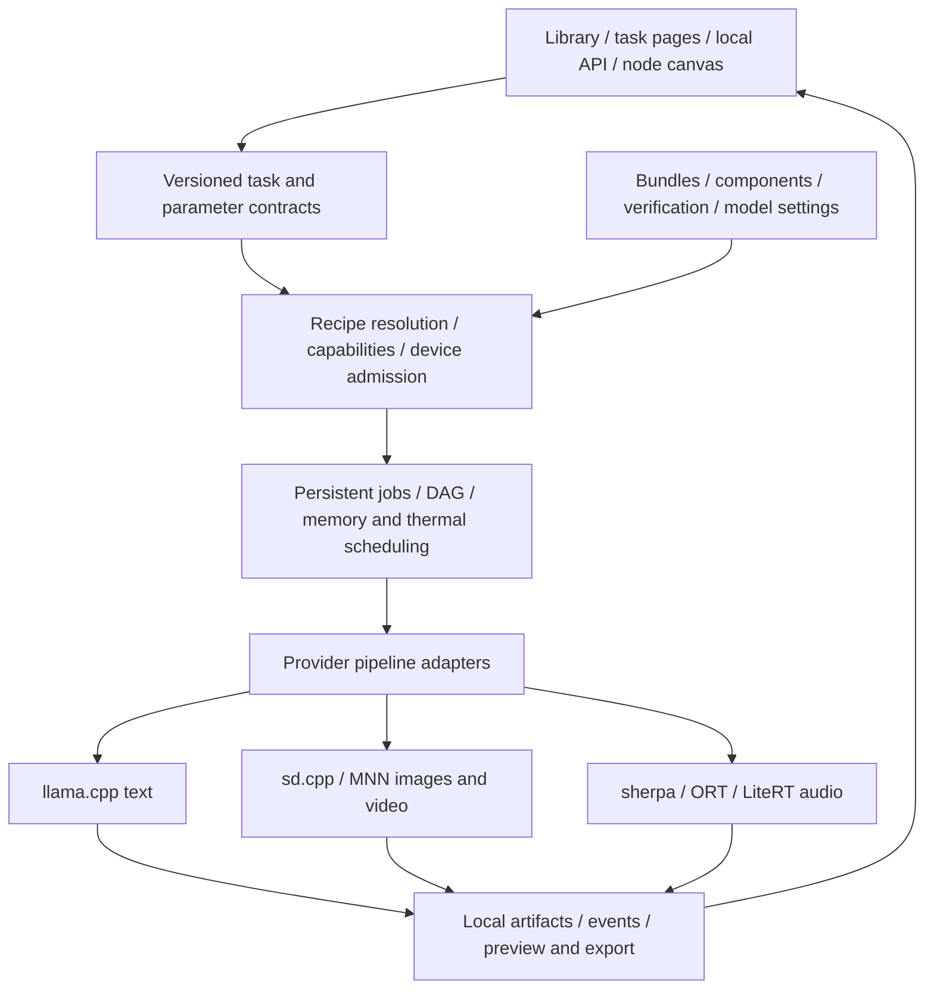

# LMA extensible local multimodal foundation

[中文](FOUNDATION.md) · [Local-model assessment](MULTIMODAL.en.md) · [Workflow proposal](WORKFLOWS.en.md) · [Documentation](README.md)

Date: **2026-10-27 (Asia/Taipei)**. Decision: **this is buildable, and an extensible local multi-engine foundation should be the main product direction.** New models should reuse downloading, settings, jobs, workflows and artifact management instead of becoming separate application features. Every inference stage remains on the same Android phone without ROOT or off-device inference/fallbacks.

This evaluates current source and upstream native/Android engines. **The foundation is not implemented.** Current APK 0.2.0 executes single-file text GGUF only. No new weights were downloaded, engines built, phone generation run or endurance measured. Z20 is a constrained device to accommodate, not the upper limit of the product.

## 01 · Evidence and limits

Existing C/C++ and Android execution paths support the proposal: [stable-diffusion.cpp](https://github.com/leejet/stable-diffusion.cpp#features) implements multiple image/video families; [MNN Diffusion](https://github.com/alibaba/MNN/blob/master/transformers/diffusion/README.md) has mobile image recipes; [ONNX Runtime](https://onnxruntime.ai/docs/tutorials/mobile/), [sherpa-onnx](https://github.com/k2-fsa/sherpa-onnx) and [LiteRT Android](https://developers.google.com/edge/litert/android) provide audio components or complete speech-pipeline building blocks. Pin and validate actual Android builds and coverage separately.

This supports a multi-engine engineering approach, **not execution of arbitrary HF weights**. ONNX/TFLite graph runtimes do not automatically implement a TTS tokenizer, sampling host loop and audio codec. A native engine listing an architecture does not establish operator coverage on every Android GPU.

| Addition | Main work after the foundation exists | Data-only addition possible? |
| --- | --- | --- |
| Another fine-tune/quantization of a supported architecture | Pinned sources, components, settings, compatible recipe and acceptance | **Yes**, if the installed engine supports the variant and every component |
| Matching LoRA/voice in a supported architecture | Assets and base-model constraints | **Yes**, if that adapter/voice mechanism already exists |
| Family present upstream but not enabled in LMA | Provider pipeline/parameter mapping, components and validation | Not guaranteed; an app update may be needed |
| New architecture/custom operators | Update/add engine and architecture adapter, possibly converted graphs | **Code and a signed release update required**; UI/downloads/queue should remain reusable |
| New GPU/NPU for an existing model | Backend recipe, operator probes and hardware validation | Often requires a new native build; a chip name alone is insufficient |
| New task, such as future audio editing | Task schema, interaction and adapter | Extension required, without rewriting the whole application |

Measure broad support by **continued addition of supported architecture variants, coexistence of engines and clear explanations for unknown models**. Do not invent a coverage percentage or count untested devices as supported.

## 02 · Three independent layers

1. **Architecture/pipeline:** how SD, Wan, LTX or a TTS family tokenizes, encodes, samples and decodes, with matching components.
2. **Runtime engine:** pinned executable builds such as llama.cpp, sd.cpp, MNN, ORT or LiteRT.
3. **Hardware backend:** CPU, Vulkan, OpenCL, QNN operator/shape/precision/driver constraints.

Tasks combine these layers. `video.generate` is not synonymous with Wan, `audio.generate` is not synonymous with TTS, and Vulkan is not a weight format. An LMA engine provider is an application adapter, distinct from an ONNX Runtime Execution Provider.

## 03 · Shared architecture

Pages and workflows use one task contract, without independent model-launch code. A single image request also goes through jobs; a workflow connects tasks that remain independently callable. Changing models updates controls from capability and parameter descriptors.

## 04 · Models, components and recipes

Represent model identity, weight variant, component files and execution recipes separately. One model may have multiple quantizations/backend/device recipes while keeping stable attribution and the user's model ID.

Bundles record pinned repository/revision, component role/path/bytes/SHA256, task, architecture, format/quantization, license and tags. Recipes select tokenizer, encoders, VAE/codec, pipeline adapter, engine-build requirements, hardware profile, parameter schema and resource estimate. A downloaded backbone alone never makes an incomplete pipeline runnable.

Content hashes index shared components; a dependency graph supports deletion and storage planning. Verify components and atomically commit ready status only when mandatory files are complete. Running jobs retain references so deletion/cleanup cannot remove their inputs. Unknown hashes or unpinned provenance cannot be represented as reviewed bundles.

HF search remains broad, with separate discovered, recipe-available, installed, eligible-to-try and verified-on-target states. Show required components, total downloads, reused assets and reasons. Initially distribute prepared compatible assets: users need no attached computer for conversion, and no external conversion/inference service is invoked. Missing recipes produce an unsupported explanation.

## 05 · What engine plugins mean

| Runtime route | Foundation role | Initial integration |
| --- | --- | --- |
| llama.cpp | Existing text capability | Wrap the current implementation to validate migration |
| sd.cpp | General native image/video candidate | Expose only architectures in the actual build; validate one image and one small video pipeline |
| sherpa-onnx / ORT | Small TTS and ONNX audio pipelines needing dedicated host loops | Shared task contract, complete preprocessing/postprocessing per architecture |
| MNN | Packages with a demonstrated mobile-optimization benefit | Reserve an extension point; add measured recipes instead of loading every engine by default |
| LiteRT | Converted audio/other mobile pipelines | Add for specific models; .tflite alone does not establish full pipeline support |

These are complementary extension points, not a requirement to install every dependency immediately. Pipelines reference registered native operations and parameters; descriptors contain no executable scripts or arbitrary expressions. Data additions cannot bypass architecture/engine validation.

Start with **versioned modules inside the application**. Audited native engines ship in the signed APK and load on demand. Users install one app and download data for existing support. New engines arrive through ordinary APK updates; arbitrary HF `.so`, Python and custom nodes are not executable plugins. [Android dynamic-code guidance](https://developer.android.com/privacy-and-security/risks/dynamic-code-loading)

Pin engine commits, build flags, ABI, minSdk, native dependencies and licenses. The LMA provider-protocol version is separate from upstream versions. Adapters absorb upstream API/CLI changes rather than exposing CLI flags directly to the UI. Maintain compatible build tables in releases.

Heavy engines run in separate worker processes with version-negotiated IPC and controlled file handles/artifact references. They may be Android Service processes or packaged native executables like the current engine; the main process owns durable queue/state. Avoid mixing different ggml/C++ dependency versions in one process. This separates lifecycle and crashes; **it is not an additional security sandbox or immunity from OS kills**. [Android process model](https://developer.android.com/guide/components/processes-and-threads)

Start workers only when needed. Z20 defaults to one large-engine lease, not five resident model sets because five runtimes are supported. CPU is a baseline only for recipes with a compatible CPU implementation, not a universal rescue for every GPU/NPU graph.

## 06 · Common tasks, task-specific semantics

A shared request envelope contains job ID/idempotency key, task type, model/recipe references, input artifacts, parameter overrides, priority and version. Distinguish at least `text.generate`, `image.generate`, `video.generate`, `speech.synthesize`, `audio.generate` and `media.compose`. Image-to-image, image-to-video and editing need appropriate input schemas.

A common lifecycle is `probe → validate → plan → load → run → cancel / finish → unload`. Declare streaming, progress, preview, cancellation, pause and checkpoint support individually. Do not fabricate previews/pauses; if an engine provides no progress denominator, show stage state.

Parameters use versioned model/recipe schemas. Context, CFG, steps, voice and audio duration retain their meanings rather than fitting one global form. User defaults still follow model ID. Recipe/quantization-specific fields may have explicit subprofiles and migrations; switching backends must not overwrite other models' settings.

Editable presets clamp known hard limits; dimensions/frame counts/compiled shapes require joint validation. Separate model constraints, backend limits and resource estimates. Estimates are not rated model maxima. Snapshot requested values, effective values and adjustment reasons.

Events share job/node ID, sequence, time and type, with distinct token, diffusion-step, audio-chunk, preview and artifact payloads. Image/video tasks are not presented as continuous text tokens. Bound audio/preview queues to avoid unlimited RAM consumption when a consumer is slow.

## 07 · Resources, artifacts and workflows

Plan the complete pipeline, including staged encoder/backbone/VAE memory, OS/UI/driver headroom, temporary disk and outputs. Download bytes are not RAM requirements. Use measured recipes and current device state to queue, reject or offer legal lower profiles; unknown estimates cannot become guaranteed eligibility.

The scheduler owns engine leases, foreground execution, cancellation ownership, timeouts and bounded crash recovery. A failure releases its worker and records a clear state. Bind process identity to job and launch generation so cancellation cannot kill a later job. Resource failures never offload or silently substitute another model.

Artifacts are local references with provenance, hash, MIME, dimensions/duration and sample rate/fps. Large tensors stay inside providers. Latent shapes/scales/encoders/VAEs are not interchangeable across engines: initially exchange decoded image/audio/video artifacts. Expose tensor nodes only under an explicitly compatible, versioned latent contract.

SQLite persists jobs, nodes, settings snapshots, events and artifacts. Reuse verified completed nodes after restart. Intermediate resume requires real engine checkpoints matching model hashes, engine and configuration. Cache keys also include recipes, input hashes and effective seeds to prevent invalid reuse across versions.

ComfyUI-like DAGs, templates, canvas, reruns, previews and queues reuse this layer. Import only whitelisted nodes that map to equivalent on-phone implementations. Do not execute arbitrary Python custom nodes, scripts or external-service nodes. [Workflow details](WORKFLOWS.en.md)

## 08 · Migration from current code

| Current code | Reusable part | Foundation change |
| --- | --- | --- |
| [Store.java](../app/src/main/java/com/lma/app/Store.java), `modelFile(id)` | Stable IDs, private storage, user settings | Bundle/Component/Recipe repositories; wrap old GGUF as single-component bundles preserving files/IDs |
| [Downloads.java](../app/src/main/java/com/lma/app/Downloads.java) | HTTPS, resume, SHA256, pause/atomic install | Component transfers, bundle transactions, shared references and total-space planning |
| [EngineHost.java](../app/src/main/java/com/lma/app/EngineHost.java) | Packaged process, health checks, stop/recovery | Wrap as `llama_text`, then add engines; remove single-CLI assumptions from core |
| [LmaApp.java](../app/src/main/java/com/lma/app/LmaApp.java) / [LmaService.java](../app/src/main/java/com/lma/app/LmaService.java) | Foreground service, notification, locks, state bridge | Evolve single engineModel/Process into JobManager/WorkerSupervisor, preserving the text entry point |
| [HubClient.java](../app/src/main/java/com/lma/app/HubClient.java) | HF queries, pinned revisions, file/auth boundaries | Trusted recipe resolution beyond single `.gguf` selection; no compatibility claim based only on suffix/pipeline_tag |
| [ModelSettings.java](../app/src/main/java/com/lma/app/ModelSettings.java) | Per-model settings and clamping | Task/recipe schemas with compatible text fields/migration |
| WebView / SQLite chats / text API | Offline UI, history and established workflows | Jobs/artifact views and async task API; do not force image/video responses into text API semantics |

Preserve Recommended `m08 → m06 → m01`, broad All/search discovery, Local management and separate uncensored labels. Capability-driven expansion does not replace the existing recommendations.

## 09 · Stages and completion criteria

| Stage | Concrete delivery | Extensibility evidence |
| --- | --- | --- |
| F1: contracts/migration | Bundle/recipe/capability/settings protocols, old text provider, durable task layer | Existing models/settings/downloads/text API work; no model-ID-specific UI routing |
| F2: cross-modality execution | One image, one audio and one actual video-generation pipeline on the shared queue/artifact store | At least two engine modules; video may be experimental, but a still-image MP4 does not qualify |
| F3: data extension | Second supported weight/adapter and a different architecture provider | First addition changes no page/queue code; second does not rewrite library/downloads/workflows |
| F4: devices/failures | Z20-class and newer-device capability/resource/background checks, crashes, missing files, cancellation, disk exhaustion and migrations | Results trace to model/engine/backend/device combinations, with offline generation throughout |
| F5: workflows/release | Runnable templates, node editing, partial reruns, bilingual guides and actual output demonstrations | Single jobs and graphs use the same protocol, not duplicate schedulers/component stores |

Host contract/migration checks can advance F1. **F2/F4 phone execution cannot be replaced by fixtures, JSON drafts or source review.** No device is available now, so the foundation cannot yet be declared complete or all modalities supported. ROOT-free foreground services also cannot guarantee survival; see workflow background/recovery limits.

The continuing costs are new native architecture pipelines, mobile operators/quantization quality, resource measurements and upstream maintenance. Descriptors and a canvas cannot solve those alone. Validate a shared image/audio/video execution chain first, then expand model coverage. New models and engines will have explicit extension points, with Z20 and newer-device capabilities coexisting in one product.
