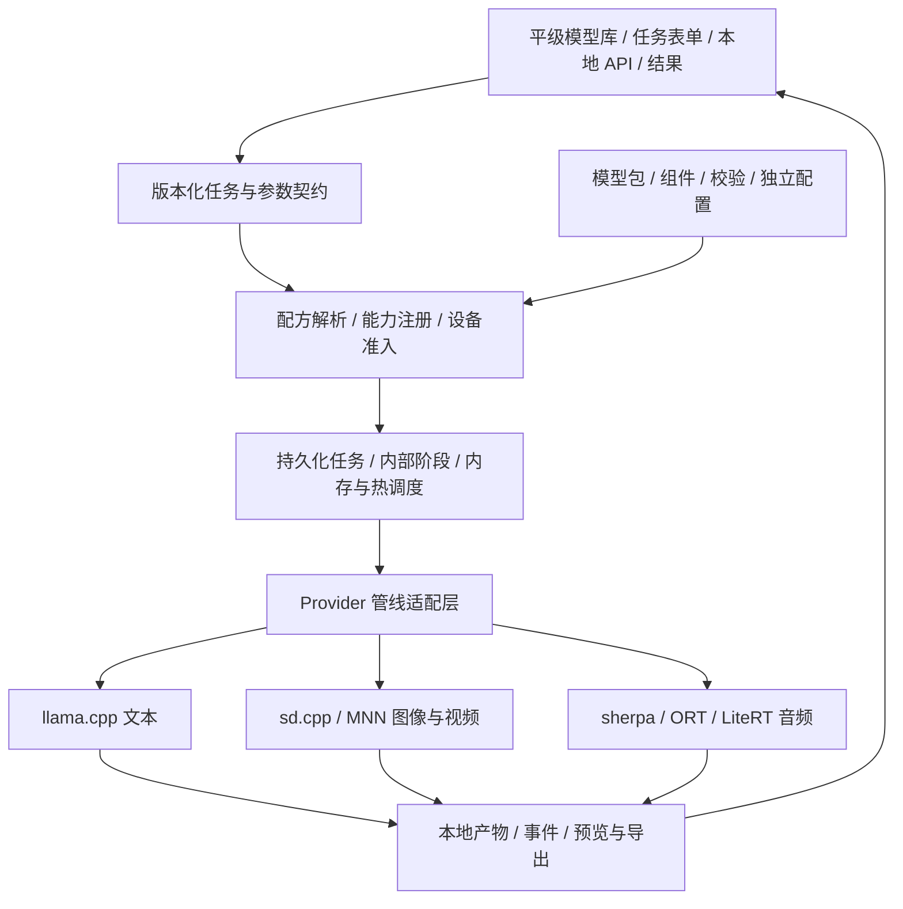

# LMA 多模态本地基座评估

[English](FOUNDATION.en.md) · [本地模型评估](MULTIMODAL.md) · [任务执行](WORKFLOWS.md) · [现行发版需求](MULTIMODAL_RELEASE_PLAN.md) · [文档目录](README.md)

日期：**2026-10-27（Asia/Taipei）**。结论：**可以构建，建议把产品主线定为可扩展的本地多引擎基座。** 核心目标是以后添加模型时复用下载、配置、任务与结果管理；不要求先把每个模型写成独立功能。全部推理在同一 Android 手机进行，无需 ROOT，无外部推理或回退。

本文是对当前源码和上游 Android / 原生引擎的评估，**尚未实现这套基座**。当前 APK 为 0.2.0、单文件文本 GGUF；没有新增权重下载、引擎构建、手机生成或耐久测量。Z20 是需要兼顾的低资源设备，不决定整个产品的模型上限。

下一版本 v0.3.0 一次交付全部基座与所选目标，以[完整版本更新需求](MULTIMODAL_RELEASE_PLAN.md)为准：01–14 / 16 / 17 及冻结子目标、所有模型平级，以功能和基座依赖标签筛选；只做任务表单 / 队列 / 结果，不建设 ComfyUI 画布、用户节点、插件生态或图导入。本文的内部模块属于应用代码。

## 01 · 可行性的依据与边界

已有可集成的 C/C++ 或 Android 图执行基础：[stable-diffusion.cpp](https://github.com/leejet/stable-diffusion.cpp#features) 覆盖多个图像 / 视频家族；[MNN Diffusion](https://github.com/alibaba/MNN/blob/master/transformers/diffusion/README.md) 有移动图像配方；[ONNX Runtime](https://onnxruntime.ai/docs/tutorials/mobile/)、[sherpa-onnx](https://github.com/k2-fsa/sherpa-onnx) 和 [LiteRT Android](https://developers.google.com/edge/litert/android) 提供音频组件或完整语音管线的实现基础。实际手机版本和适配范围仍按固定构建验证。

这支持“多引擎共同扩展”的工程结论，**不证明任意 HF 权重可直接执行**。ONNX / TFLite 图执行器不会自动提供某个 TTS 的分词、采样循环和音频 codec；一个 C++ 引擎列出某架构也不表示每个 Android GPU 支持它。

| 新增对象 | 基座设计后的主要改动 | 是否可能只更新模型数据 |
| --- | --- | --- |
| 已支持架构的其他微调 / 量化权重 | 增加固定来源、组件、参数与兼容配方；重新验收 | **可以**，前提是现有引擎支持该变体及全部组件 |
| 同架构的新 LoRA / 音色 | 增加资源和基础模型约束 | **可以**，前提是适配器格式 / 音色机制已支持 |
| 引擎已支持、LMA 尚未启用的家族 | 补 provider 的家族管线 / 参数映射、必要组件与验证 | 不保证；可能需要更新应用 |
| 全新架构 / 自定义算子 | 更新或新增引擎及架构适配器，必要时转换图 | **需要代码和签名发行更新**，界面 / 下载 / 队列应继续复用 |
| 同模型的新 GPU / NPU | 新增后端配方、算子探测与硬件验证 | 经常涉及新原生构建；不按芯片名称自动放行 |
| 新任务类型，如未来新增音频编辑 | 扩展任务 schema、交互与适配器 | 需要扩展，但不重写整个应用 |

“高支持度”应通过**已支持架构的变体可持续加入、不同引擎可以并存、未知模型能说明缺什么**衡量，不用一个未经设备验证的模型数量或百分比表示。

## 02 · 必须分开的三层

1. **架构与管线：** SD、Wan、LTX、TTS 等如何分词、编码、采样、解码；组件之间怎样匹配。
2. **推理引擎：** llama.cpp、sd.cpp、MNN、ORT、LiteRT 等执行代码及其固定构建。
3. **硬件后端：** CPU、Vulkan、OpenCL、QNN 等可用算子、形状、精度及驱动限制。

任务再与这三层组合。`video.generate` 不等于固定 Wan，`audio.generate` 不等于某一个 TTS，Vulkan 也不是模型格式。LMA 的 engine provider 是应用适配层，不应与 ONNX Runtime 的 Execution Provider 混为一谈。

## 03 · 共用架构

页面与 API 调用同一任务契约。一次生图也通过任务层，编码 / 采样 / 解码依赖留在内部管线，不要求用户编排节点。用户换模型后，表单从能力与参数描述生成可用选项。

## 04 · 模型、组件和配方

模型身份、权重变体、组件文件、运行配方分别建模。一个模型可以拥有多个量化、后端或设备配方，但显示稳定的来源和用户模型 ID。

模型包记录固定仓库 / revision、组件角色 / 路径 / 大小 / SHA256、任务、架构、格式 / 量化、许可和标签。配方记录匹配的 tokenizer、编码器、VAE / codec、管线适配器、引擎构建要求、硬件档位、参数 schema 和资源估算。缺少任何必需项都不能仅因主权重已下载而显示可运行。

内容哈希索引用于共享组件，依赖图用于删除和空间预算；安装按组件校验，全部必需组件完成后原子提交包状态。运行期间持有组件引用，删除 / 清理不得影响正在执行的任务。未知 SHA 或来源未固定要明确显示，不能冒充已审核包。

HF 搜索继续覆盖全部来源，但“可发现”“有适配配方”“已安装”“当前设备可尝试”“已在该设备验证”分别显示。选择后提供所需组件、总下载、已有共享资源和可运行原因。本版使用预适配资源包，不要求用户连接电脑转换，也不调用外部转换 / 推理服务；没有适配包就说明暂不支持。

App 更新只提供基座代码、引擎、标签 / 目录元数据和配方，不含模型权重或模型专用资产；用户选择后按需下载 / 导入完整包。安装 / 升级 / 浏览不触发模型下载，已有文件与设置保留，模型更新由用户独立选择。支持范围的开发验收不要求用户安装全部目标；无模型也能浏览和管理 App。

## 05 · 应用内部引擎模块

| 引擎路线 | 基座中的定位 | 本版接入要求 |
| --- | --- | --- |
| llama.cpp | 已有文本能力 | 先包装现有实现，验证迁移 |
| sd.cpp | 图像 / 视频的通用原生主线候选 | 按构建实际启用架构；从一条图像与一条小视频管线验证 |
| sherpa-onnx / ORT | 小型 TTS 及需专用 host loop 的 ONNX 音频管线 | 共用任务协议；每种架构补完整前后处理 |
| MNN | 明确有移动优化收益的图像 / 其他适配包 | 保留扩展口，有可验证配方再引入，不默认加载全部引擎 |
| LiteRT | 已转换的音频 / 其他移动管线 | 按具体模型需要接入，不能仅凭 .tflite 判为完整支持 |

这是一组互补的扩展入口，不是一次装入全部依赖的要求。管线只引用已注册的原生操作和参数；模型描述文件不携带可执行脚本或任意表达式。增加数据不能绕过引擎 / 架构能力校验。

引擎采用**应用内版本化模块**，原生运行器随签名 APK 分发，按需加载。用户仍安装一个应用，下载模型数据即可使用已有支持。增加新引擎通过正常 APK 升级，不承诺从 HF 下载任意 `.so`、Python 或自定义节点即运行。[Android 动态代码说明](https://developer.android.com/privacy-and-security/risks/dynamic-code-loading)

各引擎包固定 upstream commit、编译选项、ABI、minSdk、native 依赖及许可；LMA provider 协议版本独立于上游版本。上游 API 变化在适配器内消化，不让前端依赖 CLI 参数。新旧引擎构建的兼容表由发行维护。

重型引擎放入独立工作进程，使用可版本协商的 IPC 和受控文件句柄 / 产物引用。可以是独立 Android Service 进程，或像当前引擎一样的已打包原生可执行进程；主进程持有队列与状态。不同 ggml / C++ 依赖尽量避免在同一进程内混载。进程分开用于生命周期和崩溃隔离，**不等于额外安全沙箱或不会被系统杀死**。[Android 进程说明](https://developer.android.com/guide/components/processes-and-threads)

进程只在需要时启动；Z20 默认同一时刻一个大型引擎。不能因为支持五种引擎就让五套模型常驻。CPU 是有相应实现的配方的基线路径，不能作为所有 GPU / NPU 图失败后的通用保证。

## 06 · 统一任务，保留任务差异

共用请求字段：任务 ID / 幂等键、任务类型、模型 / 配方引用、输入产物、参数覆盖、优先级和版本。任务类型区分 `text.generate`、`image.generate`、`video.generate`、`speech.synthesize`、`audio.generate`；媒体合成、图生图 / 图生视频 / 编辑仅为后续扩展口，不自动纳入所选模型本版冻结的能力。

共用生命周期为 `probe → validate → plan → load → run → cancel / finish → unload`。能力声明单独指出 streaming、progress、preview、cancel、pause 和 checkpoint 是否真正支持。上游没有暂停 / 中间预览时，界面不能虚构；不提供进度分母就显示阶段状态。

参数采用按模型 / 配方的版本化 schema。上下文、CFG、步数、音色、音频时长等保留自己的语义，不硬套一个全局通用面板。用户默认配置仍跟随模型 ID；配方或量化有差异的字段增加子配置并明确迁移，不让换后端覆盖其他模型设置。

数值支持可编辑预设，已知硬上限超限自动回填；宽高 / 帧数 / 编译形状联合校验。区分模型硬约束、后端硬限制和设备资源估算，后者不是模型额定上限。任务保留原始输入、有效参数及调整原因。

事件共用任务 / 内部阶段 ID、序号、时间和类型；payload 分别承载 token、diffusion step、音频 chunk、预览或产物。图像 / 视频不会被伪装成持续输出文本 token。音频缓冲和预览队列有界，避免前端消费慢导致无限占用内存。

## 07 · 资源、产物和内部任务执行

运行前解析完整资源需求，包含编码器 / 主干 / VAE 分阶段占用、OS / UI / 驱动余量、临时磁盘和产物空间。总下载大小不能作为 RAM 需求。根据已测配方和当前设备状态决定入队 / 拒绝 / 提供合法低档位；未知内存估算不显示已保证可用。

调度器管理引擎租约、前台服务、取消归属、进程超时和崩溃收敛。失败只影响对应任务，释放引擎并保留明确状态；进程号还要绑定任务 / 启动代次，避免取消了后来启动的任务。资源不足时不转出手机，也不静默换成其他模型。

产物统一为带来源、hash、mime、尺寸 / 时长、采样率 / fps 的本机引用；大 tensor 留在 provider 内。不同引擎的 latent 形状、尺度、编码器和 VAE 不天然兼容，首版跨引擎通过图片、音频、视频等已解码产物交换。中间张量保留在匹配管线内部，不提供用户节点互接要求。

SQLite 持久化任务、内部阶段、配置快照、事件和产物。恢复可复用校验通过的已完成阶段；续步只适用于引擎真实 checkpoint，且必须匹配模型哈希、引擎版本及配置。缓存还要包含配方、输入 hash 和有效 seed，不能跨模型版本误复用。

采用平级模型库、任务表单、共用队列、结果预览和重新生成。内部依赖调度不需要公开通用 DAG / 画布 / 节点 / 插件，也不提供 ComfyUI 图导入。[任务与后台细节](WORKFLOWS.md)

## 08 · 当前代码如何迁移

| 当前实现 | 可复用部分 | 基座改造 |
| --- | --- | --- |
| [Store.java](../app/src/main/java/com/lma/app/Store.java) 的 `modelFile(id)` | 稳定模型 ID、私有存储、用户配置 | 增加 Bundle / Component / Recipe 库；旧 GGUF 映射成单组件包，保持文件和 ID |
| [Downloads.java](../app/src/main/java/com/lma/app/Downloads.java) | HTTPS、续传、SHA256、暂停 / 原子安装 | 将传输单元拆成组件，增加包事务、共享引用与总空间计划 |
| [EngineHost.java](../app/src/main/java/com/lma/app/EngineHost.java) | 已打包进程、健康检查、停止 / 恢复 | 包装成 `llama_text` provider，再接其他引擎；移除核心对单一 CLI 的依赖 |
| [LmaApp.java](../app/src/main/java/com/lma/app/LmaApp.java) / [LmaService.java](../app/src/main/java/com/lma/app/LmaService.java) | 前台服务、通知、锁、状态桥接 | 单个 engineModel / Process 演进为 JobManager / WorkerSupervisor；当前文本路径保留兼容入口 |
| [HubClient.java](../app/src/main/java/com/lma/app/HubClient.java) | HF 查询、固定提交、文件与认证边界 | 从单 `.gguf` 选择扩展到可信配方解析；不单凭扩展名或 pipeline_tag 宣称兼容 |
| [ModelSettings.java](../app/src/main/java/com/lma/app/ModelSettings.java) | 模型独立配置、数值回填 | 增加任务 / 配方 schema；现有文本字段和迁移保持兼容 |
| WebView / SQLite 聊天 / 文本 API | 离线界面、历史与已有使用逻辑 | 新增任务与产物页、异步任务接口；文本 API 不强塞图片 / 视频响应 |

“推荐”仍保留 `m08 → m06 → m01`，其他来源继续从全部 / 搜索进入本地管理；无审查保留独立标签。这套基座按能力添加模型，不改变已有推荐选择。

## 09 · 同一版本的基座完整验收

以下均为下一版本 v0.3.0 的必需工作项，不对应不同版本；不能以完成其中一项代替完整基座和全部模型范围。

| 工作项 | 必须交付 | 完成标准 |
| --- | --- | --- |
| K1 契约和兼容迁移 | 包 / 配方 / 能力 / 参数协议、旧文本 provider 和持久任务层 | 旧模型、设置、下载、聊天与文本 API 可用，推荐保留 |
| K2 共用跨模态执行 | 生文、生图、生音频和真实生视频共享队列、参数、后台和结果库 | 至少两个实际引擎模块；静态图 MP4 不计生视频 |
| K3 全部目标与可扩展性 | 01–14 / 16 / 17、所有冻结子目标及两类 LoRA 基础模型都接入；同架构第二权重复用数据描述 | 同版逐项验收；新 provider 不重写模型库 / 下载 / 任务体系 |
| K4 设备与异常 | Z20 类与较新设备配方、资源 / 后台、崩溃、取消、缺文件、磁盘不足和恢复 | 每个目标有明确设备与离线证据，不冒充全在 Z20 已通过 |
| K5 交互与发行 | 平级标签、任务表单、队列 / 结果、完整原生依赖与签名包、双语文档 / 功能媒体 | F-01–F-12、A1–A11 和 R-01–R-05 共同通过 |

K1 的部分契约 / 迁移可用桌面检查；K2–K4 的设备执行须真实产物与物理 Android 记录。目前无真机，不能宣布基座与模型全部完成。前台服务也不能保证永不被杀，详见任务执行方案。

主要成本是各架构的原生管线、移动算子 / 量化、资源 / 质量验证和上游维护，均属于本版需解决的工作。内部实现可有依赖顺序；未关闭目标留作本版阻塞，不拆给其他版本。
