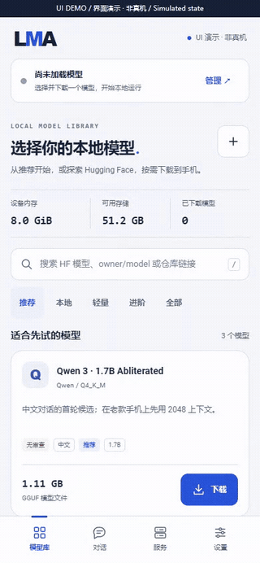

# HF 发现与本地模型

[English](HF_MODELS.en.md) · [文档导航](README.md)

LMA 0.2.0 将产品定位改为“本地模型工作台”。既有推荐不变，新增 HF 在线发现与“本地”管理。模型选择不再限定无审查变体；这类变体保留独立标签及依据。

## 开发版的多组件入口

0.3.0-dev.5 新增显式 HF 组件选择：固定版本、按角色选择不同仓库文件、登记后单独确认下载。详见[配方与完整性指南](HF_RECIPES.md)。仅覆盖签名 App 中的特定模板，不能让全部 HF 架构直接运行。下方 v0.2.0 的 GGUF 操作继续保留。

## 入口和完整操作

“推荐”仍以 `m08 → m06 → m01` 显示原有模型，名称、排序、标签、固定权重和作者依据均保留。“轻量 / 进阶”继续使用原有 14 项精选分组；联网搜索不会改写它们。

1. 进入模型库，点“全部”，或在搜索框输入关键词、`owner/model`、`https://huggingface.co/owner/model`。除“本地”内的搜索外，输入后约 550ms 自动查询 HF，回车可立即查询。
2. 默认筛选 GGUF，按下载量排序。可改成“HF 全部格式”，并按喜欢数或更新时间排序。列表每页至多 24 个仓库，通过上一页 / 下一页继续浏览。
3. 点击“选择文件”。原生端重新读取仓库元数据，固定 40 位提交版本，再递归分页读取文件树。每次最多查询 100 个树条目，页面只展示其中的 `.gguf` 文件。
4. 选择量化和文件，确认体积、任务类型及不支持原因。无 GGUF 的文件页仍可能有下一页；也可打开来源仓库寻找对应 GGUF 转换仓库。LMA 不执行在线转换。
5. 点击“下载”后进入“本地”。任务交给原生前台服务，串行下载、暂停 / 续传、校验并保存到私有存储。已选择同一仓库、提交及路径的文件不会重复添加。
6. 在“本地”集中查看内置、HF 和手动导入的已下载模型，也能管理未完成任务。搜索只过滤本地条目，不联网。下载完成后可加载；运行中的模型须先停止才能删除。

普通模型无需“无审查”标记也可搜索、下载和运行。HF 搜索依赖 API 当时返回的可见模型和权限，结果不是完整库的本地快照。元数据失败时可重试，推荐和已下载模型仍可离线浏览。搜索不启动推理前台服务，不中断正在运行的模型。

## 发现、下载和运行范围

| 对象 | 当前行为 |
| --- | --- |
| HF 模型仓库 | 支持在线关键字、精确仓库、链接、排序及分页发现；公开或当前身份有权读取的模型 |
| 普通 / Uncensored / Abliterated GGUF | 相同下载路径；无需成为精选或具有特殊标签 |
| 单文件 GGUF 文本模型 | 可选下载候选；实际加载受固定引擎支持的架构、量化、模板和手机内存限制 |
| 分片 GGUF | 显示不支持原因并禁用下载选择；当前未实现分片合并与成组管理 |
| `mmproj` / projector | 显示不支持原因，不能单独当文本模型加载 |
| 明确标记的语音、嵌入或其他任务 | 文件选择禁用；未标任务的仓库仍需用户核对及实际加载确认 |
| Safetensors / PyTorch / ONNX / MLX 等 | “HF 全部格式”可发现仓库、查看来源；当前不能作为运行器输入下载 / 加载，也不自动转换 |
| 受限 / 私有仓库 | 需有效 HF 权限、可选令牌、许可同意及网络；没有替代许可审批的机制 |

文件有 `.gguf` 扩展名并不保证能运行。当前固定 llama.cpp v0.4.1（提交见架构文档），CPU / ARM64 / Android 9+；单文件最大 12 GiB、保留 64 MiB 存储余量。文件体积不等于 RAM。Z20 等老款手机建议先用小模型与短上下文；尚无真机兼容性或 tokens/s 实测。

HF 广泛发现、选择量化、下载、本地管理、聊天和 API 服务采用 LM Studio 类似流程；完整多模态、多运行器、自动转换、分片支持及全部桌面功能并未实现。LM Studio 自身也以运行器支持的格式和模型为界，参考[官方模型下载说明](https://lmstudio.ai/docs/app/basics/download-model)及 [HF GGUF 文档](https://huggingface.co/docs/hub/en/gguf)。

## 固定版本、文件校验与本地身份

仓库读取时固定提交 SHA，文件分页及 `resolve/{sha}/{path}` 使用同一版本。LFS SHA256 存在时下载后比对；没有预期 SHA256 时只做 GGUF、传输长度及本地哈希检查，界面不会显示发布者哈希一致。

本地 HF ID 为 `hf_` 加仓库名、提交和文件路径的 SHA256 前 40 个十六进制字符。URL 远端路径逐段编码，本地文件名只用安全 ID。删除 HF 模型会清理安装文件、未完成文件、拒绝文件和持久元数据；卸载应用会删除全部私有模型和历史。升级相同签名 APK 保留原有模型 ID 和记录。

选择命令只传仓库、提交和路径；原生端必须在当前已获取的文件页找到匹配项。WebView 不能指定下载 URL、篡改大小或哈希。分页链接限制为受信任 HF 主机、HTTPS、对应 API 路径，防止把远端分页变成任意地址请求。

## 每个本地模型的参数

已下载条目的设置图标可编辑该模型的上下文、输出、线程、温度、思考和系统提示词。参数按模型 ID 独立保存，支持预设和手动输入，超限自动回填。HF 不同提交或量化文件有不同 ID；同一固定文件重复选择会复用配置。详见[模型参数](MODEL_SETTINGS.md)。

## HF 令牌与下载源

公开模型默认不需要令牌。设置中选择自动、Hugging Face 或 HF Mirror，自动模式失败后尝试镜像。镜像是独立服务；LMA 读取其返回的公开 HF 元数据，完整文件有预期 SHA256 时再校验。

受限 / 私有模型：先在 HF 同意许可并取得读取权限，在“设置 → Hugging Face 访问”填入 `hf_…` 令牌并保存。当前只支持访问令牌，没有 HF 网页登录流程。公开模型也可以不设置令牌。

令牌保存在应用私有 SharedPreferences，禁用应用备份；没有宣称硬件加密。页面只接收“已设置”布尔值，保存后密码框清空。令牌不会进入模型记录、日志导出、截图或发布物。设置令牌后所有 HF 请求使用官方源，避免私有请求去往镜像；每次 HTTPS 重定向都重新检查主机，只有 `huggingface.co` 默认 HTTPS 端口获得 Authorization，CDN / 镜像 / 自定义域名不获得令牌。官方源不可达时可清除令牌后使用公开镜像。

401 / 403 提示授权与许可问题；404 也可能是身份无权访问；429 可稍后重试。没有在本轮使用真实账号令牌测试私有 / 受限仓库。

## 独立无审查标签

| 显示 | 依据 |
| --- | --- |
| 无审查 | 既有精选中的作者声明已核对，保留固定作者说明、实际权重和 SHA256 对照 |
| 无审查 · 元数据 | 在线仓库名称或标签出现 uncensored / abliterated / Dolphin 相关标识；仅作提示，未逐项核对作者卡 |
| 不显示该标签 | 没有相关依据或提示；不代表独立测过拒答情况 |

手动链接及文件导入不凭名称冒充已核对条目。标签不保证零拒答，也不保证能力、正确性或手机运行表现。应用不额外过滤模型提示和回复。既有证据见 [UNCENSORED_MODELS.md](UNCENSORED_MODELS.md)。

## 证据与演示

45 项生产 Java HF 逻辑检查覆盖分页限制、路径 / URL 校验、格式阻止、固定版本与哈希、去重、持久化 / 删除、过期查询、令牌目的主机和原生选择。5 项实时检查通过生产客户端访问公开 HF Mirror 元数据，验证 GGUF / 全格式搜索、分页、仓库提交及文件 SHA256；没有下载权重或执行推理。记录见 [hub.json](../verification/hub.json)、[hub-live.json](../verification/hub-live.json)。UI 检查使用明确的模拟桥接。

[截图与录屏说明](MEDIA.md) · [验证边界](VALIDATION.md) · [架构实现](ARCHITECTURE.md)

dev.21增加SoulX的第34个显式组件模板及 `.f32` 二进制数据识别：全14份资产都由用户选择，包含已训练声源参数。匹配转换组件的完整公开HF候选尚未核对，原始PyTorch权重不能直接即用；模板可选不等于已验证用户下载 /Android运行。详见 [SoulX资产与来源边界](SOULX_ENGINE.md#2-一份配方14份用户资产)。
