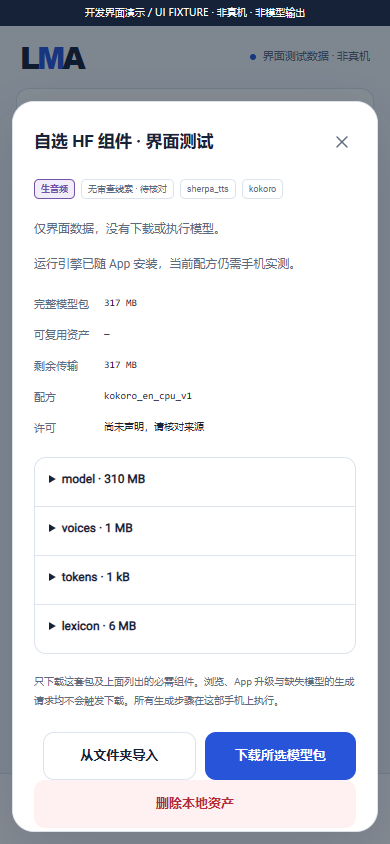

# HF components and local recipes

dev.34 adds explicit companion review on one pinned revision. Confirm unique filename/paired-path suggestions without replacing bindings; unresolved or incomplete listings retain manual selection. Declaration/download remain separate and matching hints preserve model identity. See [usage and design](COMPONENT_SUGGESTIONS.en.md).

[中文](HF_RECIPES.md) · [HF discovery](HF_MODELS.en.md) · [Development status](DEVELOPMENT.en.md) · [Asset-control audit](ASSET_CONTROL_AUDIT.en.md)

Applies to **0.3.0-dev.16 / code 20, an internal checkpoint, not a Release**. The App supplies code and recipe metadata; users select and manage model assets. This workflow does not establish Android support for arbitrary HF weights. Architecture, language, matching components, licensing and device resources still need verification.

## User workflow

1. Search HF or use All, open a repository's file picker, then choose **构建模型包 / LoRA 配方**. The existing single-file GGUF text route is preserved.
2. Explicitly select one of twenty-nine signed data templates: text GGUF, MOSS Nano, Qwen3-TTS Base, MOSS Delay first-class, Local-v1.5 / SoundEffect-v2, MOSS-TTS / v1.5 / TTSD / VoiceGenerator, matched Sana MNN mobile, split Z-Image/FLUX/Qwen-Image/Wan, complete/split SD1.5/SDXL, their ordinary LoRAs, SD-Turbo, both LCM checkpoint/LCM-LoRA architectures, and English Kokoro/Piper/Matcha. See the [diffusion guide](DIFFUSION_ENGINE.en.md). Templates neither install engines nor convert weights or verify phone support.
3. Select each required role, such as `model`, `voices`, `tokens` or `vocoder`. Enter another `owner/repository` and paginate when necessary. Existing choices retain their own repository and frozen commit. Extensions validate role formats only; they do not identify architecture or language. Changing templates clears choices; closing/restarting may lose an undeclared draft.
4. Inspect all files, disclosed dependencies, sources, revisions, sizes and integrity types. Diffusion templates disclose CLIP merges; split SDXL requires CLIP-L, CLIP-G and VAE. Speech templates disclose their English lexicon; other languages need complete matching recipes. LCM-LoRA needs its specific template; a name does not declare acceleration.
5. **加入本地并查看下载计划** registers an immutable manifest and **does not download**. Review the full size, verified reuse, remaining transfer and engine status, then explicitly download. Missing engines/assets or incompatibility fail locally with an explanation; no off-device inference or implicit dependency download is added.
6. Manage pause/resume, folder imports, independent settings and asset deletion in Local. LoRAs remain peer entries and require an explicitly chosen compatible base. Jobs execute on the same phone; Recommended remains `m08 → m06 → m01`.

## Data and integrity

The bundled `lma.recipe-catalogue/1` contains templates, parameters, roles and dependency metadata only. Generated `lma.model-bundle/2` manifests contain data components, without Python, SO files, scripts, arbitrary commands or user plugins.

| Source | Pinned expected integrity | After explicit transfer/import |
| --- | --- | --- |
| HF LFS weights and other large files | Published metadata SHA256 and full length | Compute and compare content SHA256 |
| Ordinary small Git files | Frozen commit, Git blob SHA-1 and full length | Verify the Git object ID over `blob <length>\0` plus file bytes; separately record actual content SHA256 |

A Git blob ID is neither raw-file SHA-1 nor publisher SHA256. The UI does not invent expected SHA256 when ordinary Git metadata lacks one. A namespaced storage key is not a content-hash claim. Job provenance keeps both the expected algorithm/digest and the measured SHA256. Integrity checks cannot establish trustworthy authorship, license permission or model quality.

Existing `lma.model-bundle/1` SHA256 objects/receipts remain compatible. Schema 2 requires exactly one expected digest per component. Recipe imports separate roles, e.g. `model/model.onnx` and `vocoder/model.onnx`, avoiding cross-repository filename collisions; consult the exact paths in the download plan. Runtime leases protect complete base/adapter groups, and deleting another model preserves shared objects.

Native selection accepts files from the current frozen repository page only. Changed templates, repositories or pagination invalidate stale commands. WebView cannot invent unlisted downloads or supply executable engines. Repeating the same template/component selection reuses its ID; changed pinned sources or recipes create distinct immutable records. After registering a new version, use Local version management for [independent updates/rollback](MODEL_UPDATES.en.md). Existing-file migration is implemented; physical Android upgrade acceptance remains unfinished within this release.

## Verification and media

425 foundation/storage/version checks include 233 recipe/Git-integrity assertions. Separate HF/controller and browser checks are recorded in [development evidence](../verification/development/status.json). Host checks use arbitrary bytes or explicitly simulated native state, without test weights; they are not model outputs, Android installation or screen-off endurance evidence.

Complete v0.3.0 still requires F-01–F-12, every frozen subtarget in 01–14/16/17, and A1–A11. This feature does not reduce, split or defer that scope. The public APK remains v0.2.0.

Metadata fields were checked on 2026-10-28 against the [official HF SDK `RepoFile` parser](https://github.com/huggingface/huggingface_hub/blob/main/src/huggingface_hub/hf_api.py) and [file-tree API documentation](https://huggingface.co/docs/huggingface_hub/package_reference/hf_api#huggingface_hub.HfApi.list_repo_tree): ordinary-file `oid` and LFS `oid` have different meanings. New controller tests use deterministic metadata fixtures. Direct HF requests timed out and the mirror returned 403 in this run; no new live tree acceptance or weight download is claimed.

## Nano external-data recipe

The eighth template covers only MOSS-TTS-Nano browser ONNX with its full codec. `.model` SentencePiece data and `.data` external ONNX weights are separate user choices. Eight core roles are required; every data file referenced by a graph is also required at execution. Registration does not transfer anything. See [Nano roles, guards, build and evidence](MOSS_NANO_ENGINE.en.md).

## Text GGUF recipe

dev.8 adds `text_gguf_cpu_v1`, with the single required `text_gguf` role. Users download/import the complete pinned model and contained tokenizer. Split GGUF, vision components and automatic architecture conversion are unsupported by this recipe. New bundles submit shared `text.generate` jobs and preview response/reasoning. Existing single-file entry points and recommendations remain; existing local files now use the [migration path](MODEL_MIGRATION.en.md). See the [text foundation guide](TEXT_ENGINE.en.md).

Dev.9 adopts existing complete text/HF/import GGUFs into the same assets/settings/jobs/version protocol without downloading again. Its 69 host checks do not establish Android upgrade acceptance. See [migration](MODEL_MIGRATION.en.md).

dev.13 adds four split templates for Z-Image-Turbo, FLUX.2-klein 4B, Qwen-Image 2.1 and Wan 2.1 T2V 1.3B, bringing the total to twenty. Users explicitly select encoders, VAEs and vocabularies; a GGUF main weight does not remove dependencies. See [components and parameters](ADVANCED_DIFFUSION.en.md).

## Sana mobile variant

dev.14 adds the [Sana mobile / MNN pipeline](MNN_SANA_ENGINE.en.md): a real ARM64 CPU worker, 13 user-selected components, whitelisted Qwen3 metadata, encoder release before diffusion, per-model CFG/token/thread controls and immutable job plans. Its 74 host/C++ checks perform no model inference. All 21 templates remain metadata with separately confirmed downloads. Foundation 445 and UI 208 checks pass; 37 screenshots and recording/GIF are explicit UI FIXTUREs. No Android image/endurance evidence exists. Every frozen target and release gate remains in the same complete v0.3.0, without a new Release.

Qwen3-TTS adds the 22nd template and a pinned optional bundle: two GGUFs provide Talker (embedded BPE/Code Predictor/speaker encoder) and the 12Hz codec. Shared `provides` discloses embedded roles without extra downloads. Only matching 0.6B Base is accepted; headers are reviewed and phone execution remains untested. See the [Qwen speech guide](QWEN_TTS_ENGINE.en.md).

## MOSS Delay: optional reference encoder

The 23rd template, `moss_delay_firstclass_cpu_v1`, requires a matching native first-class backbone and decoder. Users select an encoder only when reference WAV support is needed. Ordinary MOSS GGUFs, v2 codecs and other MOSS architectures differ. No new pinned checked download candidate is added; users choose files/import conversions, without an implicit encoder fetch. See the [complete workflow](MOSS_DELAY_ENGINE.en.md); all frozen family members retain individual acceptance gates.

[Local-v1.5 / SoundEffect-v2](OPENMOSS_ENGINE.en.md) use two user-selected matching backbone/extras GGUFs. Embedded BPE/codecs are disclosed through provides; the two layouts and first-class Delay files are incompatible. Registration, browsing and foundation updates never trigger asset downloads.

The same engine adds separate TTS / v1.5 / TTSD / VoiceGenerator recipes with explicit 32/16-codebook and 8B/1.7B geometry checks. All output 24 kHz mono; TTSD maps paired speaker references and VoiceGenerator requires a voice instruction. Components do not interchange with other MOSS formats. See the [workflow, parameters and publisher evidence](OPENMOSS_ENGINE.en.md). Models remain peers with audio/TTS/multi-speaker or voice-design tags independent of their foundation dependencies.

dev.20 adds metadata-only recipe 33: [Stable Audio Open Small](STABLE_AUDIO_ENGINE.en.md). TFLite files are selectable in HF file lists. Users explicitly download/import three matching graphs and the paired SentencePiece model. No community four-file distribution is marked verified runnable. Model terms are separate from App licensing; full-model acceptance remains open.
