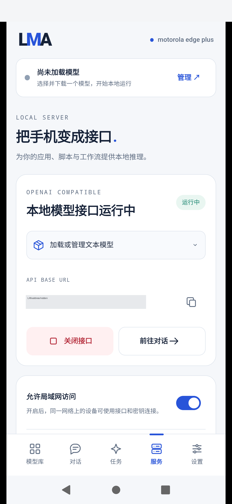

# v0.3.12 supplementary physical LAN HTTP test

[中文](LAN_HTTP_TEST.md) · [Original benchmark](DEVICE_BENCHMARK_V0312.en.md) · [API usage](LOCAL_API_V0312.en.md) · [57-check JSON](../verification/supplemental/v0.3.12/lan-http.json)

On 2026-11-02, the released **v0.3.12/code62** passed a new direct LAN test: enable “允许局域网访问” in the phone's Service page, then issue native HTTP requests from the Windows PC's physical Ethernet interface to the phone's Wi-Fi IPv4. **All 57 checks passed across 128 HTTP requests.** LAN access remains enabled.

This supplement adds tests, evidence and documentation. The released APK, original tag and Release attachments retain their exact identities. APK SHA256: `67b20c2a548f7b253db18f938156f44e817fe20fc58332f8912314f40f756140`. Device: motorola edge plus, Android 12 / API 31, SM8250. These are not X30, Z20 or general Android results.

## Transport and evidence

The HTTP path is **physical PC Ethernet → local network → phone wlan0 → LMA API → workers on that same phone**. ADB only operates the authorized UI, discovers Wi-Fi/package identity and controls the screen. API traffic never uses ADB forwarding. Python `http.client` connects directly, binds the selected PC address and does not read proxy configuration. Every TCP local/peer address is checked. The exporter independently verifies that the selected PC adapter is active physical hardware.

Raw addresses, ephemeral ports and request paths stay in ignored `build/device-lan-http/` files. Public evidence includes verification results and the private proof's SHA only. The authorized UI key stays in memory and is hidden again; no key enters source, logs, screenshots or reports. No Docker, WSL, emulator or off-device inference is used.



## Coverage

| ID | Coverage | Actual result |
|---|---|---|
| L01 | Physical connection, installed APK, execution location | PC hardware adapter/phone share a subnet; exact stable APK SHA; same_android_phone |
| L02 | Authentication and origin checks | Missing/wrong key 401; browser Origin 403 |
| L03 | Publication, details and parameters | Five local peers: image 1 / speech 1 / video 1 / mesh 2; saved schemas/settings match |
| L04 | HTTP caching | Catalogue ETag/304 and bodyless HEAD |
| L05 | Invalid requests and generation bounds | Unsupported image batch 400 before admission, no job created; generation deadline null |
| L06 | Async jobs, idempotency and cancellation | Admission 202; original-key replay returns the same job; changed body 409; own second job cancelled |
| L07 | New speech output | Unified async route and standard `/v1/audio/speech` each generate a real WAV |
| L08 | New image output | `/v1/images/generations` produces a decodable PNG; replay reuses the job |
| L09 | Artifacts and events | GET/SHA/HEAD/304, Range, matching/stale If-Range; JSON events and a real SSE frame |
| L10 | Binary upload and image input | Bounds 400 / offset 409 without advancing; 8192-byte chunks; completion SHA; typed image-only 3D preflight |
| L11 | Video transfer | Existing owned 6.125-second/49-frame video; full SHA, FFprobe and actual byte-range checks |
| L12 | Screen off and preservation | Generation/download with screen asleep for 111.959 seconds; 30 subsequent health calls pass; history/five models/settings preserved |

The 57 checks are a separate supplement. The 128 requests include repeated discovery, polling and health sampling. They are not added to the original Release's 62 suites / 15,115 assertions, 24 physical program checks or 28 SDK checks.

## New outputs and measurements

| ID | New output | Parameters/output | Request or task elapsed time |
|---|---|---|---|
| O01 | [Async speech](media/tests/lan-http-v0312/lan-speech.wav) | MeloTTS Chinese INT8, two threads, 44.1 kHz mono, 2.7748 seconds, 244,780 bytes | 13.023s |
| O02 | [Standard speech](media/tests/lan-http-v0312/lan-standard-speech.wav) | Same speech model, standard WAV route, 3.0650 seconds, 270,380 bytes | 13.118s |
| O03 | [Image](media/tests/lan-http-v0312/lan-image.png) | RealisticVision, 128×128, one step, four threads, CFG4, seed1234, 27,116 bytes | 23.569s |

All three are newly generated on the phone in this run and obtained through the LAN. Their hashes match committed phone artifacts. The low-step image remains a blurry colour block; valid files do not establish image or subjective speech quality.

The video is the previously generated [original MP4](media/benchmarks/v0.3.12/wan-cpu-6s.mp4), downloaded again from the phone: 200,149 bytes, 49 frames, 6.125 seconds, SHA `66165d831f6f36eaf0d86082e718a7c7dd2bb0c13fae05cbd03d67f37ff27677`. **No new video was generated in this run.** Video preflight is not video inference; 3D preflight is not successful GLB output.

Thirty catalogue requests measured median **39.44 ms**, p95 **103.56 ms**, maximum **167.32 ms**, including the PC client, LAN and phone service. Screen-off time was 111.959 seconds, including at least 60 seconds / 30 health calls after generation; this is not endurance acceptance. The whole script took 144.099 seconds including UI preparation.

## Reproduction

Connect PC and phone to the same LAN. USB debugging must be authorized and the phone unlocked, with complete installed image/speech/video/mesh assets. No weights were downloaded/copied. The current UI locator targets this 1080×2340 phone layout; inspect controls before adapting it to another layout.

```powershell
python tools/device_lan_http.py --serial SERIAL `
  --source-address PC_PHYSICAL_IPV4 --enable-lan `
  --run-existing-models --screen-off-seconds 60
```

The script discovers wlan0, reads the UI port, explicitly enables LAN and leaves it enabled. It scrolls the key control above bottom navigation before tapping. Unlock first when needed; the tool accepts/stores no lock credentials. Generation has no fixed execution deadline; individual HTTP calls have separate network waits, and synchronous 504 is followed through the original job. Failure cleanup attempts cancellation only for known jobs created by this run.

Review the redacted screenshot/owned outputs before exporting:

```powershell
python tools/export_lan_http_evidence.py --report build/device-lan-http/RUN/report.json
python tools/export_lan_http_evidence.py
```

Manual native HTTP is also possible with the actual address/key shown by the phone:

```powershell
$env:LMA_BASE_URL = "http://PHONE_WIFI_IPV4:8080/v1"
$env:LMA_PC_IPV4 = "PC_PHYSICAL_IPV4"
# Supply LMA_API_KEY in the current process environment; do not save it in Git.
curl.exe --noproxy "*" --interface "$env:LMA_PC_IPV4" `
  -H "Authorization: Bearer $env:LMA_API_KEY" "$env:LMA_BASE_URL/models"
```

## Failed setup and limits

The first script attempt passed two environment checks and stopped during UI preparation before any API/model request. The custom WebView switch exposed `checked=false` even while enabled, and bottom navigation obscured the key control. The locator now reads the page address that tracks LAN settings and requires the button to be fully visible; actual connectivity is ultimately verified from TCP endpoints. This is a test-harness repair, not an invented App networking fix.

The successful run backed up and removed only one owned cancelled fixture job. All three successful outputs and pre-existing records remain. Weights and saved parameters are unchanged. No text/music assets were installed for inference in those categories. The original TRELLIS.2 `empty_structure` / missing GLB, all 82-bundle quality and long background limits remain as documented in the original benchmark. No APK change hides those outcomes.

[Public check record](../verification/supplemental/v0.3.12/lan-http.json) · [Media identities](media/tests/lan-http-v0312/manifest.json) · [Test runner](../tools/device_lan_http.py) · [Allowlist exporter](../tools/export_lan_http_evidence.py)
