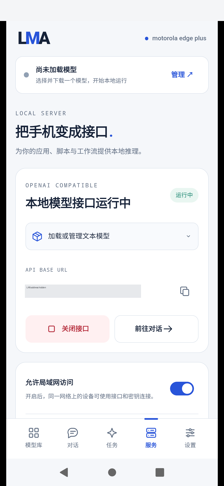

# v0.3.12 内网 HTTP 实机补充测试

[English](LAN_HTTP_TEST.en.md) · [原版完整测评](DEVICE_BENCHMARK_V0312.md) · [API 使用](LOCAL_API_V0312.md) · [57 项检查 JSON](../verification/supplemental/v0.3.12/lan-http.json)

2026-11-02，在已发布的 **v0.3.12/code62** 上新增一轮真实局域网测试：在手机“服务”开启“允许局域网访问”，由 Windows PC 的物理以太网接口直接请求手机 Wi-Fi IPv4 地址。**57 项检查通过，128 次 HTTP 请求**。手机继续保持内网访问开启。

本轮只新增测试脚本、证据和文档，发布 APK、原标签和既有 Release 附件保持原始身份。APK SHA256：`67b20c2a548f7b253db18f938156f44e817fe20fc58332f8912314f40f756140`；设备为 motorola edge plus、Android12/API31、SM8250。这不是 X30、Z20 或全部 Android 机型的结果。

## 连接与证据

HTTP 路径为 **PC 物理以太网 → 家庭局域网 → 手机 wlan0 → LMA API → 同手机工作器**。ADB 只用于设置页面、获取 Wi-Fi/安装包信息和控制锁屏；API 请求不经过 ADB 转发。Python `http.client` 直接连接并绑定指定 PC 地址，不读取代理配置。每次连接均核对 socket 的本地与对端地址；导出器另外确认该 PC 地址所属适配器确为启用中的物理网卡。

原始 TCP 两端地址、临时端口及路径日志保存在忽略的 `build/device-lan-http/` 下；公开记录只有校验结论及私有证明文件 SHA。API 密钥仅从已授权手机页面读取至内存，随后隐藏，不保存到日志、截图、源码或报告。未调用 Docker、WSL、模拟器或远端推理。



## 测试覆盖

| 编号 | 覆盖 | 实际结果 |
|---|---|---|
| L01 | 物理连接、已安装 APK、执行位置 | 物理网卡/手机同网段；包 SHA 与正式版一致；`same_android_phone` |
| L02 | 鉴权、来源校验 | 无密钥/错误密钥 401；浏览器 Origin 403 |
| L03 | 模型广播、详情、参数 | 5 个本地模型；生图1/语音1/视频1/3D2；详情与保存 schema/参数一致 |
| L04 | HTTP 缓存 | 模型目录 ETag/304、HEAD 无正文 |
| L05 | 非法请求、生成约束 | 不支持的图片批量在入队前返回400；不产生任务；生成固定时限为null |
| L06 | 异步任务、幂等、取消 | 新建202；原键重试同一任务；改正文409；独立自有任务取消成功 |
| L07 | 新语音生成 | 统一异步路由与标准 `/v1/audio/speech` 各输出一段真实 WAV |
| L08 | 新图片生成 | 标准 `/v1/images/generations` 输出可解码 PNG；重试复用原任务 |
| L09 | 文件与事件 | GET/SHA/HEAD/304、Range、匹配与过期 If-Range；JSON 事件及真实 SSE 帧 |
| L10 | 二进制上传、图片输入 | 越界400、错偏移409且位置不变；8192字节分块；完成SHA；图片输入3D预检 |
| L11 | 视频传输 | 下载此前自有6.125秒/49帧视频；完整SHA、FFprobe及真实字节切片通过 |
| L12 | 锁屏、数据保留 | 锁屏111.959秒完成生成/下载；生成后30次健康请求通过；原有历史、5模型及参数保留 |

57 是独立补充检查的数量，128 包含重复发现、轮询与健康请求。它们不合并到原 Release 的62组/15,115项程序断言、24项真机程序或28项SDK检查中。

## 新输出与测量

| 编号 | 新产生的文件 | 参数/输出 | 请求或任务总耗时 |
|---|---|---|---|
| O01 | [异步语音](media/tests/lan-http-v0312/lan-speech.wav) | MeloTTS Chinese INT8，2线程，44.1kHz单声道，2.7748秒，244,780字节 | 13.023秒 |
| O02 | [标准语音](media/tests/lan-http-v0312/lan-standard-speech.wav) | 同一语音模型，标准WAV路由，3.0650秒，270,380字节 | 13.118秒 |
| O03 | [图片](media/tests/lan-http-v0312/lan-image.png) | RealisticVision，128×128，1步，4线程，CFG4，seed1234，27,116字节 | 23.569秒 |

三个文件均为本轮由手机重新生成并经局域网取得，SHA与手机已提交产物一致。低步数图片仍为模糊色块；不据此声明画质或语音主观质量通过。

视频使用此前已生成并公开的[原始 MP4](media/benchmarks/v0.3.12/wan-cpu-6s.mp4)。本轮再次从手机下载，确认200,149字节、49帧、6.125秒，SHA为`66165d831f6f36eaf0d86082e718a7c7dd2bb0c13fae05cbd03d67f37ff27677`。**本轮没有新生成视频**；视频预检不等于视频推理，3D预检也不等于GLB成功。

30次模型目录调用：中位数 **39.44ms**，p95 **103.56ms**，最大 **167.32ms**，包含PC客户端、局域网和手机服务开销。锁屏总计111.959秒，其中生成后另外采样至少60秒、30次健康请求；不将其表述为长期后台耐久。整个脚本耗时144.099秒，包括UI准备。

## 复跑

PC与手机连接同一局域网，手机开启USB调试、已授权且已解锁；已有完整图片、语音、视频与3D模型。本轮没有下载或复制模型。当前UI定位针对本轮1080×2340手机布局；其他布局应先核对控件，不盲点坐标。

```powershell
python tools/device_lan_http.py --serial SERIAL `
  --source-address PC_PHYSICAL_IPV4 --enable-lan `
  --run-existing-models --screen-off-seconds 60
```

脚本发现手机 wlan0 地址，从页面读取端口，显式开启LAN后保留该设置。密钥按钮滚动到导航栏上方才点击；若锁屏需先解锁，工具本身不接收或保存锁屏密码。生成过程无固定执行期限，HTTP请求各有独立网络等待预算；同步504通过原任务查询继续。异常清理仅尝试取消本轮已知自有活动任务。

人工检查脱敏截图与自有输出后导出：

```powershell
python tools/export_lan_http_evidence.py --report build/device-lan-http/RUN/report.json
python tools/export_lan_http_evidence.py
```

也可自行设置环境变量，从本机手工请求，使用手机页面显示的实际地址与密钥：

```powershell
$env:LMA_BASE_URL = "http://PHONE_WIFI_IPV4:8080/v1"
$env:LMA_PC_IPV4 = "PC_PHYSICAL_IPV4"
# LMA_API_KEY 由使用者在当前进程环境中提供，勿写入仓库。
curl.exe --noproxy "*" --interface "$env:LMA_PC_IPV4" `
  -H "Authorization: Bearer $env:LMA_API_KEY" "$env:LMA_BASE_URL/models"
```

## 失败记录与边界

首轮脚本只通过两个环境检查，随后在UI准备阶段停止，未发起API或模型调用。原因是自定义WebView开关即使打开也报告`checked=false`，且密钥按钮位于底部导航后方。修正为读取随LAN设置更新的页面地址，并确保按钮完整露出；连接状态最终由真实TCP两端核对。它是测试脚本修正，不是将不存在的App网络故障记为修复。

完整成功轮只备份并移除一个自有取消测试任务；三个成功输出及所有原有任务继续保留。模型权重和保存参数未改。文本/音乐没有已安装资产，本轮没有这两类推理；TRELLIS.2既有`empty_structure`和3D未产出GLB、全部82包质量、长期后台等边界继续见原测评。没有修改APK来掩盖这些结果。

[公开原始检查](../verification/supplemental/v0.3.12/lan-http.json) · [媒体身份](media/tests/lan-http-v0312/manifest.json) · [测试脚本](../tools/device_lan_http.py) · [白名单导出器](../tools/export_lan_http_evidence.py)
