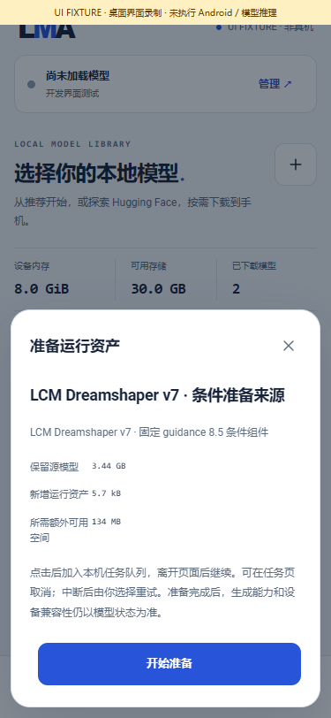
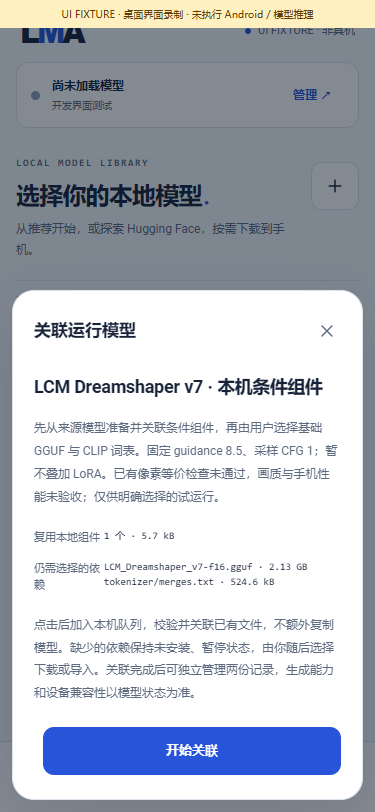

# LCM：用户资产到本机生成

[English](LCM_APP_FLOW.en.md) · [当前编号交付与完整待办](releases/v0.3.0-dev.28.md) · [原始准备实验](LCM_LOCAL_PREPARATION.md) · [完整版本需求](MULTIMODAL_RELEASE_PLAN.md)

dev.28 把已有的小型准备程序接入 App 的共用资产、队列、模型与生成模块。App 只携带运行与准备代码，源模型、基础模型、词表和派生条件参数均由用户取得或明确准备。新增的两条模型记录与其他模型平级，功能标签为生图；来源记录标记为准备资产，运行记录标记为固定条件的 LCM。既有推荐 m08→m06→m01 保留。

这是产品链路接入。原像素比较最大差值 **8 > 5** 的失败保留，质量与 Android 验收仍未通过。能够生成文件不代表模型已经获得完整支持认证，也不完成编号 03 或完整 v0.3.0。

## 1. 用户操作

| 编号 | 操作 | 实际行为 |
|---|---|---|
| U01 | 在全部模型中选择 `LCM Dreamshaper v7 · 条件准备来源`，下载或导入完整文件 | 只有用户点击才传输；固定来源、修订、字节数及完整 SHA256 校验 |
| U02 | 在本地模型详情打开“运行资产”，检查源文件、新增文件与空间，再点“开始准备” | `model.prepare` 进入共用队列；可以离开页面、取消或明确重试。原文件保留 |
| U03 | 准备完成后选择“关联运行模型”，检查复用组件与缺失依赖，再点“开始关联” | 单独的 `model.assemble` 任务关联已验证文件，不自动下载基础模型或词表 |
| U04 | 打开运行模型详情，自行下载或导入仍缺失的完整基础模型和 CLIP merges | 不完整记录保持暂停，不能生成；文件齐全并通过完整校验后才成为已安装模型 |
| U05 | 在本地管理运行模型，设置参数，点“使用”，填写提示词并明确同意在本机尝试 | 生成请求保存自己的参数快照；`SdEngine` 验证条件文件与配方后启动随 App 分发的原生引擎 |
| U06 | 在任务与结果页查看输出、取消、明确重试或再次生成 | 复用共用后台执行、结果、草稿、恢复、容量与来源记录；不启动远程推理或隐式补下载 |

准备来源不是可直接生成的完整模型。它与运行模型有独立记录、设置和删除操作。准备完成不会自动关联；关联完成不会自动下载；下载完成不会自动生成。

## 2. 固定资产与空间

权威数据在[模型目录](../catalogue/model-bundles.json)、[准备目录](../catalogue/asset-preparations.json)、[关联目录](../catalogue/model-assemblies.json)与[计算合约](../research/lcm_prepare/contract.json)。用户不能通过清单选择外部程序或更换准备算法。

| 资产 | 固定来源 / 修订 | 字节数 | 用途 |
|---|---|---:|---|
| 原始 F32 UNet | `SimianLuo/LCM_Dreamshaper_v7` / `a85df6a8bd976cdd08b4fd8f3b73f229c9e54df5` | 3,438,495,328 | 用户选取的准备来源，完整流式 SHA256 校验 |
| 完整基础 GGUF | `Steward/lcm-dreamshaper-v7-gguf` / `ae3fa73e105d5f848a4ef122e2ce14c92123bf1a` | 2,134,675,232 | 保留完整基础权重，不能换成同名其他文件 |
| CLIP merges | 目录中固定的独立词表组件 | 524,619 | 用户选择下载或导入，APK 不内嵌词表 |
| 派生条件 GGUF | 从上述原始 UNet 在本机明确准备 | 5,696 | 含 1 个 F32 偏置张量及完整来源绑定；属于用户模型数据，不随 APK 或 Git 分发 |

源文件、基础模型与词表同时保留约 **5.57 GB**，运行记录可复用已有对象。准备计划另要求派生输出加 **128 MiB** 空间余量；该余量用于存储准入，传给转换器的输出预算恰为 **5,696 字节**。内存、发热、实际耗时和可用空间还会在共用准入与实际执行处复查。这里的文件大小不代表推理峰值内存。

关联使用经校验的本机文件与独立硬链接所有权，避免复制第二套完整权重。单独删除准备记录不会删除运行记录持有的组件；删除运行模型也不会删除原始源模型。Android 文件系统行为仍需要真机验收。源文件是否继续保留由用户管理，App 不自动清理它。

## 3. 参数与运行合约

| 参数 | 此配方行为 |
|---|---|
| 训练条件 guidance | 固定 **8.5**，绑定在准备合约和组件元数据中，不是采样 CFG |
| 采样 CFG | 固定 **1**；用户越界值归位为该模型上限 |
| 步数 | 默认 **4**，范围 **1–8**，可编辑预设 |
| 采样 / 调度 | `lcm` / `lcm`，入队与原生执行分别验证 |
| 宽高、线程、种子等 | 来自这条运行模型自己的字段与限制；宽高默认 512，完整字段以目录为准 |
| 负面提示词 | 此管线禁用；直接接口传入非空内容会被拒绝 |
| LoRA | 固定条件组件目前不接受叠加 LoRA，防止改变已折叠的时间嵌入；请使用独立基础模型进行 LoRA 配对。既有 SD1.5 / SDXL LoRA 路径保留 |

设置保存在模型记录上。本次请求的归位和采样调整写入不可变 `diffusionPlan`，执行前复核，实际参数写入来源记录；不会把调整写回其他模型。任务恢复或草稿恢复仍要求用户明确提交。

## 4. 基座实现

1. `ModelPreparations` 只解析随 App 分发、完整固定来源的准备方案。`NativePreparation` 从私有租约读取源文件，仅启动已注册且校验过的程序，阶段输出预算与磁盘预留分开。
2. 原生准备程序用 4 MiB 缓冲校验完整源文件，再读取三个所需张量，计算固定条件偏置。256 个数学常量不含学习参数；派生的 1,280 个偏置值是用户模型数据。
3. `PreparedAssets` 校验输出字节、SHA、来源与收据后提交；取消、缺文件或不匹配不会发布准备结果。未完成工作区由共用恢复流程管理。
4. `PreparedModelAssembly` 只执行用户确认的角色映射。固定关联指纹绑定准备方案、来源记录和目标模型，缺失依赖保持暂停，不调用下载器。
5. `LcmCondition` 在 Java 和 C++ 两端限制为一个 GGUFv3 张量、六个精确元数据项、固定来源与基础 SHA、1280 个有限 F32 数值、零填充和精确文件结束。拒绝额外张量、错型、截断、NaN、未知字段或不匹配来源。
6. `SdEngine` 在完整文件租约与采样快照复核后传递独立 `condition_bias` 角色。原生层检测加载失败并拒绝生成，防止失败后继续使用未修补的原偏置。标准扩散、独立 LoRA、文本与其他音视频适配器继续使用共用框架。

准备程序不联网、不启动用户脚本、不安装插件；模型清单仅描述数据，不提供可执行文件。无需 ROOT、Termux、虚拟机或 ComfyUI。所有产品推理步骤设计为在同一部 Android 手机上执行；本轮开发验证使用原生 Windows 生产源码与明确的 Android 系统端口替身。

## 5. 验证、图片与复现

当前执行收据见[证据索引](../verification/development/status.json)与[本轮交付](releases/v0.3.0-dev.28.md)。结构拒绝检查、完整源准备、真实生产 Java / 原生出图及 Android 编译分别记录。相同新管线与历史原生准备管线输出一致，也不能使失败的官方参考像素比较变成通过。

| 源文件准备确认（界面数据） | 关联与缺失依赖确认（界面数据） |
|---|---|
|  |  |

[依赖页面](media/development/lcm/03-dependencies.png) · [本次生成参数](media/development/lcm/04-generate.png) · [界面录屏](media/development/lcm/lcm-ui.mp4) · [GIF](media/development/lcm/lcm-ui.gif) · [媒体来源与哈希](media/development/lcm/manifest.json)。这些页面使用明确的 UI FIXTURE 状态，不是手机推理录像。历史训练输出另行保留于[原始准备实验媒体](LCM_LOCAL_PREPARATION.md)，不能混作界面演示模型结果。

以下是本轮生产 Java → 原生 Windows 引擎的真实 512×512 输出，4 步、seed 42、CFG 1。准备、关联、安装依赖与实际生成都经生产模块执行；取消后明确重试的 PNG 字节相同。[两份原始 PNG 与来源清单](media/development/lcm-app-trained/manifest.json)独立于 UI 演示。画面中狐狸面部细节模糊，仍需画质评估；原参考像素失败保留，未标记为手机或质量验收通过。


```powershell
python tools/test_lcm_app_host.py
python tools/render_lcm_app_host.py
python tools/test_preparations.py
python tools/test_assemblies.py
python tools/test_diffusion.py
node tests/ui-smoke.cjs
node tools/capture_workbench.cjs lcm
python tools/build.py
python tools/verify_package.py
python tools/test_android_lint.py
```

完整模型测试只使用开发目录中已明确取得的固定文件，不自动下载；缺失即失败。运行前需配置本机 JDK、Windows C++ 工具链、Android SDK / NDK、Playwright 与 FFmpeg，方法见[构建文档](BUILD.md)和[媒体说明](MEDIA.md)。测试拥有的浏览器、进程及路径别名在结束时清理。

## 6. 未通过项

原始完整采样与新偏置折叠的数值 / 像素偏差、画质、人声或其他功能的验收、Android 实际生成、内存温度、后台锁屏与长时 API 均不能由主机页面或编译代替。目录许可字段只引用来源声明，使用与再分发仍须核对所有组件的适用许可。完整同版目标、每个冻结子目标和正式 Release 门槛保留，见[全部待办表](releases/v0.3.0-dev.28.md#完整同版待完成--remaining-in-the-same-complete-release)。
