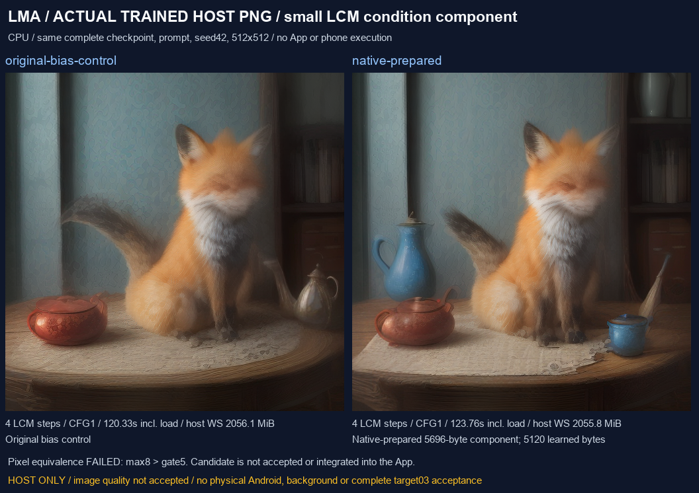

# LCM 小型本地准备组件

[English](LCM_LOCAL_PREPARATION.en.md) · [上轮训练权重检查](SD_DISTILLED_TRAINED.md) · [本轮编号交付与完整待办](releases/v0.3.0-dev.24-lcm-preparation.md)

本轮实现一个不含学习参数的原生资产准备程序：读取用户单独取得的原始 LCM UNet，校验完整来源后生成小型条件组件，避免额外保留一份 2.13 GB 修正版 checkpoint。Windows 实际执行与 Android 编译分别记录；当前 APK 仍是 dev.24，尚未接入这个准备程序、派生组件配方或相应用户流程。

## 来源与计算

固定来源在 [准备合约](../research/lcm_prepare/contract.json) 中：`SimianLuo/LCM_Dreamshaper_v7` 的原始 F32 UNet 为 3,438,495,328 字节；匹配的 `Steward/lcm-dreamshaper-v7-gguf` 完整 checkpoint 为 2,134,675,232 字节。源、基础模型、版本、文件大小和完整 SHA 分别固定；不是其他同名文件的通用修补器。此前逐一比对的 686 个张量与原始权重转换值一致，仅缺少条件投影。

计算为 `b0′ = b0 + W0 × Wcond × guidance_embedding(8.5 − 1)`。`W0` 先按匹配转换模型的方式做 F16 舍入，条件投影保留原始 F32；点积按固定顺序用 F64 累加，每个线性结果回到 F32，关闭 FMA。结果不要求与 PyTorch 的并行 FP32 点积逐位一致，而要通过独立数值门槛。这个新 C++ 实现的完整官方 UNet 等价性仍需独立验证；上轮针对另一份折算偏置的完整 UNet 检查不能直接转移。

程序内的 256 个 guidance 数值是正弦 / 余弦数学常量，不是学习参数。[生成器](../tools/generate_lcm_condition_contract.py) 从固定官方 diffusers v0.22.0 源码重新计算并校验这些常量；不读取模型生成常量。数学数据为 1,024 字节，SHA 为 `54d6aabf1d7a3082cbf26313138517135674c6216bd9c2a2636e1f8809ea8250`。

**固定 distilled guidance 8.5 与采样 CFG 1 是不同参数。** 此组件仅表示 guidance 8.5；不能通过修改任务 CFG 改变它，也不能将它视作任意 guidance、任意转换精度或其他基础模型的支持声明。

## 原生程序边界

[prepare.cpp](../research/lcm_prepare/prepare.cpp) 使用已有本地准备 I/O 基座，读取有边界的 Safetensors 头，验证张量形状、连续范围及文件总长，流式校验完整 SHA。只保留三个计算张量，共 1,971,200 字节参数数据，另用 4 MiB 输入块；不把整个 checkpoint 放入内存，不修改来源。

输出 `lcm-condition-bias.gguf` 为 5,696 字节，只有一个 1,280 维 F32 偏置、5,120 字节学习数据及来源元数据。元数据记录来源 SHA、匹配基础模型 SHA、算法、固定 guidance 和采样 CFG。派生权重仅保存在开发缓存或未来用户选定的本机资产区；不放入 Git 或 APK。

准备采用独占临时目录、文件同步与读回校验，再提交目录。来源错误、非有限参数、无效预算、未知字段、重复字段、越界名称或取消会失败，保留来源并清理本次临时文件；已有目标不被覆盖。Android 程序继承已有准备基座的父进程结束保护。ARM64 / API28 / 16 KiB ELF 编译、无网络及外部进程导入检查，与 Android 真正执行、断电耐久和后台存活是不同证据。

## 实际验证与媒体

[核心检查](../verification/development/lcm-preparation-core.json) 包含 24 个原生进程、105 项检查，覆盖重复执行、来源 / 格式 / 参数错误、取消及恢复。合成输入的全部 1,280 个输出标量与独立固定顺序计算逐位一致；与 FP32 PyTorch 方程的最大偏差为 `5.960464477539063e-08`。

[训练权重检查](../verification/development/lcm-preparation-trained.json) 确实流式校验完整 3.44 GB 原始文件，输出 SHA 为 `213f8a346cf0a70b2cfbb6460f2c9e990b3c45c6fdd435002a82c906e2d3c66c`。全部输出标量与独立计算一致；偏置与 FP32 方程的最大偏差为 `1.4901161193847656e-07`，六组确定输入的一层非线性时间投影最大偏差为 `1.430511474609375e-06`。后者不是完整 UNet，也不构成画质通过。原生准备主机观察为 214.327 秒、峰值工作集 12.46 MiB，不能作为手机性能。

[实际原生出图](../verification/development/lcm-overlay-trained.json) 对原始偏置对照、原生派生组件、非法 CFG、真实采样步取消及恢复分别记录原始日志、图像、耗时和主机内存观察。[独立审计](../verification/development/lcm-preparation-capture-audit.json) 重新读取 153 份原始文件、31 个原生进程记录、完整来源、派生组件和 4 张实际图像，保留严格采集器因一个空行判失败的历史记录；该历史进程的 PNG 与上轮整份修正版逐字节一致。新的采集只额外容忍纯空白行，原始错误列表仍保留。五个执行检查均通过且恢复 PNG 完全一致，但新 C++ 组件相对上轮 PyTorch 折算图的平均 RGB 差值为 0.083892822265625（上限 0.1），最大差值为 8（上限 5）。**本次预设像素等价门槛未通过，候选保持未通过；未修改门槛或转为 App 支持。**



[GIF](media/development/lcm-preparation-slideshow.gif) · [MP4](media/development/lcm-preparation-slideshow.mp4) 是实际主机 PNG 的标注静态轮播，**不是 App / Android 录屏**。狐狸及茶壶仍有可见细节缺陷；本轮保留画质未通过，亦未证明完整官方管线等价。

## 用户资产与后续接入

后续产品流程应复用本地模型管理、共享准备任务、派生资产和显式关联：用户选择来源 → 查看所需文件 / 额外存储 → 明确下载或导入 → 明确准备 → 选择匹配基础模型与词表 → 明确关联 → 在“本地”独立管理及运行。安装、升级、浏览或恢复暂停任务都不能发起模型下载。准备来源、运行基础模型、词表和派生组件各自保留，删除与更新需要处理任务引用及使用中的租约。

若用户主动选择这一特定方案，原始 UNet、基础 checkpoint 与 CLIP merges 合计 5,573,695,179 字节，另有 5,696 字节派生文件及临时空间。小组件节省修正版副本，不降低推理时基础模型的内存需求，也不表示努比亚 Z20 已通过验收。这些是该方案的可选资产，不是所有 LMA 用户的必装模型。

当前 Java `SdSpec` 仍要求完整 checkpoint 与独立 diffusion 二选一；主机试验直接使用底层双文件加载，不能当作 App 配方已支持。下一步需要新增明确的条件组件角色，验证恰好一个正确张量、完整来源与基础模型绑定、固定 guidance、准备回执及快照，然后才映射到底层覆盖路径。缺失 / 损坏 / 错配组件必须在启动引擎前失败；不能依赖底层加载失败后继续使用原始偏置。

现有用户模型、设置、推荐 `m08 → m06 → m01`、HF 全部 / 搜索和本地管理继续遵守原有要求。程序只扩展基座能力，模型平级，功能 / 格式 / 后端 / 依赖 / 设备 / 证据 / 许可 / 内容标签分开；无审查仅为单独有来源的内容标签。

## 开发复查

以下均为开发者主动执行，不联网取得资产；需要已经明确取得并校验的固定来源与原生 Windows 工具链。不要使用 Docker / WSL / 虚拟机或模拟器。

```powershell
python tools/generate_lcm_condition_contract.py
python tools/build_lcm_prepare.py
python tools/build_lcm_prepare.py --android
python tools/test_lcm_prepare.py
python tools/test_lcm_preparation_trained.py
python tools/test_lcm_overlay_trained.py
python tools/check_lcm_preparation_evidence.py --capture-audit
python tools/render_lcm_preparation.py
python tools/export_development.py
python tools/check_repository.py --development
```

首次繁忙主机编译曾触发 300 秒观察超时；保留失败日志，确认所属编译进程结束后从同一构建目录续编，不重复启动同一个在途任务。编译通过不代表真机运行。全部 F-01–F-12、既有生文、01–14 / 16 / 17 及冻结子目标仍共用一个完整 v0.3.0 发版门槛；当前没有发布完整 Release。
