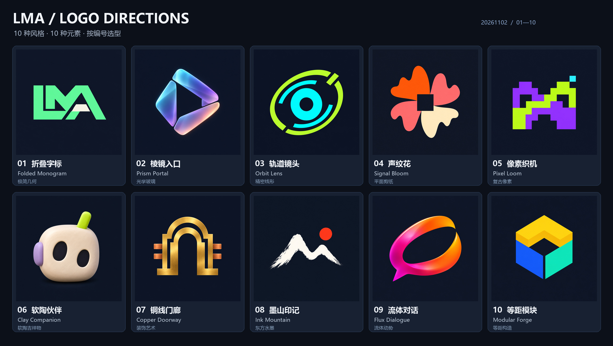

# LMA · 20261102 Logo 选型 / Logo selection

[离线交互选型页 / Offline selector](../output/imagegen/lma-logo-selection-20261102/index.html) · [总览 / Overview](../output/imagegen/lma-logo-selection-20261102/overview.jpg) · [小尺寸对比 / Small-size review](../output/imagegen/lma-logo-selection-20261102/small-size-review.jpg) · [生成清单 / Manifest](../output/imagegen/lma-logo-selection-20261102/manifest.json)

本轮按用户指定的 **sub2-image-gen** 技能，使用 **gpt-image-2.5** 独立生成 10 套不同风格、不同核心元素的 LMA Logo。围绕本地多模态创作与暗色界面选型，没有替换现有 App 图标或发布新 APK。

Ten original raster logo directions were generated individually through the user-requested **sub2-image-gen / Sub2API** route using **gpt-image-2.5**. They explore LMA's local multimodal identity and dark interface. This is visual selection, without changing the production app icon or APK.

| 编号 / ID | 名称 / Name | 风格 / Style | 核心元素 / Element | 原图 / Original |
| --- | --- | --- | --- | --- |
| 01 | 折叠字标 / Folded Monogram | 极简几何 / Swiss geometric | LMA 字母与折叠结构 | [PNG](../output/imagegen/lma-logo-selection-20261102/01-folded-monogram.png) |
| 02 | 棱镜入口 / Prism Portal | 光学玻璃 / Optical glass | 三片棱镜与创作入口 | [PNG](../output/imagegen/lma-logo-selection-20261102/02-prism-portal.png) |
| 03 | 轨道镜头 / Orbit Lens | 精密线形 / Technical contour | 镜头与偏心轨道 | [PNG](../output/imagegen/lma-logo-selection-20261102/03-orbit-lens.png) |
| 04 | 声纹花 / Signal Bloom | 平面剪纸 / Flat cut-paper | 声波花瓣与创作绽放 | [PNG](../output/imagegen/lma-logo-selection-20261102/04-signal-bloom.png) |
| 05 | 像素织机 / Pixel Loom | 复古像素 / Pixel graphic | 像素拼接与模块编织 | [PNG](../output/imagegen/lma-logo-selection-20261102/05-pixel-loom.png) |
| 06 | 软陶伙伴 / Clay Companion | 软陶吉祥物 / Clay mascot | 口袋机器人与陪伴 | [PNG](../output/imagegen/lma-logo-selection-20261102/06-clay-companion.png) |
| 07 | 铜线门廊 / Copper Doorway | 装饰艺术 / Art Deco | 门廊与本地芯片 | [PNG](../output/imagegen/lma-logo-selection-20261102/07-copper-doorway.png) |
| 08 | 墨山印记 / Ink Mountain | 东方水墨 / Modern ink | 山形笔势与朱红太阳 | [PNG](../output/imagegen/lma-logo-selection-20261102/08-ink-mountain.png) |
| 09 | 流体对话 / Flux Dialogue | 流体动势 / Fluid gradient | 对话轮廓与流动丝带 | [PNG](../output/imagegen/lma-logo-selection-20261102/09-flux-dialogue.png) |
| 10 | 等距模块 / Modular Forge | 等距构造 / Isometric architecture | 三面模块与创作基座 | [PNG](../output/imagegen/lma-logo-selection-20261102/10-modular-forge.png) |

## 如何选 / How to choose

打开离线页可同时勾选多个方案、切换深浅衬底、查看原图及 96／48／32px 缩略预览，并复制选型编号。浅色衬底用于查看图标在亮色页面的外观，不将原图转换为透明底。网页不调用任何外部资源或推理接口。

The offline page supports multiple selections, dark/light surrounding surfaces, original-image links, small previews and copying IDs. Changing the surrounding surface does not remove the opaque image background. The page has no external resources or inference calls.

可按“主选 06，保留 01 的配色”等方式选方向；后续精修和生产适配需根据用户选择进行，不能把探索稿自动应用为最终图标。现有软件与 20261102 全部功能规划保持原状态。

Select a direction or combine specific visual preferences before refinement. Production adaptation follows the user's selection; exploratory candidates are not automatically applied. Existing app behavior and the full dated functional plan remain intact.

## 文件与验证 / Files and verification

- 原图请求参数为 high／1024×1024／PNG，网关实际返回尺寸逐项记录，原始字节不改写。Native files are preserved; actual returned dimensions are recorded separately from requested size.
- 每套另有 1024、512、192、96、48、32px 六种 PNG，共 60 个缩放预览；总览与小尺寸板只做拼版，不替代实际生成。Each direction includes six derived sizes, with layout-only comparison boards.
- 原图带深色底，为栅格 PNG；透明底、单色矢量母版和 Android adaptive icon 不属于本轮已完成内容。Opaque raster candidates are not transparent/vector masters or finished adaptive icons.
- 公开提示词与 SHA256 位于目录中；不包含网关配置、密钥或请求头。Public prompts and file hashes contain no gateway configuration or credentials.
- 本轮未操作手机、运行手机模型、启动浏览器／虚拟化或修改 APK；离线页仅做结构与脚本语法检查。No phone model or APK validation is implied; the selector received structure/script-syntax checks without launching a browser.

| 编号 / ID | 本轮完成 / Delivered | 范围 / Boundary |
| --- | --- | --- |
| C01 | 10 套独立生成方向 / Ten generated marks | User-requested route and model; different styles/elements |
| C02 | 总览、小尺寸、60 份预览与离线选型页 / Presentation | Derived raster previews, not production icon integration |
| C03 | 提示词、清单与双语说明 / Prompts, manifest and guide | No gateway secrets in public artifacts |

| 编号 / ID | 待处理 / Pending | 说明 / Meaning |
| --- | --- | --- |
| P01 | 用户选型 / User selection | Choose preferred IDs and visual details |
| P02 | 选定后精修与正式图标适配 / Refinement and production adaptation | Transparent/monochrome/vector/adaptive outputs are not claimed yet |
| P03 | 原 D01–D12 与冻结模型范围 / Existing functional plan | This artwork task does not implement or reduce that scope |

[本轮素材检查 / Artifact validation](../output/imagegen/lma-logo-selection-20261102/validation.json)：10 原图／60 预览、文件哈希／尺寸、离线资源、脚本语法与 ZIP 检查；不是浏览器、手机或模型质量验收。
