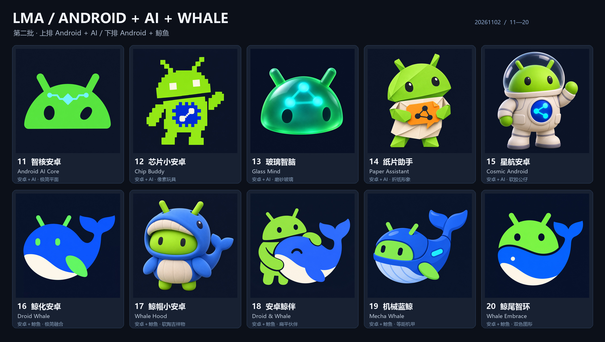

# LMA · 第二批 Logo 选型 / Batch 2: Android, AI and whale

2026-11-02 · [离线选型页 / Offline selector](../output/imagegen/lma-logo-selection-20261102-batch2/index.html) · [总览 / Overview](../output/imagegen/lma-logo-selection-20261102-batch2/overview.jpg) · [小尺寸 / Small sizes](../output/imagegen/lma-logo-selection-20261102-batch2/small-size-review.jpg) · [第一批归档 / Batch 1](LOGO_SELECTION_20261102.md)

按用户的新方向重新制作 10 套：**11–15 安卓＋AI，16–20 安卓＋鲸鱼**。安卓部分保留机器人、双天线和眼睛；鲸鱼部分参考用户指定的 DeepSeek 蓝鲸意象，探索融合、套装、伙伴、机械鲸和环抱轮廓。每套使用独立提示词，通过指定的 **sub2-image-gen / gpt-image-2.5** 路线实际生成。

Ten new directions follow the user's Android + AI and Android + whale themes. IDs 11–15 explore AI robot identities; 16–20 combine Android features with the requested DeepSeek-style blue-whale imagery. Each was generated from its own prompt through the explicitly requested skill/model. Batch 1 remains available separately.

| 编号 / ID | 名称 / Name | 方向 / Theme | 风格 / Style | 原图 / Original |
| --- | --- | --- | --- | --- |
| 11 | 智核安卓 / Android AI Core | Android + AI | 极简平面 / Flat mascot | [PNG](../output/imagegen/lma-logo-selection-20261102-batch2/11-android-ai-core.png) |
| 12 | 芯片小安卓 / Chip Buddy | Android + AI | 像素玩具 / Pixel toy | [PNG](../output/imagegen/lma-logo-selection-20261102-batch2/12-android-chip-buddy.png) |
| 13 | 玻璃智脑 / Glass Mind | Android + AI | 磨砂玻璃 / Frosted glass | [PNG](../output/imagegen/lma-logo-selection-20261102-batch2/13-android-glass-mind.png) |
| 14 | 纸片助手 / Paper Assistant | Android + AI | 折纸形象 / Origami mascot | [PNG](../output/imagegen/lma-logo-selection-20261102-batch2/14-android-paper-assistant.png) |
| 15 | 星航安卓 / Cosmic Android | Android + AI | 软胶公仔 / Vinyl character | [PNG](../output/imagegen/lma-logo-selection-20261102-batch2/15-android-space-ai.png) |
| 16 | 鲸化安卓 / Droid Whale | Android + whale | 极简融合 / Flat fusion | [PNG](../output/imagegen/lma-logo-selection-20261102-batch2/16-android-whale-fusion.png) |
| 17 | 鲸帽小安卓 / Whale Hood | Android + whale | 软陶吉祥物 / Clay mascot | [PNG](../output/imagegen/lma-logo-selection-20261102-batch2/17-android-whale-hood.png) |
| 18 | 安卓鲸伴 / Droid & Whale | Android + whale | 扁平伙伴 / Flat character duo | [PNG](../output/imagegen/lma-logo-selection-20261102-batch2/18-android-whale-partners.png) |
| 19 | 机械蓝鲸 / Mecha Whale | Android + whale | 等距机甲 / Isometric mecha | [PNG](../output/imagegen/lma-logo-selection-20261102-batch2/19-android-mecha-whale.png) |
| 20 | 鲸尾智环 / Whale Embrace | Android + whale | 双色图形 / Two-tone emblem | [PNG](../output/imagegen/lma-logo-selection-20261102-batch2/20-android-whale-embrace.png) |

选型建议：**20 号优先考虑 App 图标，17 号优先考虑配套吉祥物**；16 号可作更直接的安卓蓝鲸融合备选，11 号适合偏极简的安卓＋AI 方向。20 号在小尺寸下仍保留两个核心轮廓，17 号的套装与公仔细节更适合较大画面。Suggested pairing: **20 for the app icon and 17 for the companion mascot**; 16 is a direct droid-whale alternative and 11 the simpler Android + AI option.

## 选型与文件 / Selection and files

离线页支持多选、只看已选、深浅衬底、复制编号及原图查看。可以按“主选 16，角色姿态参考 18”说明偏好。先看整体轮廓，再比较 96／48／32px 下的辨识度；复杂公仔适合配套形象，图标细节需在选定后收敛。

The offline selector supports multiple choices, selected-only filtering, surrounding-surface switching, copying IDs and viewing originals. Compare silhouette first, then recognition at small sizes. Detailed mascot directions can serve companion artwork; production-icon details follow selection.

原图保留网关返回字节和实际尺寸，另有 1024／512／192／96／48／32px 六种预览，共 60 份。总览与小尺寸板仅拼版／缩放。PNG 带深色底；透明底、单色／矢量母版及 Android 自适应图标仍需在选定后制作。

Native returned PNGs and their actual dimensions are preserved. Sixty derived previews provide six sizes per direction. Comparison boards only arrange/rescale the generated artwork. These are opaque raster candidates; transparent, monochrome/vector and adaptive-icon production follows the selected direction.

[清单 / Manifest](../output/imagegen/lma-logo-selection-20261102-batch2/manifest.json) 记录独立提示词、生成参数、实际尺寸及 SHA256；[素材检查 / Validation](../output/imagegen/lma-logo-selection-20261102-batch2/validation.json) 记录文件／尺寸／哈希、离线资源、脚本语法和归档检查。公开材料没有网关地址、密钥或请求头。选型页无外部依赖；本轮未启动浏览器、虚拟化环境或手机模型。

The manifest records public prompts, generation settings, returned dimensions and hashes without gateway configuration or credentials. Artifact checks cover image integrity, offline resources, JavaScript syntax and archive contents. No browser, virtualization or phone inference was used for this artwork task.

| 编号 / ID | 本轮完成 / Delivered | 状态 / Status |
| --- | --- | --- |
| C01 | 第二批 10 套独立生成 / Ten new directions | 11–15 Android + AI; 16–20 Android + whale |
| C02 | 总览、60 预览、小尺寸与离线页 / Selection materials | Native originals retained |
| C03 | 双语入口、提示词、清单与更新说明 / Documentation | First batch preserved |

| 编号 / ID | 待处理 / Pending | 范围 / Scope |
| --- | --- | --- |
| P01 | 用户按编号选型 / Select preferred IDs | Refine chosen shapes, colors and mascot details |
| P02 | 正式图标制作与接入 / Production adaptation | Transparent/vector/monochrome/adaptive assets, then app integration |
| P03 | D01–D12 及原冻结模型范围 / Functional update | This artwork task does not implement that scope |

App 仍为 v0.3.13，本轮只交付候选形象；既有 APK／Release 附件和全部用例保留。This artwork delivery keeps the existing app/release identity and detailed usage/test evidence intact.
