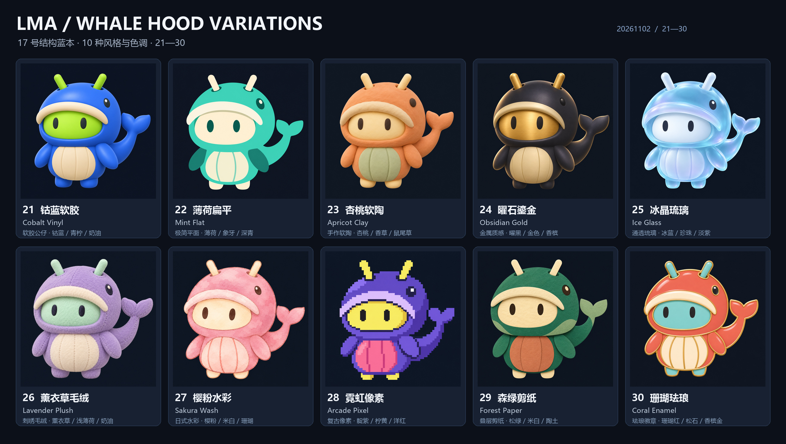

# LMA · 17 号结构蓝本：十套新风格 / Whale Hood: ten style variations

**定稿更新 / Final decision · 2026-11-02：用户已确定使用 21 号「钴蓝软胶 / Cobalt Vinyl」。** [品牌与素材记录 / Branding record](BRANDING.md)。17 号是结构蓝本，其余方案归档保留；下方保留生成过程。

2026-11-02 · [离线选型页 / Offline selector](../output/imagegen/lma-logo-selection-20261102-batch3-whale17/index.html) · [总览 / Overview](../output/imagegen/lma-logo-selection-20261102-batch3-whale17/overview.jpg) · [小尺寸 / Small sizes](../output/imagegen/lma-logo-selection-20261102-batch3-whale17/small-size-review.jpg) · [上一批 / Previous batch](LOGO_SELECTION_20261102_BATCH2.md)

用户已指定 **17 号“鲸帽小安卓”作为结构性蓝本**。本轮重新生成 **21–30** 共十套，统一大鲸鱼帽、帽内安卓脸、双天线、短鳍手臂、短脚、腹部与右侧翘尾，主要改变风格、表面材质及套装／脸部／腹部色调。

The user selected **17, Whale Hood, as the structural blueprint**. Ten new directions (21–30) retain the whale-costume Android character, oversized hood, twin antennae, oval face opening, short flippers and feet, belly panel and raised right-side tail. Rendering medium and palette vary across the series.

| 编号 / ID | 名称 / Name | 风格 / Style | 色调 / Palette | 原图 / Original |
| --- | --- | --- | --- | --- |
| 21 | 钴蓝软胶 / Cobalt Vinyl | 软胶公仔 / Vinyl toy | 钴蓝 / 青柠 / 奶油 | [PNG](../output/imagegen/lma-logo-selection-20261102-batch3-whale17/21-cobalt-vinyl.png) |
| 22 | 薄荷扁平 / Mint Flat | 极简平面 / Minimal flat | 薄荷 / 象牙 / 深青 | [PNG](../output/imagegen/lma-logo-selection-20261102-batch3-whale17/22-mint-flat.png) |
| 23 | 杏桃软陶 / Apricot Clay | 手作软陶 / Handmade clay | 杏桃 / 香草 / 鼠尾草 | [PNG](../output/imagegen/lma-logo-selection-20261102-batch3-whale17/23-apricot-clay.png) |
| 24 | 曜石鎏金 / Obsidian Gold | 金属质感 / Sculpted metal | 曜黑 / 金色 / 香槟 | [PNG](../output/imagegen/lma-logo-selection-20261102-batch3-whale17/24-obsidian-gold.png) |
| 25 | 冰晶琉璃 / Ice Glass | 通透琉璃 / Translucent glass | 冰蓝 / 珍珠 / 淡紫 | [PNG](../output/imagegen/lma-logo-selection-20261102-batch3-whale17/25-ice-glass.png) |
| 26 | 薰衣草毛绒 / Lavender Plush | 刺绣毛绒 / Embroidered plush | 薰衣草 / 浅薄荷 / 奶油 | [PNG](../output/imagegen/lma-logo-selection-20261102-batch3-whale17/26-lavender-plush.png) |
| 27 | 樱粉水彩 / Sakura Wash | 日式水彩 / Soft watercolor | 樱粉 / 米白 / 珊瑚 | [PNG](../output/imagegen/lma-logo-selection-20261102-batch3-whale17/27-sakura-watercolor.png) |
| 28 | 霓虹像素 / Arcade Pixel | 复古像素 / Retro pixel art | 靛紫 / 柠黄 / 洋红 | [PNG](../output/imagegen/lma-logo-selection-20261102-batch3-whale17/28-arcade-pixel.png) |
| 29 | 森绿剪纸 / Forest Paper | 叠层剪纸 / Layered papercut | 松绿 / 米白 / 陶土 | [PNG](../output/imagegen/lma-logo-selection-20261102-batch3-whale17/29-forest-papercut.png) |
| 30 | 珊瑚珐琅 / Coral Enamel | 珐琅徽章 / Enamel pin | 珊瑚红 / 松石 / 香槟金 | [PNG](../output/imagegen/lma-logo-selection-20261102-batch3-whale17/30-coral-enamel.png) |

## 选型 / Selection

离线页中可同时对比多个编号，查看原图及 96／48／32px，切换周围深浅衬底并复制编号。页面附 17 号原图便于结构对照；切换衬底不会去除图片的深色底。可按“选 26 的材质、22 的配色”说明偏好。

The offline selector supports multiple choices, original and small-size views, surrounding-surface switching and copying IDs. The original 17 is included for structural comparison. Changing the surrounding surface does not remove the opaque background. Specify preferred material and palette by ID.

## 生成与文件 / Generation and files

本轮按指定 **sub2-image-gen / gpt-image-2.5 / high / 1024×1024 / PNG** 路线独立生成。开发者观察 17 号原图并把结构转录为共享提示词；当前技能 CLI 仅支持文字生成，**没有将原图上传为图生图编辑输入**。各方向是重新生成的设计，不是程序换色或滤镜。

The original was visually inspected and transcribed into shared structural text constraints, then each variant was generated through the requested skill/model. The current CLI accepts text generation only; **the original was not uploaded as an image-edit input**. Code did not recolor or filter the same mascot to create these directions.

- 保留每套原图的实际尺寸、字节与 SHA256；另存六种尺寸预览，共 60 份。Native bytes, dimensions and hashes are retained; six derived sizes per direction provide 60 previews.
- `reference/` 原样保留 17 号图像，来源与哈希见[清单](../output/imagegen/lma-logo-selection-20261102-batch3-whale17/manifest.json)。The manifest records the preserved blueprint and generation provenance.
- 总览、小尺寸板只做排版与缩放。候选为深色底 PNG，正式透明／单色／矢量／Android adaptive 图标按 21 号定稿实施。Boards arrange/rescale artwork; these opaque raster candidates still need production adaptation.
- [素材检查](../output/imagegen/lma-logo-selection-20261102-batch3-whale17/validation.json) 覆盖原图／预览、参考图身份、离线资源、脚本语法和归档；不计作手机、完整模型或浏览器验收。Checks cover image integrity, reference identity, local resources, JavaScript syntax and archive contents, without claiming phone/model/browser acceptance.
- 公开文件不含网关配置、密钥或请求头；没有调用浏览器、Docker、WSL 或模拟器。Public artifacts exclude gateway configuration and credentials; no browser or virtualization was launched.

| 编号 / ID | 本轮完成 / Delivered | 范围 / Scope |
| --- | --- | --- |
| C01 | 21–30 十套实际生成 / Ten new directions | Same structural brief, distinct style/palette treatments |
| C02 | 总览、60 预览、小尺寸与离线页 / Selection materials | Includes the preserved 17 blueprint |
| C03 | 提示词、清单、双语文档和维护说明 / Documentation | Earlier batches and detailed use cases retained |
| C04 | 用户确定 21 号定稿 / User finalized 21 | Canonical image is displayed in both READMEs |

| 编号 / ID | 待处理 / Pending | 说明 / Scope |
| --- | --- | --- |
| P02 | 生产图标与配套形象接入 / Production adaptation | Transparent/monochrome/vector/adaptive assets and app integration |
| P03 | D01–D12 及原冻结模型范围 / Functional plan | Remains pending; artwork does not implement the plan |

本轮为设计选型材料更新，App／APK 仍为 v0.3.13，已有发布附件、详细用例和历史证据保留。The artwork delivery preserves the current app/release identity and previous evidence.
