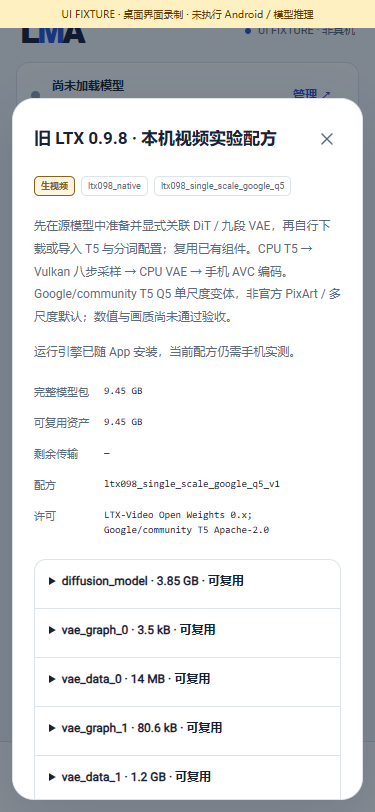
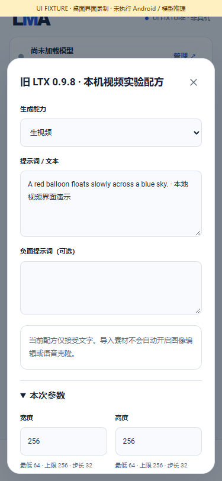

# Old-LTX local video business flow

> 当前 / Current: **v0.3.0**. [完整程序集成 / implementation](IMPLEMENTATION_V030.en.md). [仅程序验证策略 / validation](PROGRAM_VALIDATION.md) 优先于下文历史完整模型 / 手机运行门槛；旧检查点与失败记录保留为历史。Original PixArt multiscale LTX is now integrated; quality/device acceptance remains untested. [Release](releases/v0.3.0.md).

[中文](LTX098_APP_FLOW.md) · [Numbered delivery and complete pending scope](releases/v0.3.0-dev.30.md) · [Complete release requirements](MULTIMODAL_RELEASE_PLAN.en.md)

Internal **0.3.0-dev.30 / code 34** connects old-LTX components to the production queue, independent model settings and artifact library. The APK delivers runtime code; users choose all weights, T5, tokenizer configuration and VAE assets. This recipe remains experimental: original numerical failures, video quality, phone resources and Android execution are unaccepted.

## 1. User flow

1. Choose the exact **old LTX 2B 0.9.8 distilled** source through All/search, then explicitly download or import it. LTX 2/2.3 assets cannot substitute for this architecture.
2. In Local → source model → Runtime assets, explicitly prepare DiT and the nine-stage VAE. Preparation uses the shared cancellable queue and retains the source. No silent replacement or update occurs.
3. Choose the **old LTX · Google T5 Q5 single-scale generation** association. The new `ltx098_runtime_google_q5_v2` record reuses prepared objects. Existing `v1` asset records and settings remain unchanged; they do not silently acquire generation capability. Missing T5/tokenizer dependencies await the user's download/import choice.
4. Edit this model's preset inputs: width/height up to 256 in multiples of 32; 9/17/25/33 frames; 1–60 fps; 1–8 threads; -1 for an automatic seed; exactly eight distilled steps. Excessive values clamp, joint constraints are checked again on submission/execution, and accepted requests retain their own parameters.
5. Select Use, enter the complete prompt, review local resources and experimental status, then explicitly submit. The shared queue reports noise, text encoding, sampling, latent layout, decoding, encoding and saving. Leaving the page does not cancel the task; cancellation remains explicit.
6. On success, preview/export MP4, inspect provenance or edit and generate again. Failure, cancellation or service interruption never publishes partial tensors/files as successful output or automatically restarts execution.

Video models remain peers of text, image and audio models, with separate task, runtime-dependency and installation labels. Recommended m08→m06→m01, HF discovery and other model settings retain their existing behavior. All product stages execute on the same phone.

| Exact variant and assets | Independent editable settings |
|---|---|
|  |  |

| Explicit submission | Shared queue and cancellation |
|---|---|
|  |  |

[Screen recording](media/development/ltx/ltx-ui.mp4) · [GIF](media/development/ltx/ltx-ui.gif) · [Manifest](media/development/ltx/manifest.json). These show production pages against labelled desktop bridge fixtures, without Android or model inference.

## 2. Execution on the phone

`Ltx098Engine` holds one shared model lease and immutable task. Fixed signed components run sequentially in an owned workspace:

| Stage | Local backend | Output |
|---|---|---|
| Resolve seed and generate noise | Native CPU | Bounded F32 files |
| Google/community T5 XXL Q5_K_M | Native CPU | Tokens, mask and caption |
| Complete 28-layer DiT, eight steps | Vulkan | Sampled latents |
| Unpatchify | Native CPU | NCTHW file |
| Load/run/unload nine VAE stages | ONNX Runtime CPU | Decoded F32 |
| Convert RGB frames | Native CPU | Bounded frame stream |
| Encode AVC and commit inspected output | Android MediaCodec/artifact store | MP4 and provenance |

Each child exits and is reaped before the next stage starts. Large tensors stay outside Java JSON; receipts, exit codes, shapes, exact extents and finite values are checked. Cancellation/service shutdown stops owned processes and releases leases, hard links and intermediate files. Android children also receive a parent-death signal. Model data cannot supply executable commands or plugins.

Substantial storage, RAM and Vulkan support are still needed. Sequential unloading does not establish Nubia Z20 viability; desktop GPU behavior does not establish phone performance. Foreground-service endurance remains subject to Android/vendor management and requires the same complete-release acceptance.

## 3. Exact recipe and evidence

`ltx098_single_scale_google_q5_v1` is single-scale with Google/community quantized T5, CFG=1, STG=0, eight LinearQuadratic Euler steps, VAE timestep 0.05/noise 0.025. It is distinct from the official PixArt T5/multiscale default. The six original numerical failures and other known failures remain preserved; connecting production features does not change thresholds.

`tools/build_ltx098_app.py` builds four Windows/Android ARM64 components from pinned existing sources without model retrieval. `tools/package_ltx098_app.py` verifies code and shared dependencies. `tools/test_ltx098_app.py` exercises the actual production queue/adapter; ordinary mode combines synthetic neural protocol stages with three real tensor stages, including success, invalid receipts/output, encoder failure, cancellation and interruption. `--trained` only accepts existing complete local assets after whole-file size/SHA verification. Its explicit host FFmpeg encoder port is distinct from production Android MediaCodec.

See [the current delivery record](releases/v0.3.0-dev.30.md) and [evidence index](../verification/development/status.json) for executed checks and APK identity. All trained-quality, official-variant and phone requirements remain in the single complete v0.3.0 release.

## 4. Actual trained model output

After verifying all **9,448,043,488 bytes across 22 components**, the actual production Java queue executed six native stages; 38 trained-chain checks passed. The 256×256, 33-frame, 24-fps, seed-42 result is a **17,738-byte** MP4. Seven bridge files and the video are byte-identical to the original native host baseline. This establishes that the business integration preserves existing computation; six independent numerical failures remain unchanged and quality remains unaccepted.

[Original complete MP4](media/development/ltx-app-trained/video.mp4) · [Labelled HOST GIF](media/development/ltx-app-trained/preview.gif) · [Manifest](media/development/ltx-app-trained/manifest.json). Original video SHA256: `67c56a3c362fa2df106451179e275a0bbd50ca7aefe699535ba8665516ecad1d`. This is actual desktop model output through the FFmpeg host encoder port; Android MediaCodec execution is untested.
