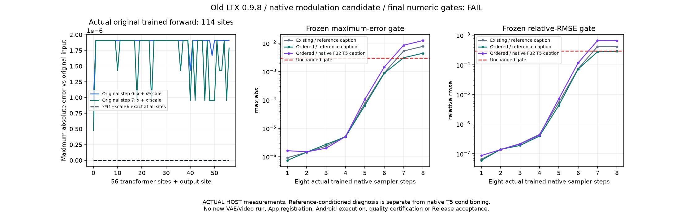

# 旧 LTX 0.9.8：调制顺序诊断

[English](LTX098_MODULATION.en.md) · [前一轮分步实验](LTX098_STAGING.md) · [完整需求](MULTIMODAL_RELEASE_PLAN.md)

这次修正了一处确定的浮点运算顺序差异，但**完整采样数值门槛仍未通过**。这是同一 v0.3.0 的开发源码补充，候选没有注册到 App 或进入 APK；没有新增 Android、视频质量或后台验收。

## 定位与实现

原作者在每个 Transformer 块的两处调制以及最终输出使用 `x * (1 + scale) + shift`；原隔离原生实现使用 `(x + x * scale) + shift`。实数运算等价，F32 分步舍入不同。新候选明确保留作者顺序和 F32 矩阵乘法输入，不改旧实现、权重、参考结果或阈值。

两次实际原作者训练前向观察对应 B 提示词的第 0、7 步。每次完整加载 715 张量 / 1,923,385,472 参数，按模块分页，并在 57 处被动记录归一化值、scale、shift 和原前向实际输入，共保留 456 份数组。没有替换原前向函数。两次原前向的采样输出均逐位匹配原冻结轨迹。

| 原始步骤 | 调制位置 | 作者顺序逐位匹配 | 重排后不同元素 / 37,355,520 | 最大绝对误差 |
| --- | --- | --- | --- | --- |
| 0 | 57 | 57 / 57 | 9,520,543 | 1.9073486328125e-6 |
| 7 | 57 | 57 / 57 | 9,388,623 | 1.9073486328125e-6 |

独立留存文件审查重新计算 114 处调制和 16 个原生采样步骤，核对 478 份原始文件，复现所有已报告数值。这里的参考 caption / latent 是定位输入，不能算作完整原生模型验收。

## 实际原生采样

固定旧 LTX `ltxv-2b-0.9.8-distilled` 的转换 DiT，Vulkan 后端、4 CPU 线程、8 步、原 B 几何与噪声。以下两次新原生执行均实际运行完整 28 层训练 DiT：

| B 条件 | 最终最大绝对误差 | 相对 RMSE | Cosine | 原数值门槛 |
| --- | --- | --- | --- | --- |
| 原参考 caption，仅诊断 | 0.00445225834846 | 0.000286313719571 | 0.999999959027 | FAIL：最大误差 |
| 已留存真实原生 F32 T5 caption | 0.0124872624874 | 0.000660452306871 | 0.999999781991 | FAIL：最大误差、RMSE |

阈值保持最大误差 ≤0.003、相对 RMSE ≤0.0003、cosine ≥0.99999。原参考 caption 的旧 Vulkan 结果最大误差为 0.00779688358307；局部改善并未关闭完整链路失败。原生 T5 条件仍包含量化编码器与下游敏感性，不把参考条件的改善解释成 T5 已修复。

两次新执行约 9.35 /9.75 秒，主机观测峰值工作集约 1.22 GB、采样峰值私有字节约 4.36 GB。时间包含文件加载，缓存和系统负载影响明显；没有测 GPU 显存，不作为手机资源或性能结论。本轮没有重复执行已失败条件的 VAE、RGB 或视频编码；原完整链路失败证据保留。



## 文件与复现

- [隔离调制实现](../research/ltx098_modulation/modulation.inc)、[构建器](../tools/build_ltx098_modulation.py)、[采样测试](../tools/test_ltx098_modulation.py)。
- [原前向被动观察](../tools/analyze_ltx098_modulation.py)、[独立留存张量复算](../tools/check_ltx098_modulation_evidence.py)。
- [第 0 步](../verification/development/ltx098-modulation-step0.json)、[第 7 步](../verification/development/ltx098-modulation-step7.json)、[参考条件采样](../verification/development/ltx098-modulation-reference-vulkan.json)、[原生 T5 条件采样](../verification/development/ltx098-modulation-f32-vulkan.json)、[复算回执](../verification/development/ltx098-modulation-capture-audit.json)。

已按[旧链路复现](LTX098_PIPELINE.md)显式取得开发资产并建立冻结参考后，可以运行：

```powershell
python tools/analyze_ltx098_modulation.py --reference build/ltx098-pipeline-tests/run-s3z3urrv/original-reference --case 1 --step 0
python tools/analyze_ltx098_modulation.py --reference build/ltx098-pipeline-tests/run-s3z3urrv/original-reference --case 1 --step 7
python tools/test_ltx098_modulation.py --reference build/ltx098-pipeline-tests/run-s3z3urrv/original-reference --case 1 --context reference --backend vulkan
python tools/test_ltx098_modulation.py --reference build/ltx098-pipeline-tests/run-s3z3urrv/original-reference --case 1 --context f32 --backend vulkan
python tools/check_ltx098_modulation_evidence.py
```

这些命令不下载模型；路径中的原参考目录属于这次固定开发运行，复现时须使用自己建立并验哈希的同一参考。开发模型和数组留在忽略的 `build/`，不进入仓库、APK 或用户设备。后续仍需数值修复、生产接入、用户自主资产流程及完整同机 Android 验收；其他冻结目标和 SD1.5 / SDXL LoRA 等继续属于同一个完整版本。
