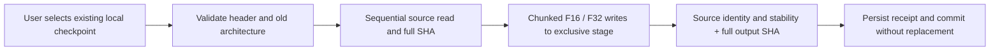
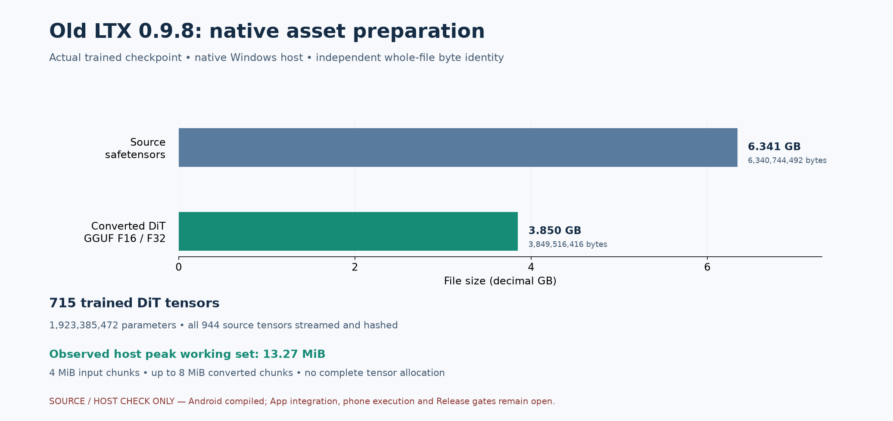

# Native local asset preparation for old LTX

[中文](LTX098_PREPARE.md) · [Numbered delivery and complete pending scope](releases/v0.3.0-dev.21-ltx-prepare.md) · [Complete release scope](MULTIMODAL_RELEASE_PLAN.en.md) · [Host video and numerical gaps](LTX098_PIPELINE.en.md)

This adds a portable **streaming safetensors → DiT GGUF converter**, preparing the foundation for users to prepare selected assets on the same Android phone. It reads an existing user-local file and requires no Python / Torch, ROOT, Termux, network or service on another device. It remains a standalone source component without production App integration. Android compilation is separate from execution and complete target 17 support.

App updates continue to deliver the foundation. Users select, download or import model assets; this component embeds, retrieves, deletes and silently replaces none of the original model data. Preparation must follow an explicit user action, never installation, upgrade, browsing or discovery of missing assets.

## Processing contract

| No. | Operation | Boundaries |
| --- | --- | --- |
| C-01 | Bounded metadata validation | Requests ≤32 KiB; safetensors headers ≤16 MiB; reject duplicate keys, excessive nesting, invalid dimensions / types / offsets and uncovered bytes |
| C-02 | Exact old architecture | 715 tensors / 1,923,385,472 parameters / frozen layout SHA, old transformer constants and the distilled eight-step schedule; developer fixtures require a separate CLI flag |
| C-03 | Streaming conversion | Read in source-offset order, write in original header tensor order; dense 2-D `.weight` tensors use F16, other tensors F32; BF16 / F16 / F32 inputs |
| C-04 | Bounded memory | 4 MiB input and at most 8 MiB conversion buffers; no complete tensor/checkpoint allocation; bounded metadata is additional |
| C-05 | Complete source identity | Every source byte, including unused VAE components, enters SHA-256; hashing and conversion consume the same bytes; reject non-finite converted parameters and F16 overflow |
| C-06 | Transactional commit | Exclusive fresh stage, stable source check, output flush/full SHA, persisted receipt, then directory commit without replacement; preserve existing files/directories |
| C-07 | Cancellation | Check a cancellation file per chunk; normal failures/cancellation remove only the two owned files and their empty stage, never recursively delete user data |
| C-08 | Local execution | Absolute local paths; reject URL / UNC / Windows network-drive / final file-link inputs; no network, external process or inference dependency |

The architecture contract comes from the [pinned old source lock](../third_party/ltx098-source-lock.json), rather than a model-name heuristic. The selected file must match the caller's trusted size/SHA. Structural validation alone does not establish trusted download identity or compatibility with other LTX releases. Compiled structural metadata contains no learned data.



`inspect_dit` performs metadata/architecture/output-budget preflight only. It retains `source_sha256_verified=false` and has no output hash. It does not establish download integrity or successful conversion.

## Invocation

The current CLI is for developers. The production App's explicit preparation action, SAF selection/copy, managed user-asset registration, progress and persistent jobs still need integration. End users should not need desktop Python or a separate inference computer.

```json
{
  "operation": "convert_dit",
  "checkpoint": "/data/user/0/com.lma.app/files/models/user-selected.safetensors",
  "expected_source_bytes": 6340744492,
  "expected_source_sha256": "76aa8c4786af752fa6f951947129d5290c3c6c0b2fadcadea6b5e114ae2cad8f",
  "storage_root": "/data/user/0/com.lma.app/files/models",
  "output_name": "user-selected-ltx098-dit",
  "cancel_file": "/data/user/0/com.lma.app/files/jobs/prepare.cancel",
  "max_output_bytes": 4000000000
}
```

These are protocol examples, not files currently created by LMA. Size/SHA identify the reviewed old publisher checkpoint; a future caller must use the trusted record for the user's selection. `storage_root` must exist and `output_name` must be a new internal basename. The committed directory contains `ltx098-dit.gguf` and `conversion.json`. `cancel_file` and `max_output_bytes` are optional. `inspect_dit` rejects `storage_root`/`output_name`. Unknown request fields fail.

Stdout returns one success/error JSON; stderr reports byte counters in the `convert`, `verify_output` and `committed` phases. Exit status is 0 for success and 1 for failure. Cancellation never commits partial output. An abrupt OS process kill can leave an uncommitted stage; production task recovery/orphan-stage reclamation needs its own integration and is not established by normal cancellation tests.

## Storage and model settings

The reviewed source is **6,340,744,492 bytes** and its DiT output is **3,849,516,416 bytes**. Both coexist during preparation; preflight also requires 1 MiB beyond the output as receipt headroom. T5, VAE and execution caches are additional. Source deletion remains a separate user decision.

Conversion working set does not estimate generation RAM, GPU memory, speed or Z20 compatibility. Receipts do not replace per-model settings, immutable job snapshots, tags, licensing or device checks. All models remain equal peers; text/image/audio/video and foundation-dependency tags are independent of download state. This source component is not yet a registered available model capability.

## Reproduction and evidence

Build with native Windows tools; no virtualization, emulator, Docker or WSL. The Android build uses ARM64 / API 28 / static C++ / 16 KiB alignment and rejects network/external-process imports.

```powershell
python tools/build_ltx098_prepare.py
python tools/build_ltx098_prepare.py --android
python tools/test_ltx098_prepare.py --trained
python tools/export_development.py
python tools/plot_ltx098_prepare.py
python tools/check_repository.py --development
```

The trained test reuses developer assets already explicitly acquired locally, without downloading. It requires the original checkpoint and independent Python-converted GGUF under the existing ignored `build/` tree. Conversion fixtures cover all 63,488 finite FP16 patterns, 65,280 finite BF16 patterns, 190,462 FP32 rounding cases and header order different from payload order. These are container/number-conversion tests, not neural inference.

[Public results](../verification/development/ltx098-prepare.json) separate actual Windows conversion, whole-output Python/hashlib identity, process memory, failure protection and [Android compilation](../verification/development/ltx098-prepare-arm64.json). [Host binary identity](../verification/development/ltx098-prepare-host.json) and [figure provenance/hashes](media/development/ltx098-native-prepare.json) are independently recorded.



## Complete release remains open

This does not repair the six failed complete-chain float comparisons. On-phone VAE asset preparation, production adapter/App API/media integration, generation quality, device resources and endurance remain open. All frozen models and F-01–F-12 stay in the same complete v0.3.0 without an assumed deferral or reduced preview. See the [numbered pending scope](releases/v0.3.0-dev.21-ltx-prepare.md).

The completed invocation records **156 checks / 46 failure-protection cases / 51 native children**, including one complete trained conversion. Observed host peak working set was **13.27 MiB**; the conversion child took 403.86s including full source/output hashing. Environment and I/O affect this timing; it is not phone throughput or generation resource evidence.
