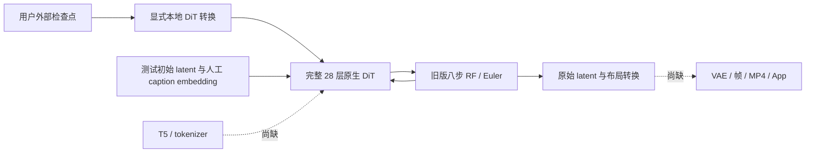

# 旧 LTX 0.9.8：用户资产转换与原生采样

[English](LTX098_SAMPLING.en.md) · [DiT 结构](LTX098_DIT.md) · [文档导航](README.md) · [编号交付](releases/v0.3.0-dev.21-ltx-sampling.md)

目标仍是冻结目标 **17：LTX-Video 2B 0.9.8 distilled**。本次扩展尚未注册到 App 的原生研究组件，加入显式检查点获取、本地流式 GGUF 转换、旧版坐标 / 布局及八步采样。**这不是完整视频生成**：本轮没有执行 T5 / tokenizer 或 VAE，没有产生视频，也没有 Android 真机执行。APK 仍为 **0.3.0-dev.21 / code 25**；公开 Release 仍为 **v0.2.0**。

## 1. 资产与基座分离

APK 不包含本次检查点、GGUF、词表、文本编码器、VAE 或任何训练参数。以下获取和转换均为开发者显式命令，不在 App 安装、升级、浏览、模型缺件或测试启动时触发下载。后续 App 仍须让用户自主选择、下载、导入和管理模型，不能用开发缓存代替可下载的完整用户资产方案。

| 项目 | 固定内容 |
| --- | --- |
| 原检查点 | [发布者文件](https://huggingface.co/Lightricks/LTX-Video/blob/8984fa25007f376c1a299016d0957a37a2f797bb/ltxv-2b-0.9.8-distilled.safetensors)，revision `8984fa25007f376c1a299016d0957a37a2f797bb` |
| 文件大小 / SHA256 | `6,340,744,492` 字节；`76aa8c4786af752fa6f951947129d5290c3c6c0b2fadcadea6b5e114ae2cad8f` |
| 实际内容 | BF16 DiT、匹配 VAE 编码器 / 解码器与通道统计；**不含 T5 / tokenizer** |
| 本轮转换 | 只转换 DiT：715 张量、1,923,385,472 参数；二维密集权重 F16，其余 F32；标准 GGUF v3，架构标识 `lma-ltx-video-098` |
| GGUF 大小 / SHA256 | `3,849,516,416` 字节；`ef29c886b36f8a1dbc6693002256049407e512da7a61bf2cc750f1d4d2277ebf` |
| 许可 | 模型遵循独立的 LTXV Open Weights License 0.X；源码 / GGML 许可见 [NOTICE](../research/ltx098/NOTICE) |

[资产身份锁](../third_party/ltx098-trained-assets.json)只记录来源、散列、许可与范围，不是已安装模型。下载器默认仅核验本地文件；只有显式 `--download` 才获取。分块响应严格核对范围 / 总长度，断点仅恢复同一固定身份，最终完整 SHA256 通过后才发布最终文件。镜像只改变下载来源，不改变检查点身份，也不参与推理。

转换器逐张量读取，不一次将完整多 GB 检查点复制进内存；核对旧版配置、完整布局、范围 / 重叠 / 截断、有限值、F16 溢出及转换期间的源文件身份。输出目录必须不存在，先在同目录 staging 写完并核验，再原子改名；失败保留输入与既有资产，清理自己的 staging。它不下载，也尚未成为 App 的导入路径。

## 2. 原生管线与限制



1. latent 形状为 `F=(frames-1)/8+1`、`H=height/32`、`W=width/32`，token 顺序为 `F,H,W`，通道放在 token 内。unpatchify 可还原为 `B,C,F,H,W`。
2. 精确旧版使用 `causal_temporal_positioning=False`；像素坐标按 `[8,32,32]` 放大，时间轴乘浮点 `1/fps`。没有套用较新 LTX 的首帧因果修正。
3. 官方 `LinearQuadratic(8, .025)` 的实际时间为 `1, .99375, .9875, .98125, .975, .909375, .725, .421875`。元数据的四位小数仅用于允许值核对，不能用来替换这些采样时间。
4. 确定性 RF 更新使用官方“严格小于当前时间减 `1e-6` 的最近较低时间”，再执行 `sample - dt * velocity`。单步工具分别处理全局 / 逐 token 时间；全局零时间拒绝，逐 token 零时间保持原样。
5. 八步采样保持同一个 DiT 实例，每步输出实际阶段事件、图分配和可选原始 latent trace；步骤前后检查取消，不发布取消后的最终产物。当前取消边界在 DiT 前向之间，尚未实现生产 Android 强制中断。
6. 研究边界：宽高 `32..2048` 且为 32 倍数、帧数 `1..257` 且为 `8n+1`、fps `1..240`、最多 4096 latent token、文本最多 256 token。上限不是手机资源保证。没有开放自定义 CFG / STG、替换 scheduler、图生视频、生产随机初始噪声接口或批处理；未知设置直接拒绝。

执行器不含网络 / shell 调用。缺件或不兼容在本地失败；CPU 与 Vulkan 显式选择，没有远程回退。固定 GGML Vulkan 要求 **Vulkan 1.2**，当前以 F32 shader 算术核验 F16 权重；这不构成 Z20 驱动兼容或性能结论。

## 3. 验证范围

新增套件的完整结果见 [采样证据](../verification/development/ltx098-sampling.json)，DiT 原有 675 项检查 / 80 个真实子进程 / 48 次对照见 [独立 DiT 证据](../verification/development/ltx098-transformer.json)。两个套件分别记录，不将检查数当成视频质量。

| 本轮结果 | 实测范围 |
| --- | --- |
| 692 项检查 / 58 个真实原生子进程 / 33 项防护 | 包含 22 个数学案例、10 条未训练八步轨迹、完整训练 Vulkan 前向及八步采样；共 111 个误差记录 |
| 坐标 / unpatchify / RF | 22 个案例与官方输出完全相同 |
| 未训练 CPU / Vulkan 八步轨迹 | CPU F16 最大误差 `3.45827e-4` / RMSE `1.36672e-4`；Vulkan 最大 `6.55651e-7` / RMSE `2.96737e-7`，均在预设门槛内 |
| 完整训练 DiT velocity | 最大误差 `6.91414e-6`，RMSE `1.63089e-6` |
| 完整训练第 8 步 latent | 最大误差 `3.57628e-6`，RMSE `8.72783e-7` |
| 主机资源 / 时间 | RTX3060 Vulkan；八步 CLI 含加载约 `21.26s`；权重缓冲 `3,849,462,272` 字节，每步 GGML 图缓冲 `1,874,992` 字节；Windows 观测工作集峰值 `1,216,548,864`、采样 private 峰值 `4,021,002,240` 字节 |

时间仅适用于上述微小 latent 输入的一次主机运行，不能换算手机速度或视频 FPS。 测试先读取 GGUF 计算完整散列，文件缓存状态可能影响加载时间；冷启动尚未测量。进程内存按 20ms 采样，未测 GPU 显存、最后采样间隔或系统总占用；GGML 图缓冲也不是全管线峰值。完整训练核验目前仅 Vulkan，CPU 完整训练模型与 Android 执行仍待验证。

未训练套件实际运行官方 `SymmetricPatchifier`、坐标转换、`RectifiedFlowScheduler` 及 2 / 28 层原始 PyTorch 前向，核对数学环节、F32 / F16 与 BF16 → GGUF 的 CPU / Vulkan 八步轨迹。另检查非法几何 / 时间 / 设置、现有文件保护、错误张量与转换清理，以及在真实神经前向开始后取消。

训练套件使用完整固定 BF16 检查点。官方 28 层模型的 `forward` 不改写；通过模块前后 hook，依次加载一个模块的 F32 参数，计算后移回 meta，最大单次调度参数为 `268,623,872` 字节，**这不是峰值 RSS**。715 个训练张量均实际经过前向，八步完整执行。原生端加载独立 F16 / F32 GGUF，并记录各步误差、计算缓冲及后端设备。

官方参考目录还逐项记录文件大小与SHA256；采样测试先核对全部输入 /期望输出 /夹具GGUF，额外、缺失或被修改的参考文件直接失败。

验证输入仅为 **64×64 / 17 帧 / 24fps 的 latent 几何、12 个 latent token、5 个人工文本嵌入 token**。这没有运行 T5，不是新提示词的视频结果，也不能判断画质、语义遵从、实际帧率、手机可用内存或后台耐久。训练 velocity 预置门槛为最大误差 `2e-3` / RMSE `5e-4`，八步 latent 为 `1e-2` / `2e-3`；失败不能通过放宽门槛改写为通过。

[Android 构建证据](../verification/development/ltx098-transformer-arm64.json)分别核对 probe 与 sampler 的 ARM64 / API28 / 16 KiB ELF 和依赖。它们不进入 APK，编译不能代替手机执行。旧的 `model_inference=false` 是完整 Android 验收口径；本次训练 DiT host 标记另列，不能据此启用完整视频能力。

## 4. 复现

使用原生 Windows PowerShell，从仓库根运行；不使用 Docker / WSL / 模拟器。代码与 oracle 准备见 [构建指南](BUILD.md) 和 [DiT 文档](LTX098_DIT.md)。所有开发数据留在忽略的 `build/`，以下均不调用远程推理。

```powershell
$env:PYTHONIOENCODING='utf-8'
$env:TEMP=Join-Path $PWD 'build/tmp'
$env:TMP=$env:TEMP
python tools/test_ltx098.py
python tools/fetch_ltx098_trained.py --download
# 可显式选镜像：--origin https://hf-mirror.com
python tools/export_ltx098.py --checkpoint build/ltx098-trained/originals/ltxv-2b-0.9.8-distilled.safetensors --output-dir build/ltx098-trained/converted
python tools/ltx098_sampling_oracle.py --output build/ltx098-sampling-oracle
python tools/ltx098_sampling_oracle.py --output build/ltx098-trained/oracle --checkpoint build/ltx098-trained/originals/ltxv-2b-0.9.8-distilled.safetensors
python tools/test_ltx098_sampling.py --trained --skip-build
python tools/build_ltx098.py --android --vulkan
python tools/export_development.py
python tools/check_repository.py --development
```

转换 / oracle 输出目录要求全新，不能覆盖旧资产；重跑时选择新的开发目录并对应调整检查工具路径，或先独立保留旧记录。原生构建使用临时 ASCII SUBST，在 `finally` 释放自己建立的盘符，必须顺序执行。采样测试不会补下载、自动重算 oracle 或将未训练结果改标为训练结果；缺少匹配文件 / 指纹直接失败。

开发 CLI 为 `lma_ltx098_sample MODEL.gguf|- REQUEST.json OUTPUT.f32 cpu|vulkan THREADS [--fixture]`。`--info` 列出 geometry / rf_step / unpatchify / sample；sample 请求需要外部 latent、caption embedding 和 mask。仅小网络测试可显式 `--fixture`；不能把这个入口包装成已完成的用户文生视频功能。

## 5. 同版待完成

| 编号 | 待处理事项 | 完成要求 |
| --- | --- | --- |
| P-01 | 目标17完整用户资产 | 固定 T5 / tokenizer、匹配 VAE、下载 / 导入 / 更新 / 回滚方案与许可；开发转换不是完整用户下载候选 |
| P-02 | 目标17完整同机管线 | 实际提示词编码、生产噪声 / 参数、VAE / 帧 / MP4、顺序生命周期、资源预算与生产取消；采用 Vulkan 或 QNN 之一；QNN 为可选替代，启用的路线必须具备自己的兼容性证据 |
| P-03 | App 接入 | 平级模型、任务 / 基座 / 后端 / 格式 / 设备 / 证据 / 许可 / 内容标签、独立参数快照、共用队列 / API / 产物；无 ComfyUI 画布或用户插件体系 |
| P-04 | 完整冻结范围 | F-01–F-12、既有生文、01–14 / 16 / 17、九个 MOSS 子目标、SD1.5 / SDXL LoRA 和全部冻结子目标的真实训练输出 / 质量 / 资源，均不顺延 |
| P-05 | Android 与 Release | 每模型 3 次加载卸载、15 分钟锁屏、1 小时交替 API、升级保留、A1–A11 / R01–R05；全部通过后同一完整 v0.3.0 发布 |

已知没有可用真机，不重复索要。本轮没有 App 页面变更，沿用准确标注的 dev.21 UI 夹具截图 / 录屏 / GIF；没有制作伪造视频生成演示。推荐 m08 → m06 → m01、全部 / 搜索 / 本地、用户自主资产及每模型参数约定继续保留。
