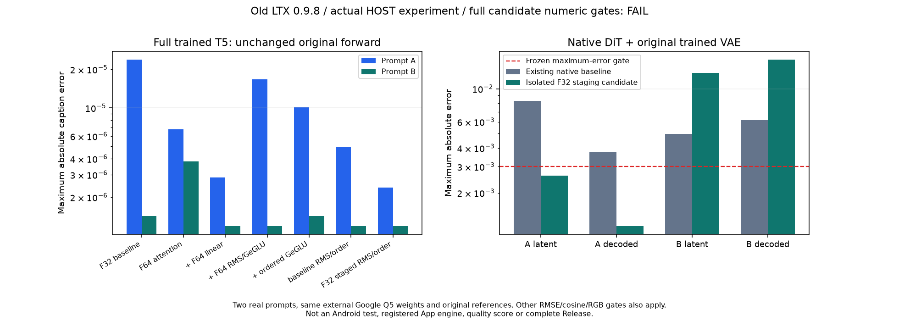
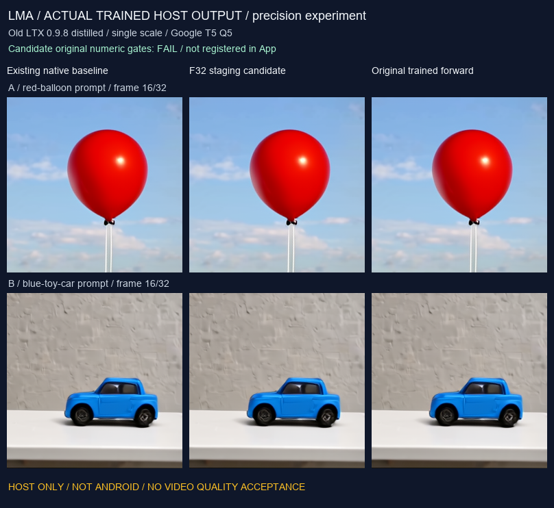

# 旧 LTX F32 运算分步验证

[English](LTX098_STAGING.en.md) · [原始精度定位](LTX098_PRECISION.md) · [完整链路](LTX098_PIPELINE.md) · [编号交付 / 全部待办](releases/v0.3.0-dev.23-ltx-staging.md) · [同版完整范围](MULTIMODAL_RELEASE_PLAN.md)

本轮实现原始 F32 RMS 分组累加及 GeGLU 运算顺序候选，并完成真实训练组件的主机 A/B/A 串联。该候选的原始完整浮点 / RGB 门槛结果为 **未通过**。原始参考前向、权重和门槛保持原样。现有原生基线仍保留此前 163 项中 157 通过、6 项失败的记录；候选尚需生产接入和全部回归。

App 仍只交付基座，用户自行选择、下载或导入模型及必要依赖。本轮候选是开发目录中的离线原生程序，未注册到 App，未进入 APK。当前签名包仍是 `0.3.0-dev.23 / code 27`，公开版本仍是 v0.2.0；完整 v0.3.0、手机推理、资源 / 质量及后台验收仍待完成。

## 运算顺序

1. 原 GeGLU 提前把系数与 `x` 连续相乘。原始模型先算 F32 `x³`，再乘系数，之后逐步进行加法、tanh 和乘法。新候选显式保留这些 F32 步骤。
2. RMS 先对每个输入进行 F32 平方，再按八 lane、四 stream、每组十六项累加；均值、加 epsilon、倒平方根、输入乘法和权重乘法各保留 F32 舍入。C++ 标量实现复现已核对的宽度 4096，不依赖 x86 指令。其他宽度及 Android 编译 / 数值仍需相应验证。
3. 矩阵投影和注意力沿用已有隔离 F64 累积候选，图中阶段张量仍是 F32。全部 219 个 T5 训练张量、4,762,310,656 个参数、外部 GGUF、分词结果和模型方程保持一致。

分组方式核对了 [PyTorch v2.14.0 CPU 求和实现](https://github.com/pytorch/pytorch/blob/v2.14.0/aten/src/ATen/native/cpu/SumKernel.cpp)。本地分析消费保留的真实训练中间张量：48 个均值张量共 **2,544** 个值与原始 Torch 逐位一致；24 个 GeGLU 运算顺序对照同样逐位一致。共 72 个局部对照。均值部分是 NumPy 模拟，GeGLU 部分是 Torch 运算顺序分析；这些局部结果不能替代 C++ 完整模型或手机验收。

## 实际主机结果

四种新候选各完成真实 T5 A/B/A 三次推理，共 12 次；每种候选均实际加载 / 卸载，重复 A 字节一致。F64 并不自动接近原始 F32 参考，因此保留全部结果。

| Candidate | A caption max abs | B caption max abs | Actual trained jobs |
| --- | --- | --- | --- |
| F64 RMS + F64 GeGLU | 1.66893005371e-05 | 1.19209289551e-06 | 3 / bitwise A/B/A |
| F64 RMS + ordered F32 GeGLU | 1.01029872894e-05 | 1.43051147461e-06 | 3 / bitwise A/B/A |
| Baseline RMS + ordered F32 GeGLU | 4.94718551636e-06 | 1.19209289551e-06 | 3 / bitwise A/B/A |
| Staged F32 RMS + ordered F32 GeGLU | 2.38418579102e-06 | 1.19209289551e-06 | 3 / bitwise A/B/A |

最终 F32 分步候选再消费同一实际提示词与相同种子的原生嵌入，执行三次独立 DiT / 解码链路：256×256、33 帧、24 fps、8 步、单尺度 Google/community Q5 T5。每次新运行原生 seeded noise、unpatchify、完整九图 VAE、RGB 帧和主机 FFmpeg 封装。数据桥接均来自原生训练组件，参考张量仅用于比较。

| Job | Latent max abs | Latent relative RMSE | Decoded max abs | Decoded relative RMSE | RGB max / mean | Gates |
| --- | --- | --- | --- | --- | --- | --- |
| A | 0.00260734558105 | 0.000125466615603 | 0.00119844079018 | 5.84066037162e-05 | 1 / 0.00196622598051 | PASS |
| B | 0.0127477049828 | 0.000665280217877 | 0.0156812220812 | 0.000527671740951 | 2 / 0.00814295296717 | FAIL |
| A repeat | 0.00260734558105 | 0.000125466615603 | 0.00119844079018 | 5.84066037162e-05 | 1 / 0.00196622598051 | PASS |

门槛为最大绝对误差 ≤ `0.003`、相对 RMSE ≤ `0.0003`、cosine ≥ `0.99999`；RGB 最大差 ≤ 2、均值差 ≤ 0.02。每次分别比较 caption、token latent、NCTHW latent、解码浮点和 RGB。重复 A 的潜变量、解码数组和全部 RGB 帧逐字节一致。

首条采样完成后，复核器的字段名错误已修复。恢复调用重新核对该实际采样的原生程序、权重、请求、日志及 11 个文件，保存为复用，未伪称重新执行。恢复调用新执行 **14** 个原生子进程；连同此前首条采样，共有 15 个采样 / 解码阶段子进程，另有最终候选的 3 次 T5 推理。新训练 VAE 实际执行三次，各九图并逐一卸载。资源记录是主机子进程观测，GPU 显存未计量。





[实际主机视频](media/development/ltx098-staging-comparison.mp4) · [GIF](media/development/ltx098-staging-comparison.gif)。媒体明确标注 HOST ONLY；数值一致性不能证明语义、运动质量或 Android 可用性。这里也未验收原始未量化 Google / PixArt 权重、官方多尺度默认或提示词增强。

## 采样器独立诊断

为区分文本误差和采样器误差，另做五次原生八步 B 诊断：全部输入完全相同的原始参考 caption、原始噪声与训练权重。这些诊断明确使用参考张量作条件，不能计入上面的原生 T5 完整模型验收。每次是新的真实原生子进程，保存八个中间 latent、最终文件、请求、日志、程序身份和主机资源。

原 CPU 后端的 F16 权重矩阵运算会通过 `vec_dot_type=F16` 将右侧 F32 激活转换到 F16；已有累加精度设置不能阻止该路径。隔离候选在 `ggml_mul_mat` 前显式将两个输入转换到 F32。另一个仅 CPU 候选为 DiT 的 Q/K 与块 RMS 增加显式 F32 分组归约；源权重文件、原方程与门槛不变。对应固定 [GGML CPU 源码](https://github.com/ggml-org/ggml/blob/a5915eb0e47adef21c3f25b889a008925ea838c2/src/ggml-cpu/ggml-cpu.c) 与本地锁定源一致。

| Sampler diagnostic | Latent max abs | Relative RMSE | Cosine | Native seconds | Latent gates |
| --- | --- | --- | --- | --- | --- |
| Original CPU | 0.788247942924 | 0.0505370007584 | 0.998722860265 | 109.441 | FAIL |
| Original Vulkan | 0.00779688358307 | 0.000416970937671 | 0.999999913106 | 9.502 | FAIL |
| Explicit F32 CPU | 0.00511467456818 | 0.000285841148193 | 0.999999959164 | 133.567 | FAIL |
| Explicit F32 Vulkan | 0.00779688358307 | 0.000416970937671 | 0.999999913106 | 560.564 | FAIL |
| Explicit F32 + staged RMS CPU | 0.00590533018112 | 0.000333848676232 | 0.999999944295 | 574.886 | FAIL |

表中秒数包含原生子进程加载和主机 I/O，不是可直接比较的推理基准。最后一次 CPU RMS 诊断遇到磁盘排队，期间顺序只读同一固定权重以改善缓存；3,849,516,416 字节的整文件 SHA256 再次与固定身份一致。该辅助读取没有修改任何模型或程序，也不计作模型推理。

F32 输入减少了 CPU 的半精度转换误差，但并未关闭完整模型数值门槛。Vulkan 的显式转换结果与原诊断一致，不能把 CPU 改善推广到其他后端。主机工作集/私有内存采样也不等于峰值显存、Android 内存或速度承诺。

这五份独立公开记录是 `ltx098-context-reference-{cpu,vulkan}.json`、`ltx098-compute-f32-reference-{cpu,vulkan}.json`、`ltx098-compute-f32-rms-reference-cpu.json`，均在 `verification/development/`。其 `diagnostic_only=true`，模型、视频、App、Android 和 Release 验收保持独立且未完成。

## 复现与证据

原生 Windows、已核对的 MSVC / CMake / Ninja 和现有离线开发资产；不运行虚拟化。精度程序保持在 `research/ltx098_text_accuracy/`、`ltx098_text_order/`、`ltx098_text_f32/`。所有输入来源、编译依赖、二进制、输出文件身份、数值及实际阶段资源写入证据。权重、原始中间数组和运行缓存留在忽略的 `build/`。

```powershell
$env:PYTHONDONTWRITEBYTECODE='1'
$env:PYTHONIOENCODING='utf-8'
$env:TEMP="$PWD/build/tmp"
$env:TMP="$PWD/build/tmp"
# Existing pinned developer assets/reference; no implicit acquisition.
python tools/analyze_ltx098_staging.py <preserved-trained-intermediate-directory>
python tools/experiment_ltx098_text_accuracy.py --reference <original-reference> --activation-f64
python tools/experiment_ltx098_text_order.py --reference <original-reference>
python tools/experiment_ltx098_text_staging.py --reference <original-reference> --normalization baseline
python tools/experiment_ltx098_text_f32.py --reference <original-reference>
# Native host FFmpeg must be on PATH for the complete developer chain.
python tools/test_ltx098_accuracy_trajectory.py --variant f32 --reference <original-reference>
python tools/diagnose_ltx098_sampling_context.py --reference <original-reference> --case 1 --context reference --backend cpu
python tools/diagnose_ltx098_sampling_context.py --reference <original-reference> --case 1 --context reference --backend vulkan
python tools/diagnose_ltx098_compute_precision.py --reference <original-reference> --case 1 --context reference --backend cpu
python tools/diagnose_ltx098_compute_precision.py --reference <original-reference> --case 1 --context reference --backend vulkan
python tools/diagnose_ltx098_compute_precision.py --reference <original-reference> --case 1 --context reference --backend cpu --staged-rms
python tools/export_development.py
python tools/render_ltx098_staging.py --reference <original-reference>
python tools/check_repository.py --development
```


`--initial-sampling` 显式恢复已完成的首阶段；`--review` 重算已有完整 A/B/A 的证据，执行数量按复用状态记录。公开记录为 `verification/development/ltx098-staging-analysis.json`、四份 `ltx098-accuracy-*.json` 及 `ltx098-accuracy-trajectory-f32.json`；仓库检查重算门槛状态并校验来源关系。图像 / GIF / MP4 另有源文件 SHA 与媒体清单。

下一步必须先修复仍失败的文本/采样数值，再完成生产接入、所需原生回归及 Android 候选构建；随后继续 T5 用户资产取得、同机编码、真实质量 / 资源和手机后台验收。全部 F-01–F-12、既有生文及 01–14 /16 /17 仍属于同一个完整版本，详见[完整待办表](releases/v0.3.0-dev.23-ltx-staging.md)。
