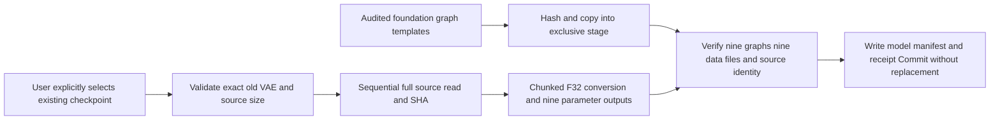
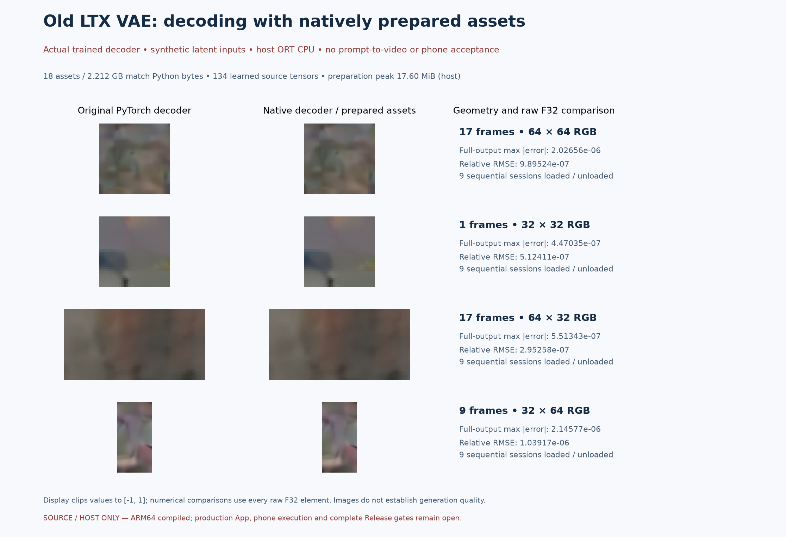

# Native local asset preparation for the old LTX VAE

[中文](LTX098_VAE_PREPARE.md) · [Numbered handoff and full pending scope](releases/v0.3.0-dev.21-ltx-vae-prepare.md) · [DiT preparation](LTX098_PREPARE.en.md) · [Original decoder comparisons](LTX098_VAE.en.md) · [Complete release scope](MULTIMODAL_RELEASE_PLAN.en.md)

> **dev.22 integration:** [App runtime-asset preparation](MODEL_PREPARATION.en.md) now packages the preparers and audited model-free architecture graphs, separately from generation engines. Users explicitly select/download/import source weights and start preparation; Android execution remains untested. Standalone component receipts below retain their original scoped meaning.

The old LTX 0.9.8 VAE now has a **native asset preparer without Python, ONNX or Torch runtime dependencies**. It generates all external parameters for nine decoder stages from an original checkpoint explicitly selected/acquired by the user. It shares bounded file reading, SHA, numeric conversion and transactional directory handling with the DiT preparer.

This remains source/host evidence plus Android compilation, without App registration or phone execution. Moving necessary preparation into portable native code advances the complete same-phone design; desktop tools must not become end-user prerequisites. App updates deliver the foundation. Weights and statistics remain user-selected assets, never implicitly acquired on installation, upgrade, browsing or missing-asset discovery.

## Architecture versus user model data

| No. | Content | Ownership and checks |
| --- | --- | --- |
| G-01 | Nine ONNX graphs | Architecture, standard operators and external parameter descriptors; every initializer has empty inline data |
| G-02 | Graph constants | 1,073 integer tensors for structural indexing/shapes; of 129 float tensors, five timestep frequency vectors are recomputed byte-for-byte from the formula and the rest contain only `1e-8` / `1` / `2` |
| G-03 | 138 external initializer records | Exactly 132 decoder tensors and two 128-channel statistics vectors, with shared parameters written to the required stages |
| G-04 | 21 folded tables | Only reshapes of source parameters, verified byte-for-byte; no unidentified learned parameter computation |
| G-05 | Learned timestep scale | Read from `vae.decoder.timestep_scale_multiplier` and written to five external locations; never substituted with a code constant |
| G-06 | User model data | Weights, means, standard deviations and learned parameters stay in the user's checkpoint/prepared data, outside graph templates and executables |

The [template compiler/auditor](../tools/prepare_ltx098_vae_templates.py) checks each external initializer against its original parameter and recomputes complete parameter-file hashes. It is a developer-only offline tool, not an Android dependency. Its `source_full_sha_verified_by_this_tool=false` explicitly limits the claim: observed parameter/structure checks are distinct from full source identity, which the subsequent native streaming conversion establishes.

Templates are internal foundation execution code. They derive from the pinned old architecture under the [Lightricks Apache-2.0 source license](../research/ltx098/licenses/Lightricks-Apache-2.0.txt); [NOTICE](../research/ltx098_vae_prepare/NOTICE) and the model-weight terms remain separate. This protocol does not install user plugins or arbitrary graphs: graph bytes must match hashes in the compiled contract.

## Conversion and commit



Input chunks are 4 MiB and converted chunks at most 8 MiB; bounded header/contract metadata is additional. No complete tensor, parameter file or checkpoint is allocated. All 944 source tensor payloads enter the complete source hash, including unused components. Converted parameters must be finite; standard deviations and the learned timestep multiplier must be positive.

The source is **6,340,744,492 bytes**. Eighteen assets total **2,211,661,835 bytes**: **2,211,259,604 bytes** of external parameters and **402,231 bytes** of structural graphs. The manifest, receipt and 1 MiB receipt headroom are additional. The source is retained. Source deletion, model updates and deletion of prepared assets remain separate explicit user operations.

Inspection creates nothing and never claims full-source verification. Conversion commits only after graph, whole-source and parameter-file hashes pass. Normal failure/cancellation closes files and removes only the 20 owned files and empty stage, without recursive deletion. Abrupt-kill orphan recovery and persistent App jobs still need production integration.

## Protocol and reproduction

```json
{
  "operation": "convert_vae",
  "checkpoint": "/data/user/0/com.lma.app/files/models/user-selected.safetensors",
  "expected_source_bytes": 6340744492,
  "expected_source_sha256": "76aa8c4786af752fa6f951947129d5290c3c6c0b2fadcadea6b5e114ae2cad8f",
  "graph_root": "/data/user/0/com.lma.app/files/foundation/ltx098-vae-graphs",
  "storage_root": "/data/user/0/com.lma.app/files/models",
  "output_name": "user-selected-ltx098-vae",
  "cancel_file": "/data/user/0/com.lma.app/files/jobs/vae-prepare.cancel",
  "max_output_bytes": 2300000000
}
```

These are protocol examples, not current App-created paths/UI. The preparer requires the reviewed exact old distilled checkpoint size/SHA; it does not substitute another LTX version. `storage_root` must exist and the output basename must be new. Output contains nine `.onnx`, nine `.onnx.data`, `ltx098-vae.json` and `preparation.json` files. `inspect_vae` rejects `graph_root`, `storage_root` and `output_name`, retaining `source_sha256_verified=false`. Stdout is one JSON response, stderr carries progress; success exits 0 and failure exits 1.

```powershell
# Reuse explicitly acquired local developer assets; no model downloads.
python tools/prepare_ltx098_vae_templates.py
python tools/build_ltx098_prepare.py
python tools/build_ltx098_prepare.py --android
python tools/build_ltx098_vae_prepare.py
python tools/build_ltx098_vae_prepare.py --android
python tools/test_ltx098_prepare.py --trained
python tools/test_ltx098_vae_prepare.py
python tools/export_development.py
python tools/plot_ltx098_prepare.py
python tools/plot_ltx098_vae_prepare.py
python tools/check_repository.py --development
```

Use native Windows MSVC/NDK, without Docker, WSL, virtualization or emulation. ARM64 builds require API 28, 16 KiB alignment and static C++; imported network/external-process interfaces are rejected. The commands also require the existing developer decoder build and original-forward references from the [decoder guide](LTX098_VAE.en.md). End users should not run these developer commands.

## Evidence boundaries and pending work

[Template audit](../verification/development/ltx098-vae-templates.json), [native preparation/actual decoding](../verification/development/ltx098-vae-prepare.json), [host build](../verification/development/ltx098-vae-prepare-host.json) and [Android build](../verification/development/ltx098-vae-prepare-arm64.json) are separate. All 18 prepared assets must match independently exported Python bytes. An actual native ORT decoder then consumes the newly prepared assets in four geometries and compares stages/final output to the original model under unchanged gates.



Source, host conversion, host neural decoding and ARM64 compilation do not establish App/device acceptance. This does not repair the six failed complete prompt/video float gates or close quality, resources, endurance or Release requirements. Explicit App preparation, SAF, managed asset registration, persistent recovery, production adapter/API/same-phone encoding and every other frozen target remain in the same complete v0.3.0. See the [numbered full pending scope](releases/v0.3.0-dev.21-ltx-vae-prepare.md).

The completed invocation records **243 checks / 25 failure-protection cases / 31 native children**, including one full preparation, four trained decodes and 40 original-forward comparisons. Observed host preparation peak working set was **17.57 MiB**; separate decoder resources remain in the public JSON. The 156-check shared DiT regression passes again. These counts do not establish complete-chain accuracy, phone performance or generation quality.
