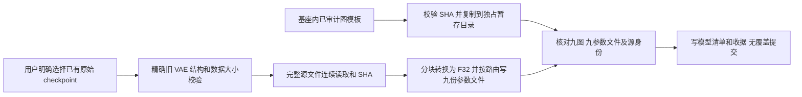

# 旧 LTX VAE 的本机原生资产准备

[English](LTX098_VAE_PREPARE.en.md) · [编号交付与完整待办](releases/v0.3.0-dev.21-ltx-vae-prepare.md) · [DiT 准备](LTX098_PREPARE.md) · [解码器原始对照](LTX098_VAE.md) · [完整版本范围](MULTIMODAL_RELEASE_PLAN.md)

本次将旧 LTX 0.9.8 的完整 VAE 参数准备实现为 **无需 Python / ONNX / Torch 运行依赖的原生组件**。它从用户已选择取得的原始 checkpoint，生成九段解码器使用的全部外部参数文件。它与上一轮 DiT 准备器共用有界读取、SHA、数值转换和目录事务代码。

目前是独立源码 / 主机验证 / Android 编译，尚未注册到 App 或在真机执行。把必要的数据准备移到可在手机原生运行的代码，是完整同机方案的一部分；开发机工具不能成为最终用户的使用前提。App 继续只更新基座，模型权重与统计量由用户选择下载 / 导入，不能随安装、升级、浏览或缺件发现而隐式获取。

## 九段图与用户数据的边界

| 编号 | 内容 | 归属与检查 |
| --- | --- | --- |
| G-01 | 九份 ONNX 图 | 网络结构、标准算子、外部参数描述；全部 initializer 的内联数据为空，不含学习到的权重 |
| G-02 | 图常量 | 1,073 个整数张量用于形状 / 索引等结构，129 个浮点张量中 5 份时间编码向量由公式逐字节重算，其余仅为 `1e-8` / `1` / `2` |
| G-03 | 138 个外部参数条目 | 全部对应 132 个解码器张量及两份 128 通道统计量；重复使用的参数分别落到所需阶段文件 |
| G-04 | 21 份折叠表 | 与原始 checkpoint 参数仅相差 reshape；逐字节核对，不包含不可追溯的学习参数计算 |
| G-05 | 学习到的时间缩放 | 从 `vae.decoder.timestep_scale_multiplier` 读取并写入五处外部数据，不能以代码常量代替 |
| G-06 | 用户模型数据 | 权重、均值、标准差及学习参数只存在用户 checkpoint / 准备后的数据文件中，不进入图模板或程序 |

[图模板编译与审计工具](../tools/prepare_ltx098_vae_templates.py)检查每一项外部数据与源参数的关系，并重新核对完整参数文件 SHA。该工具是开发者离线编译 / 检查工具，不是 Android 运行依赖。其记录明确 `source_full_sha_verified_by_this_tool=false`：图审计只验证所观察参数及结构，完整源文件身份由后续原生转换的完整同流哈希证明，不能混为一项结论。

图模板是内部基座执行代码。它们来自锁定的旧版网络结构，适用 [Lightricks Apache-2.0 源码许可](../research/ltx098/licenses/Lightricks-Apache-2.0.txt)；[NOTICE](../research/ltx098_vae_prepare/NOTICE)与旧 LTX 模型权重许可分别保留。用户不能通过此协议导入任意图或安装插件；输入模板始终必须匹配编译合同内的 SHA。

## 转换与事务



4 MiB 输入缓冲、最多 8 MiB 转换缓冲，头部 / 编译合同等小型元数据另计；不分配完整张量、整份参数文件或完整 checkpoint。所有 944 个源张量的载荷都会参与完整源 SHA，即使该准备器只使用其中的解码器 / 统计量。转换数据必须有限，标准差和学习到的时间缩放必须为正。

原始源文件 **6,340,744,492 bytes**；18 个模型资产合计 **2,211,661,835 bytes**，其中外部参数 **2,211,259,604 bytes**，九份结构图 **402,231 bytes**。另有模型清单、准备收据和 1 MiB 收据余量。源文件保留；删除源、更新用户模型、删除准备结果均应是独立的用户动作。

预检不创建输出，也不声称完成源 SHA。实际转换只有在图、完整源、参数文件 SHA 全部通过后，才无覆盖提交最终目录。正常错误 / 取消会关闭文件并只删除本次拥有的 20 个文件及空暂存目录，不递归删除用户目录。系统强杀后的孤立暂存 / App 持久任务恢复仍需要生产接入，不能以正常取消检查代替。

## 协议与复现

```json
{
  "operation": "convert_vae",
  "checkpoint": "/data/user/0/com.lma.app/files/models/user-selected.safetensors",
  "expected_source_bytes": 6340744492,
  "expected_source_sha256": "76aa8c4786af752fa6f951947129d5290c3c6c0b2fadcadea6b5e114ae2cad8f",
  "graph_root": "/data/user/0/com.lma.app/files/foundation/ltx098-vae-graphs",
  "storage_root": "/data/user/0/com.lma.app/files/models",
  "output_name": "user-selected-ltx098-vae",
  "cancel_file": "/data/user/0/com.lma.app/files/jobs/vae-prepare.cancel",
  "max_output_bytes": 2300000000
}
```

以上是协议示例，尚不是现有 App 已创建的路径 / UI 功能。准备器只接受确切旧 distilled checkpoint 的可信大小 / SHA；它不替代其他版本 LTX。`storage_root` 必须存在，输出 basename 必须全新；最终输出九份 `.onnx`、九份 `.onnx.data`、`ltx098-vae.json`、`preparation.json`。`inspect_vae` 必须省略三个目录 / 名称字段，保留 `source_sha256_verified=false`。stdout 返回单个 JSON；stderr 报进度；成功退出 0，失败退出 1。

```powershell
# 已显式准备的本地开发资产；不会下载模型。
python tools/prepare_ltx098_vae_templates.py
python tools/build_ltx098_prepare.py
python tools/build_ltx098_prepare.py --android
python tools/build_ltx098_vae_prepare.py
python tools/build_ltx098_vae_prepare.py --android
python tools/test_ltx098_prepare.py --trained
python tools/test_ltx098_vae_prepare.py
python tools/export_development.py
python tools/plot_ltx098_prepare.py
python tools/plot_ltx098_vae_prepare.py
python tools/check_repository.py --development
```

使用原生 Windows MSVC / NDK；不运行 Docker、WSL、虚拟机或模拟器。ARM64 组件要求 API 28 / 16 KiB 对齐 / 静态 C++，检查动态导入中没有网络 / 外部进程接口。上列命令还需已有的开发解码器构建与原始前向参考，见[解码器指南](LTX098_VAE.md)。用户最终不应运行这些开发命令。

## 证据范围与待办

[公开图审计](../verification/development/ltx098-vae-templates.json)、[原生准备和实际解码结果](../verification/development/ltx098-vae-prepare.json)、[主机构建](../verification/development/ltx098-vae-prepare-host.json)、[Android 构建](../verification/development/ltx098-vae-prepare-arm64.json)分开记录。完整 18 个资产必须与独立 Python 导出逐字节一致；随后让真实原生 ORT 解码器读取本次准备的资产，在四种尺寸上对照原始模型的阶段和最终输出，保留原误差门槛。


源码 / 主机转换 / 主机神经解码 / ARM64 编译均不等于生产 App 或手机验收。本轮没有修复完整提示词视频链路的六项浮点失败，也没有关闭质量、资源、后台耐久或正式 Release 门槛。App 的显式用户准备入口、SAF、资产登记、持久恢复、生产 adapter / API / 同机媒体编码与其他所有冻结目标，继续属于同一个完整 v0.3.0，详见[编号待办](releases/v0.3.0-dev.21-ltx-vae-prepare.md)。

本次完整验证：**243 项检查 / 25 组失败保护 / 31 个原生子进程**，包括 1 次全量准备、4 次训练解码、40 项原始前向对照。准备进程主机观测峰值 **17.57 MiB**；独立解码器的资源另见公开 JSON。共用 DiT 回归 156 项重新通过。完整链路误差、手机性能和生成质量不由这些数量推定。
