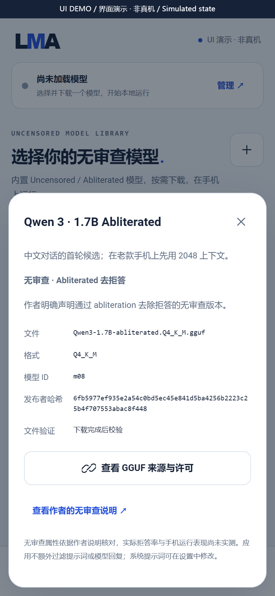
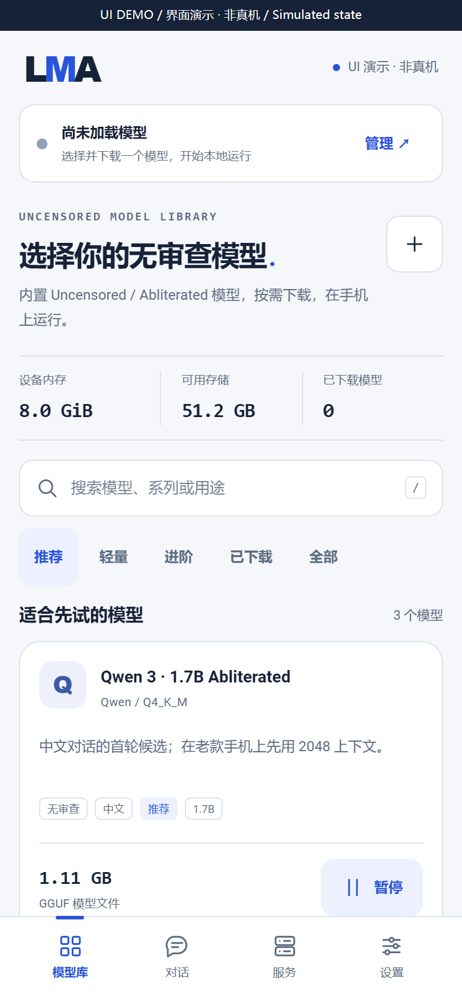
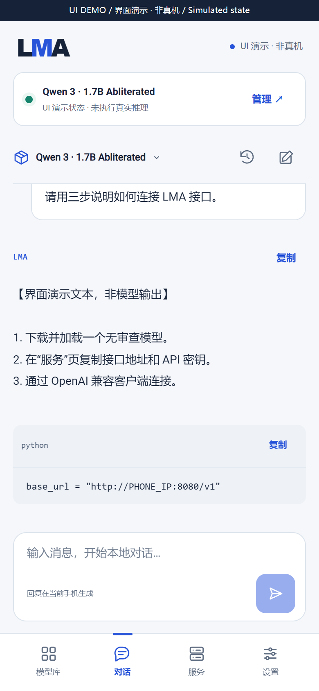
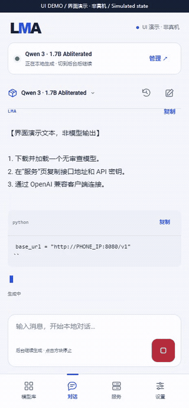

# 截图与演示 / Screenshots and demonstrations

[文档目录 / Documentation](README.md)

## 来源与范围 / Source and scope

当前素材由 `tools/capture_media.cjs` 直接加载 `app/src/main/assets/` 中随 APK 分发的 HTML / CSS / JavaScript，通过明确的演示原生桥接录制。390 × 844 CSS 像素视口；截图为 2 倍像素比例。视频是浏览器页面实际录制，FFmpeg 转成 MP4 / GIF，非设计稿动画。

The capture script renders the exact shipped UI assets with an explicit demonstration native bridge, at a 390 × 844 CSS-pixel viewport. Screenshots use scale factor 2. The video is an actual browser-page recording, converted by FFmpeg, not an animation of design mockups.

**不是 Android 真机实录。Not a physical Android recording.** 下载状态为模拟；对话是带“非模型输出”标识的脚本文本；示例 IP 为 `192.0.2.20`，API 密钥是演示占位符。没有下载模型或执行推理。顶部全程显示 UI DEMO；不会移除标识后将素材冒充验收。

HF metadata and downloads are simulated. Chat text explicitly says it is not model output. The IP and key are placeholders. No weights are downloaded and no inference runs. The permanent demo banner must remain when sharing these assets. HF 元数据和演示的模型参数上限同样来自明确的界面夹具，不是具体权重的真实元数据证据；实际公共 API 检查独立记录在验证目录。 Model limits in media are explicit fixtures, not measured metadata for the illustrated weights.

## 截图 / Screenshots

| 页面 / Page | 文件 / File |
| --- | --- |
| 本地模型库与原有推荐 / Local model library and preserved recommendations | [01-library.png](media/01-library.png) |
| 作者依据与哈希 / Publisher evidence and hash | [02-model-evidence.png](media/02-model-evidence.png) |
| 模拟下载与暂停 / Simulated download controls | [03-download.png](media/03-download.png) |
| 对话与代码 / Scripted chat and code | [04-chat.png](media/04-chat.png) |
| OpenAI 兼容服务 / API service controls | [05-api.png](media/05-api.png) |
| 模型独立参数 / Per-model settings | [06-settings.png](media/06-settings.png) |
| 深色主题 / Dark theme | [07-dark.png](media/07-dark.png) |
| HF 在线发现 / HF discovery | [08-hf-discovery.png](media/08-hf-discovery.png) |
| GGUF 量化文件选择 / GGUF file selection | [09-hf-files.png](media/09-hf-files.png) |
| 本地模型管理 / Local manager | [10-local-models.png](media/10-local-models.png) |
| 输出超限归位 / Output clamping | [11-model-output.png](media/11-model-output.png) |
| 全局应用偏好 / Application preferences | [12-preferences.png](media/12-preferences.png) |

<p>
  
  
  
</p>

## 录屏和 GIF / Recording and GIFs

- [lma-walkthrough.mp4](media/lma-walkthrough.mp4)：完整操作录屏 / Full UI walkthrough，约 35 秒 / approximately 35 seconds。
- [lma-walkthrough.gif](media/lma-walkthrough.gif)：完整 GIF / Full walkthrough GIF。
- [lma-api-theme.gif](media/lma-api-theme.gif)：API 与主题短片 / API and theme excerpt。
- [lma-hf-local.gif](media/lma-hf-local.gif)：HF 搜索、文件选择与本地管理 / HF search, file picker and Local management。
- [lma-model-settings.gif](media/lma-model-settings.gif)：每个模型的可编辑预设、超限归位与保存 / Per-model editable presets, automatic clamping and saving。
- [manifest.json](media/manifest.json)：输入指纹、截图清单、文件大小和 SHA256、视频探测信息与演示边界 / Input fingerprints, files/hashes, video probe, and simulation scope。

<p></p>

## 复现 / Reproduce

需要 Node.js、Playwright、Edge / Chromium、Playwright 的 FFmpeg 组件，以及 PATH 中的 FFmpeg / FFprobe。Requires Node.js, Playwright, a browser, Playwright's FFmpeg component, and FFmpeg / FFprobe on PATH.

```powershell
# 可选：指定已有依赖 / Optional: select existing dependencies
$env:LMA_PLAYWRIGHT = 'C:/path/to/node_modules/playwright'
$env:LMA_BROWSER = 'C:/Program Files (x86)/Microsoft/Edge/Application/msedge.exe'
node tools/capture_media.cjs
```

`LMA_FFMPEG`、`LMA_FFPROBE` 可指定可执行文件。服务器仅监听临时本机端口，网络路由阻止外部资源。原始视频与专用浏览器 profile 位于被忽略的 `build/media/`，不上传。finally 关闭所有录制页、context 和浏览器，并停止 HTTP 服务。

The server binds to a temporary loopback port and external requests are blocked. Raw video and the dedicated browser profile stay in ignored `build/media/`. Cleanup closes recording pages, context/browser, and the server even on failure.

## 后续补充 / Future device media

真机可用后，应单独补充安装、完整下载、实际生成及屏幕关闭期间客户端持续输出的录制，并关联设备、参数、模型哈希和验收结果。不要把屏幕录制本身当成无 ADB / 电池供电耐久证据。

When a phone becomes available, add separately labeled installation, real download/inference, and screen-off client recordings with device, parameters, model hash, and acceptance results. Screen recording alone is not evidence of unplugged, ADB-free endurance.

开发媒体新增 `09-tts-form.png`，与 development MP4 / GIF 一起展示语音表单和独立音色 / 语速；全程标记 UI FIXTURE，不提供伪造音频。The development speech-form capture is an explicit UI fixture without synthesized audio. See [development media](DEVELOPMENT.md).

开发媒体 dev.4 增加 [基础模型配对](media/development/10-lora-pairing.png)与[独立强度表单](media/development/11-lora-form.png)，同步 MP4 / GIF，全程 UI FIXTURE；未生成任何 LoRA 示例图片。 / dev.4 adds explicit compatible-base and strength-form scenes to development captures; these are UI fixtures without generated model images.


dev.5 增加[自选 HF 配方](media/development/12-hf-components.png)和[组件文件](media/development/13-hf-component-files.png)，更新完整 MP4 / GIF，显式 UI FIXTURE；未下载权重或提供伪造模型输出。 / dev.5 adds user-controlled recipe/component scenes to the labeled development recording and GIF; no weights or inference output are involved.

内部 dev.6 新增 [Nano 组件配方](media/development/15-moss-nano-recipe.png)与[外置数据选择](media/development/16-moss-external-data.png)，并更新同一开发录屏 / GIF；共 16 张 PNG 与 2 个视频 / 动图文件。均显示 UI FIXTURE 标识，没有模型下载或语音推理。Dev.6 adds Nano component/external-data screenshots and updates the labeled development recording/GIF: 16 PNGs and two video/animation files, without model downloads or speech inference.

dev.8 新增[文本参数](media/development/22-text-model-settings.png)、[任务表单](media/development/23-text-queue-form.png)和[正文 / 思考](media/development/24-text-result.png)，更新开发 MP4 / GIF，共 24 张 PNG 与 2 个视频 / 动图文件。全程 UI FIXTURE；正文为固定测试字符串，非模型输出。Dev.8 adds text settings/task/result scenes, 24 PNGs plus recording/GIF, all visibly labeled fixtures without actual inference.

dev.9 当前开发媒体为 **26 PNG + MP4 + GIF**。新增 [25 · 已有模型详情](media/development/25-migrated-text-model.png) 与 [26 · 共用文本任务](media/development/26-migrated-text-task.png)，并更新录屏 / GIF。全部为 UI FIXTURE；不证明手机迁移或推理。 / The current dev.9 media contains 26 screenshots plus recording/GIF, with explicit fixture labels.

开发 dev.10 新增 `27-scheduler-model-waiting.png` 与 `28-scheduler-chat-waiting.png`，共 28 张 PNG；录屏 / GIF 同步展示已选文本驻留和可取消回复等待。所有画面均有 UI FIXTURE 标识，未执行 Android 或模型。Dev.10 adds two explicit scheduling UI fixtures and refreshes the recording/GIF without phone or model execution.

dev.11 当前媒体为 **30 PNG + MP4 + GIF**，新增[导入素材](media/development/29-imported-media-library.png)与[本地输入契约表单](media/development/30-local-input-role-form.png)。表单是独立 UI FIXTURE，非已支持语音克隆模型；不执行 Android 或推理。录屏 / GIF 和 manifest 同步，浏览器已在 finally 关闭。Dev.11 adds two explicit local-input UI contracts, with refreshed recording/GIF and browser cleanup.

dev.12 历史媒体为 **32 PNG + MP4 + GIF**，新增 [LCM 配对采样](media/development/31-lcm-sampling-policy.png) 与 [SD-Turbo 表单](media/development/32-sd-turbo-task.png)。均为显式 UI FIXTURE，没有下载或运行模型；浏览器在 finally 关闭。Dev.12 adds explicit low-step task UI fixtures, with refreshed recordings and cleanup.


dev.13 当前媒体 / current media：**35 PNG + MP4 + GIF**。新增 [Z-Image 采样](media/development/33-zimage-sampling-policy.png)、[Qwen 组件](media/development/34-qwen-image-components.png)、[Wan 视频参数](media/development/35-wan-video-parameters.png)；全部明确为 UI FIXTURE，未下载权重、未执行 Android 或模型。录制结束在 finally 关闭上下文与浏览器。All are explicit fixtures, not model outputs or device evidence; browser resources close after capture.

dev.14 Sana 页面：[组件](media/development/36-sana-mobile-components.png)、[独立参数](media/development/37-sana-mobile-parameters.png)；[37 张页面清单](media/development/manifest.json)、[录屏](media/development/foundation-ui.mp4)与 [GIF](media/development/foundation-ui.gif)均是实际页面与明确的 UI FIXTURE。No models were downloaded or executed; these are not Android image or performance evidence. See [中文](MNN_SANA_ENGINE.md) / [English](MNN_SANA_ENGINE.en.md).

dev.20：新增 [56 四组件](media/development/56-stable-audio-components.png)、[57 本地音频表单](media/development/57-stable-audio-task.png)、[58 token 与时长参数](media/development/58-stable-audio-bounds.png)，共 58 screenshots + MP4/GIF（60 媒体文件）。[录屏](media/development/foundation-ui.mp4) / [GIF](media/development/foundation-ui.gif) 均标记 UI FIXTURE；没有下载权重或生成模型音频。浏览器页面、context 和任务进程在 finally 中关闭；不调用模拟器 / Docker / WSL。Screens are production UI with simulated state, not physical Android inference.


dev.21：新增 [59 十四份组件](media/development/59-soulx-components.png)、[60 配套参考原文](media/development/60-soulx-paired-references.png)、[61 上下文联合归位](media/development/61-soulx-context-bounds.png)；当前61张PNG + MP4 /GIF，共63个媒体文件。全部是实际生产页面配明确模拟原生桥的UI FIXTURE，没有下载或运行模型。完整训练主机WAV留在忽略目录，不拿合成参考冒充音质演示。浏览器页面、context与本轮进程均在finally关闭；没有模拟器 /Docker /WSL。Production UI with explicit fixture state; no phone inference media or quality claim.
