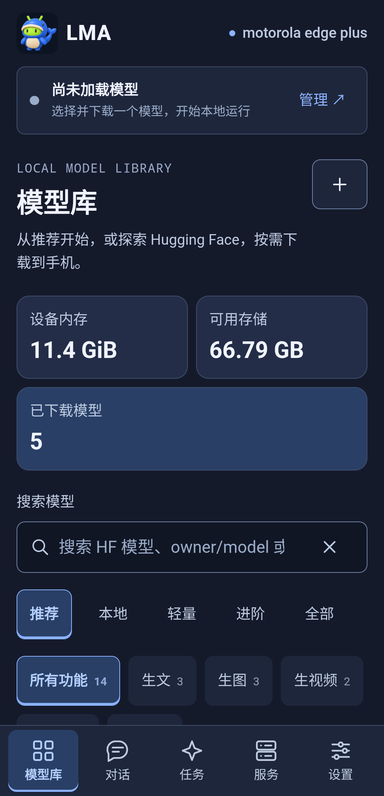
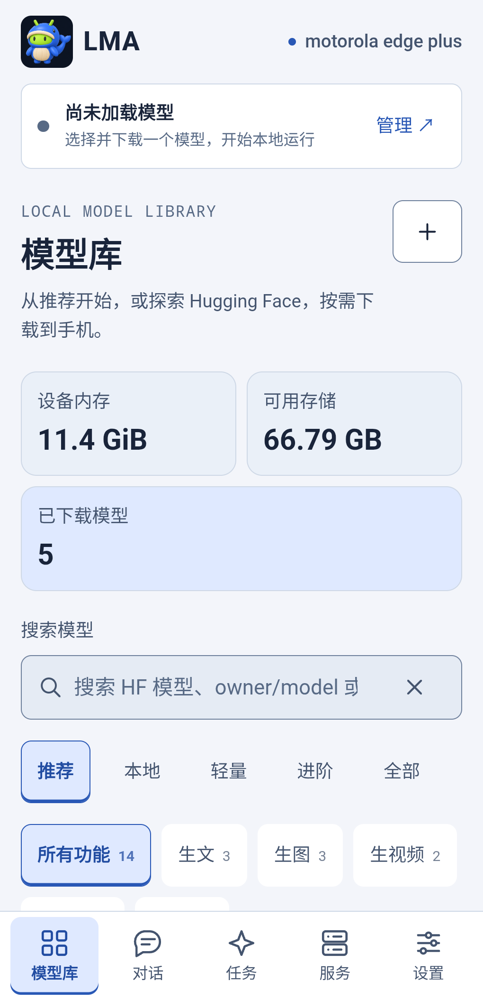
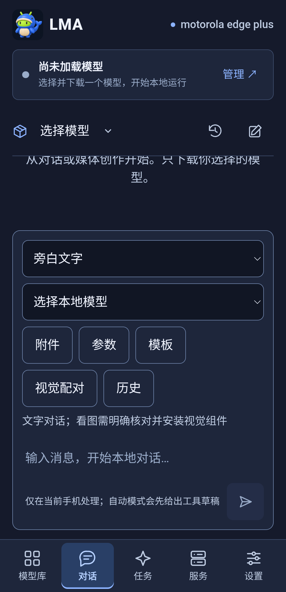
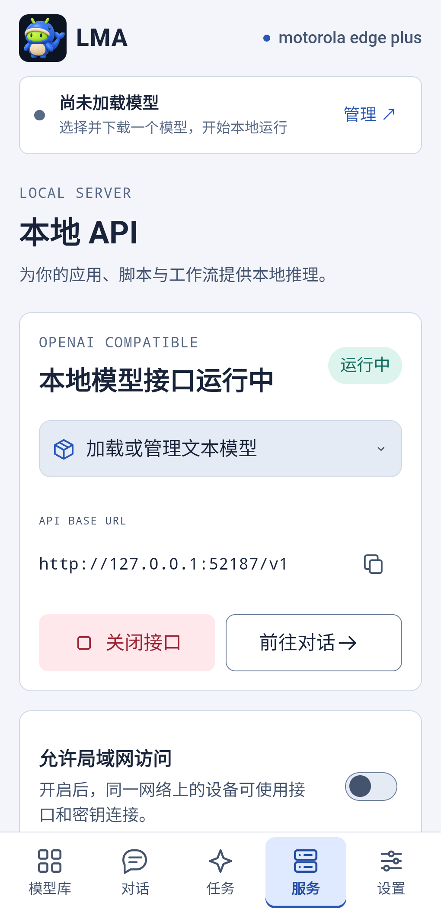

# v1.0.0 Mica Bento UI major release

**v1.0.1 follow-up:** The user requested the original chat hierarchy; creation controls now open through “+”. Mica themes and other pages remain. See [current usage, media and integration evaluation](CHAT_RESTORE_20261106.en.md). Counts/media below retain their v1.0.0 identity.


[中文](MICA_V100.md) · [Stable Release](https://github.com/wikigsroom/LMA/releases/tag/v1.0.0) · [Design contracts](design/README.md)

UI10 Mica Bento now covers LMA. Opaque blue-gray planes, cobalt selection and mint downloads span all five destinations, overlays, forms and media. Dark is the installation default; Light and System are complete preferences. Logo21, slogan04, the original signer and existing user assets are retained.

## Pages and behavior

| ID | Surface | Behavior |
| --- | --- | --- |
| UI01 | Shell and resources | LMA brand, memory/storage/background indicators; single scrolling flow in short windows |
| UI02 | Models | Recommended / All / Local, clearable search, task/capability/content tags and wrapping filters |
| UI03 | Cards and downloads | Preserve m08→m06→m01; explicit mint download actions; independent local asset management |
| UI04 | Parameters | Editable presets, model bounds, per-model profiles and separate temporary overrides |
| UI05 | Conversation | Unified composer, attachments, tools, W01–W06 and results; Enter inserts a newline, Ctrl/Cmd+Enter sends |
| UI06 | Tasks and artifacts | Search, filters, progress, cancellation, retry and export; semantic text accompanies color |
| UI07 | Local API | Port 52187, authentication, service controls and model publication; keys masked by default |
| UI08 | Settings | Immediate theme preview, explicit save, unsaved preview reverts on leaving |
| UI09 | Modals | Inert background, focus restoration, 48px controls; earlier alerts cannot block modal controls |
| UI10 | Adaptation | Minimum usable width 240px, R00–R06, side rail from 840px, at most two/three columns; fewer with large text |
| UI11 | Android host | Native inset ownership, IME notifications, no double insets, configuration changes preserve business state |
| UI12 | Performance | No live blur, decorative loops or polling; event-driven viewport updates; inactive media pauses and GLB releases |

Upgrade with the original signed APK. New installations start dark; existing Light/Dark/System choices survive. Preview a theme in Settings and save to keep it. Manage model profiles through Models → Local. No weights, parameters or task history are replaced and no model download starts on upgrade.

## Implementation and checks

`docs/design/tokens.json` feeds `build_mica.py`, generating packaged tokens and design identity. The final `mica.css` layer styles production surfaces; `mica.js` reacts to native/window/focus events. Documentation `tokens.css` remains a reference.

- Dedicated UI: 20 checks and 520 layout scenarios. Seventeen numeric viewports × two themes × three text scales × five pages, plus 130% text on both themes/all pages. Additional checks cover 240px, breakpoint edges, IME, focus, alert/modal overlap and no automatic model actions.
- Business UI: 796 production-page checks. Thirty conversation-fixture checks cover bounded mounting with 100 sessions, 1,000 messages and 100 artifacts. Fixtures are distinct from phone evidence.
- Physical phone: the exact signed v1.0.0 APK on motorola edge plus / Android 12, checking themes, five pages, parameters, actual keyboard, rotation, installed assets and preferences. Short screen-off API health and idle UI measurements are separate records.
- Native Windows, 41 ARM64 libraries, Android 9+, Lint zero errors / 17 warnings. No Docker, WSL, VM, emulator, model download or complete trained-model run. Owned browser contexts close in finally.

[Version evidence](../verification/releases/v1.0.0/status.json) · [Physical UI](../verification/releases/v1.0.0/mica-physical-ui.json) · [Media provenance](media/device/v1.0.0/manifest.json)

## Actual phone demonstration

 

 


[Actual MP4](media/device/v1.0.0/physical-walkthrough.mp4) · [Versioned conversation program demo](media/conversation-v1.0.0/walkthrough.mp4). Original playback speed. Screenshots crop system notifications/navigation. Explicit task search hides personal history; empty new conversations preserve existing sessions.

## Limits

This release verifies UI, program contracts, upgrades and bounded physical interactions. UI demonstrations do not establish model quality or endurance. Physical hinge/tablet coverage and a full TalkBack listening pass remain unavailable; continuous narrow/split regions have program layout checks and are not represented as different phones.

Existing m03/m09/m16 projector identity gaps, unmatched export endpoints, complete Android visual/codec output, video/3D quality and extended background limits keep their original evidence. Arbitrary HF architectures are not universally executable. Existing video >5 seconds and uncapped generation contracts remain.

## Reproduction

```powershell
python tools/build.py
python tools/build_acceptance.py
python tools/verify_package.py
python tools/test_android_lint.py
node tests/ui-smoke.cjs
node tests/mica-ui.cjs
node tests/conversation-ui.cjs
python tools/device_check.py --serial YOUR_DEVICE --run --existing-models --program-api --minutes 1
python tools/profile_device.py --serial YOUR_DEVICE --label optimized --existing-models
```

Use an authorized unlocked phone. Keep upgrade baselines private, restore temporary display/font settings and visually review media before export. The recorder does not accept an unlock password. Signing material, device identifiers, keys and personal logs are excluded from source archives and Releases.
