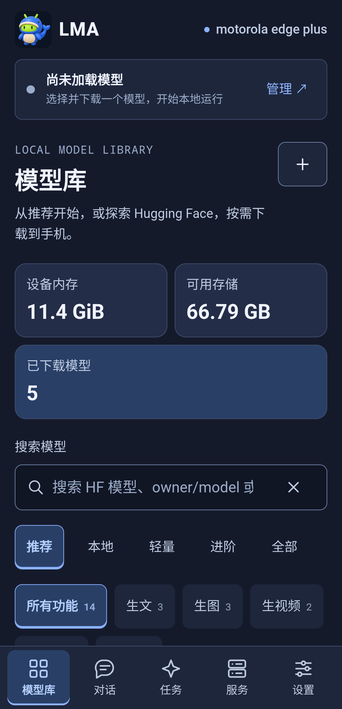
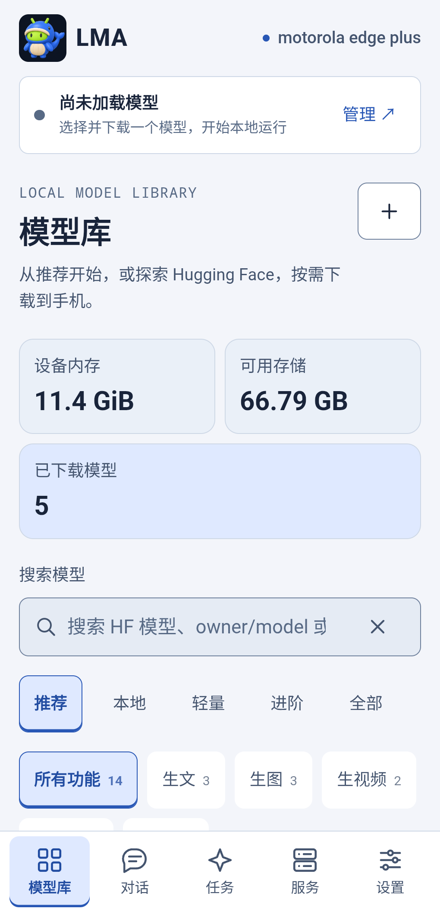
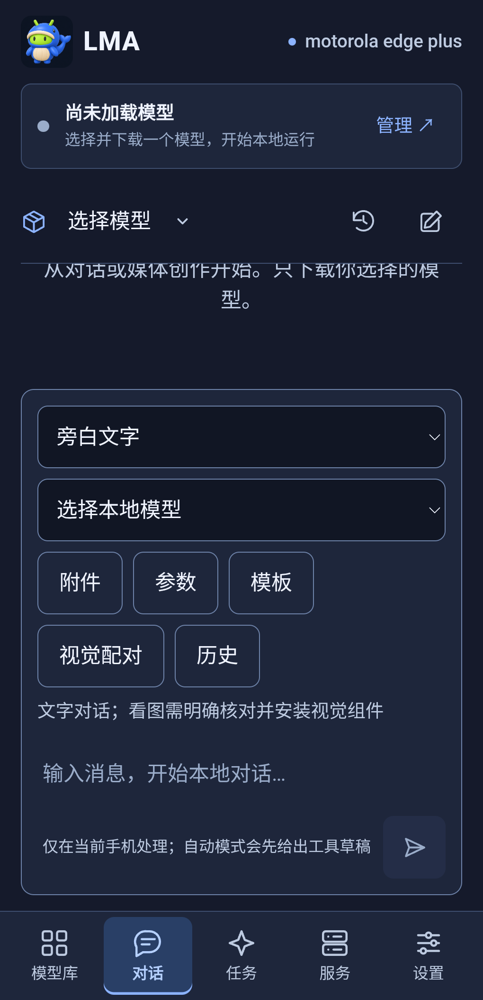
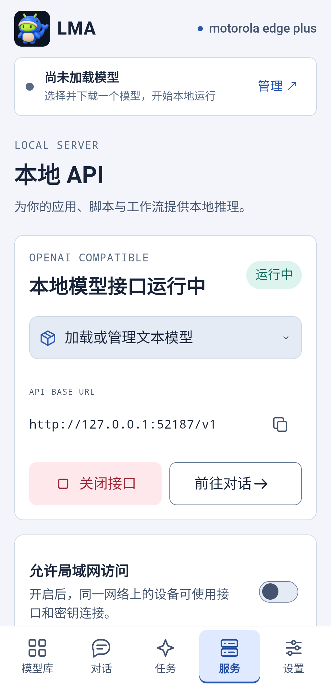

# v1.0.0 云母分区 UI 大版本

[English](MICA_V100.en.md) · [正式 Release](https://github.com/wikigsroom/LMA/releases/tag/v1.0.0) · [完整设计规范](design/README.md)

本版把 UI10「云母分区」接入整个 App：默认暗色，完整支持明亮主题和系统跟随，保留 Logo21、Slogan04、原签名及用户模型。五个业务入口和原有生成／任务／API 能力继续共用本地基座。

## 页面与操作

| 编号 | 页面／组件 | 本版行为 |
| --- | --- | --- |
| UI01 | 框架、品牌、资源卡 | 蓝灰不透明分区；Logo21、LMA 名称、内存／存储／后台状态；短屏转普通滚动 |
| UI02 | 模型库 | 推荐／全部／本地、带清空动作的搜索、五类输出筛选及独立内容／能力标签 |
| UI03 | 模型卡、下载 | 原推荐前缀 m08→m06→m01；下载使用薄荷色；仅明确选择触发下载；本地资产独立管理 |
| UI04 | 模型参数与任务表单 | 可编辑预设、模型上限归位、独立参数和临时覆盖；字段、依赖、校验、错误可读 |
| UI05 | 对话与本地创作 | 输入、附件、参数、工具草稿、W01–W06、消息块和结果统一样式；手机回车换行，Ctrl/Cmd+Enter 发送 |
| UI06 | 任务与结果 | 搜索／筛选、进度、失败、取消、重试和导出；颜色与文字共同表达状态 |
| UI07 | 本地 API | 服务开关、52187 地址、认证和模型广播；密钥默认遮蔽；UI 切换不启动推理 |
| UI08 | 设置 | 即时主题预览，保存后持久保留；未保存离页恢复；应用偏好与模型参数分离 |
| UI09 | 弹层 | 背景 inert、焦点约束和恢复、48px 按钮；既有错误提示不遮挡弹层操作 |
| UI10 | 宽窄布局 | 240px 最小可用窗口、R00–R06、840px 起侧轨、最多两／三列；大字自动减少列数 |
| UI11 | 键盘与系统 | 原生单一安全区所有者、IME 显隐通知、避免双重扣边；配置变化保留 WebView 与业务状态 |
| UI12 | 性能与媒体 | 无实际 blur、装饰循环或持续轮询；窗口更新合并；离页暂停非活动媒体并释放 GLB 预览 |

原签名覆盖安装后进入模型库。首次安装为暗色；已有明亮／暗色／系统偏好保留。在设置中预览主题，再保存。模型独立推理参数仍从「模型库 → 本地」管理。HF 搜索、模型权重、配置、任务和生成数据不随 UI 升级替换。

## 实现与验证

`docs/design/tokens.json` 是来源；`build_mica.py` 生成随包的 `mica-tokens.css` 和设计身份。最后加载的 `mica.css` 覆盖通用页面／组件，`mica.js` 仅响应窗口、焦点和原生通知。设计目录中的 `tokens.css` 仍是参考文件。

- 专项 UI：20 项检查、520 个布局场景；17 组数值视口、两主题、100%／150%／200% 字体，以及五页面两主题下 130% 字体。另检查 240px、断点边界、推荐顺序、草稿、换行、键盘、焦点、弹层遮挡及无自动模型动作。
- 业务 UI：796 项生产页面检查；对话夹具 30 项，覆盖 100 会话／1000 消息／100 素材的有界挂载。夹具与真机证据分开。
- 真机：同一原签名 v1.0.0 APK，motorola edge plus / Android 12；双主题、五页面、参数／任务弹层、真实键盘、旋转、已有模型包和偏好保留。短锁屏 API 与空闲 UI 测量分别留证。
- 原生 Windows 构建；41 个 ARM64 库，Android 9+；Lint 0 错误／17 个警告。没有 Docker、WSL、虚拟机、模拟器、模型下载或完整模型实跑。自有浏览器上下文在 finally 关闭。

[版本证据](../verification/releases/v1.0.0/status.json) · [真机 UI](../verification/releases/v1.0.0/mica-physical-ui.json) · [媒体来源与哈希](media/device/v1.0.0/manifest.json)

## 本版真实手机演示

 

 


[真机 MP4](media/device/v1.0.0/physical-walkthrough.mp4) · [本版对话功能程序演示](media/conversation-v1.0.0/walkthrough.mp4)。原速录屏；截图裁去系统通知／导航栏。任务页使用搜索隐藏个人记录，不删除历史；空白对话保留既有会话。

## 边界与保留问题

本版验证 UI、业务程序、升级及有界真机交互，不将界面演示当成模型输出或长期耐久。仅一台普通手机，真实折叠铰链／平板与完整 TalkBack 听读尚无覆盖；连续分屏区域有程序布局检查，不能冒充各款真机。

既有 m03／m09／m16 视觉组件身份缺口、部分导出下载来源、完整 Android 视觉／codec 输出、视频与 3D 画质及长时间后台限制沿用原记录。没有扩大为任意 HF 架构可运行；视频 >5 秒和无固定生成时限的既有合同继续保留。

## 复现

```powershell
python tools/build.py
python tools/build_acceptance.py
python tools/verify_package.py
python tools/test_android_lint.py
node tests/ui-smoke.cjs
node tests/mica-ui.cjs
node tests/conversation-ui.cjs
python tools/device_check.py --serial YOUR_DEVICE --run --existing-models --program-api --minutes 1
python tools/profile_device.py --serial YOUR_DEVICE --label optimized --existing-models
```

仅在已授权、解锁设备执行。保留私有升级基线；恢复临时字体／屏幕设置；人工复核素材后才导出。录制工具不接收解锁密码。签名材料、设备标识、密钥、个人日志和私有基线不进入源码或 Release。
