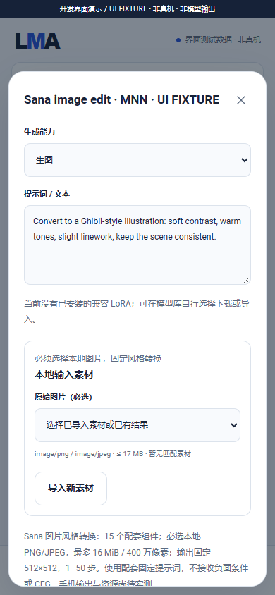
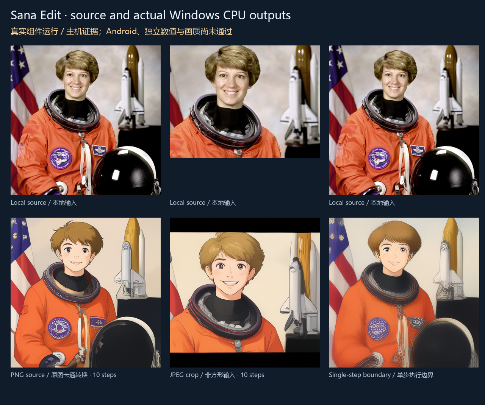

# Sana Edit：本地图片风格转换

本指南保留 dev.36 的实际图片编辑记录。其 39 份报告和状态已按原字节归档于 [dev.36 历史](../verification/history/0.3.0-dev.36/status.json)；当前开发与完整待办见 [dev.37](releases/v0.3.0-dev.37.md)。Sana Edit 不替代冻结 04 文生图。

[English](MNN_SANA_EDIT.en.md) · [文档导航](README.md) · [dev.36 编号交付及全部待办](releases/v0.3.0-dev.36.md)

## 1. 能力更正与边界

`taobao-mnn/MNN-Sana-Edit-V2` 的配套应用将其用于**输入图片的固定卡通风格转换**，并非通用文生图。此前 dev.35 的 13 组件文生图分类不准确；其灰图、失败说明与原始产物保留在[历史实验](MNN_SANA_TRAINED.md)，不作为当前图片编辑的成功证据。

依据：[固定上游版本的 Sana 官方说明](https://github.com/alibaba/MNN/blob/35a20ca0995bb7e4a549b7def42c4acb30559a94/apps/sana/README.md)、[Android 配套默认提示词](https://github.com/alibaba/MNN/blob/35a20ca0995bb7e4a549b7def42c4acb30559a94/apps/Android/MnnLlmChat/app/src/main/java/com/alibaba/mnnllm/android/chat/SanaDefaults.kt)。HF 的通用元数据标签不等于实际运行能力。

当前生产配方 `sana_edit_mnn_cpu_v1`：`mnn_diffusion` / CPU，架构 `sana_mobile_edit`、管线 `sana_edit_mnn_v1`，与其他模型平级，标记图片、`image_to_image`、`fixed_style` 及对应基座。**原冻结 04 的 Sana 文生图目标仍未完成；图片编辑不替代该目标。**

## 2. 用户使用顺序

1. 在模型的「全部」或 HF 搜索中打开目标仓库的文件列表，固定所需版本。保留原「推荐」及本地模型管理。
2. 选择「Sana Edit · 本地图片卡通转换」配方。核对建议的配套文件并明确确认；文件名建议不能证明架构兼容。
3. 明确登记模型，查看完整 15 组件下载计划，再自行下载，或明确导入已取得的文件。App 不附模型，也不因更新、搜索或登记而下载权重。
4. 在模型「本地」中管理该模型及其独立参数。选择用于生成，导入本地 PNG/JPEG，在必选的「原始图片」栏选中素材。
5. 表单显示配套的只读固定提示词；不提供负面提示词或 CFG 开关。建议使用正方形图片、512×512、10 步，先进行运行前检查，再明确提交任务。
6. 在共用任务列表查看进度、取消、错误和重试；成功图片进入共用素材/结果管理，可预览、读取或导出。重试创建新任务，历史快照保持不变。

下载、素材导入和本地推理属于不同操作。运行本身不需要联网、ROOT、Termux 或另一个推理设备。开启接口后可接收客户端请求，计算仍必须发生在运行 App 的同一部手机上。后台服务受 Android 及厂商电源管理约束；未实测的手机不能宣称锁屏持续可用。

## 3. 必须完整选择的 15 个组件

固定开发验证身份：仓库 `taobao-mnn/MNN-Sana-Edit-V2`，版本 `dd5955b4e63359b5822fa29a3b3711a112212046`，合计 **1,661,730,284 字节**，约 1.55 GiB；下载与安装还需额外临时空间。完整路径、字节数与 SHA-256 见[资产身份表](../research/mnn_edit_trained/assets.json)。该表只含元数据。

| 角色 | 文件 | 数量 |
|---|---|---:|
| diffusion / diffusion_data | transformer.mnn / transformer.mnn.weight | 2 |
| connector / connector_data | connector.mnn / connector.mnn.weight | 2 |
| projector / projector_data | projector.mnn / projector.mnn.weight | 2 |
| vae / vae_data | vae_decoder.mnn / vae_decoder.mnn.weight | 2 |
| vae_encoder / vae_encoder_data | vae_encoder.mnn / vae_encoder.mnn.weight | 2 |
| llm / llm_data | llm.mnn / llm.mnn.weight | 2 |
| llm_config | llm_config.json | 1 |
| tokenizer | tokenizer.txt | 1 |
| meta_queries | meta_queries.mnn | 1 |

旧 13 组件的声明、文件、设置与任务保留，不静默迁移、换 ID 或改写其任务。执行旧文生图配方时会明确提示不兼容。用户必须自行选择新的 15 组件配方及缺少的图像编码器；相同内容的已安装组件可以被存储层复用，仍须确认新模型登记和下载计划。

## 4. 图片、参数与接口约束

| 项目 | 当前约束 |
|---|---|
| source_image | 必选的已导入 PNG/JPEG；最多 16 MiB、4,194,304 像素 |
| 输出尺寸 | 宽、高均固定 512；编辑超限会归位为配方上限 |
| 提示词 | 配套固定提示词；界面只读，API 自定义文本会被拒绝 |
| 负面条件 / CFG / LoRA | 本配方不接受；不会静默丢弃用户提交的条件 |
| steps | 1–50，默认 10；单步只用于执行边界验证，不代表质量达标 |
| threads | 1–32，默认 4；实际速度/内存需具体手机验证 |
| maxInputTokens | 1–1792，默认 512；包含编码器格式前缀，预算过小明确失败 |
| seed | -1 随机或 0–2,147,483,647；实际种子写入执行记录 |

非正方形图片按匹配的上游图片流程填充/缩放，输出仍为正方形。尚未验证所有相机 EXIF 朝向、色彩配置或超大图片；先导出为正确朝向、适当尺寸的 PNG/JPEG。不能把图片输入解释为通用指令编辑、任意风格或任意原版 Sana 权重支持。

使用[共用 API](API.md)的 `POST /v1/jobs/preflight`、`POST /v1/jobs`，任务类型仍为 `image.generate`。`input.artifacts` 必须包含 `{ "role": "source_image", "artifactId": "已导入的素材 ID" }`，`input.prompt` 必须等于引擎输入 schema 中的 `fixedPrompt`。不能提交文件系统路径代替素材 ID。服务保存素材哈希、元数据及冻结参数，执行时重新校验并租用素材；正在使用的素材不可删除。

App 将已验证的素材内部路径交给签名内置 worker。worker 在模型分配前检查真实 PNG/JPEG 头、文件体积与像素上限，并检查实际解码结果；不执行模型附带任意配置、Python、外部程序或网络推理。失败不发布结果，取消结束实际子进程并释放工作目录；成功结果保存其来源素材和参数。

## 5. 当前证据与复现





[实际产物 MP4](media/development/sana-edit-trained/sana-host-outputs.mp4) · [GIF](media/development/sana-edit-trained/sana-host-outputs.gif) · [原始 PNG 结果](media/development/sana-edit-trained/01-a.png)。这些是原生 Windows CPU 的实际模型输出及产物展示，**不是 Android 录屏**。素材为 NASA 公有领域宇航员样例，[来源与说明](../tests/fixtures/images/LICENSE.md)。图片编辑样例保留了人物、服装及场景，但改变了外观细节；这不证明全面身份保持或最终质量。

原生检查覆盖 PNG/JPEG、非方形输入、固定提示词、采样步数、缺少/损坏/超限图片、错误管线、缺少图像编码器、token 预算和恢复。生产 Java 检查覆盖完整用户组件导入、独立参数归位/重启、素材导入/租用、不可变任务、实际采样取消、恢复、结果发布/重启/来源保存和用户删除素材。界面检查使用明确标记的测试数据，与训练模型执行分别留证。

在已有原生 Windows 工具链的项目目录中显式执行；开发模型只保存在忽略的 build 目录，不进入 APK：

```powershell
python tools/fetch_mnn_edit_trained.py --download --origin https://huggingface.co
python tools/build_mnn.py
python tools/test_mnn.py
python tools/test_mnn_edit_trained.py
python tools/test_mnn_edit_app_host.py
python tools/export_mnn_evidence.py
python tools/render_mnn_edit_trained.py
```

下载前需自行核对模型许可与来源。可明确选择工具支持的公开镜像；默认不自动下载。Android 编译与主机使用相同生成管线文件，仍不能代替 Android 实际运行、数值参考对齐、质量、资源、锁屏或持续接口验收。所有冻结范围与原失败保持，详见[完整待办](releases/v0.3.0-dev.36.md)。
