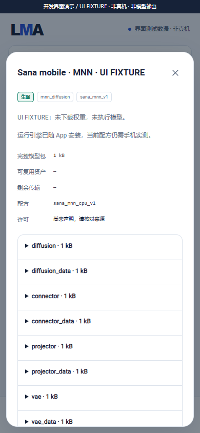
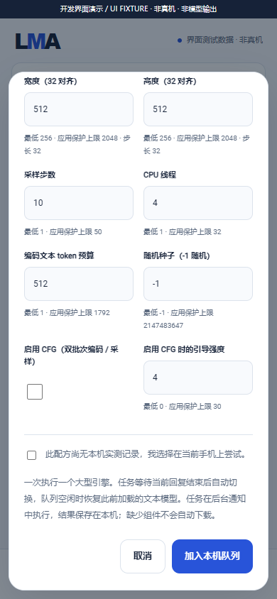

# Sana mobile pipeline and local MNN engine

[中文](MNN_SANA_ENGINE.md) · [Complete release requirements](MULTIMODAL_RELEASE_PLAN.en.md) · [HF components](HF_RECIPES.en.md) · [Development status](DEVELOPMENT.en.md)

Internal checkpoint **0.3.0-dev.14 / code 18** adds a real MNN CPU worker and production Java job binding. This is selection 04's explicitly matched MNN mobile alternative, **not a universal loader for original Sana 600M**. Native compilation, host protocol and APK checks exist; Android image generation, quality, speed, memory and background endurance remain unverified. Complete v0.3.0 is unpublished.

## Foundation and user assets

The APK adds engine code, data recipes, parameters and licenses. It contains no weights, model tokenizer, meta queries or voices. Recommended `m08 → m06 → m01` is preserved. The new template triggers no downloads.

In All/search, open HF files, select `Sana mobile · Qwen3 + MNN`, and choose all 13 matching components. Declaring the manifest only opens the complete download plan; the user separately starts downloads or imports files that pass integrity checks. Local provides independent settings, pause/resume, updates, import and deletion. Browsing, App upgrades, missing files and job submission never implicitly download assets.

Tags are `task:image`, `text_to_image`, `engine:mnn_diffusion`, `pipeline:sana_mnn_v1`, `backend:cpu` and component formats `mnn / mnn_data / json / text`. This is a peer of text/audio/video entries. Installed assets, available engines and physical-device validation remain separate states. The template does not automatically add an Uncensored tag.

## Exact match and components

The reference is official [MNN-Sana-Edit-V2](https://huggingface.co/taobao-mnn/MNN-Sana-Edit-V2), with metadata inspected at `dd5955b4e63359b5822fa29a3b3711a112212046`. This identifies the matching pipeline; it is **not a built-in download or an inference-tested model**. Users must check each selected revision and component license; the inspected model card declares Apache-2.0.

| Roles | Controlled runtime filenames |
| --- | --- |
| `diffusion / diffusion_data` | `models/transformer.mnn / transformer.mnn.weight` |
| `connector / connector_data` | `models/connector.mnn / connector.mnn.weight` |
| `projector / projector_data` | `models/projector.mnn / projector.mnn.weight` |
| `vae / vae_data` | `models/vae_decoder.mnn / vae_decoder.mnn.weight` |
| `llm / llm_data` | `llm/llm.mnn / llm.mnn.weight` |
| `llm_config` | `llm/llm_config.json`, read and rebuilt through a whitelist |
| `tokenizer` | `llm/tokenizer.txt`, matching MNN tokenizer format |
| `meta_queries` | `llm/meta_queries.mnn` |

Each graph and its `.weight` must belong to the same export. This recipe implements text-to-image only; image editing, image-to-image and LoRA do not follow automatically from upstream capabilities. It requires no VAE encoder and accepts no arbitrary outer `config.json`. Original Sana, SD VAEs, generic HF tokenizers and different Qwen3 exports are not interchangeable merely because extensions match.

## On-phone execution and settings

1. The native process uses the matching Qwen3-0.6B prompt format and appends 256 meta queries. CFG encodes positive and negative branches. The formatted input must fit the selected token budget; excess input fails instead of silently truncating.
2. It verifies float features shaped `[1 or 2, 256, 1024]`, copies independent constants, releases the encoder, and then loads connector/projector/transformer/VAE decoder.
3. The actual upstream feature-input sampling path writes PNG. Shared on-phone scheduling, foreground notification, cancellation, model leases and artifact validation apply. No remote execution or fallback exists.

| Per-model setting | Range / default |
| --- | --- |
| Width / height | 256–2048, multiples of 32; default 512. Implementation limits do not establish available phone memory. |
| Sampling steps | 1–50, default 10 |
| CPU threads | 1–32, default 4, passed to encoder and diffusion |
| Input token budget | 1–1792, default 512, including prompt formatting; another 256 meta queries are reserved |
| `useCfg / cfg` | Disabled / strength 4 by default, strength 0–30. Negative conditioning requires explicit CFG and increases batch/resource use. |
| Seed | -1 for a recorded random seed, or 0–2147483647 |

Editable presets belong to the selected model. Generic validation and the Sana policy clamp values into a frozen `diffusionPlan`, which is recalculated before execution. Task adjustments do not overwrite saved preferences; settings edits affect future jobs. Native policy checks run again.

## Configuration isolation and builds

Only Qwen3 type, 1024 hidden size, float/full attention and a range-checked tied embedding layout survive metadata sanitization. Jinja is not executed. Arbitrary base directories, filenames, cache/network flags and other configuration are never merged. LMA writes a fixed-path CPU config. Private workspaces hardlink leased verified components without copying large weights or modifying installed files. Cleanup waits for actual child exit; startup reconciles owned orphan directories.

MNN is pinned at [35a20ca](https://github.com/alibaba/MNN/tree/35a20ca0995bb7e4a549b7def42c4acb30559a94). Native Windows NDK r30/CMake/Ninja build API 28 ARM64 `liblma-mnn.so` with 16 KiB alignment, without Docker, WSL or an emulator. Generated overlays add load guards, formatted token limits, bounded thread settings and required-module checks while preserving a clean upstream checkout. HTTP resources, Logcat, OpenCL, Vulkan, ARM82 and OpenMP are disabled. Upstream diagnostics are isolated; only structured worker events leave the process.

```powershell
python tools/fetch_mnn.py
python tools/build_mnn.py
python tools/collect_mnn_notices.py
python tools/test_mnn.py
python tools/build.py
python tools/verify_package.py
```

Use the [build prerequisites](BUILD.en.md), including the pinned sd.cpp JSON header, native Windows tools, Java and the test JSON jar. Source/header/notice/ELF hashes are locked. Build tools download source code, never models. Host C++ checks require MSVC.

## Evidence limits

74 Sana checks cover the production Java contract/policy/configuration, actual host protocol children, hardlinks/deferred cleanup and 15 shared native C++ policy assertions. The host child intentionally writes only a `JSON_NOT_AN_IMAGE` protocol fixture. It runs neither MNN nor a model and proves no image generation. Shared backend, HF metadata, UI, Lint, APK and asset-separation checks are additional.




Screenshots, [recording](media/development/foundation-ui.mp4) and [GIF](media/development/foundation-ui.gif) use actual shipped HTML/CSS/JS with an explicit demonstration bridge. They show no installed or executed model. Offline fresh-input Android output with every reference component, repeated load/unload, quality/resources, screen-off endurance and upgrades remain required within the same complete v0.3.0.
