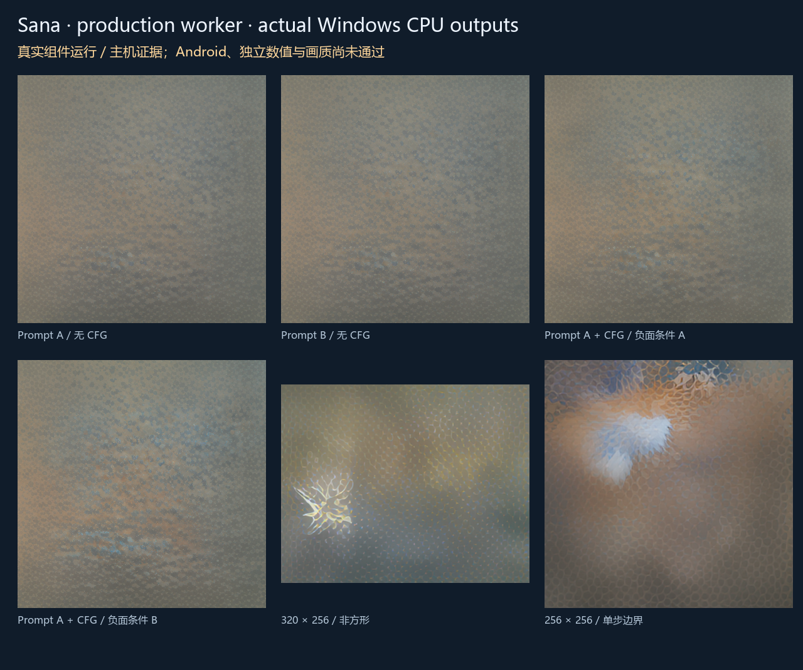

# Sana 真实组件与生产执行链路

[English](MNN_SANA_TRAINED.en.md) · [引擎与参数](MNN_SANA_ENGINE.md) · [配套文件选择](COMPONENT_SUGGESTIONS.md) · [本轮交付与完整待办](releases/v0.3.0-dev.35.md)

dev.35 / code 39 把匹配的 Sana 移动变体推进到真实组件执行与生产 Java 导入、运行、取消、恢复验证。这里的实际执行发生在原生 Windows CPU；Android 是同源 ARM64 编译，尚未真机执行。图片文件存在不能代替提示词一致性、独立数值参考或画质验收。

## 模型与 App 的关系

App 更新只增加基座代码，不含权重、分词器、meta queries 或其他学习数据。用户可继续选择其他模型；推荐 `m08 → m06 → m01` 不变。Sana 与生文、生音频、生视频模型平级，标签仍为 `task:image`、`text_to_image`、`engine:mnn_diffusion`、`pipeline:sana_mnn_v1`、`backend:cpu`。

本次开发验证使用 [MNN-Sana-Edit-V2 固定版本](https://huggingface.co/taobao-mnn/MNN-Sana-Edit-V2/tree/dd5955b4e63359b5822fa29a3b3711a112212046) 的 13 个完整组件，总计 **1,505,181,194 字节**，逐文件完整 SHA-256 校验。[公开身份锁](../research/mnn_trained/assets.json)只有来源、路径、长度和哈希；实际文件保留在忽略的构建目录。它不是原版 Sana 600M 的任意权重加载能力，也没有新增图像编辑、图生图或 Sana LoRA 支持。模型卡标记 Apache-2.0，用户仍需核对所选版本及组件许可。

## 用户操作

1. 在模型“全部 / 搜索”中打开匹配的 HF 仓库和版本，选择 `Sana mobile · Qwen3 + MNN` 配方。
2. 绑定 transformer 主文件，点击“检查配套文件”，检查固定版本的 13 个角色、文件大小及校验信息。歧义和缺件手动选择；用户确认前不会绑定建议。
3. 确认组件后，单独登记模型，查看完整下载计划，再明确下载；也可以导入已经取得的匹配文件。登记、浏览、升级或提交任务不会隐式下载。
4. 在“本地”管理该模型及独立参数，在生成工作台选择该模型并提交任务。任务固定本次参数；修改偏好只影响后续任务。用户可以取消，再明确重试。
5. 在任务详情查看阶段、有效参数、错误及最终 PNG；下载暂停、续传、更新、导入和删除继续沿用共用资产管理。当前手机运行、画质和资源能力仍需验收，页面不会把下载完成等同手机可用。

开发者已有的测试文件不是用户必须准备的前置环境。App 不需要 Python、Windows、Termux、ROOT 或其他设备；生产编码、扩散、VAE 解码与 PNG 写入均设计为同一 Android 本地执行，无外部执行回退。

## 本轮修复

| 项目 | 之前的实际问题 | 当前代码 |
|---|---|---|
| 文本条件 | 上游 Sana helper 选择整数 mask，而匹配导出的 attention mask 声明为浮点 | 使用浮点 additive causal mask，保留 padding 与位置关系 |
| CFG | 导出的 Qwen 内部 batch 固定为 1；双条件一次送入在真实运行中失败 | 正、负条件分别用新的编码器实例执行，复制独立的 `[1,256,1024]` 有限浮点特征，再拼成扩散所需双条件 |
| 采样进度 | 上游接受回调但没有在循环内调用 | 等待每一步实际计算结束后报告进度，生产 Java 可以在采样中取消 |
| 单步边界 | 时间步公式除以 `steps - 1` | 单步选择与多步起点一致的高噪声时间步，避免除零 |
| 写入失败 | 上游最终无条件返回成功 | 返回真实图像写入结果，失败不发布产物 |

两个编码器实例均在扩散组件加载前释放。安装的 metadata 不被改写；生产 Java 只提取批准字段，生成受控相对路径配置，通过临时硬链接提供组件，并在子进程退出后清理。上游源码保持固定且干净，覆盖文件由同一生成函数产生，主机与 Android 的两份生成文件逐字节哈希一致。没有模型 ID 专属的页面或任务队列分支。

## 验证和局限

原生验证覆盖提示词 A/B/A、CFG、不同负面条件、非方形、单步、输入预算、缺组件、无效输出位置、错误管线与恢复。生产 Java 验证通过实际 HF 配方构造、用户文件导入、完整 SHA、独立参数归位、重启保留、不可变快照、真实采样中取消与恢复，并核对主机直接运行和 Java 链路的像素关系。

非均匀像素、同机重复结果与参数影响检查属于执行控制，**不是图像质量指标或独立原始参考**。本轮观察到非 CFG 和 CFG 的 512×512、10 步样例均未呈现提示词要求的主体；必须保留该画质问题，不能因流程检查通过就宣告编号 04 完成。CPU 时间和内存如见于收据，均是桌面测量，不能推算努比亚 Z20 的速度或资源需求。所有冻结目标及原 LCM / LTX 数值失败仍属于同一完整 v0.3.0。



[原始产物展示 MP4](media/development/sana-trained/sana-host-outputs.mp4) · [GIF](media/development/sana-trained/sana-host-outputs.gif)。它们是带标记的真实产物幻灯展示，不是手机录屏。公开收据见[验证索引](../verification/development/status.json)。

## 本地开发复现

```powershell
python tools/fetch_mnn_trained.py --download
python tools/build_mnn_host.py
python tools/test_mnn_trained.py
python tools/test_mnn_app_host.py
python tools/build_mnn.py
python tools/collect_mnn_notices.py
python tools/test_mnn.py
python tools/export_mnn_evidence.py
python tools/render_mnn_trained.py
```

仅第一条带 `--download` 的开发命令取得模型；不带该参数时只验证已有文件。受限网络可明确选择 `--origin https://hf-mirror.com`，但必须保持同一固定提交、大小与完整 SHA，不能以镜像可下载代替身份检查。其余命令不下载模型，不由 App 调用。工具使用原生 Windows MSVC / NDK，不调用 Docker、WSL、虚拟机或模拟器。
