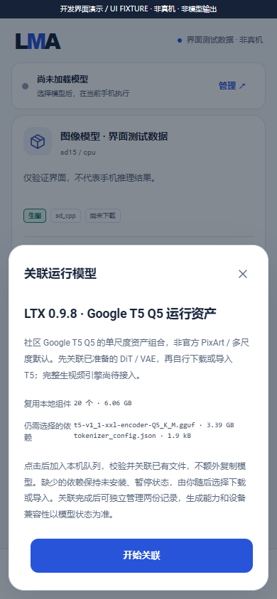
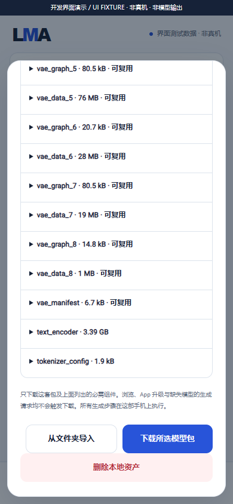

# User-selected runtime model association

[中文](MODEL_ASSEMBLY.md) · [Source preparation](MODEL_PREPARATION.en.md) · [Complete release scope](MULTIMODAL_RELEASE_PLAN.en.md) · [Numbered handoff](releases/v0.3.0-dev.23.md)

dev.23 adds the generic `model.assemble` task. The APK delivers association plans, storage and execution infrastructure; users choose source models, prepared data, runtime models and remaining dependencies. Installation, upgrades, browsing and missing-asset requests never start model downloads. Associating assets does not establish generation support.

## User workflow

1. Select a source model in All and explicitly download or folder-import it. Existing Recommended entries retain their order and labels.
2. In Local → Runtime assets, review preparation and its storage requirement, then explicitly start. Original weights and settings are retained.
3. After preparation succeeds, open the association review. Check the target model, reused files and missing dependencies; browsing starts no conversion or download.
4. Start association to enter the shared local queue. The App fully verifies prepared files and associates selected components with a separate runtime model record.
5. Manage the runtime record in Local. Missing dependencies remain paused and uninstalled until a separate explicit download or folder import; verified components are reused.
6. Complete installation and a registered generation engine are separate conditions. Generation also requires valid parameters/inputs; device evidence remains separately labeled.

## First pinned candidate

`ltx098_runtime_google_q5_v1` contains runtime assets for **old LTX-Video 2B 0.9.8 distilled with community Google T5 Q5, single scale**. It does not represent the official PixArt encoder or the default multiscale/upscaler/prompt-enhancement recipe. Evidence for different weights or recipes is not interchangeable.

| Components | Identity | Bytes | Acquisition decision |
| --- | --- | ---: | --- |
| DiT GGUF, 9 VAE ONNX graphs, 9 external weight files and manifest: 20 files | Existing `ltx098_dit_vae_v1` outputs; exact roles, paths, sizes and SHA-256 digests | 6,061,184,991 | User obtains source weights, explicitly prepares, then associates |
| `t5-v1_1-xxl-encoder-Q5_K_M.gguf` | `city96/t5-v1_1-xxl-encoder-gguf`, revision `005a6ea51a7d0b84d677b3e633bb52a8c85a83d9` | 3,386,856,640 | Explicit user download or import |
| `tokenizer_config.json` | `google/t5-v1_1-xxl`, revision `3db67ab1af984cf10548a73467f0e5bca2aaaeb2` | 1,857 | Explicit user download or import |

Retaining the original source, prepared files and both T5 dependencies uses 15,788,787,980 bytes of model data; hardlinks do not add another 6.06GB copy. Preparation/download reserves and other models/system storage are additional.

All 22 identities appear in the [pinned catalogue](../catalogue/model-bundles.json) and [association plan](../catalogue/model-assemblies.json). These reuse previously measured trained assets and pinned provenance; this update does not claim a fresh online HF verification. The 20 derived files have no download URL: they require matching local preparation or explicit folder import. Download remains disabled while non-downloadable derived components are missing.

The candidate has `video`, `runtime_assets`, `derived_assets`, `community_google_t5_q5` and `single_scale` tags, `runtime_assets_only` evidence and `generationSupported=false`. It is a peer of text, image and audio models. The `ltx098_native` generation engine remains unregistered; association does not enable generation.

## Shared foundation contracts

| ID | Implementation | Boundary |
| --- | --- | --- |
| A01 | APK-signed `lma.model-assembly/1` descriptors | Only source/target/preparation IDs and role mappings; no user code, paths or URLs |
| A02 | Runtime-computed binding to preparation and target manifests | Sizes and SHA-256 identities must match; unique mappings prevent component substitution |
| A03 | Shared TaskInput, JobStore, LocalJobs and execution slot | Immutable requests, idempotency, duplicate active-target protection, resident-text parking, two-hour guard, cancellation and explicit retry |
| A04 | Full prepared-file hashing and read leases | Waiting/running jobs protect source records; target records have existing job-reference protection |
| A05 | `BundleStore.adoptAvailableLocal` | Reuses owned files through same-filesystem private hardlinks, without copying model bytes or invoking a downloader; unsupported filesystems fail with originals retained |
| A06 | Atomic object/metadata publication | Incomplete models remain paused/uninstalled with no transfer token; existing model settings survive |
| A07 | Independent ownership | Removing preparation preserves runtime hardlinks and vice versa; disk bytes shared with another owner are not necessarily freed by deleting one record |
| A08 | Cancellation and recovery | Pre-commit cancellation advertises no installation; a late cancellation may retain verified associations (paused while dependencies are missing) while the job stays cancelled with no successful media; restart never resumes downloads and later leases fully hash files |
| A09 | API and receipts | `/v1/models` exposes selected partial records with actual installed/reusable/remaining fields; prepared records include assembly options; completion produces an association receipt, not media |

The foreground service, wake lock and shared execution slot are existing foundations. No ROOT, external execution, remote inference or ComfyUI graph/plugin system is added. Source code alone does not establish indefinite background survival on vendor Android builds.

## API

Read the current plan fingerprint from `prepared_assets[].assemblyPlans[]` in the model listing, then explicitly submit through `POST /v1/tasks`:

```json
{
  "type": "model.assemble",
  "bundleId": "ltx098_runtime_google_q5_v1",
  "preparedAssetsId": "prep_<32 hexadecimal digits from the current record>",
  "assemblyId": "ltx098_google_q5_runtime_v1",
  "assemblyFingerprint": "<current plan fingerprint>"
}
```

Use existing task endpoints for status and cancellation. The service freezes `assemblySourceFingerprint`; clients cannot inject it. Explicit retry revalidates current source identity. This task neither downloads T5 nor executes an encoder, model API or video generation.

## Verification and complete delivery

Forty-seven production-core Java contracts cover strict requests, changed identities, same-size/time tampering, hardlinks, settings, waiting/active references, cancellation, atomic state, independent deletion and restart. The trained host association check verifies all 20 actual hardlinks and exactly 3,386,858,497 bytes of missing T5 dependencies. Shared queue/API checks use host Android framework ports. Screenshots, recording and GIF are explicitly UI FIXTUREs.

These establish no Android installation, SAF/private-filesystem association, generation, quality, resource or background-endurance acceptance. **Six prior full old-LTX host float gates still fail.** F-01–F-12, existing text, all frozen 01–14/16/17 subtargets, three load/unload cycles, 15-minute screen-off, one-hour alternating API, upgrade retention and A1–A11/R01–R05 remain in the same complete v0.3.0. Scope has not been reduced or moved into later releases. No phone is available and no complete Release is published.





[Recording](media/development/foundation-ui.mp4) · [GIF](media/development/foundation-ui.gif) · [Verification](../verification/development/status.json)
