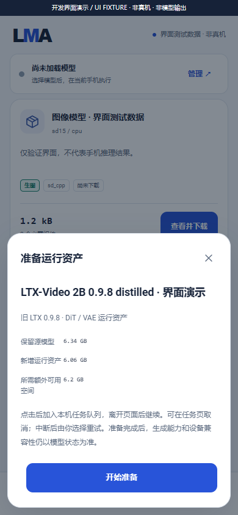

# 用户选择的本地运行资产准备

dev.28 将同一准备基座扩展到 [LCM 固定条件](LCM_APP_FLOW.md)：按阶段输出字节传递预算，保留独立磁盘余量；用户明确关联后自行选择缺失依赖。下文保留 dev.22 的旧 LTX 路径与独立验收范围。

[English](MODEL_PREPARATION.en.md) · [文档目录](README.md) · [编号交付](releases/v0.3.0-dev.22.md)

**dev.22 / code 26 是内部开发检查点，完整 v0.3.0 尚未发布。** 本轮将已有的原生准备器接入 App 的共享任务基座。完整训练文件的转换在 Windows 主机通过；Android 安装、SAF、准备执行和后台耐久仍待真机验证，生视频引擎尚未登记。

## 用户操作

1. 在模型库“全部”选择 **LTX-Video 2B 0.9.8 distilled** 的源模型条目，查看版本、许可、文件身份和大小。生视频标签描述目标功能，不表示当前可生成。
2. 用户自行选择下载，或使用文件夹导入原始 `ltxv-2b-0.9.8-distilled.safetensors`。使用已有的组件传输与 SAF 流程；下载失败保留状态，恢复需用户明确操作。安装、升级、浏览目录和缺组件检查均不自动下载。
3. 源文件完整安装后，在“本地”打开该模型的“运行资产”，查看准备方案。App 不会因安装完成而自动转换。
4. 确认保留源文件，并留出额外 **6,195,402,719 字节**空间：20 个运行文件合计 **6,061,184,991 字节**，另有 128 MiB 保留空间。原始文件另占 **6,340,744,492 字节**；两者及保留空间合计约 **12.54 GB**，未计 T5、其他模型和系统空间。
5. 点击“准备运行资产”，在“任务”查看进度、取消或明确重试。服务串行执行，与文本及生成任务共用执行槽；进入准备前暂停驻留文本执行。低内存、过热、空间不足或文件身份不符时在本机失败。
6. 准备成功后，在模型详情管理派生运行资产。它们与源文件、模型参数及生成结果分别保存。删除运行资产保留源文件和设置；删除源文件后，剩余运行资产仍显示在“本地”，可以继续管理。

源候选只包含原始 checkpoint。dev.23 可通过[运行模型关联](MODEL_ASSEMBLY.md)显式复用 20 项派生资产，再由用户主动取得 T5 两项依赖；生产视频适配器仍未接入。准备不会启用不存在的生成按钮，也不会下载其他依赖。不支持把任意其他模型文件套用此转换方案。

## 基座结构

| 层 | 实现与约束 |
| --- | --- |
| 签名方案 | `asset-preparations.json` 是随 App 交付的版本化代码合同，指定源角色/大小/SHA256、阶段、准备模块及输出身份；不执行用户提交的脚本、路径或模块 |
| 程序登记 | `engine-builds.json.preparations` 与生成引擎独立；两个 ARM64/API28/16KiB 原生程序均核对大小/SHA256 |
| 数据边界 | APK 含九份经审计的无模型参数 ONNX 结构图，共 402,231 字节；138 个学习参数输入均由外部用户文件提供，学习时间乘数与通道统计不写入图 |
| 请求冻结 | `model.prepare` 只接受用户所选 bundle、方案 ID、方案指纹；服务器补充源包身份，排队后不跟随界面选择改变 |
| 生命周期 | `LocalJobs` / `JobStore` / `ExecutionGate` / 前台服务复用；源文件保持租约，取消/进程回收完成后才释放工作目录和执行槽 |
| 子进程 | 内部路径与固定程序登记；限长消息、完整回执和逐文件校验；Android 父进程结束时内核终止准备器，防止孤儿进程继续写入 |
| 派生存储 | `PreparedAssets` 私有目录、独占锁、原子索引、读租约、每次获取重新校验；启动清理自有未完成数据，已完成资产独立保留 |
| 发布边界 | 完成准备产生 `preparation` 回执，不伪造图像/音频/视频产物，不代表模型推理、质量或真机验收 |

首个方案 `ltx098_dit_vae_v1` 只接受固定原始文件 SHA256 `76aa8c4786af752fa6f951947129d5290c3c6c0b2fadcadea6b5e114ae2cad8f`。阶段一生成 DiT GGUF；阶段二生成九图、九份参数数据及 manifest。新架构需增加受信任的准备程序/合同，列表、任务队列和存储无需按模型 ID 分叉。

源文件是开发阶段已显式取得并完整验证的 checkpoint。本轮源候选沿用其固定发布者 revision 和已测字节身份；未声称重新完成官方 HF 在线下载验证。用户的实际下载或导入仍须通过完整 SHA 校验。

## API

已安装源模型或只剩派生资产的本地记录通过 `GET /v1/models` 返回 `preparation_plans` / `prepared_assets`。`installed` 仍表示源组件是否完整，不会因为派生文件存在而改为 true。准备模块不冒充生成引擎。

从模型记录取得当前方案 `fingerprint` 后，显式 `POST /v1/jobs`：

```json
{
  "type": "model.prepare",
  "bundleId": "ltx098_source_r8984fa2",
  "preparationId": "ltx098_dit_vae_v1",
  "planFingerprint": "45c36668b83f7ce989720fc4144992cf3d99ab9b3e989ba34345c856a0922131"
}
```

请求使用现有鉴权、幂等键、查询、事件、取消和重试接口。不要传入本机路径、下载 URL、模块名或生成参数；它们会被拒绝。方案更新后应重新查看并明确提交当前指纹。当前独立删除准备资产通过 App 完成；未增加通用文件删除 API。

## 验证与复现

`python tools/test_preparations.py` 的 44 项检查覆盖严格请求、文件篡改、错误回执、取消、租约、恢复和四个实际协议夹具子进程。它们不是模型测试。`python tools/test_preparations.py --trained` 让生产 Java 核心采用已有完整 checkpoint，实际调用两个主机原生程序；20 个结果与签名方案全部匹配，源文件保留。该运行约 1,126 秒；未测 Java/Android 峰值内存，不能用准备器的局部主机内存数字推算手机需求。

原生 DiT/VAE 另有独立字节对照、拒绝用例及四次实际训练 VAE 解码。已有完整提示词视频的 **六项浮点误差门槛仍失败**，不因转换通过而关闭。见 [DiT 准备](LTX098_PREPARE.md)、[VAE 准备](LTX098_VAE_PREPARE.md)和[完整管线](LTX098_PIPELINE.md)。

| 证据 | 本轮边界 |
| --- | --- |
| 主机生产核心 | 一次完整训练文件准备、两个原生子进程、20 个完整输出身份通过 |
| APK | dev.22、原签名、29 个原生文件；不含权重、词表或学习参数 |
| UI | 62–65 截图及录像/GIF均为实际分发页面 + 明确桥接夹具，无模型/Android执行 |
| Android / 完整 Release | 未验证；全部冻结范围和 A1–A11 / R01–R05 继续属于同一 v0.3.0 |



[任务截图](media/development/64-preparation-queue.png) · [独立管理截图](media/development/65-preparation-management.png) · [录像](media/development/foundation-ui.mp4) · [GIF](media/development/foundation-ui.gif) · [公开准备验证](../verification/development/preparation-trained.json)
