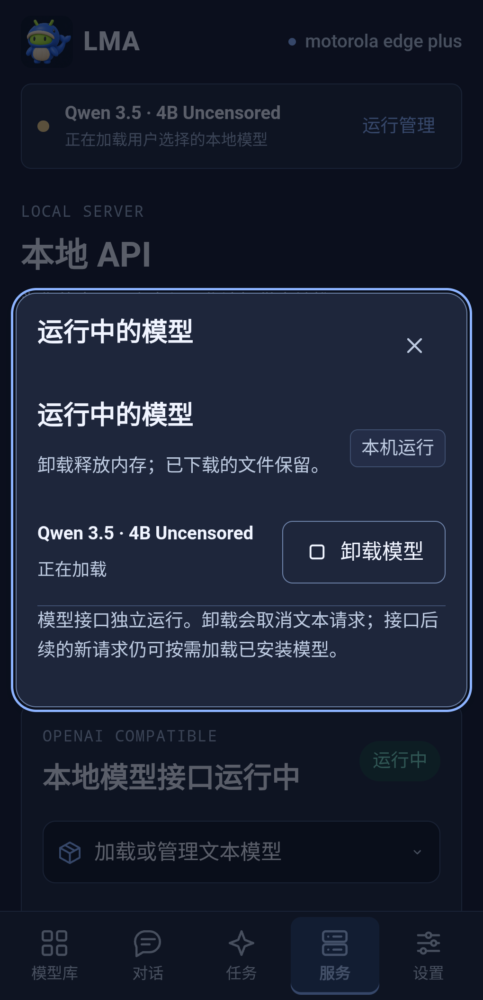
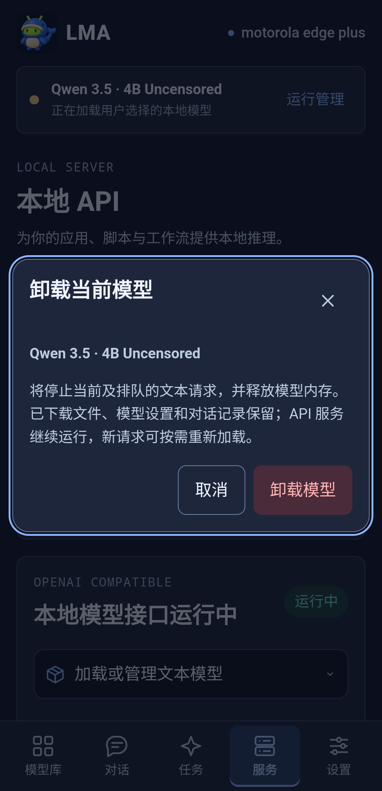

# Running models and Unload · v1.1.0

[中文](MODEL_RUNTIME.md) · [Deleting downloaded files](MODEL_DELETE.en.md) · [DSH/API](DSH_TOOLS.en.md)

## 1. Where to unload

| ID | Entry | Operation |
| --- | --- | --- |
| U01 | Top status strip → **运行管理** (Running models) | Review the resident text model, choose **卸载模型** (Unload), confirm its name |
| U02 | Models → **Local** → loaded text card | Use the labelled Unload button; the separate trash/Delete button manages files |
| U03 | Services → **运行中的模型** | Manage the text resident and temporary generation jobs |
| U04 | Chat's model picker | Inspect current residency and use the same Unload control |

## 2. Memory, files and listener

**Unload** cancels current and queued text requests, stops the native text process, releases model memory and disables desired automatic recovery. Downloaded weights, per-model settings, conversation history and installed catalogue publication remain. Cancelling the dialog does nothing. The native command checks its target to prevent a stale confirmation unloading a newly selected model.

**Delete** removes downloaded files to recover storage, with its own confirmation and transfer/job/asset guards. [File deletion](MODEL_DELETE.en.md) remains independent; Unload does not call Delete.

**Stop API** closes the listener and its text requests; text residency and independent generation jobs have separate controls. Unload keeps the listener. A later explicit client request may load an installed, complete and published model again. Stop the API or the requesting client if further loads must be prevented.

## 3. States and media jobs

Ready text shows “loaded in memory”; loading, recovering and waiting are distinct. When a media task occupies the shared execution slot, text displays suspended/restore-after-task rather than claiming continued residency. Unloading suspended text cancels its restoration without cancelling independent media work.

Image/video/audio/3D engines load temporarily for task execution and release afterward. Running tasks appear with **停止并释放** (Stop and release), confirmation and actual native cancellation/cleanup. Files and completed results remain. Cancellation in progress disables the button; Tasks retains the real state/error.

Mica themes and narrow layouts remain. Runtime status follows services/jobs rather than download status, and a click alone does not establish process cleanup.

## 4. Evidence

Labelled browser fixtures cover entry points, target confirmation, cancellation, file preservation and320–1024px light/dark layouts. Actual screenshots use this signed APK. [Selected physical checks](../verification/releases/v1.1.0/physical-tools.json) separately verify native process exit, surviving API/catalogue reads, explicit API reload and unchanged assets/settings. They do not establish all-model quality or sustained background endurance.
