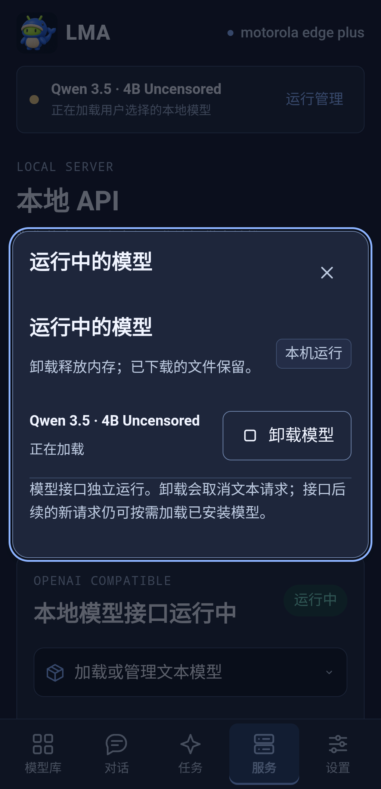
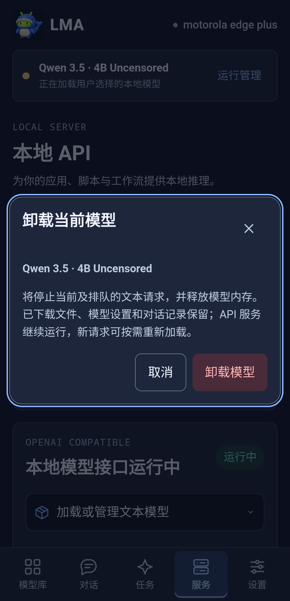

# 运行中的模型与 Unload · v1.1.0

[English](MODEL_RUNTIME.en.md) · [删除下载文件](MODEL_DELETE.md) · [DSH/API](DSH_TOOLS.md)

## 1. 在哪里卸载

| 编号 | 入口 | 操作 |
| --- | --- | --- |
| U01 | 顶部状态条 → **运行管理** | 查看当前文本模型，点击**卸载模型**，核对名称后确认 |
| U02 | 模型 → **本地** → 已加载文本模型卡片 | 直接点击**卸载模型**；旁边的垃圾桶／删除另管文件 |
| U03 | **服务** → **运行中的模型** | 查看文本驻留及临时生成任务，分别卸载或停止 |
| U04 | 对话顶部模型选择 | 查看当前模型状态及同一卸载入口 |

## 2. Unload 和删除的区别

**卸载模型 / Unload** 停止当前及已排队文本请求、释放原生文本进程与模型内存，并关闭其自动恢复意愿。下载权重、逐模型参数、对话历史和目录发布保留。取消确认不执行操作；原生端会核对弹窗指向的模型，避免旧弹窗卸载已经切换的新目标。

**删除 / Delete** 删除本地下载文件、回收存储，需要独立确认并受传输／任务／资产保护。详情见[文件删除](MODEL_DELETE.md)。卸载确认不会调用删除。

**停止接口** 关闭 API 监听与其文本请求；文本驻留和其他独立任务分别管理。卸载模型则保留监听。后续客户端明确请求一个已完整安装且发布的模型时，API可再次加载它；若要阻止后续请求，请停止接口或关闭相应客户端请求。

## 3. 状态与媒体任务

“已加载到内存”表示就绪驻留；加载中／恢复中／等待加载分别显示。媒体占用共用执行槽时，文本显示“暂挂，任务结束后恢复”，不冒充仍占用模型内存。卸载暂挂模型会取消其恢复，不取消独立媒体任务。

生图、生视频、生音频、生3D使用任务生命周期临时加载；任务完成后释放。运行面板列出活动任务，点击**停止并释放**进入确认，取消选中的任务并等待原生清理；不会删除模型文件或已有结果。取消处理中按钮禁用，任务列表保留实际状态及失败原因。

界面沿用云母分区、明暗主题和窄屏适配。它显示的是服务和任务状态，不用下载状态推断模型驻留，也不以按钮点击即宣告进程已清理。

## 4. 验证

浏览器测试使用明确的界面夹具，检查四个入口、确认／取消、正确目标、文件保留及320–1024px明暗布局。真机 UI 材料来自本版精确签名APK。[选择性实机检查](../verification/releases/v1.1.0/physical-tools.json)另外验证确认后原生进程实际退出、API仍可查询、后续请求重载以及用户资产／参数不变，不据此宣告所有模型和长期后台耐久通过。
