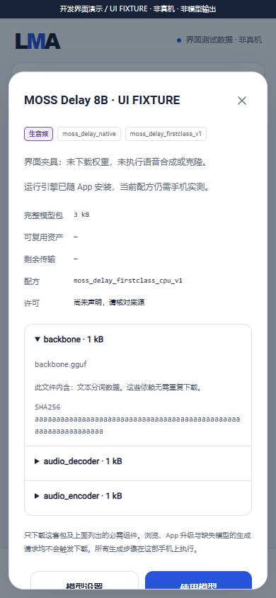
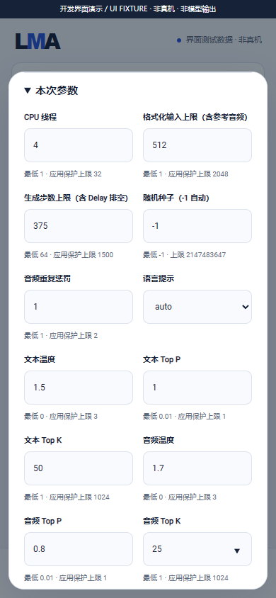

# MOSS Delay：first-class 本机 CPU 语音管线

[English](MOSS_DELAY_ENGINE.en.md) · [用户模型资产](ASSET_CONTROL_AUDIT.md) · [完整版本要求](MULTIMODAL_RELEASE_PLAN.md)

本页记录同一完整 v0.3.0 中的内部开发实现。新增真实 Android ARM64 CPU 引擎，不表示 MOSS 家族九个冻结子目标已全部适配，也不表示任何手机已通过语音、质量、速度或后台验收。App 交付基座；模型、内嵌词表和 codec 均由用户明确选择，不随安装或升级下载。

## 管线、格式与来源

运行顺序为可选参考 WAV → 原生音频编码器 → 主模型内的 BPE / 32 路 Delay 自回归生成 → 去延迟 / 完整音频码提取 → 原生波形解码器 → 24 kHz 单声道 PCM16 WAV。全部阶段在同一手机的签名 App 子进程中执行；不调用 Python、ROOT、Termux、其他设备或远程推理。

源码固定为 [OpenMOSS/llama.cpp](https://github.com/OpenMOSS/llama.cpp/tree/b785003ba497794ecfa337c3e47f01af79489888)，revision `b785003ba497794ecfa337c3e47f01af79489888`，MIT。LMA 从固定的 `tools/tts/run-moss-tts-delay.cpp` 提取已核对的原生算法；排除 CLI、Python / ONNX 包装器、shell helper、原始 codes 文件输出和上游宽松 WAV 读取器。BPE 的两个辅助操作直接调用 llama API，未链接 common 的下载 / 网络代码。提取器与完整源文件 SHA256 受 [source lock](../third_party/moss-delay-source-lock.json) 约束，原始 checkout 不修改。

**仅接受 first-class 转换布局。** 普通 `OpenMOSS/MOSS-TTS-GGUF`、只有 Qwen3 backbone 的 GGUF、Nano / Local / Realtime 和 v2 codec 都不能替代本配方。[上游说明](https://github.com/OpenMOSS/llama.cpp/blob/b785003ba497794ecfa337c3e47f01af79489888/docs/moss-tts-firstclass-e2e.md)明确区分这些格式；相同扩展名不能证明兼容。

当前原生契约是 8B / hidden 4096 / 36 层 / 32 个音频量化通道 / codebook 1024 / 24 kHz / hop 1920。加载前核对 GGUF 架构、维度、BPE 数组、32 组音频 embedding 和输出头、codec 元数据；此布局检查不证明 checkpoint 的来源、质量或各家族成员的效果。需要原版 MOSS-TTS 1.0 对应转换作为该子目标的最终验收资产。其他冻结成员继续逐项适配与验收。

## 用户选择与管理

在“全部 / 搜索”选择 GGUF 后使用 **MOSS Delay 8B · first-class 原生语音** 配方，明确选择以下组件，核对下载计划并点击下载；也可通过本地模型包文件夹导入已转换的数据。此检查点没有把尚未核对的公共 GGUF 当作固定推荐候选。

| 组件角色 | 必需性 | 用途 |
| --- | --- | --- |
| `backbone` | 必需 | 完整 first-class 主模型；BPE、32 路音频 embedding / 输出头包含其中，`provides` 明示分词依赖 |
| `audio_decoder` | 必需 | 配套 `moss-tts-audio-decoder` GGUF；24 kHz / 32 路 |
| `audio_encoder` | 可选 | 配套 `moss-tts-audio-encoder` GGUF；仅参考音频路径需要 |

没有选择编码器时，普通 TTS 仍可运行，任务表单不显示参考音频选择。需要参考能力时，用户重新选择包含编码器的完整配方 / 独立模型包更新；App 不补下缺失组件。参数、任务和结果仍在“本地”及共用任务 / 结果库管理。推荐 `m08 → m06 → m01` 保持原顺序。

平级标签为 **生音频 / TTS**，并分别列出 `moss_delay_native`、`moss_delay_firstclass_v1`、`moss_delay_8b_v1`、GGUF、CPU 与组件依赖；安装状态和设备验证独立标记。该语音路由不自动添加音效、音乐、Realtime、多说话人或完整家族支持标签。

下图使用实际页面和明确模拟的已安装状态；未下载模型、未生成语音：



## 参数与输入约束

参数随模型保存；可编辑数值超限会回填，提交后固定快照，Java 和 C++ 再核对。下列限制是当前基座的应用保护范围，**不是手机实测能力或发布方训练上限**。

“模型设置”保存该模型的默认值；“使用模型”中的本次参数只覆盖当前任务，不能隐式改写模型默认值。

| 参数 | 默认 | 应用范围 |
| --- | --- | --- |
| CPU 线程 | 4 | 1–32 |
| 格式化输入上限 `maxInputTokens` | 512 | 1–2048，包含模板和参考音频占用 |
| 生成步数 `maxNewTokens` | 375 | 64–1500，包含 32 路 Delay 排空，不等于最终音频帧数 |
| 文本温度 / Top P / Top K | 1.5 / 1 / 50 | 0–3 / 0.01–1 / 1–1024 |
| 音频温度 / Top P / Top K | 1.7 / 0.8 / 25 | 同上 |
| 音频重复惩罚 | 1 | 1–2 |
| 随机种子 | -1 | 自动，或 0–2147483647；实际种子进入执行记录 |
| 语言提示 | auto | 表单中的发布方语言代码；auto 使用无指定提示，不代表语言质量已验收 |

格式化输入 + 生成预算 + 8 必须同时小于等于实际模型训练 context 和应用的 4096 context 保护上限。参考音频为用户显式导入的 **24 kHz 单声道 PCM16 或 float32 WAV，1–10 秒，最多 1 MiB**；严格核对 RIFF 边界、完整 samples、有限且归一化的浮点值。没有自动重采样或默认音色。

8B 路线有很高的内存需求，当前没有可声明的 Z20 / 其他手机 RAM、速度或实时性结论。主模型使用 mmap，prefill 分块 128；参考编码器先释放，主模型和 KV 在加载波形解码器前释放。这些策略减小同时存活的组件集合，不能保证给定手机一定能容纳模型。



[完整开发界面录屏](media/development/foundation-ui.mp4) · [GIF](media/development/foundation-ui.gif)。媒体只展示生产表单与模拟桥接状态。

## 共用任务与接口

沿用带密钥的 `POST /v1/jobs` 和 `speech.synthesize`，先用户安装兼容包。示例中的 ID 必须替换为本机真实已安装 ID：

```json
{"bundleId":"YOUR_INSTALLED_BUNDLE_ID","type":"speech.synthesize","input":{"prompt":"新的测试句子","artifacts":[{"role":"reference_audio","artifactId":"YOUR_IMPORTED_WAV_ID"}]},"parameters":{},"allowUnmeasured":true}
```

普通 TTS 省略 `artifacts`。实际可用参数和输入角色以本机模型详情为准；`allowUnmeasured` 只是允许未实测配方，不使不兼容组件可执行。没有新增 `/v1/audio/speech` 兼容性声明。

子进程只使用持有租约的私有硬链接；取消 / 错误后等待实际进程退出才清理工作区，保留用户原始文件。宿主死亡时 worker 结束。阶段事件和生成步数是不定进度；记录实际种子、格式化帧数、参考编码 / 主模型加载 / 生成 / codec 解码耗时、音频时长、停止原因及 pipeline RTF。RTF 包括原生验证、加载、合成和保存，不包括排队 / 子进程启动；没有预填手机性能数据。

## 构建与当前证据

原生 Windows 工具链；源码、缓存和临时文件均在项目目录，不使用虚拟化：

```powershell
python tools/fetch_moss_delay.py
python tools/build_moss_delay.py
python tools/collect_moss_delay_notices.py
python tools/build_recipe_templates.py
python tools/test_moss_delay.py
python tools/build.py
```

NDK r30 / API 28 / ARM64 `armv8-a` CPU / 静态 C++ / 16 KiB ELF；关闭 GPU、OpenMP、动态 backend、CURL 和 server / CLI 构建。构建检查拒绝网络、shell / exec 与 logcat 导入。模型数据始终是外部用户资产。

当前 **176 项检查 = 69 项生产 Java / 实际主机子进程检查 + 107 项 C++ 算法 / 策略检查**。C++ 执行固定上游 Delay / sampler / de-delay 自检，验证 frame-major codec 输出及参考边界；主机仅提供 fatal assertion sink，未实现或模拟 tensor / backend / model API。WAV 是结构夹具，不是模型语音。编译、主机测试、界面截图和录屏都不能替代每个冻结目标的物理 Android 新输入输出、发音 / 音色质量、资源、三次加载卸载、锁屏 15 分钟、一小时服务及升级验收。完整 v0.3.0 范围和门槛继续保留。
