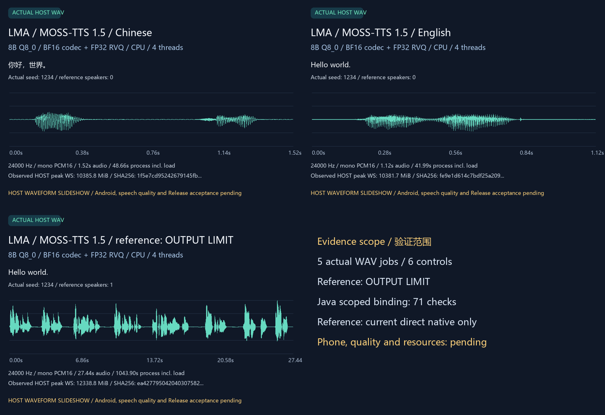

# MOSS 提示、排空与参考缓存

[English](MOSS_DELAY_FIX.en.md) · [模型使用](MOSS_TTS15.md) · [原始诊断](MOSS_REFERENCE_DIAGNOSTICS.md) · [本轮交付与完整待办](releases/v0.3.0-dev.43.md)

dev.43 把修正接入实际 CPU 引擎，ARM64 和原生 Windows 使用同一套生成源码。App 更新仍只交付基座，不附带模型、音色、分词器或识别模型；用户继续自行选择、下载、导入和管理资产。

| 编号 | 问题与修正 | 当前检查范围 |
|---|---|---|
| M01 | Delay 架构普通生成的 assistant 提示不再预先添加 audio_start；续写和其他架构保留各自路径 | 真实 GGUF 词表、未改写的官方格式方法，7/7 网格完全一致；含中英、混合文本和多种参考长度 |
| M02 | 排空开始当步递增计数；提取时移除 n_vq−1 行；助手没有开启音频时不返回用户参考片段 | 原生 DelayState 对官方生成与去延迟方法，5/5 的逐步行与音频码一致；固定贪心 logits，不含模型推理 |
| M03 | 参考编码的音频码全部复制到主机后，释放 CPU 批处理图的临时分配器，供后续任务重新分配 | 21 项、7 次实际 GGML 计算、3 次释放；独立矩阵结果、持久权重、并存流式图与重复输出核对 |

M01 按引擎架构处理，M02/M03 属于共用原生实现，不增加按模型名称分支的页面、队列或外部执行。未对照的其他 MOSS 子目标仍须逐一验收。固定 logits 比较仅定位算法差异；它不能替代完整权重、实际语音、文本遵循、音色、资源或手机验收。

释放统计包括次数、累计临时缓冲大小及最大单次大小。它们是分配器的缓冲字节，**不是驻留内存测量**，不能据此承诺某手机可运行。权重映射和独立流式分配器不属于被释放的批处理缓存。实际进程资源仍单独采样。

旧报告、WAV 和失败不覆盖。旧 PCM 逐字节比较继续记录；提示和延迟输入改变后，不再把旧输出字节相同作为新实现的正确性条件。当前实现仍须检查原始文字、种子、采样参数与 375 步预算下的实际输出、正常结束、显式截断、取消与恢复。

本轮完整参考案例按原文字、种子和 375 步预算输出 27.44 秒 WAV，仍未自然结束；失败继续保留。实际记录释放 7,368,704 个编码缓存字节，资源和质量另行核对。[当前完整模型报告](../verification/development/openmoss-trained.json)与[原始失败](../verification/research/openmoss-reference-issue/first-run.json)分开保存。

开发者在已有锁定源码和显式取得的完整资产下复现：

```powershell
python tools/test_openmoss_prompt.py
python tools/test_openmoss_delay.py
python tools/test_openmoss_codec_memory.py
python tools/test_openmoss.py
python tools/build_openmoss.py
python tools/test_openmoss_trained.py
python tools/test_openmoss_app_host.py --reuse-existing-local-files
```

完整模型驱动在执行时把实际事件写入各案例的 `*-events.jsonl`，保留原始请求、日志、WAV、资源采样及输入指纹。已有文件接纳仍使用生产完整 SHA 路径，不等于大文件流式复制或 Android 文件选择器通过。所有桌面结果均标为主机证据；无需 ROOT、同手机全管线与完整 v0.3.0 门槛不变。

本轮 Java 使用显式 `--skip-reference-case` 范围：完整资产接纳、独立参数、英文输出、预算错误、取消与恢复。当前参考采样由完整原生测试覆盖，不重复宣称当前 Java 参考生成通过；历史 dev.41 的完整 Java 参考结果另行保留。上方命令默认仍执行完整 Java 测试，正式验收门槛没有取消。源码改变后不能复用旧二进制的模型运行报告。

新 WAV 的独立离线英文识别：Kokoro 控制及本轮 MOSS 英文均为 0 词错误；本轮参考模式仍有 36 个错误 / 2 个目标词。原始 dev.41/42 的 35 / 2 失败另行保留，不能以算法一致性代替文本遵循。[当前识别记录](../verification/development/openmoss-intelligibility.json)。可先运行 `python tools/render_openmoss_trained.py --audio-only` 发布已验证的原始 WAV，再执行 `python tools/test_speech_intelligibility.py --manifest research/openmoss_trained/dev43-asr-cases.json`；无需完整模型再次推理，识别仍只在本机执行。

本轮 Java 实际完成 **71 项检查 / 4 次子进程 / 2 个 WAV**。英文、预算错误、实际采样取消与恢复通过，英文及恢复输出与本轮直接原生 WAV 逐字节一致；没有网络调用。该范围没有重跑 Java 参考生成，完整默认测试及全部手机门槛仍保留。



[波形 GIF](media/development/openmoss-0.3.0-dev.43/openmoss-trained-waveforms.gif) · [实际音频 MP4](media/development/openmoss-0.3.0-dev.43/openmoss-trained-speech.mp4) · [中文 WAV](media/development/openmoss-0.3.0-dev.43/openmoss-trained-zh.wav) · [英文 WAV](media/development/openmoss-0.3.0-dev.43/openmoss-trained-en.wav) · [参考模式 WAV（失败保留）](media/development/openmoss-0.3.0-dev.43/openmoss-trained-reference.wav) · [媒体身份](media/development/openmoss-0.3.0-dev.43/openmoss-trained-media.json)。这是原始音频及波形展示，非手机录屏；MP4 音轨明确转为 AAC，原 WAV 不变。
