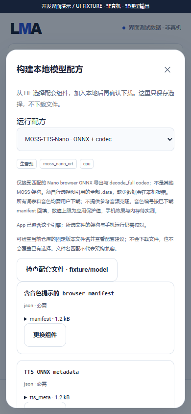

# MOSS-TTS-Nano local speech foundation

[中文](MOSS_NANO_ENGINE.md) · [Complete scope](MULTIMODAL_RELEASE_PLAN.en.md) · [Development status](DEVELOPMENT.en.md) · [HF components](HF_RECIPES.en.md)

Internal checkpoint **0.3.0-dev.6 / code 10** adds a compiled `moss_nano_ort` ARM64 CPU worker for selection 09. The original dev.6 record had no trained speech output. A dev.24 follow-up now has [actual trained production-source and Java host execution](MOSS_NANO_TRAINED.en.md). **Android execution, speech quality, selection09 and complete v0.3.0 remain unaccepted.** This implementation does not replace the nine other MOSS architectures frozen under selection 12.

## User flow

1. Open a matching Nano ONNX repository through Models → All/search → files → component recipe, and select `MOSS-TTS-Nano · ONNX + codec`.
2. Explicitly choose the eight required components below and every external `.data` file referenced by those graphs. Components may come from different HF repositories; each retains its fixed revision, size and SHA256/Git-blob identity.
3. Adding the model only registers the selection. Review every dependency, total/reusable bytes and licenses, then separately confirm Download. A matching complete manifest and verified local folder can also be imported.
4. After installation, edit this model's settings in Local and submit new narration text through its speech form. Tokenization, generation and decoding execute on the same phone, without ROOT, Termux, Python or off-device inference.
5. Successful tasks produce mono PCM16 WAV artifacts with effective parameters, component integrity receipts, frame count, sample rate and finish reason. Cancellation waits for the owned worker to exit before deleting temporary execution links; selected model objects remain.

App installation/upgrades do not download models. No weights or voices are fixed inside this recipe. Missing components fail locally without downloads, model substitution or off-device fallback. Official source documentation points to the [TTS ONNX repository](https://huggingface.co/OpenMOSS-Team/MOSS-TTS-Nano-100M-ONNX) and [codec ONNX repository](https://huggingface.co/OpenMOSS-Team/MOSS-Audio-Tokenizer-Nano-ONNX). The original dev.6 checkpoint had no frozen inventory. The dev.24 follow-up verifies eleven components/eighteen voices and supplies a [user-importable manifest](../catalogue/moss-nano-100m-onnx.bundle.json) with [complete use and measured results](MOSS_NANO_TRAINED.en.md). It is not added to the builtin catalogue/recommendations and makes no phone-acceptance claim.

## Complete asset roles

| Role | Format | Content |
| --- | --- | --- |
| `manifest` | JSON | `browser_poc_manifest.json`, with token configuration, prompt templates and downloaded builtin voice-prompt codes |
| `tts_meta` | JSON | `tts_browser_onnx_meta.json`, with graph filenames, dimensions and I/O |
| `codec_meta` | JSON | `codec_browser_onnx_meta.json`, with decode_full and sample-rate configuration |
| `text_tokenizer` | SentencePiece `.model` | Matching `tokenizer.model` |
| `tts_prefill` | ONNX | Prefill graph |
| `tts_decode` | ONNX | Decode-step graph |
| `tts_local` | ONNX | Local fixed-sampled-frame graph |
| `codec_decode` | ONNX | Audio tokenizer's decode_full graph |
| `tts_data_1`…`tts_data_4` | ONNX `.data` | Explicit TTS external-weight choices in the HF form |
| `codec_data_1`…`codec_data_4` | ONNX `.data` | Explicit codec external-weight choices in the HF form |

External-data slots are optional in the generic template because individual graphs determine their files. **Every referenced data file is mandatory for execution.** Imported manifests may use either group's `*_data_1`…`*_data_99`, with 32 data files total. This grants no automatic discovery/download permission. Graph filenames must match metadata; external data uses original flat filenames beside its graph. Traversal, absolute paths, unselected data and external `EPContext` execution contexts are rejected.

Model-specific manifests, prompt codes, tokenizers, graphs and external data are user assets, never APK payload. The Android example's pretokenized sample sentences or voice codes must not become an embedded substitute for arbitrary-text inference.

## Parameters and execution

| Parameter | Application guard | Behavior |
| --- | --- | --- |
| `threads` | 1–16; default 2 | CPU threads, without a measured device-optimal claim |
| `speaker` | Candidate range 0–127 | Submission reads the downloaded manifest and clamps to actual voice count minus one |
| `maxFrames` | 1–1500; default 375 | Audio-token frame cap, further bounded by the application's 4096-row context guard |
| `maxInputTokens` | 1–2048; default 1024 | Actual SentencePiece token budget for new text; excessive input fails without silently dropping its tail |
| `seed` | 0–2147483647; default 1234 | Random inputs to the fixed sampling graph, without cross-device byte-identical guarantees |

These are application guards, **not verified model maxima**. Narration accepts 1–4000 characters. Single codec output has a 60-second application guard; excessive output fails rather than counting a truncated waveform as success. Settings remain independent per model/recipe with editable presets and effective-value corrections. Embedded temperature/top-k constants are not presented as editable parameters. This route uses downloaded voice-prompt codes and does not provide reference-audio cloning, streaming audio endpoints or extra WeText normalization. Number pronunciation and long-text quality need actual acceptance.

The native route is SentencePiece → user voice/text prompt rows → prefill → autoregressive decode/local sampled frame → codec decode_full → WAV. Prefill weights are released before decoder loading; TTS sessions/KV caches are released before codec loading. [Follow-up Windows resource measurements](MOSS_NANO_TRAINED.en.md) are now available; actual phone peak memory and Z20 suitability remain unmeasured.

`EngineWorkspace` hardlinks leased verified objects into private `engine-work/work-UUID/tts` and `codec` directories, preserving external-data filenames without duplicating large weights. Unsupported hardlinks fail locally. Success, failure and cancellation clean up links; Application startup reconciles abandoned workspaces. The ONNX protobuf guard visits initializers, attribute tensors, nested graphs, sparse tensors, functions and training graphs; ORT still validates the model itself.

## Build, licenses and evidence

Prepare the native Windows NDK, diffusion sources and shared ORT per the [build guide](BUILD.en.md), then run:

```powershell
python tools/fetch_moss_nano.py --transport ssh
python tools/build_moss_nano.py
python tools/collect_moss_nano_notices.py
python tools/test_moss_nano.py
python tools/build.py
python tools/verify_package.py
```

The [source lock](../third_party/moss-nano-source-lock.json) pins MOSS `8b7bcc9341b3b4ef3a3a58ba1338a7d85ff133eb`, SentencePiece 0.2.1 `31646a467d2051eb904e0b45de3a73e91fe1c1e3`, and ORT 1.28.2 headers `33ca9628233dc8f002435e868d4c2e9f82766ca1`. MOSS/SentencePiece use Apache-2.0; ORT uses MIT. Original static-dependency notices ship in the APK. Actual model-data licenses require separate review.

The compiled worker is 902,776 bytes, SHA256 `3cde4a274f286227a762b0dc6065c72e59fed7c1365a553e635fcaeedac785be`, API 28 and 16 KiB aligned. It shares the identical ORT binary with sherpa. Packaging permits a shared filename only for identical size/hash/API requirements and rejects conflicts. Raw native diagnostics do not expose prompts; Android liblog interception still needs device checks.

There are 190 new host checks: 136 Java contract/hardlink/child-lifecycle checks, 47 actually executed C++ external-reference checks, and seven shared-dependency checks. Child fixtures emit labeled arbitrary bytes, **not WAV, MOSS speech or phone-inference evidence**. New-text speech quality, three load/unload cycles, resource budgets, background/upgrades and every full-v0.3.0 release gate remain required.



The screenshot and [recording/GIF](MEDIA.md) display an explicit fixture banner; they contain no model download or generated output.
