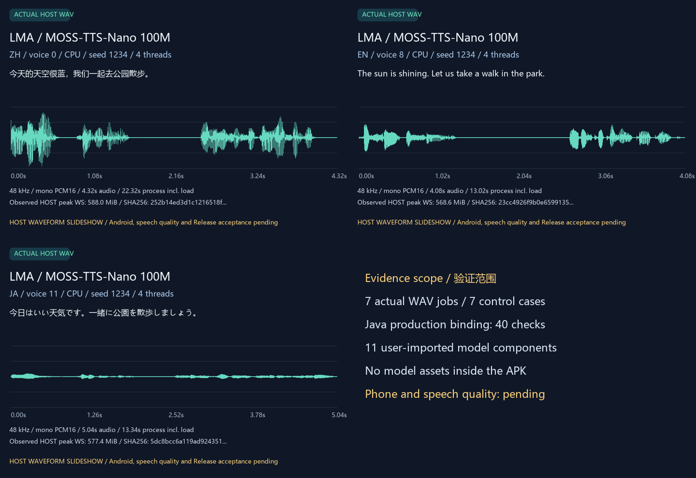

# MOSS-TTS-Nano 100M: real assets, import and production execution

[中文](MOSS_NANO_TRAINED.md) · [Native engine](MOSS_NANO_ENGINE.en.md) · [Numbered handoff and full pending scope](releases/v0.3.0-dev.24-moss-nano.md) · [Complete release scope](MULTIMODAL_RELEASE_PLAN.en.md)

This dev.24 follow-up provides a user-importable pinned model manifest and actual trained production-C++ and Java→native HOST execution. **Android installation, SAF, Service lifecycle, phone inference and background endurance were not executed. Speech quality and complete selection 09 remain unaccepted.** APK inputs/version, recommendations and public releases are unchanged; this remains work toward the one complete v0.3.0.

## User acquisition and use

1. Obtain [moss-nano-100m-onnx.bundle.json](../catalogue/moss-nano-100m-onnx.bundle.json). In dev.24, use the Models page's model-bundle import action and select this JSON through the system picker. It only declares metadata: no installation or download. It remains a user import with `catalogue:false`, without a reviewed-builtin recommendation claim.
2. Open this entry in Local. Review its audio task, CPU/`moss_nano_ort`, dependencies, license and plan: **11 components, 717,414,286 bytes, approximately 684.18 MiB**. Identical existing objects can be reused. Output, temporary storage and runtime memory are additional.
3. Separately tap **下载所选模型包 / Download selected model bundle** to fetch the pinned HF URLs, or **从文件夹导入 / Import folder** to provide the complete structure below. Weights, graphs, tokenizer and voice-prompt data remain user assets. Folder import never downloads missing components as a fallback.
4. After installation, edit this model's settings in Local, tap Use, enter new narration and submit its speech task. Results use the shared artifact library. Tokenization, TTS and codec are implemented for execution by the foundation on the same phone. This turn tested the production Java path with host filesystem ports; **it did not establish phone interaction acceptance**.
5. Pause, resume, update and delete models independently. App installation/upgrades/browsing never download or replace model assets; missing dependencies fail locally. HF All/search remains available for other choices. Recommended stays `m08 → m06 → m01`.

HF discovery does not imply every format, architecture or device is runnable. This manifest binds only the two matching exports below. Models remain equal peers; task, CPU/ONNX/engine/component dependencies, evidence, license and content labels are independent. This model makes no uncensored claim; attributed labels on other variants do not create a separate model hierarchy.

```text
user-selected-folder/
  tts/
    browser_poc_manifest.json
    tts_browser_onnx_meta.json
    tokenizer.model
    moss_tts_prefill.onnx
    moss_tts_decode_step.onnx
    moss_tts_local_fixed_sampled_frame.onnx
    moss_tts_global_shared.data
    moss_tts_local_shared.data
  codec/
    codec_browser_onnx_meta.json
    moss_audio_tokenizer_decode_full.onnx
    moss_audio_tokenizer_decode_shared.data
```

## Asset and license identity

TTS: [official OpenMOSS 100M ONNX](https://huggingface.co/OpenMOSS-Team/MOSS-TTS-Nano-100M-ONNX), revision `f52645cb467506d8e18e746ddd59482685b74e58`. Codec: [official Nano tokenizer ONNX](https://huggingface.co/OpenMOSS-Team/MOSS-Audio-Tokenizer-Nano-ONNX), revision `ceff0d0749bfb3fa2d61149794ec6feef0d1e1ae`. Both publishers declare Apache-2.0. Complete URLs, SHA256 identities, lengths and provenance are retained in the [asset lock](../research/moss_nano_trained/assets.json), [acquisition receipt](../verification/development/moss-nano-assets.json) and user manifest.

| Role | File | Bytes |
| --- | --- | ---: |
| manifest | browser_poc_manifest.json | 503,354 |
| tts_meta | tts_browser_onnx_meta.json | 4,487 |
| codec_meta | codec_browser_onnx_meta.json | 17,036 |
| text_tokenizer | tokenizer.model | 470,897 |
| tts_prefill | moss_tts_prefill.onnx | 283,305 |
| tts_decode | moss_tts_decode_step.onnx | 291,483 |
| tts_local | moss_tts_local_fixed_sampled_frame.onnx | 471,262 |
| codec_decode | moss_audio_tokenizer_decode_full.onnx | 681,902 |
| tts_data_1 | moss_tts_global_shared.data | 440,813,568 |
| tts_data_2 | moss_tts_local_shared.data | 229,678,080 |
| codec_data_1 | moss_audio_tokenizer_decode_shared.data | 44,198,912 |

The model-specific manifest contains learned voice-prompt codes and is itself a model asset. It, tokenizer vocabulary, graphs and external weights stay outside APK/Git. Git contains metadata, code, documentation and this turn's newly generated audio samples. Developer acquisition requires explicit `--download`; it is neither the App downloader nor a user installation prerequisite.

## Independent parameters and execution

| Parameter | Default; editable range | Constraint source |
| --- | --- | --- |
| speaker | 0; 0–17 | Actual downloaded manifest has 18 voices; submission rereads and clamps |
| threads | 2; 1–16 | Application guard, without a device-optimal claim |
| maxFrames | 375; 1–1500 | Application guard, also bounded by 4096 context rows and 60-second codec-output guard |
| maxInputTokens | 1024; 1–2048 | Application guard, enforced after actual SentencePiece tokenization |
| seed | 1234; 0–2147483647 | Application guard; no cross-runtime/device byte-identity guarantee |

Settings belong to the model record. Editable presets clamp excessive values; submitted requests retain immutable snapshots. The voice range comes from these actual assets; other guards are not measured theoretical model maxima. Temperature/top-k constants inside the exported local sampling graph are not offered as ineffective controls. Reference-audio cloning, extra WeText normalization and streaming audio endpoints are not provided by this route.

The actual path is SentencePiece → downloaded text/voice prompts → prefill → decode/local sampling → codec decode_full → PCM16 WAV. Prefill and TTS caches are released before later stages. The publisher codec emits 48 kHz stereo; the current worker averages channels into **48 kHz mono**. It checks undeclared external weights, workspace escapes and matching graph metadata; missing assets fail locally.

## Measured results

Fixed CPU 4 threads, seed 1234 and maxInputTokens 1024; normally maxFrames 375. Each time includes a fresh process, loading and output writing. Memory is observed Windows peak working set, **not Nubia Z20 speed, available memory or endurance**.

| Actual job | Voice | Audio seconds | Process seconds | Host peak MiB | Finish |
| --- | ---: | ---: | ---: | ---: | --- |
| Chinese A | 0 | 4.32 | 22.32 | 588.0 | stop |
| Different Chinese text B | 0 | 5.04 | 18.02 | 593.5 | stop |
| A with changed voice | 1 | 3.92 | 28.59 | 586.1 | stop |
| English | 8 | 4.08 | 13.02 | 568.6 | stop |
| Japanese | 11 | 5.04 | 13.34 | 577.4 | stop |
| maxFrames=1 | 0 | 0.08 | 5.55 | 563.6 | length |
| A recovered after cancellation | 0 | 4.32 | 13.14 | 587.5 | stop |

A and recovered A share complete WAV SHA256 `252b14ed3d1c1216518f2afb0b7fa0f78821931c7658984a371641e483347856`; different text and changed voice have different hashes. Actual termination after frame 5 progress exited in approximately 0.063 seconds, leaving no successful WAV. Six error controls cover schema, voice 18, token budget 1, frame cap 1501, workspace escape and missing external global weights. Seven successes, seven controls and info total 15 actual child processes.

The production Java path separately passed **40 checks with 3 actual native children**: complete 717 MB local import, eleven integrity records, zero network calls, per-model clamp/isolation, execution/cancellation/recovery, leases/process exit/workspace cleanup and persisted-store restoration. Its two WAVs exactly match direct worker A. It runs actual `BundleStore/BundleTransfers/MossNanoEngine/NativeWorker`; Application/AtomicFile are host filesystem ports, without Android scheduling, SAF or foreground Service execution.

Windows tests link isolated official ORT **1.28.0/API28**; production Android retains **1.28.2/API28**. Only CRT paths, redirection and parent-lifetime handling have Windows ports; production C++ neural operations are unchanged. Equal API numbers establish no numerical parity across those runtimes.



[Original Chinese WAV](media/development/moss-nano-trained-zh.wav) · [Original English WAV](media/development/moss-nano-trained-en.wav) · [Original Japanese WAV](media/development/moss-nano-trained-ja.wav) · [Silent waveform GIF](media/development/moss-nano-trained-waveforms.gif) · [Waveform MP4 with actual generated audio](media/development/moss-nano-trained-speech.mp4) · [Media provenance/hashes](media/development/moss-nano-trained-media.json)

Original WAV bytes are unchanged and unnormalized. MP4 transcodes audio to AAC; GIF has no audio. Both are labelled HOST waveform slideshows, **not App/phone recordings or generation-speed demonstrations**. Valid PCM, output differences and repeatability cannot establish listening quality, intelligibility, pronunciation, speaker similarity or all 18 voices/languages. Only voice indices 0/1/8/11 were actually used here.

## Native Windows reproduction and audit

Use the repository directory and [existing pinned source/NDK/MSVC setup](BUILD.en.md), without Docker/WSL/VM/emulators. Assets, host runtime and logs remain below ignored `build/`; global Python ORT is unchanged.

```powershell
$env:PYTHONIOENCODING='utf-8'
$env:PYTHONDONTWRITEBYTECODE='1'
$env:TEMP="$PWD/build/tmp"
$env:TMP="$PWD/build/tmp"
python tools/fetch_moss_nano_trained.py --download --origin https://hf-mirror.com
python tools/fetch_moss_nano_host_runtime.py --download
python tools/build_moss_nano_host.py
python tools/test_moss_nano_trained.py
python tools/test_moss_nano_app_host.py
python tools/check_moss_nano_trained_evidence.py --raw --self-test
python tools/render_moss_nano_trained.py
python tools/export_development.py
python tools/check_repository.py --development
```

Without `--download`, both fetch tools verify existing files without implicit networking. The asset tool also accepts explicit `https://huggingface.co`. Exact range/length checks and whole-file SHA precede final download commit; changed or unidentified existing files are preserved. Rendering refuses to overwrite existing media. New trained runs preserve separate raw directories; updated public media must retain existing release assets and bind the correct new sources.

Public [trained results](../verification/development/moss-nano-trained.json), [Java results](../verification/development/moss-nano-app-host.json), [independent raw audit](../verification/development/moss-nano-capture-audit.json) and [host build](../verification/development/moss-nano-host-build.json) retain separate fingerprints/scopes. Audit rereads 65 raw files, 15 protocol streams, 9 WAVs and 11 actually imported objects, and rejects 8 false promotions to Android/quality/complete target/Release. The earlier [190 Nano contracts](../verification/development/moss-nano.json) remain a separate structural/host record.

## Required remaining work

Selection 09 still requires Android acquisition/execution, speech quality/resources, three loads/unloads per model, 15-minute screen-off, one-hour API and upgrade acceptance. No phone is available; the gate remains open. Nano cannot cover selection 12's nine other MOSS routes. F-01–F-12, existing text, all frozen selections 01–14/16/17 and A1–A11/R01–R05 remain mandatory for the same complete v0.3.0. See the [full pending table](releases/v0.3.0-dev.24-moss-nano.md).
