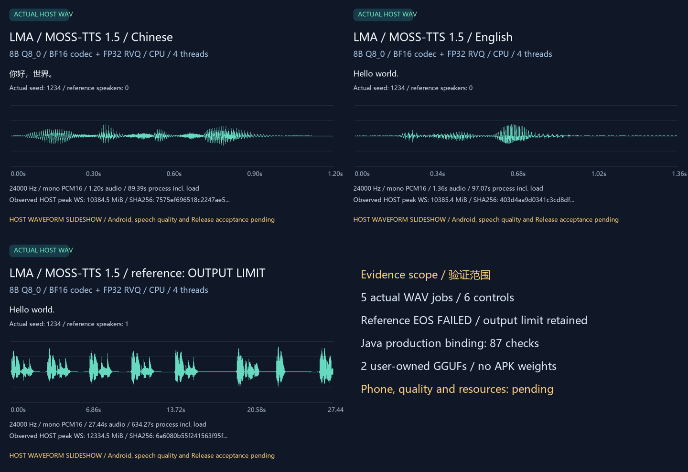

# Local MOSS-TTS 1.5 speech

Dev.43 corrects prompt/delayed state and reference-encoder scratch; see [implementation and reproduction](MOSS_DELAY_FIX.en.md). Original dev.41 speech/failures below remain historical. [Current delivery](releases/v0.3.0-dev.43.md) records new validation separately; old model results do not establish current-APK acceptance.

dev.42 leaves native engines/weights unchanged. The 87-check Java model run below is exact dev.41 history after the importer changed. See [shared imports](MODEL_TRANSFERS.en.md) and [independent diagnostics](MOSS_REFERENCE_DIAGNOSTICS.en.md).

[中文](MOSS_TTS15.md) · [MOSS engine and format boundaries](OPENMOSS_ENGINE.en.md) · [Complete version scope](proposals/multimodal-release-scope.json)

## User workflow

1. Install LMA, open Models → All, and search for MOSS. Existing Recommended entries remain intact. Adding a candidate starts no transfer or replacement.
2. Select `MOSS-TTS 1.5 · Q8 / BF16 · CPU`, review its license, both component sizes and runtime status, then explicitly download. The component page also accepts the matching files selected by the user.
3. Manage the installed model in Local. Its editable preset fields clamp values to its own bounds and persist independently of other models.
4. Choose speech synthesis and enter the text, optionally adding a language or voice description. An explicitly selected reference must be a 1–10 second, 24 kHz, mono PCM16 or float32 WAV, at most 1 MiB. LMA does not silently resample or acquire reference voices.
5. Submission freezes an independent parameter snapshot. Loading, reference encoding, actual sampling, audio decoding and saving all execute on the same Android device. Listen, save or share the resulting WAV from Results.
6. Download, pause, resume, import, update, rollback and deletion remain user decisions. An App update updates the foundation without replacing or downloading model assets.

The complete pair occupies **13,430,589,376 bytes**: a 9,339,597,248-byte backbone and 4,090,992,128-byte extras file. Download size does not establish peak RAM: context caches and intermediate computation require additional memory. There is no Z20 or other physical Android pass record. Models remain peers with separate audio-generation, speech, CPU, GGUF and validation tags; no Uncensored claim is made for this candidate.

## Matched assets and runtime

The immutable pair comes from [ilintar/moss-tts-gguf](https://huggingface.co/ilintar/moss-tts-gguf/tree/66bc8249cc3bae20547d312123f502332158c1d0). Its model card identifies Apache-2.0 and the official MOSS-TTS-v1.5 / MOSS-Audio-Tokenizer sources. See the [asset lock](../research/openmoss_trained/assets.json) for exact revisions, sizes and SHA-256, and the [optional App bundle](../research/openmoss_trained/catalogue-bundle.json).

This conversion requires the pinned `pwilkin/openmoss` runtime and matching llama revision. The reviewed reader preserves BF16 codec tensors and FP32 quantizer statistics. First-class MOSS, old Local, Local-v1.5, Nano, Realtime and unrelated GGUF files cannot be substituted. Execution creates private hardlinks to the two leased objects, without converting or rewriting weights, then removes links and request files after worker exit. The APK contains no weights, vocabulary, voices or reference recordings.

## Parameters and actual progress

| Parameter | Editable bound and meaning |
|---|---|
| Input budget | 1–2048; includes formatted conditioning and reference positions |
| Generation steps | 1–1500; includes Delay flushing and termination, not a character or duration count |
| Text / audio temperature | 0–3 each |
| Audio Top P / Top K | 0.01–1 / 1–1024 |
| Repetition penalty | 1–2 |
| Threads | 1–32; more threads do not guarantee faster execution |
| Seed | -1 chooses a seed, or 0–2147483647; results retain the actual choice |
| Voice description / language | Plain text, at most 1000 / 64 characters; template markers are rejected |

The formatted input, generation limit and reserved positions must also fit the actual 4096-position context. Validation occurs before prefill.

CPU auxiliary weights use private file mappings of the required tensor ranges. Original Q8_0, BF16 and FP32 bytes remain unchanged; the codec and repeated text embedding are not copied wholesale onto the heap. Computation still runs on the device CPU, with the same tokenizer, sampling, context and seed. All mappings close when the model is released. Source-file bytes, mapped-view bytes and tensor bytes are reported separately; none is a peak resident-memory estimate.

Progress comes from the actual sampling loop, including first, successive and terminating steps, with separate decode and save stages. Results retain actual parameters, seed, sampled steps, reference frames, output samples, duration and phase timings. `stopReason=end_of_speech` records model completion; `stopReason=max_new_tokens` with `truncated=true` records the user limit and potentially incomplete speech. Cancellation or failure accepts no partial WAV and preserves the model and settings for retry.

## Known reference-mode failure

The actual 3-second-reference/short-text case generates until the explicit 375-step budget, producing a 27.44-second WAV without natural end-of-speech. **Reference natural-completion acceptance fails** and its cause remains open. Voice-cloning quality and the complete MOSS family are not accepted. The business layer must preserve the truncation, original output and editable retry; the App never retries automatically. Model selection discloses this limitation. [Original failure](../verification/research/openmoss-reference-issue/first-run.json) · [Official-format review and scope](../research/openmoss_trained/reference-investigation.json).

The upstream [continuation-prefix default issue and fix](https://github.com/pwilkin/openmoss/issues/17) were also reviewed. The pinned revision includes that fix and the actual reference case records `continuationPrefixFrames=0`. That historical issue does not explain this failure; the review does not change the version, increase the limit or accept quality.

Opening a limited result from a task or the artifact list shows that its contents may be incomplete. A normally completed result clears the warning. Original results and parameters remain independent.

## Evidence boundary

Chinese and English WAV bytes match the original upload-based loader exactly. English SHA-256 is `403d4aa9d0341c3cd8df4619311389941fea5326ab7fa77316d2c31b3fb24ac1`; Chinese is `7575ef696518c2247ae5b04f4682aee01f078805bb73fe45c1567a5b903d9311`. The [immutable baseline](../verification/research/openmoss-memory/baseline.json) preserves original reports and the explicit interruption of the subsequent reference case; that interrupted full run never passes.

The mapped English case records about 1.5 seconds to load, 97 seconds total and a 10.89 GB observed peak Windows working set. Source files total 13.43 GB and auxiliary mapped views about 5.37 GB. These observations are neither a controlled performance comparison nor an Android memory budget.

Android compilation, complete public asset SHA verification, 530 MOSS-specific checks, 25 real mapping checks and 490 shared UI checks pass. The complete native pipeline produces five WAV cases and six controls: business checks pass while reference natural completion fails. The historical dev.41 production Java run passed 87 checks across five actual native runs and three WAVs, covering full-SHA existing-file adoption, independent/clamped settings, immutable requests, reference input, cancellation after actual steps, budget errors, recovery and process/work-file cleanup, with zero network calls. Existing-file adoption cannot establish the unpassed stream-copy path. UI media explicitly simulate the bridge and establish neither Android execution nor speech quality.

This is **TTS-v1.5**, one of nine frozen MOSS targets. TTS-v1.0, old Local, Local-v1.5, TTSD, VoiceGenerator, old SoundEffect, SoundEffect-v2 and Realtime remain required, together with every model's quality, resources and same-phone background acceptance, in the same complete v0.3.0 scope. No reduced Release or automatic deferral is authorized.

## File reuse and developer reproduction

Existing-file association reuses the complete files only after full-byte SHA verification. Execution uses private hardlinks and removes them when the worker exits. Users explicitly choose both the files and target bundle; browsing and App upgrades never perform association automatically.

The host stream-copy import did not complete within its 900-second driver deadline, leaving 3,565,027,328 unverified temporary bytes and starting no model child. Its [original failed attempt](../verification/research/openmoss-import-issue/attempt.json) is retained. Full-SHA adoption of existing files is a separate production path; it cannot establish complete stream-copy or Android file-picker acceptance.

These commands are native Windows developer checks, requiring the pinned sources, JDK, NDK and dependencies beforehand. They are not user installation prerequisites. The first command explicitly downloads about 13.43 GB; the App never runs these commands automatically.

```powershell
python tools/fetch_openmoss_trained.py --download
python tools/build_openmoss_host.py
python tools/test_openmoss_mapping.py
python tools/test_openmoss_trained.py
python tools/test_openmoss_app_host.py --reuse-existing-local-files
python tools/build_openmoss.py
python tools/build.py
```

The full native test preserves the reference-mode failure and returns nonzero. Business execution, natural completion, quality, Android and full Release have separate acceptance. A larger generation budget or a different seed cannot clear the original failure. Original captures remain read-only; explicitly rechecking them requires the same binary and exact requests, with reused cases labelled as not reexecuted.

## Actual artifacts and reports

These are actual native Windows outputs with unchanged original WAV bytes. The waveform GIF and actual-audio MP4 display artifacts; they are not Android recordings. The reference case explicitly retains its output limit and failed natural completion. MP4 audio is separately transcoded to 48 kHz AAC and cannot replace the original WAV hashes.

[Chinese WAV](media/development/openmoss-trained-zh.wav) · [English WAV](media/development/openmoss-trained-en.wav) · [Reference-input WAV: truncated](media/development/openmoss-trained-reference.wav) · [Waveform GIF](media/development/openmoss-trained-waveforms.gif) · [Actual-audio MP4](media/development/openmoss-trained-speech.mp4)



[Complete native execution and retained original failure](../verification/history/0.3.0-dev.41/openmoss-trained.json) · [87 production Java checks](../verification/history/0.3.0-dev.41/openmoss-app-host.json) · [Media provenance and file hashes](media/development/openmoss-trained-media.json). Chart timings come from the direct native captures; the Java English/reference/recovery runs took about 724/1551/43 seconds. Different disk caches and workloads prevent treating these observations as a controlled benchmark or phone-speed estimate.
