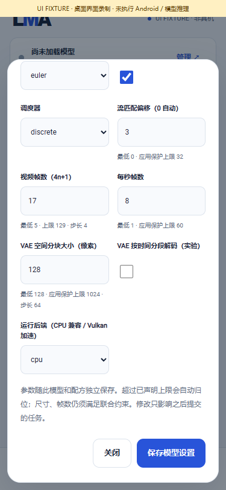

# On-device model repair and operation · v0.3.11

[中文](ON_DEVICE_MODEL_REPAIR.md) · [Implementation](IMPLEMENTATION_V0311.en.md) · [Historical failures](TASK_FAILURES.en.md) · [Phone probes](../verification/releases/v0.3.11/physical-models.json)

This update adds an explicit CPU route for already downloaded Wan weights and repairs Android staging paths across the shared 3D, vision and speech workers. The user authorized selected bounded phone/model tests. Those results remain separate from program gates; complete testing of every model is still optional.

## 1. Use the installed Wan model

1. Install the stable APK over the existing signed app, preserving installed assets and settings.
2. Open **Models → Local → Wan → model settings**, choose `cpu` in **运行后端（CPU 兼容 / Vulkan 加速）**, then save. The choice belongs only to this model ID.
3. For a diagnostic, use **128 × 128, 5 frames, 1 sampling step, CFG 1, 4 CPU threads, VAE tiles 128, 8 FPS** and an ordinary test prompt. Confirm the request.
4. Follow the task and preview/export its MP4 from the result library. Check temperature, memory and waiting time before raising resolution or steps.

The final-APK one-step probe on **motorola edge plus / burton, Android 12, about 11.4 GiB visible RAM** completed in about **176 seconds**. Its decoded result is **H.264, 128 × 128, 5 frames, 8 FPS, 625 ms, 9,173 bytes**. The picture is nearly blank: computation, encoding and saving work, but usable quality is not accepted. An earlier development APK completed a roughly 166-second probe, excluded from final-APK gate counts. Neither establishes normal-resolution performance or compatibility with other phones.

A **4-step / CFG 3** retest on the same final APK completed in **347.04 seconds**, producing **4,885 bytes** with another near-blank picture. [Original four-step MP4](media/models/v0.3.11/wan-cpu-128-four-steps.mp4). Both successes describe the pipeline and valid video files, not usable quality. The four selected public probes are two Wan successes and one bounded cancellation for each 3D model, bound to their actual tested APKs.

The original GPU bundle ID, content labels, four component hashes and downloaded state are retained. CPU mode uses the existing signed `sd_cpp` worker inside the APK. Tokenization, UMT5, diffusion, VAE and H.264 encoding all run on this same phone. No second manifest import, duplicate download, multi-GB weight copy, ROOT or second compute device is needed.

The existing default stays `vulkan` until explicitly changed. There is no silent fallback. Previously submitted requests retain their frozen GPU choice; create a new task or explicitly edit/retry it. Vulkan still requires its own capability preflight. CPU success does not repair the GPU driver.

## 2. Same-phone API

Enable the service and use your own API key. The following request selects the installed catalogue Wan model. ADB forwarding used by the diagnostic tool transports control and result bytes only; inference remains on the phone.

```json
{
  "bundleId": "wan21_13b_q4_vulkan_catalogue_v1",
  "type": "video.generate",
  "input": {"prompt": "An orange cube rotating slowly on a plain white background."},
  "parameters": {
    "executionBackend": "cpu",
    "width": 128, "height": 128, "frames": 5, "fps": 8,
    "steps": 1, "cfg": 1, "threads": 4,
    "vaeTiling": true, "vaeTileSize": 128
  },
  "allowUnmeasured": true
}
```

Check `POST /v1/jobs/preflight` before confirming `POST /v1/jobs`. Poll that task and retrieve its result from `/v1/artifacts/{id}/content`. Frozen parameters contain `executionBackend`; execution metadata also identifies the actual signed worker file, byte size, SHA256 and exit status. The registered adapter/default backend is distinct from the worker selected for this execution.

Other matching Wan 1.3B catalogue variants share this backend setting, but their weights and quality do not inherit a physical pass. Wan 14B, arbitrary Wan 2.x, video LoRA and unrelated architectures remain subject to their own integration limits.

## 3. The 3D failure and shared repair

Android denied the former hardlink staging operation. v0.3.10 added verified symlinks, but native validation still rejected symlink inputs, causing early failure before sampling. v0.3.11 resolves image, reference audio, point-cloud, camera and source-GLB inputs to ordinary files still protected by their leases.

Model components and ordered views require execution filenames. Replacing them with object-store hash names would break those layouts. Requests now bind `componentSources` and `viewSources`; native checks require a path inside the private workspace, an ordinary selected source, actual file identity between source and staging entry, and the architecture's required filename. Unbound symlinks, mismatched sources and escaping parents remain rejected. Weights are not copied.

Affected routes include **single-image TRELLIS/Pixal, Pixal multiview, RF Shape/point clouds, Spatial/Paint/UltraTex/UniForge/SAM/SUPRA, F5/OmniVoice and vision preparation**. Source coverage does not mean every complete trained model has generated successfully on a phone.

TRELLIS/Pixal now emit preprocessing, image encoding, sparse structure, shape sampling, mesh decoding, texturing and export stages. Exact pinned-source anchors insert events without altering the model math. Empty GLBs or placeholder geometry are not treated as successful generation.

## 4. Observations and remaining scope

| ID | Observation | Conclusion |
| --- | --- | --- |
| M01 | Wan CPU inference, Android video encoding, retrieval and file identity succeeded | Small diagnostic pipeline works; quality and normal sizes are unaccepted |
| M02 | TRELLIS.2 completed image encoding and entered sparse-structure computation; cancelled at 600 seconds and its process exited | Prior path failure bypassed; no completed GLB |
| M03 | Pixal3D completed image encoding and entered sparse structure; cancelled at 180 seconds | No complete GLB; startup or active computation is not a generation pass |
| M04 | Other models, higher sizes, NSFW quality, sustained background operation and other phones | Not individually accepted this round; full program integration scope is preserved |

The TRELLIS sample used about four CPU cores for computation. A ten-minute cancellation neither proves that it can never finish nor establishes successful normal generation. Staging repair cannot remove the model's compute cost or change device-driver capabilities.

## 5. Reproducing the checks

`tools/device_model_probe.py` requires explicit authorization, an installed model and a 15–600-second budget. It uses an owned orange-cube image/prompt, reads no historical user inputs, and never downloads or copies model weights. It records the installed APK SHA256, verifies generated file sizes/hashes, cancels only its own task on timeout, removes its own ADB forward and hides the UI key after reading it in memory.

`tools/physical_model_evidence.py` exports allowlisted fields from those fixed owned fixtures. No serial, API key, unlock credential, personal log or private input enters public JSON, source archives or Release assets. Bounded/random program fixtures and authorized phone results have distinct counts. Published v0.3.10 evidence remains immutable. Four owned failed/cancelled tasks and four owned inputs were privately backed up and removed; the original two successes, five artifacts, five installed models and original parameter values were preserved.



[Actual phone video](media/models/v0.3.11/wan-cpu-128.mp4) · [Diagnostic GIF](media/models/v0.3.11/wan-cpu-128.gif). These are real same-phone outputs from an owned prompt; one sampling step does not demonstrate model quality.
