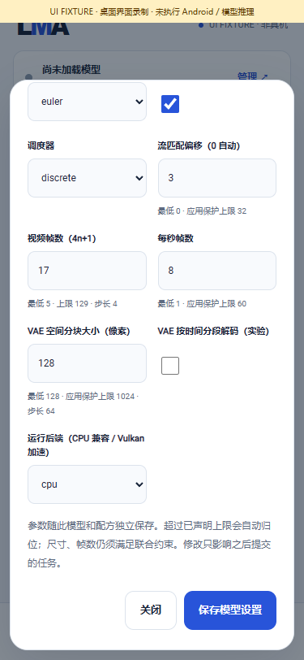

# 真机模型修复与运行指南 · v0.3.11

[English](ON_DEVICE_MODEL_REPAIR.en.md) · [完整实现](IMPLEMENTATION_V0311.md) · [任务失败历史](TASK_FAILURES.md) · [实跑记录](../verification/releases/v0.3.11/physical-models.json)

本版把 Wan 已下载权重接入可选择的 CPU 路径，并修复 3D / 视觉 / 语音运行器与 Android 文件链接之间的冲突。用户另外授权了部分真机与模型验证；程序门禁仍单独计数，不恢复逐模型完整验收的强制要求。

## 1. 在这台手机使用已有 Wan

1. 安装正式版 APK，允许原签名覆盖升级，保留已有模型、文件与参数。
2. 打开 **模型库 → 本地 → Wan 模型 → 参数设置**。在 **运行后端（CPU 兼容 / Vulkan 加速）** 中选择 `cpu`，保存。这个设置仅属于所选模型 ID。
3. 点击使用模型。建议可先做诊断：**128 × 128、5 帧、1 步、CFG 1、CPU 线程 4、VAE 分块 128、FPS 8**，填写普通测试提示词后确认提交。
4. 在任务列表查看运行状态，完成后从结果库预览或导出 MP4。提高步数或尺寸前先确认手机温度、可用内存与等待时间。

最终 APK 在 motorola edge plus / burton、Android 12、约 11.4 GiB 可见内存上，一步诊断约 **176 秒**完成，输出 **H.264 / 128 × 128 / 5 帧 / 8 FPS / 625 ms / 9,173 bytes**。画面接近空白；这只证明计算、编码与保存贯通，不属于可用画质。较早开发包也完成过约 166 秒的流程检查，不混入最终 APK 门禁。其他手机、其他架构或常用尺寸的性能均不能据此外推。

随后同一最终 APK 做了 **4 步 / CFG 3** 复测，约 **347.04 秒**完成，输出 **4,885 bytes**，画面仍接近空白。[4 步原始 MP4](media/models/v0.3.11/wan-cpu-128-four-steps.mp4)。两次成功仅指流程与有效视频文件，均未达到可用画质。公开选择记录共 4 次：Wan 两次成功、两种 3D 各一次限时取消，分别绑定实际 APK。

原始 GPU 模型 ID、内容标签、四个组件的哈希和下载状态保持不变。CPU 模式调用 APK 中已有的签名 `sd_cpp` 工作器，分词、UMT5、扩散、VAE、H.264 编码全部留在手机。无需导入第二份 JSON、重复下载、复制数 GB 权重、ROOT 或其他计算设备。

默认仍为原先的 `vulkan`；不做静默回退。旧任务冻结的 GPU 参数不会被新设置改写，须新建任务或明确编辑后重试。选择 Vulkan 时仍须通过能力检查；CPU 成功不等于 GPU 故障已修复。

## 2. 调用本机接口

服务页启用本机接口，使用自己的密钥。下面参数适用于已安装的目录 Wan 模型；在手机本机调用，验证工具的 ADB 转发只传递控制请求与结果，计算仍在手机。

```json
{
  "bundleId": "wan21_13b_q4_vulkan_catalogue_v1",
  "type": "video.generate",
  "input": {"prompt": "An orange cube rotating slowly on a plain white background."},
  "parameters": {
    "executionBackend": "cpu",
    "width": 128, "height": 128, "frames": 5, "fps": 8,
    "steps": 1, "cfg": 1, "threads": 4,
    "vaeTiling": true, "vaeTileSize": 128
  },
  "allowUnmeasured": true
}
```

先提交 `POST /v1/jobs/preflight`，确认后提交 `POST /v1/jobs`；轮询对应任务，使用结果 ID 访问 `/v1/artifacts/{id}/content`。参数快照包含 `executionBackend`；执行记录补充真实工作器文件、字节数、SHA256 与退出码。目录中的注册引擎 / 默认后端与本次实际工作器分别披露。

同架构的其他 Wan 1.3B 目录包使用同一后端参数，但其权重与效果不因这次验证自动获得“真机通过”标签。Wan 14B、任意 Wan 2.x、视频 LoRA 和其他架构仍受各自适配边界约束。

## 3. 3D 的问题与已做修复

Android 的应用私有目录拒绝旧工作目录的硬链接。v0.3.10 增加了经校验的软链接，但原生工作器仍拒绝软链接形式的输入，因此完整模型在采样前快速失败。v0.3.11 将图片、参考音频、点云、相机和源 GLB 解析为仍在租约保护中的普通文件路径。

模型组件和四视图需要固定运行文件名，不能仅替换成哈希对象名。本版在请求中绑定 `componentSources` / `viewSources`，原生端同时验证：运行路径位于私有工作目录、源是所选普通文件、两者为同一实际文件、架构要求的文件名保持匹配。未绑定的软链接、错误源与越界目录继续被拒绝；不复制权重。

此修复覆盖 **单图 TRELLIS.2 / Pixal3D、多视图 Pixal、RF Shape / 点云、Spatial / Paint / UltraTex / UniForge / SAM / SUPRA、F5 / OmniVoice 和视觉准备** 的相关文件入口。覆盖代码并不等于逐个完整模型已经在手机输出成功。

TRELLIS / Pixal 新增预处理、图片编码、稀疏结构、形状采样、网格解码、纹理和导出阶段。改动只插入固定源码锚点的事件，不改上游数学计算，不把空 GLB 或占位几何当成真实输出。

## 4. 实跑结论与剩余范围

| 编号 | 已观察结果 | 判断 |
| --- | --- | --- |
| M01 | Wan CPU 真机生成、视频编码、文件下载与哈希校验成功 | 小尺寸流程跑通；不代表画质或常用尺寸通过 |
| M02 | TRELLIS.2 已通过图片编码、进入稀疏结构；600 秒上限后取消，原生进程退出 | 先前路径故障已越过；尚无完整 GLB 结果 |
| M03 | Pixal3D 完成图片编码并进入稀疏结构；180 秒预算后取消 | 未产出完整 GLB；启动或进入计算不属于生成成功 |
| M04 | 其余模型、较高尺寸、NSFW 效果、长时间后台、其他手机 | 未在这轮逐个验收，原有程序适配范围保留 |

TRELLIS 的观察样本使用约四核 CPU 计算，不是停在提交队列。取消的十分钟测试不能推导模型必然无法完成，也不能声称已正常产出。大模型的计算量与设备驱动能力不因文件适配被消除。

## 5. 可复核的验证方法

`tools/device_model_probe.py` 只接受明确授权、已安装模型和 15–600 秒预算；使用自有橙色方块图片 / 提示词，不读取用户旧任务输入，不下载或复制权重。工具记录当前 APK SHA256，校验生成文件的大小与哈希，超时只取消本次创建的任务，结束后移除自己创建的 ADB 转发，并隐藏从界面读取的密钥。

`tools/physical_model_evidence.py` 仅发布这些固定自有夹具的白名单字段。序列号、密钥、解锁凭据、个人日志和私人输入均不进入公开 JSON、源码包或 Release。程序门禁使用各自的有界 / 随机夹具；授权手机实跑的成功与未完成结果另外列示。历史 v0.3.10 记录不被覆盖。检查后私下备份并清理 4 条自有失败 / 取消任务和 4 份自有输入；原有 2 条成功、5 项素材、5 个已装模型和原参数值保持。



[已有实机视频输出](media/models/v0.3.11/wan-cpu-128.mp4) · [诊断输出预览 GIF](media/models/v0.3.11/wan-cpu-128.gif)。这些是自有提示词的真实手机模型输出；低步数诊断不用于展示模型画质。
