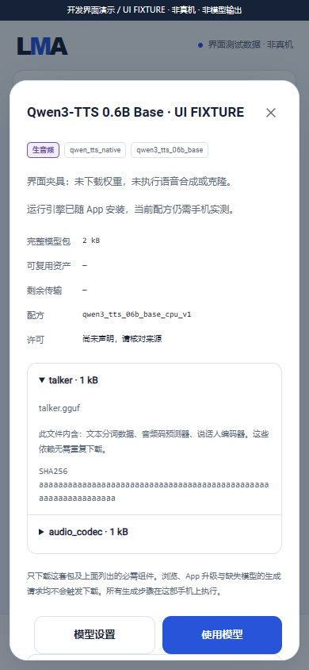
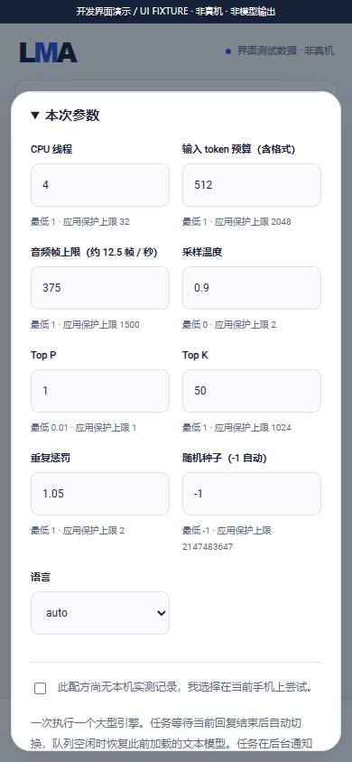

# Qwen3-TTS 0.6B Base 本地语音管线

[English](QWEN_TTS_ENGINE.en.md) · [开发状态](DEVELOPMENT.md) · [组件配方](HF_RECIPES.md) · [本地素材](LOCAL_INPUTS.md) · [完整版本要求](MULTIMODAL_RELEASE_PLAN.md)

适用：**0.3.0-dev.15 / code 19**，同一完整 v0.3.0 内的开发实现，未创建新 Release。编号 11 的原生 CPU 路线已编译并接入生产 Java 适配器；**没有完整模型推理、Android 输出、质量、实时性或后台验收证据**。文件头核对和主机子进程不能代替这些门槛。

## 用户选择与组件

App 更新提供 `qwen_tts_native` 签名运行器、`qwen3_tts_06b_base` 管线和模型目录 / 配方。模型仍是用户资产：安装、升级、浏览和缺资产任务不会下载模型。用户可以不安装该模型；既有推荐 `m08 → m06 → m01` 保留。

“全部 / 搜索”支持通过 `qwen3_tts_06b_base_cpu_v1` 选择两个匹配 GGUF；目录也提供固定版本的可选包 `qwen3_tts_06b_base_q4_rb7ee2e8`。用户查看总量和组件后点击下载，或明确导入文件。下载 / 更新 / 删除复用共用管理流程，参数在“本地”随模型 ID 保存。

| 物理文件 / 角色 | 提供的逻辑依赖 | 固定目录包大小 |
| --- | --- | --- |
| `qwen-talker-0.6b-base-Q4_K_M.gguf` / `talker` | Talker、文本 BPE 分词数据、Code Predictor、speaker encoder；`provides` 标记后三者 | 628,905,056 bytes |
| `qwen-tokenizer-12hz-Q8_0.gguf` / `audio_codec` | 16-codebook 音频解码器，24 kHz 单声道，1920 samples / frame | 291,150,624 bytes |

两文件共 **920,055,680 bytes**，来源 [Serveurperso/Qwen3-TTS-GGUF](https://huggingface.co/Serveurperso/Qwen3-TTS-GGUF)，revision `b7ee2e8c7459c3bea99da23e3d178125a7d1713c`。组件大小 / SHA256 取自固定版本 HF LFS 元数据；[文件头记录](../catalogue/qwen-gguf-headers.json)核对结构，未读取张量权重或执行模型。发布者模型卡声明 Apache-2.0；应用运行器及其 ggml 源码为 MIT，分别保留许可。

文件数不等于逻辑依赖数。通用 `Component.provides` 把文件内含角色显示为依赖标签和详情说明，不额外创建下载，也不会凭标签开启新能力。TTS 标签为 `task:audio`，另有 `engine:qwen_tts_native`、`pipeline:qwen3_tts_06b_base`、`backend:cpu`、`format:gguf` 与组件依赖；输入文字不使它成为生文模型。未测与已安装是不同状态。

## 使用与参数

1. 在“本地”选择已完整安装的模型，打开语音任务，填写 1–4000 字符的文本。
2. 可选导入 / 选择 **1–30 秒、24 kHz、单声道 PCM16 或 float32 WAV，最多 4 MiB**。当前只接入 speaker-embedding 条件，不提供 ICL 参考文本、固定命名音色或指令音色设计。无参考音频时不下载默认音色；效果仍需实际模型验证。
3. 调整本模型参数；可手填或使用预设，超限自动回填。应用保护范围见下表，**不是发布者训练上限或已测手机性能**。
4. 明确提交到共用队列；缺组件、输入不匹配或资源不足在本机说明原因。结果是本机 WAV 产物，复用播放、导出与任务重试。

| 参数 | 默认 | 应用保护范围 |
| --- | --- | --- |
| `threads` | 4 | 1–32 |
| `maxInputTokens` | 512 | 1–2048；按实际 BPE 和 TTS 格式计算，超预算文本报错 |
| `maxAudioTokens` | 375 | 1–1500；约 12.5 音频帧 / 秒，是最大预算，EOS 可提前结束 |
| `temperature` / `topP` | 0.9 / 1 | 0–2 / 0.01–1 |
| `topK` / `repetitionPenalty` | 50 / 1.05 | 1–1024 / 1–2 |
| `seed` | -1 | -1 自动，或 0–2147483647；执行前记录实际种子 |
| `language` | auto | auto、zh、en、ja、ko、de、fr、ru、pt、es、it |

进度只显示真实阶段与已产生的音频帧数；帧预算不冒充完成百分比。执行记录保留有效参数、输入 token、音频样本 / 时长、模型加载 / 合成 / 管线耗时，以及 `synthesisRTF`、`pipelineRTF`。RTF = 相应耗时 / 音频时长；管线值包括校验、加载、合成和保存，不含排队与进程启动。只有真机测量后才能据此讨论实时性。

## 本机执行与接口

生产路径是 BPE → Talker 自回归循环 → 多码本预测 → 12Hz codec → PCM16 WAV，全在同一 Android 手机。CPU 基线、Android API 28、ARMv8-A、16 KiB ELF 对齐；未编译 GPU、CoreML、HTTP 模型获取或下载工具。不使用 ROOT、Termux、远程推理或插件节点。

执行前取得模型 / 输入租约，以硬链接建立私有工作区。只暴露两个固定 GGUF 名称和用户明确选择的参考 WAV；严格核对真实 GGUF 的模型身份、维度、预测器、词表、speaker encoder 及 codec。1.7B、CustomVoice、VoiceDesign、普通文本 GGUF 和不兼容转换会被拒绝。参考音频逐样本检查非有限值 / 归一化范围；任务中断终止子进程，工作区在实际退出后清理，原模型与输入保留。低内存模式在 codec 解码前释放 Talker；资源估算为未实测的应用估计，不保证 Z20 容量或速度。

复用已有鉴权任务 API，**不是新增 OpenAI `/v1/audio/speech` 兼容声明**：

```json
{"bundleId":"qwen3_tts_06b_base_q4_rb7ee2e8","type":"speech.synthesize","input":{"prompt":"你好，这段语音将在本机生成。"},"parameters":{"language":"zh","maxAudioTokens":125},"allowUnmeasured":true}
```

将请求提交到 `POST /v1/jobs`，依约提供鉴权和幂等键；可选输入通过 `input.artifacts` 的 `reference_audio` / `artifactId` 绑定，不能传路径或远程 URL。查询任务、事件、取消及产物 Range 继续使用[共用 API](API.md)。

## 构建与证据边界

固定 [Danmoreng/qwen3-tts.cpp](https://github.com/Danmoreng/qwen3-tts.cpp) `16bb5afcd06311031c72a8488f8d59660dc2fb46` 与 ggml `af97976c7810cdabb1863172f31c432dab767de7`，见[源码锁](../third_party/qwen-tts-source-lock.json)。35 个明确列出的库源文件，排除 CLI、JNI、转换器和下载脚本；不修改上游 checkout。

```powershell
python tools/fetch_qwen_tts.py
python tools/build_qwen_tts.py
python tools/collect_qwen_tts_notices.py
python tools/audit_qwen_headers.py --origin https://hf-mirror.com
python tools/test_qwen_tts.py
python tools/build.py
```

文件头工具是开发者明确运行的源数据核对，不由 App、安装、浏览、任务或构建自动调用。它只读取两个 GGUF 的头部，保存维度 / 元数据摘要，不保存词表或张量数据。

81 项检查包含 48 项实际 Java 适配器 / 文件 / 子进程检查与 33 项原生参数 / WAV 检查；主机子进程仅写静态结构 WAV 或明确的 JSON 夹具，测试无效输出拒绝、错误传播和清理。它们没有合成声音。编号 11 的实际模型质量、RTF、三次加载释放、锁屏与持续服务仍须在物理 Android 验收，并与全部其他冻结目标一起交付完整 v0.3.0。



